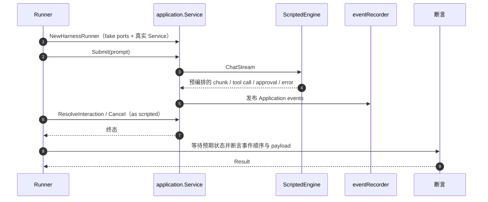

# E2E Scenario Runtime

## 生态位

本包用声明式 `seelex.scenario/v1` JSON 驱动确定性 Agent 旅程，生态位介于 Application 单元测试与真实桌面/browser E2E 之间。

## 时序图



## 核心结构

- `Scenario`/`InitialState`/`Step`：脚本、初始状态、操作与断言。
- `EngineTurn`/`Emission`：预编排的 assistant chunk、tool call、approval 和错误。
- `ScriptedEngine`：实现 `application.ChatEngine`，严格消费 turn script。
- `Runner`：执行 submit、resolve、cancel 等步骤，等待预期状态并生成 `Result`。
- `eventRecorder`：记录 Application events 供顺序与 payload 断言。
- `NewHarnessRunner`：装配 fake Runtime/Plugin/Skill/Session ports 与真实 `application.Service`。

## 数据流

```text
scenario JSON -> Load/Validate -> ScriptedEngine
       |                              |
       +---------- Runner -> Application Service -> events/snapshot
                                      |
                                 Result JSON
```

Tool lifecycle 在 Started/Completed 时进入 Application hooks；需要真实业务工具语义时通过 `ToolExecutorFactory` 注入。

## Review 指南

- `ScriptedEngine` 的 history/session 行为必须与生产 port 契约一致。
- runner wait 必须有 context/timeout，不能无限轮询。
- tool、approval、plan branch 的 ID 要稳定，便于重放。
- schema validation 错误应包含 scenario/step 上下文。

## 测试

```text
go test ./e2e/scenario -count=1
```

## 文件与函数索引

> 由源码 doc 注释自动提取（首行摘要）；描述源码行为，与实现保持同步。
> 刷新方式：`python scripts/gen_core_readme_index.py`。

### harness.go

- `func NewHarnessRunner(value Scenario) (*Runner, error)`
- `func NewHarnessRunnerWithToolFactory(value Scenario, factory ToolExecutorFactory) (*Runner, error)` — NewHarnessRunnerWithToolFactory builds the normal Application harness while
- `func newHarnessRunner(value Scenario, factory ToolExecutorFactory) (*Runner, error)`
- `func initialPlugin(value Scenario) string`
- `func initialSessionID(value Scenario) string`
- `func (lifecycle *applicationToolLifecycle) Started(ctx context.Context, execution ToolExecution)`
- `func (lifecycle *applicationToolLifecycle) Completed(ctx context.Context, execution ToolExecution)`
- `func (harnessRuntime) Model() string`
- `func (harnessRuntime) Provider() string`
- `func (harnessRuntime) Accounts() []application.AccountInfo`
- `func (harnessRuntime) SelectAccount(string) bool`
- `func (harnessRuntime) VisibleTools(context.Context) []application.Tool`
- `func (runtime harnessRuntime) ActivePlugin() string`
- `func (harnessRuntime) FullAccess() bool`
- `func (harnessRuntime) SetFullAccess(bool)`
- `func (harnessRuntime) SetFullAccessFor(string, bool)`
- `func (harnessRuntime) PermissionTier() string`
- `func (harnessRuntime) SetPermissionTierFor(string, string) error`
- `func (harnessRuntime) SetRuntimeVisibilityProjection(assemble.RuntimeVisibilityProjection)`
- `func (harnessRuntime) SetParentEvidenceProjection(assemble.ParentEvidenceProjection)`
- `func (harnessRuntime) DrainSubagentContexts() []string`
- `func (harnessRuntime) SetPlanPolicy(dto.PlanPolicy)`
- `func (harnessRuntime) SetPlanPolicyFor(string, dto.PlanPolicy)`
- `func (harnessRuntime) PrepareReplan(context.Context, dto.ReplanRequest) (dto.PlanPreflight, error)`
- `func (harnessRuntime) ReplanMetrics() dto.ReplanMetrics`
- `func (harnessRuntime) SetPlanBranchBinding(dto.PlanBranchBinding)`
- `func (harnessRuntime) BindProjectRoot(string) error`
- `func (harnessRuntime) UnbindProjectRoot()`
- `func (harnessRuntime) BindProjectRootFor(string, string) error`
- `func (harnessRuntime) UnbindProjectRootFor(string)`
- `func (harnessRuntime) SetCurrentTaskBatch(string, string)`
- `func (harnessRuntime) TodoSnapshot() []dto.TodoItem`
- `func (harnessRuntime) SetTodoStatus(int, dto.TodoItemStatus) error`
- `func (harnessRuntime) TaskSnapshot() []dto.TaskRecord`
- `func (harnessRuntime) TaskSnapshotFor(string) []dto.TaskRecord`
- `func (harnessRuntime) ReleaseSessionAsync(string) int`
- `func (harnessRuntime) AsyncPendingFor(string) int`
- `func (harnessRuntime) AsyncRunsSnapshot() []dto.AsyncRunRecord`
- `func (harnessRuntime) AsyncRunEvents() <-chan struct`
- `func (harnessRuntime) TaskAdd(dto.TaskSpec) (dto.TaskRecord, bool, error)`
- `func (harnessRuntime) TaskAddFor(string, dto.TaskSpec) (dto.TaskRecord, bool, error)`
- `func (harnessRuntime) ResolveTaskByKey(string) (dto.TaskRecord, bool, error)`
- `func (harnessRuntime) ResolveTaskByKeyFor(string, string) (dto.TaskRecord, bool, error)`
- `func (harnessRuntime) TaskSetStatus(string, dto.TaskStatus, string) (dto.TaskRecord, error)`
- `func (harnessRuntime) TaskSetStatusFor(string, string, dto.TaskStatus, string) (dto.TaskRecord, error)`
- `func (harnessRuntime) TaskAttachParticipant(string, string) (dto.TaskRecord, error)`
- `func (harnessRuntime) TaskChangedChannel() <-chan dto.TaskRecord`
- `func (harnessRuntime) SubagentTreeEvents() <-chan struct`
- `func (harnessRuntime) PlanNodeEventChannel() <-chan dto.PlanNodeEvent`
- `func (harnessRuntime) TakeServedRoute(string) (dto.ServedRoute, bool)`
- `func (harnessRuntime) SwitchSessionTasks(string, []dto.TaskRecord)`
- `func (harnessRuntime) SetSessionWorkspace(string, string)`
- `func (harnessRuntime) ScheduledCommands() []assemble.ScheduledCommandInfo`
- `func (harnessRuntime) ScheduledTasksSnapshot() []assemble.ScheduledTaskStatus`
- `func (harnessRuntime) ScheduleTask(context.Context, assemble.ScheduledTaskSpec) (*assemble.ScheduledTaskStatus, error)` — ScheduleTask 显式报错（诚实桩）：e2e 场景不使用定时任务，静默返回
- `func (harnessRuntime) UpdateScheduledTask(context.Context, string, assemble.ScheduledTaskSpec) (*assemble.ScheduledTaskStatus, error)`
- `func (harnessRuntime) CancelScheduledTask(string) error`
- `func (harnessRuntime) ClearSubagentTree() error`
- `func (harnessRuntime) RestoreSubagentAnchors(string) error`
- `func (harnessRuntime) ListSubagentRecovery(string) ([]dto.SubagentRecoveryView, error)`
- `func (harnessRuntime) ResumeInterruptedSubagents(context.Context, string) (dto.SubagentResumeReport, error)`
- `func (harnessRuntime) ResumeSubagent(context.Context, string, string) (dto.SubagentResumeResult, error)`
- `func (harnessRuntime) ForkSubagents(context.Context, string, []dto.SubagentForkSpec) (string, error)`
- `func (harnessRuntime) SetSubagentParentRepairer(func(string) error)`
- `func (harnessRuntime) SearchHistory(context.Context, string, int) (seelexctxsearch.Result, error)`
- `func (plugins *harnessPlugins) All() []application.PluginInfo`
- `func (plugins *harnessPlugins) Activate(_ context.Context, name string) error`
- `func (plugins *harnessPlugins) Deactivate(context.Context) error`
- `func (plugins *harnessPlugins) Current() (application.PluginInfo, bool)`
- `func (harnessSkills) All() []application.SkillInfo`
- `func (harnessSkills) Get(string) (application.SkillInfo, bool)`
- `func (sessions *harnessSessions) SaveCurrent(string) error`
- `func (*harnessSessions) SetWorkspace(string)`
- `func (*harnessSessions) Workspace() string`
- `func (sessions *harnessSessions) Delete(sessionID string) error`
- `func (sessions *harnessSessions) List() []application.SessionInfo`
- `func (sessions *harnessSessions) LoadHistory(sessionID string) ([]application.EngineMessage, error)`
- `func (sessions *harnessSessions) LoadHistoryRange(sessionID string, offset, limit int) ([]application.EngineMessage, int, error)`

### loader.go

- `func Load(reader io.Reader) (Scenario, error)`
- `func LoadFile(path string) (Scenario, error)`

### loader_test.go

- `func TestLoadApprovalChatFixture(t *testing.T)`
- `func TestLoadManualPlanFixture(t *testing.T)`
- `func TestLoadRejectsUnknownFields(t *testing.T)`
- `func TestLoadRejectsUnsupportedExpectation(t *testing.T)`

### recorder.go

- `func newEventRecorder(subscription application.Subscription) *eventRecorder`
- `func (recorder *eventRecorder) collect()`
- `func (recorder *eventRecorder) close()`
- `func (recorder *eventRecorder) snapshot() []application.Event`
- `func (recorder *eventRecorder) waitFor(ctx context.Context, predicate func([]application.Event) bool) error`
- `func (recorder *eventRecorder) waitForChange(ctx context.Context) error`
- `func (recorder *eventRecorder) waitForRevision(ctx context.Context, revision uint64) error`

### recorder_test.go

- `func TestEventRecorderWaitForRevisionAcceptsOutOfOrderDelivery(t *testing.T)` — TestEventRecorderWaitForRevisionAcceptsOutOfOrderDelivery 回归 macOS CI

### runner.go

- `func NewRunner(value Scenario, app Application, script ScriptState) *Runner`
- `func (runner *Runner) Run(ctx context.Context) (Result, error)`
- `func (runner *Runner) executeStep(ctx context.Context, recorder *eventRecorder, step Step) error`
- `func (runner *Runner) executeAction(ctx context.Context, step Step) error`
- `func (runner *Runner) waitForSnapshot(ctx context.Context, recorder *eventRecorder, predicate func(application.Snapshot) bool) error`
- `func containsEventSequence(events []application.Event, kinds []string) bool`
- `func containsEventSet(events []application.Event, kinds []string) bool`
- `func (result Result) WriteJSON(writer io.Writer) error`

### schema.go

- `func (scenario Scenario) Validate() error`
- `func (turn EngineTurn) validate() error`
- `func (emission Emission) validate() error`
- `func (approval ApprovalSpec) validate() error`
- `func (step Step) validate() error`

### scripted_engine.go

- `func NewScriptedEngine(script []EngineTurn, tools ToolLifecycle, approvals ApprovalRequester) *ScriptedEngine`
- `func (engine *ScriptedEngine) SetSessionID(sessionID string)`
- `func (engine *ScriptedEngine) SetToolExecutor(executor ToolExecutor)`
- `func (engine *ScriptedEngine) ChatStream(ctx context.Context, input string, onChunk func(string)) (string, error)`
- `func (engine *ScriptedEngine) takeTurn(input string) (EngineTurn, error)`
- `func (engine *ScriptedEngine) requestApproval(ctx context.Context, toolName string, approval ApprovalSpec) (application.ApprovalDecision, error)`
- `func allowOption(approval ApprovalSpec) string`
- `func (engine *ScriptedEngine) History() []application.EngineMessage`
- `func (engine *ScriptedEngine) ClearHistory()`
- `func (engine *ScriptedEngine) ReplaceHistory(sessionID string, history []application.EngineMessage) error`
- `func (engine *ScriptedEngine) SessionID() string`
- `func (engine *ScriptedEngine) StartSession() string`
- `func (engine *ScriptedEngine) SetSystemPrompt(prompt string)`
- `func (engine *ScriptedEngine) SetMaxLoops(maxLoops int)`
- `func (engine *ScriptedEngine) AppendHistory(msg types.Message)`
- `func (*ScriptedEngine) TraceText() string`
- `func (*ScriptedEngine) TokenCount() string`
- `func (*ScriptedEngine) NodeSessionConversation(string) ([]types.Message, bool)`
- `func (*ScriptedEngine) NodeContextSnapshot(string) (*snapshot.ContextSnapshot, bool)`
- `func (*ScriptedEngine) NodeToolResult(string, string) (string, bool)`
- `func (*ScriptedEngine) NodeWorktreeInfoFor(string) (assemble.NodeWorktreeInfo, bool)`
- `func (*ScriptedEngine) SubscribeSubagentLive(string) ([]dto.SubagentLiveEvent, <-chan dto.SubagentLiveEvent, func(), error)`
- `func (*ScriptedEngine) SubagentLiveHistoryPage(nodeID string, offset, limit int) dto.SubagentLiveHistoryPage`
- `func (*ScriptedEngine) SubAgentTree() []dto.SubAgentTreeNode`
- `func (engine *ScriptedEngine) Remaining() int`
- `func (engine *ScriptedEngine) toolExecutor() ToolExecutor`

