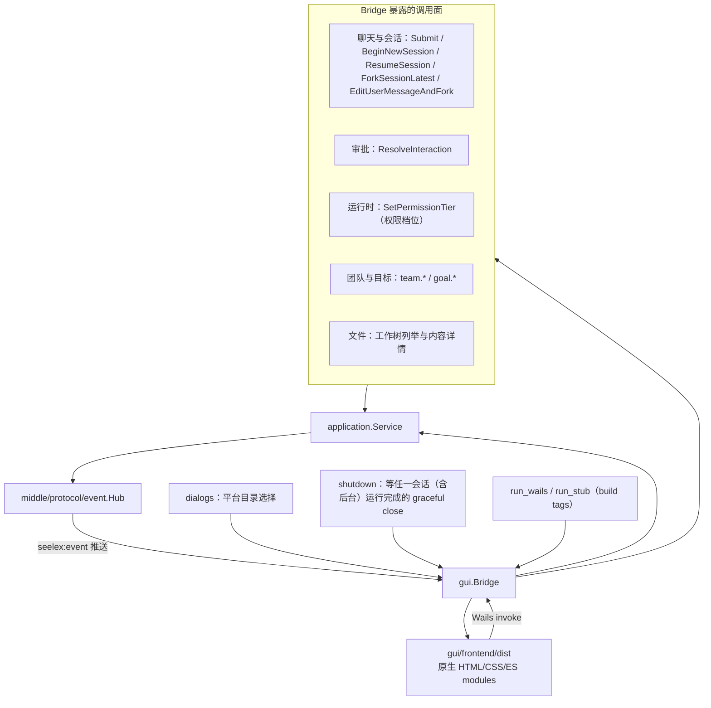
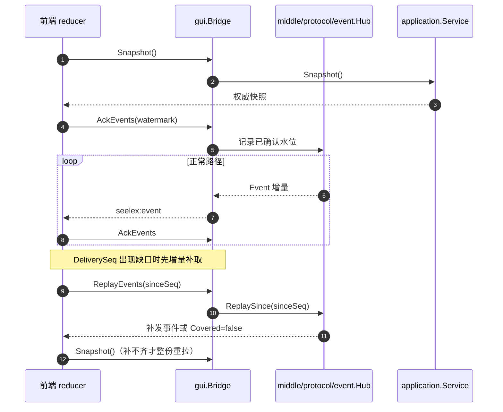

# GUI Backend

## 生态位

`gui` 是 Wails/WebView 桌面适配器。它复用 `application.Service`，负责 Go/JavaScript 边界、事件转发、目录选择和关闭协调，不拥有聊天、session、project 或 Plan 业务状态。

主要调用方：组合根 `main.go`（`-frontend gui`）与 `gui/frontend/dist` 前端模块。

发行布局把前端分成两层：启动核心（HTML/CSS/业务 JS）嵌入可执行文件，
约 5.4 MiB 的离线 vendor（mermaid/pdf.js/docx-preview/xterm/highlight）放在
`<exe>/frontend/vendor`，由 `frontendAssets` 覆盖到同一 `fs.FS`。构建脚本
必须一并交付该目录；单拷 exe 仍能启动，但对应预览/终端会走前端既有降级分支。
开发时若目录缺失，会从仓库祖先目录的 `gui/frontend/dist/vendor` 自动定位。
GUI 构建标签不再链接 TUI；TUI 使用不带 `gui` 标签的独立二进制。

## 架构图



## 时序图：事件转发与重同步



关闭路径：`CloseMainWindow` 走 graceful close（等待运行中会话收尾），
`Stop-Process -Force` 不会释放数据根锁——残留锁由 `lock_auto_recover` 兜底。

## 文件结构

| 文件 | 职责 |
|---|---|
| `bridge.go` | Wails 暴露方法、Application interface 和事件 relay。 |
| `terminal_bridge.go` | 下栏终端的 Bridge 方法（`TerminalOpen/Write/Resize/Close/List`）与 `seelex:terminal` 事件外投；工作目录取后端当前工作区根。 |
| [`terminal/`](terminal/README.md) | 本地终端会话管理（跨平台 PTY 多开、读写、resize、退出码）。 |
| `assets.go` | `//go:embed frontend/dist`。 |
| `run_wails.go` / `run_stub.go` | build tags 下的真实 GUI 与不可用 stub。 |
| `dialogs_gui.go` / `dialogs_stub.go` | 平台目录选择适配。 |
| `composer_media.go` | 输入框图片附件的桥面：`AttachComposerImage`（base64 解码 → 媒体域落盘 + 随图入队）、`ComposerImageData`（按 ref 读回缩略图字节）、`OpenComposerImage`（定位原图交给系统默认查看器）。提交时 `SubmitToSession` 的第三个参数把 ref 解析成展示元数据写进用户消息（见「输入框图片附件」§）。 |
| `openfile_gui.go` / `openfile_windows.go` / `openfile_unix.go` / `openfile_stub.go` | 「用系统默认程序打开原图」的平台分支（rundll32 / open / xdg-open）；无 GUI 构建显式报不支持。 |
| `shutdown.go` | 等待任一会话（含后台）运行完成的 graceful close；超时取消全部 running sid 并等待收尾。 |
| `fork_live_probe_test.go` | 真实 API headless fork 探针（env 门控，opt-in；顶层 Submit → fork_subagents 链路 1/10/100 并发对照）。 |
| `role_live_probe_test.go` | R2/R4 真实 API headless 冒烟（env 门控）：真实 Submit 物化主会话 → `role.*` 建 TL/写 draft/sync/floor/角色 wire → `schedule.*` → goroutine/mutex/block pprof 现场。 |
| `team_board_wiring_test.go` | 团队看板必须在嵌入前端里真的接起来（**保留面**）。`headless_team.go`（`team.*` RPC）与 `team_live_probe_test.go` / `team_work*_live_probe_test.go` / `goal_team_wiring_live_probe_test.go`（`team.*` 真 API 冒烟）**已删除**（2026-10-12 J-1a 随 Agent Team 用户面退场，整份删除）。 |
| `session_fork_live_probe_test.go` | **会话分叉**（`ForkSessionLatest`）真实 API 冒烟（env 门控）：A→B→C 分叉后制造"A 在途收尾 × C 运行"的并发窗口，断言 C 自身各轮俱在、继承前缀可见、且无 A 在途内容污染。 |
| `backend/engine/assemble/custom_role_live_probe_test.go` | provider role 能力实验（env 门控）：把非标准逻辑角色 `tl` 放入真实请求历史，确认 provider 是否接受自定义 role 名。 |
| [`frontend/`](frontend/README.md) | 原生 HTML/CSS/ES modules 前端。 |

## Bridge 契约

`Application` 是 GUI 需要的最小端口。`Bridge` 暴露 Snapshot、Submit、BeginNewSession、`SaveComposerDraft`（草稿未发送输入防抖落盘，跨重启恢复）、ResumeSession、`ForkSessionLatest`（从会话最新完整轮次分支出新会话并切换，返回子会话 ID）、`EditUserMessageAndFork`（编辑一条保留窗口内的用户输入，从其上一完整段落边界创建 child 并原子提交修改文本）、`ReorderQueuedInput`/`RecallQueuedInput`（排队中的输入调换顺序/撤回到输入框，只作用于回合运行期间的会话队列）、Cancel、Interaction、Plugin/Account/Effort/Full Access、history pagination、workspace、session storage settings、`UpdateWorkItemStatus`（工作表格 todo 三态）等方法，并把 Application Event 统一转发为 `seelex:event`。`BeginNewSession` 只进入 Application draft（早分配真实 SID，不建引擎 bundle），GUI 不通过 `/new` 字符串命令抢先创建 Session。

消息编辑不是 `ForkSessionLatest` 的前端组合：renderer 只调用
`EditUserMessageAndFork(parent, request)`。`request.operation_id` 在打开编辑器时生成，
提交重试复用；`request.expected_revision` 取 `Snapshot.ConversationRevision`。成功
回执后 Bridge 等待目录收敛并重订阅 child；失败时编辑器保留用户文本，不切换视图。
消息的复制/编辑动作只消费快照里的 `event_seq`、`editable`、`edit_disabled_reason`，
复制正文仍走 conversation view 既有的 `copyText` 通道。子会话顶部血缘条只读取
`session.forked_from`，返回入口使用 `parent_session_id`。

`CreateWorkspaces` 是项目 temp list 的批量提交口：它只登记 workspace，不绑定当前会话。
前端确认多个目录后一次调用，随后用户从刷新后的项目列表选择一个开始会话；单条
`CreateWorkspace` 保留“创建并立即绑定当前视图”的既有语义。

### 输入框图片附件（拖拽 / 粘贴，2026-10-30）

用户对某个界面不满意时，最省事的表达是**把那张截图拖进输入框**再补一句"这里不对"。
这条链刻意不与工作区文件引用合用（`file-reference.js` 传路径文本、由 agent 自己读）：
图片传的是**字节**，由模型直接看。两个入口：

- `Bridge.AttachComposerImage(sessionID, name, mimeType, width, height, dataBase64)`
  → `contract/dto.ComposerImageRequest` → 媒体域 `SessionMedia.AttachUserImage`：
  校验 MIME 白名单（png/jpeg/webp/gif/bmp）与扩展名、把字节落进**该会话自己**的媒体
  分区、并挂进「下一次请求随图」队列（与 computer use 截图同一条 `storeMedia` + `attach`，
  所以归属、配额与「至多送一次」只有一份实现）。返回 `dto.ComposerImage`（ref/name/
  bytes/尺寸）作为前端去重与「点开」的凭据。
- `Bridge.OpenComposerImage(sessionID, ref)` → `SessionMedia.MediaFilePath` 拿到原图
  的真实位置，再交给平台默认程序（Windows `rundll32 url.dll,FileProtocolHandler`、
  macOS `open`、Linux `xdg-open`；实现在 build-tagged 的 `openfile_*.go`，无 GUI 构建
  显式报不支持）。**路径不回到渲染层**：缩略图用渲染进程自己的 objectURL，"点开"才走
  后端定位文件。

两个动作都是**用户动作**：不过权限档位、不进执行选择页面（与文件保存同一条口径）。
端口 `gui.Dependencies.Composer`（形状由 GUI 自己声明）由组合根从
`Runtime.ComposerMedia()` 注入——媒体域属于 backend，应用层不认识它，所以这一格是
唯一不走 `Components` 的依赖（见 `boot/frontend_gui.go`）。

#### 发出去之后：图片属于那条用户消息（2026-10-30）

只在输入框里看得见图是不够的——用户发了"这句话 + 这张图"，如果消息里没有图，用户
自己（以及刷新后的任何人）就只看得到半句话。所以图片在**提交那一刻**被绑到消息上：

- `Bridge.SubmitToSession(sessionID, text, imageRefs)`：输入框里那几个 ref 先经
  `SessionMedia.ResolveUserImages` 按**该会话**的媒体分区解析成展示元数据
  （`dto.ComposerImage`，只读 meta 文件，不读几 MB 的图本体），然后交给
  `SubmitApplication.SubmitToSessionWithImages`。解析不出来就让整条提交失败——宁可
  让用户重拍，也不写一条指着打不开的图的消息。
- 图片随 `conversation.Request.Images` 走完整条队列（入队存 payload、晋升按批次合并
  去重），起始时写进这条 **user 事件行**（`protocol.TranscriptEvent.Images`）；
  实时视图行（`MessageOrigin.Images` → `Message.Images`）与冷恢复投影
  （`ProjectConversationEvents`）都只从这一行照抄，因此不存在"实时有图、重启没图"。
- 渲染层拿到的仍只有 ref（字节不进快照与 transcript）：
  `Bridge.ComposerImageData(sessionID, ref)` → `SessionMedia.ReadUserImage` 按
  (会话, ref) 读回字节，`message-images.js` 拼成 data URL、按 ref 缓存并注水。
  点缩略图仍走 `OpenComposerImage`（系统默认查看器打开原图）。
- sigil 输入（`/` `#` `$`）走的是后端路由器，那条路不吃图片：前端此时**不**清输入框
  里的缩略图条，并明确提示"命令 / 插件 / 技能输入不随图"。

`MediaMeta`（store/artifact）就是为了这条链加的"只读元数据"面：提交时只要名字/类型/
尺寸去写一行用户消息，不必把图读进内存。

### 多仓库 git（方向 A，2026-10-19）

工作区根下可能有若干互不相干的 git 仓库（根本身是仓库 / 若干子目录各自是仓库 /
仓库里套仓库）。只读 git 面因此多了「选仓库」这一维：

- `Bridge.WorkspaceGitRepos()` 发现当前工作区内的仓库（BFS、有界：深度 6、目录预算
  20000、仓库上限 64 钳 1..256；`.git` 目录或文件都算仓库，仓库内部继续下钻）。只
  返回相对路径与分支名，绝不下发绝对仓库路径；`Truncated`/`Scanned` 如实上报。
  **未绑定工作区或后端不支持时返回带 `Error` 文案的空结果**（不是 Go error——面板
  显示"不可用"，不是整块渲染失败）。
- 四条只读查询带上了 `repo` 参数（相对工作区根，`""`/`"."` = 工作区根）：
  `WorkspaceGitLog(repo, limit)`、`WorkspaceChanges(repo, limit)`、
  `WorkspaceGitCommitDetail(repo, hash, limit)`、
  `WorkspaceGitCommitFileContent(repo, hash, relPath, limit)`。
- `repo` 的解析与 containment 在应用层
  （`application/workspace/application.go`）：绝对路径、`..` 逃逸、软链逃逸都是
  **调用方传错参数 → Go error**（不是 `Result.Error`，那一位留给"这不是 git 仓库"
  这类可展示状态）。端口签名与 git 查询语义一律不变。
- 前端：`gui/frontend/dist/git-repos.js` 的 `buildRepoTabs`/`resolveSelectedRepo`
  决定标签栏与默认选中，`app.js` 只做接线（见 `gui/frontend/README.md`）。

### 端口核对

```text
python scripts/check_gui_ports.py
```

脚本静态核对三件事：前端字面 `invoke("...")` 与 `composerSubmitPlan` 的 RPC
必须在 `*Bridge` 导出方法里；`PROCESS_KINDS` 必须是 `middle/protocol/event`
已登记的 `EventKind`；`runtime.EventsOn("...")` 的通道名必须与 Bridge emit
的 `seelex:event` / `seelex:ready` / `seelex:terminal` 一致。动态变量方法名
无法静态解析时脚本会显式报数，不用“没查到”冒充“对齐”。

会改变会话目录的命令（`BeginNewSession`/`DeleteSession`/`ArchiveSession`/`ForkSessionLatest`/`EditUserMessageAndFork`/`SetSessionMeta`）在返回前调用 `settleCatalog()`：等 `Application.WaitCatalogRefresh` 的目录刷新回执（预算 `sessionCatalogSettleTimeout`），使 renderer 紧接着重拉的 `Snapshot()` 已携带权威列表。等待超时不算失败也不向上报错——命令本身已成功，未收敛的列表由 worker 发布的 `snapshot.changed` 补齐，前端不得为此回填旧列表。

`ArchiveSession` 的目录收敛按目标会话所在项目做范围刷新：归档行从该项目格子
过滤（record 状态 archived 是唯一标记，不存在全局数组上的归档位），其它项目
列表与数据五片不受影响。

会话级冷读宿主面（C1）：`Bridge.ListSessions()` 返回权威会话目录（与快照目录
同源）；`Bridge.SnapshotOf(sessionID)` 对未驻留会话返回 `Resident=false` 的
record 只读基线；`Bridge.GetSessionTranscript(sessionID, fromSeq, toSeq)` 按
Seq 区间读事件日志（`(0,0)` = 全量）。三者均不要求目标会话加载引擎。

子代理详情数据面（G7）：弹窗只保留三块权威面——会话记录 / 上下文 / 功能打点，
全部来自 `Bridge.SubagentSessionDetail(nodeID)`（`SubagentDetail` 载荷：截断会话
+ 上下文快照 + 工作项打点）。原先驱动「第一视角」的
`SubagentDetailStreamStart/Stop` + `seelex:subagent_live` 订阅、以及
`nodeDetailPollTimer` 2s 轮询都已删除（`TestEmbeddedFrontendExists` 的禁流式/
禁轮询断言相应启用）。

后台作业行的详情（同一个入口、不同的载荷格）：工作表格里 `async:<句柄>` 的行不是
会话，`SubagentDetail.Async` 给的是**作业读数 + 输出尾部**——状态 / 已落盘字节 /
行数 / 退出码 / 命令行 / 日志路径，外加上游执行域的有界输出窗口（`RuntimePort.AsyncOutputTail`，
不推进 fetch 游标、不进模型上下文）。没有这一格时，详情弹窗只能永远停在「加载会话
记录…」（2026-10-29 用户实测的"空文"）。

**「这件事的会话」读面（团队看板的对话区）**：`Bridge.TeammateSessionLive(roleSessionID)`
是**默认页**（最近若干条）；`Bridge.TeammateSessionLivePage(roleSessionID, offset, limit)`
是同一份读数的**分页一页**（`offset/limit/total/has_more` 都由后端归一与计算，前端只搬、
不自算；`limit<=0` → 后端默认页大小 40）。窗口/裁剪判据只有一份，在
[`backend/engine/assemble/runtime_teammate_session_live.go`](../backend/engine/assemble/runtime_teammate_session_live.go)；
会话不在本进程 → `running=false`（调用方据此如实说明，而不是假装"看到的是空的当前会话"）。
node 第一视角实时回放的**分页**读法同形落在
[`backend/engine/assemble/runtime_live.go`](../backend/engine/assemble/runtime_live.go) 的
`SubagentLiveHistoryPage`（窗口上限 `RuntimeConfig.SubagentLiveWindow`）。

统一会话与 WorkItem 执行读面：`Bridge.ConversationView/ConversationChat/RecoverConversation`
按 `ConversationSessionRef.kind` 路由 main/subagent/teammate；teammate 必须带 WorkItem。
`Bridge.WorkItemExecution(mainSessionID, itemID, offset, limit)` 是 WorkItem 详情与 teammate
当前/历史 WorkItem 共用的唯一 `WorkItemExecutionView` 来源；`Bridge.TeammateInspection`
返回当前 WorkItem、base/effective prompt、安全插件能力、limit 与权限向量。插件投影只含
名称、工具、技能、MCP 名称/transport 与来源，不含 command/env/URL、绝对路径或 Prompt 正文。

前端消费同一个读面：`agent-conversation-view.js` 把统一记录映射回主会话组件，并挂载
同一个 `createConversationView`（动效、骨架、滚动与流式语义不复写）；输入框从
`#composer-template` 克隆，提交时显式调用 `ConversationChat(ref, message)`，因此
subagent 与 teammate 的输入永远对齐它们各自的会话，不会落到主会话 ambient view。

会话内用户输入索引：`Bridge.SessionInputIndex(sessionID)` 返回该会话**全量**
用户输入索引（seq/round 序号 + 有界问题摘要 + 该轮最后一条非空 assistant 回复
开头 + 是否在当前已加载窗口），轻量零正文（不依赖已加载视图，未驻留会话也可用）；
前端右侧波浪刻度轨据此铺满整个会话，点击未加载的刻度先经 `LoadMoreHistory`
回读那一页再定位。

relay 只订阅一次 `SubscribeSession("")`（跟随当前视图会话）：会话归属由
application 在事件投递端判定，Bridge 不保存 `currentSessionID` 副本，渲染层收不到
别会话的事件，因此切换/新建/分支都只是应用层命令，不需要重建订阅。宿主应用不支持
会话级订阅时退回全局订阅（此时应用自身也没有多会话状态可污染）。

事件投递回执（C4）：`EventEmitter` 没有返回值，Go→WebView 这条腿丢了什么 Bridge
无从得知。因此 relay 优先申请**带重放窗口的订阅**（可选端口
`SubscribeSessionWithReplay`），渲染层每应用一批事件回报水位（`Bridge.AckEvents`，
150ms 合并），并可在 `delivery_seq` 缺口处主动 `Bridge.ReplayEvents` 增量补取。
水位落后时 `catchUpRenderer` 把窗口内未确认的事件重推（重复对渲染层是幂等的，
按 `delivery_seq` 去重），重推封顶 `eventResendMaxTries` 次；窗口已淘汰则改投一条带
当前水位的 `resync.required`，让渲染层整份重拉并把水位抬到该处。运行期因此不再
需要"每秒轮询 Snapshot"的兜底对账。

子代理 `subagent.changed`、`subagent.tool.started`、`subagent.tool.completed` 与其他 Application Event 使用同一 relay，不在 Bridge 内改写 payload。`tool_full_chain_test.go` 从 `Bridge.Submit` 进入，覆盖 ToolHookBridge → Application/EventHub → Bridge emitter → `seelex:event`，并验证 `Bridge.SetFullAccess(true)` 会释放既有审批、投影 Snapshot、relay `runtime.changed`。

工作表格增量 `worktable.changed` 使用同一 relay（payload 只带表格投影，不整份
runtime）；`Bridge.UpdateWorkItemStatus(id, status)` 只做参数透传，业务校验在
application 层（v1 仅支持 `todo:` 前缀行的 pending/doing/done）。已知问题：
todo 行 ID 的号不是清单索引，而回写按索引解析它（
`docs/devlog/2026-09-19-worktable-global-scope.md` §7.5）。

启动配置容错：`Options.StartupWarning` 非空时，启动期配置警告（如
`accounts.yaml` 解析失败）以系统通知进入会话可见区（`application.Service.AddNotice`）。
GUI 不再弹阻塞式原生对话框，旧会话窗口即使当前账号档异常也能立即进入；涉及模型调用的
操作再按真实错误提示。

task 体系增量 `task.changed`（逐任务状态/打点/retry）同样经 relay；主动
`taskadd` 是模型可调用的 harness 工具（注册表幂等去重），不经 Bridge。

A2A 角色管理面（右侧栏「状态 → Agent Team」子页数据源）：
`Bridge.AgentTeam*`（装配 / 角色 CRUD / 工作顺序 / 团队库 / 员工库 / 母本 / 员工提示词）**已退场**（2026-10-12 J-1a）。
`AgentTeamGlobalConfig` / `AgentTeamSaveTeam` / `AgentTeamSaveCurrentTeam` /
`AgentTeamDeleteTeam` / `AgentTeamMaterializeTeam` /
`AgentTeamPutRole` / `AgentTeamDeleteRole` / `AgentTeamSetOrder` /
`AgentTeamInstantiateRole` / `AgentTeamSaveEmployee` / `AgentTeamDeleteEmployee` /
`AgentTeamSetDefaultOrder` / `AgentTeamPublishToGlobal` / `AgentTeamRolePrompt` /
`AgentTeamOptimizePrompt` **全部删除**（是删除，不是"退场保留"）。**留下来的只有**
`AgentTeamRoleSnapshot`——团队看板「员工会话」入口的角色会话只读观察面（去掉的是它对已删
`AgentTeamView` 的回退），以及团队看板自己的读面（`TeammateSessionLive*`）。

> **下面四段是退场前的面板口径（历史，2026-10-12 J-1a 起不再适用）**：其中提到的
> `gui/frontend/dist/agent-team-view.js`（**已删除**：2026-10-12 J-1a）、`#team-section`、`team.*` RPC、团队库
> （`team/library.json`）与员工库/默认顺序母本（`team/employees.json`、`team/order.json`）
> 读写面都已随退场删除；仍然适用的只有最后一段里的「角色会话只读观察面」。
`sessionID` 传空 = 当前视图会话，
Bridge 不保存 `currentSessionID` 副本。顺序的唯一事实是会话
`lifecycle.order_policy`/`order_roles` 与角色注册表：前端只提交用户改动后的完整
顺序表（拖拽落点/摘除/恢复）或单个角色，Bridge 不缓存也不推导第二份顺序；
定时任务 agent 单独分区、永不进入 `order_roles`（设计稿 §7.1）。前端只读渲染 +
动作转发在 `frontend/dist/agent-team-view.js`（**已删除**：2026-10-12 J-1a 随面板退场；只读那一半现为 `dist/role-session-view.js`），面板 DOM 挂在
状态子页的 `#team-section`。

注（2026-09-15 第二轮）：`AgentTeamSaveCurrentTeam` / `AgentTeamPublishToGlobal` /
`AgentTeamSetDefaultOrder` 三个"整表级"写动作**在 Bridge 面上保留**（headless、
工具面与后续宿主仍可用），但 GUI 面板已不再暴露它们的入口——面板里的同类动作改成
行内最小动作：员工库逐行「入库」（`AgentTeamSaveEmployee`），团队从当前会话起手走
「团队」面板的「从当前会话填充 + 保存团队」（`AgentTeamSaveTeam`）。

**员工 CRUD 与发言调度（2026-09-15）**：「增加/修改员工」走
`AgentTeamInstantiateRole`（与 `team.put_role` 同一条幂等覆盖语义，区别只在于它还
负责建角色会话并回报执行者绑定），「删除员工」走 `AgentTeamDeleteRole`，顺序编辑走
`AgentTeamSetOrder`。`dto.TeamView.schedule` 是**运行时**的发言调度投影
（`application/assembly/agentteam/runtime.go`，**已删除**：2026-10-15 A04/A15 随发言环退场）：发言环成员（= `order_roles` − `user`）
→ 下一个该发言的角色、轮次/上限与逃生状态
（`round_limit`/`no_progress`/`no_automatic_turn`/`empty_ring`/`external_break`）。
`user` 不在环里（它的发言机会是回合尾消息队列被整批提升为下一轮），所以面板的
「下一个」永远不会指向用户；前端 `agent-team-view.js`（**已删除**：2026-10-12 J-1a）的「发言调度」块只渲染后端事实，
不下发也不缓存顺序。

**员工装配（提示词/权限）与团队库（2026-09-21）**：

- 「入职 / 修改员工」面板提交 `dto.RoleSpec`（含 `system_prompt` / `tools_policy` /
  `model_policy` / `presence_policy`）；Bridge 只做 trim + 窄转发，落盘仍是会话角色
  注册表。回读经 `TeamView.members` 的登记字段（前端编辑面板要回填，否则一次编辑会
  把提示词/权限清空）。
- `AgentTeamRolePrompt(sessionID, roleName)` 是只读提示词查询（ADVISOR 回合用它取
  已装配提示词，装配根注入的读面见 `backend/engine/assemble/runtime_role_prompt.go`）；
  `AgentTeamOptimizePrompt(sessionID, request)` 跑一次有界 LLM 回合产出候选文本 +
  改动理由，**不落盘、不写会话消息**（落盘仍走入职/保存）。
- 团队库（**全局** `team/library.json`）走 `AgentTeamLibrary`（列表）/
  `AgentTeamSaveTeam`（按 `team_id` 幂等 upsert）/`AgentTeamSaveCurrentTeam`（把当前
  会话在编员工存成库条目）/`AgentTeamDeleteTeam`（幂等）/`AgentTeamMaterializeTeam`
  （库条目 → `TeamSpec` → 既有工厂：建角色会话 + 写会话注册表 + 写 `lifecycle` 顺序）。
  团队库条目与会话在编员工是**两份不同的事实**（见 `store/README.md`）。
- **全局母本（2026-09-15）**：团队库 / 员工库（`team/employees.json`）/ 默认顺序
  （`team/order.json`）都是全局粒度；会话读的是母本**深拷贝副本**（会话在编员工表 +
  lifecycle 顺序），会话内入职/改序只改副本。`AgentTeamGlobalConfig` 读母本 + 会话副本
  投影；`AgentTeamSaveEmployee`/`AgentTeamDeleteEmployee`/`AgentTeamSetDefaultOrder`
  是库管理（直写全局）；`AgentTeamPublishToGlobal` 是「入库当前会话」（原「确认·普及
  搭配到全局」，会话副本 → 员工库 + 默认顺序 + 团队库条目）。
- **面板读侧口径（2026-09-15 第二轮）**：GUI 的「员工库」块展示的是**可用员工**——
  `TeamGlobalConfig.employees`（全局母本）∪ `TeamGlobalConfig.composition.employees`
  ∪ `TeamView.members`（本会话在编），在 `agent-team-view.js`（**已删除**：2026-10-12 J-1a）的 `employeePool()`
  里读侧合并、按 `role_name` 去重、母本优先，行上标 `库` / `本会话`。合并只发生在
  展示层：两份事实仍分属两个作用域，写动作也只写母本（`AgentTeamSaveEmployee`）。
  这样"会话里明明有人、员工库却是 0 人"不再出现，拖拽也能直接拿这些人进发言顺序
  （拖到员工栏 = 未在编的先 `AgentTeamInstantiateRole` 落到会话，再
  `AgentTeamSetOrder` 落到位置）。

**员工面板去小字（2026-09-15 第三轮）**：「入职 / 修改员工 / 新建员工」三处冷加载
面板不再渲染字段说明与底部作用域说明（原来那批 9.5px / 10px 小字），同一批事实改挂
控件与提交键的 `title`（hover 才出现），下拉选项标签自己把话说完（"只读（不写文件 /
不执行命令）"）；「优化提示词」的运行态回执改用独立类 `team-prompt-state`，不再借备注
样式。面板因此可以被断言为"零备注"：`agent-team-view.test.mjs`（**已删除**：2026-10-12 J-1a）覆盖两种作用域 × 四个
面板实例，`gui/bridge_test.go` 在嵌入产物上锁同一条不变量。**团队面板（新建 / 编辑
团队）的同类小字本轮未动**，连同其它可优化项见
[`docs/devlog/2026-09-15-agentteam-panel-optimization.md`](../docs/devlog/2026-09-15-agentteam-panel-optimization.md)。

**两个 agent 的区分（2026-09-12）**：成员表把逻辑角色名渲染成用户可读身份
（`main` → `EXEC`、`tl`/`techlead` → `ADVISOR`），成员行可点击打开该角色的
**独立会话**（`AgentTeamRoleSnapshot` → `dto.RoleSnapshot`，弹窗
`#role-session-modal`）：主对话只显示 EXEC 的可见消息，ADVISOR 自己的
`role_rows`/`draft_rows`、`role_session_id`、join/compact 与 floor 状态在这里
按角色身份单独展示。角色会话号由工厂按 `(team_id, role_name)` 派生、不落注册表，
所以 Bridge 在 `roleSessionID` 为空时先读一次成员表解析，再把可展示错误返回前端。

Bridge 方法只做参数转换和调用，不维护镜像业务状态。DSN 等敏感配置必须由 backend redaction 后再返回 renderer。

**主会话权限档位（会话粒度，2026-09-16/17）**：`Bridge.SetPermissionTier(tier)`
转发到 `Application.SetPermissionTier`，返回**真正生效**的档位（前端不得靠"取反本地
旧状态"猜方向：快照滞后一格时会把"开启"点成"关闭"）；headless 上也暴露同名
`SetPermissionTier` RPC（`headless/headless.go`），用例
`gui/headless_permission_test.go:TestHeadlessSetPermissionTierDispatch`。档位目录由后端
下发（`RuntimeState.permission_tiers`），前端只按序渲染；档位列表与 composer 芯片的
纯解析口径抽在 `frontend/dist/permission-tier.js`（`node --test` 用例
`frontend/dist/permission-tier.test.mjs`），app.js 只负责 DOM 写入。档位的**归属与落盘**
不在 GUI：它由 `application/assembly` 按会话写入会话级设置并跨重启读回（见
`store/README.md`），GUI 只是三个切换入口之一（chip/列表、CLI `/permission`、
headless RPC）。

## 下栏终端（本地 PTY，2026-09-17）

`Bridge.TerminalOpen/TerminalWrite/TerminalResize/TerminalClose/TerminalList` 是下栏
终端（VS Code 式面板）的**全部**后端面，实现落在 [`terminal/`](terminal/README.md)：

- `TerminalOpen(TerminalOpenOptions{shell,args,dir,cols,rows})` → `TerminalSession`
  （`id/title/shell/dir/cols/rows/running/exit_code`）。`dir` 缺省取**后端当前会话
  绑定的工作区根**（`Snapshot.CurrentWorkspace.RootPath`），未绑定时回退启动项目根
  ——终端的 cwd 属于后端事实，渲染层不指定路径。
- `TerminalWrite(id, data)`：`data` 是 base64 原始字节（与输出事件同一套编码，
  前端 `TextEncoder` 编码后直接送，不做字符串转义假设）。
- `TerminalResize(id, cols, rows)`：前端 xterm `fit()` 后的真实行列数。
- `TerminalClose(id)` / `TerminalList()`：结束一个会话 / 列当前会话（重连对账）。

输出与退出走**独立事件名** `seelex:terminal`（不是 `seelex:event`）：负载
`{id, kind: "output"|"exit", data?: base64, exit_code?}`。它不进 Snapshot、不占
`delivery_seq` 水位、不参与回执重推——终端是用户的本地 shell，与会话状态无关；
丢帧由前端重开终端兜底（面板本身不做 gap/resync）。

边界（Review 时最容易被越界的三处）：

1. **不进 Agent 工具面**：`fork_subagents`/工具策略里没有终端，模型无法驱动它；
2. **不进 headless 控制面**：`headless/headless.go` 的 `dispatch` 不分发 `Terminal*`
   （终端是本地交互能力，不是可远程编排的 API）；
3. **随宿主退出**：`Bridge.Stop()` 调 `closeTerminals()` 杀全部子进程并关 PTY；
   不这么做会在 Windows 上留下悬挂 shell 与 conhost。

## 关闭语义

Wails `BeforeClose` 首次触发时调用 `BeginGracefulShutdown`，后台等待
`WaitForIdle`。空闲判定是**进程级**的（生产 Application 经可选端口
`AnyChatRunning` 报告）：视图会话空闲而后台会话仍在跑时同样进入 drain，
全部会话与已接受队列完成后再允许窗口退出。重复关闭不得启动多个 waiter。

等待超时（默认 5s）表示工具、审批或 Provider 未收敛：此时调用
`CancelAllChats` 取消**全部**运行中会话（不只视图会话——后台会话同样占用
引擎与持久化通道），随后再等一个短预算让每个 runChat 走正常收尾（逐会话
flush 完成才标记 idle），到点仍未收敛才按最佳努力退出。

## Build tags

- 普通构建：GUI stub，默认 TUI 不依赖 WebView。
- Wails GUI：`-tags "gui,desktop,production"`，启用 Wails runtime。这里的 `production` 是 Wails 构建约定的一部分，只区分真实桌面实现与 stub，不表示 Seelex 已达到 production-ready；项目成熟度以根 README 的 Developer Alpha 声明为准。
- pprof 采样：`-tags pprof`，Go 侧启动 `127.0.0.1:6060`（`SEELEX_PPROF_ADDR` 可覆盖）的 `/debug/pprof/*` 端口。用于排除法对照——GUI 内存大头在 WebView2 渲染进程，Go 侧 pprof 只能确认主进程小，救不了渲染进程。
- 前端文件编译时嵌入，修改 `frontend/dist` 后必须重建二进制。

## 会话内 HTML 渲染块的沙箱与帧缓冲（2026-10-19）

会话里的 `seelex-html` 围栏渲染成 `<iframe sandbox="allow-scripts" srcdoc=…>`：正文只进 srcdoc、**不给 `allow-same-origin`**、CSP 随文档内嵌（`default-src 'none'`，断网）、不给 forms/popups/top-navigation，跨帧出口只有 `postMessage` 一条（白名单与限流见 `gui/frontend/dist/embed-bridge.js`）。这些口径由 `gui/frontend/dist/html-embed.js` 一处生成，缓冲层不做任何改写。

渲染侧的闪屏根因在后端之外：`conversation-view.js` 原来只要行的 html 字符串变了就整行替换，行内 iframe 必然重建，新帧加载完成前是空白，而流式输出每帧都变。修法在 `gui/frontend/dist/embed-buffering.js`（渲染时序与判据见 `gui/frontend/README.md`「会话内 HTML 渲染块的渲染时序」）：帧有稳定身份（`data-embed-key`）、换行前被领养、内容变了才离屏重挂、流式期间零挂载、单/双缓冲可切。**Go 侧无改动**：Bridge 不下发也不感知渲染缓冲，工具/会话数据面一条都没变。

## 渲染内存治理（根因链）

WebView2（Chromium）渲染进程吃内存的根因是：每条工具输出的全文都进可见会话快照并被 `markdown()` 渲染进 DOM。治理分三层（对应 `config/seelex.yaml` limits 段与前端渲染）：

1. **快照截断（治本）**：`snapshot_tool_output_chars`（默认 8000）——超过该值的工具输出只把预览放进快照 `message.content` / `tool.result`，完整内容归档为 `result_ref`，前端"加载完整输出"经 `Bridge.ToolResultContent`（复用 `read_tool_result` 通道）按需分页读回。provider 侧历史不受此值影响（仍由 `max_tool_result_chars` 约束）。
2. **前端折叠（立竿见影）**：`components.js` 对工具输出渲染预算压到 4KB/40 行，超预算默认折叠成 `<details class="io-collapse">`；`conversation-view.js` 处理 `data-load-ref` 点击按 `result_ref` 异步拉全文。
3. **性能追踪钩子**：`perf-hooks.js`（`window.__seelexPerf`）每 10s 轮询 `Bridge.PerfStats`（无内容指标：快照 JSON 体积/会话字符数/单条最大/截断数/归档体积），与渲染进程侧 DOM 节点数、JS heap、渲染耗时对照，顶部状态区徽标展示；点击徽标在 console 打印最近 60 个样本。对照涨跌即可定位"谁在吃内存"，无需再靠任务管理器。

## Review 指南

- Bridge 是否仍为薄适配器，业务分支应进入 Application。
- 事件订阅 goroutine、Wails context 和关闭 channel 是否可退出。
- renderer 可见数据是否已脱敏。
- build-tag 两套实现是否保持相同导出 API。
- 新 Bridge 方法是否有 fakeApplication contract test。
- 下栏终端是否仍只对渲染层开放（工具面 / headless 控制面不得出现 `Terminal*`），
  宿主退出是否经 `closeTerminals()` 收干净。
- 快照截断是否保持"可见会话预览 + 完整内容可读回"两条通道一致（`ToolResultContent` 与 `read_tool_result` 共用 `toolResultContent`）。

## 测试

```text
go test ./gui -count=1
go test ./gui/terminal -count=1
go build -tags "gui,desktop,production" ./...
go build -tags pprof .
node --test gui/frontend/dist/*.test.mjs
```

真实 API fork 并发探针（默认跳过；需要已构建的 headless 目标二进制）：

```powershell
$env:SMOKE_FORK_LIVE='1'
$env:SMOKE_FORK_LIVE_N='10'      # 子代理个数；SMOKE_FORK_LIVE_GOAL 可换题
go test ./gui -run TestRealAPIForkLiveProbe -v -count=1 -timeout 20m
```

真实 API R2/R4 群聊角色探针（默认跳过；目标二进制需包含 `role.*` 接口）：

```powershell
go build -tags pprof -o tmp/headless-smoke/seelex-pprof.exe .
$env:SMOKE_ROLE_LIVE='1'
$env:SMOKE_ROLE_LIVE_PPROF='1'
go test ./gui -run TestRealAPIRoleSessionLiveProbe -v -count=1 -timeout 20m
```

观测点：`role.snapshot` / `role.wire` 返回 `design_warnings` 与
`unassigned_role_rows`；报告落 `tmp/headless-smoke/reports/role-{mutex,block}-*.txt`
及 `fork-live-goroutine-role-live-*.txt`。race 版目标：
`go build -race -tags pprof -o tmp/headless-smoke/seelex-pprof-race.exe .`，
运行时设 `GORACE=halt_on_error=1`。

`team.*` headless RPC **已退场**（2026-10-12 J-1a）：`team.materialize` / `team.view` /
`team.put_role` / `team.delete_role` / `team.set_order` / `team.instantiate_role`，连同
`gui/headless_team.go` 与它的契约测试 `gui/headless_team_test.go` **已删除**（2026-10-12 J-1a 同一轮）。
要读角色会话/团队看板请用 `role.*`（`role.snapshot` 等）与团队看板读面（`TeammateSessionLive*`）。


`team.*` 真 API 冒烟（`TestRealAPIAgentTeamLiveProbe`）已随 J-1a 退场删除；离线冒烟改走
`role.*` 与 `fork_subagents` 那两组探针（报告落 `tmp/headless-smoke/reports/`）。


goal 自动装配与**会话分叉**的真机冒烟（默认跳过；同样需要已构建的 headless 目标）：

```powershell
# 隐式接线：只发 goal.begin，验收 team.view 自动出现 tl
$env:SMOKE_GOAL_TEAM_LIVE='1'; $env:SMOKE_GOAL_TEAM_LIVE_PPROF='1'
go test ./gui -run TestRealAPIGoalTeamWiringLiveProbe -v -count=1 -timeout 20m

# 会话分叉：继承前缀 + 自身各轮 + 无跨会话污染
$env:SMOKE_SESSION_FORK_LIVE='1'; $env:SMOKE_SESSION_FORK_LIVE_PPROF='1'
go test ./gui -run TestRealAPISessionForkLiveProbe -v -count=1 -timeout 30m
```

权威设计文档位于 [`docs/gui`](../docs/gui/README.md)。

## 事件与关闭生命周期

桌面宿主在启动时调用 `Bridge.Start`，在关闭时调用 `Bridge.Stop`；前者先发送 `seelex:ready` 快照，再将 Application Event 原样转发为 `seelex:event`。关闭运行中的会话会先进入 graceful drain，最长等待 5 秒；超时表示工具、审批或 Provider 未收敛，关闭协调器会取消全部运行中会话并等待取消收尾后退出，避免窗口无限处于拒绝关闭状态、也避免在后台会话数据落盘前强行退出。

## 文件与函数索引

> 由源码 doc 注释自动提取（首行摘要）；描述源码行为，与实现保持同步。
> 刷新方式：`python scripts/gen_core_readme_index.py`。

### appearance.go

- `func normalizeWindowTreatment(value string) string`
- `func readWindowAppearance(path string) windowAppearance` — readWindowAppearance 读外观设置。路径为空 / 文件不存在 / 内容损坏一律回落到默认
- `func writeWindowAppearance(path string, appearance windowAppearance) error`
- `func windowWantsTranslucency(path string) bool` — windowWantsTranslucency 就是 run_wails 启动期读的那一行：这份外观设置要不要把

### appearance_test.go

- `func TestReadWindowAppearanceFallsBackToOpaque(t *testing.T)`
- `func TestWindowAppearanceRoundTripsTranslucency(t *testing.T)`
- `func TestBridgeSetWindowAppearanceNormalizesTreatment(t *testing.T)` — SetWindowAppearance 是前端唯一入口：它必须把**未知材质词**归一成默认，而不是原样
- `func TestBridgeSetWindowAppearanceWithoutPathIsNoop(t *testing.T)` — 宿主没给落盘路径（浏览器预览 / 未接线）：写是 no-op，读回不透明，都不报错。

### assets_overlay.go

- `func frontendAssets() (fs.FS, error)` — frontendAssets 返回前端资源根：内嵌核心 + 可选的外部 vendor 目录。
- `func locateFrontendVendor() string` — locateFrontendVendor 按发行目录、显式环境变量、开发仓库祖先目录查找
- `func (overlay frontendOverlayFS) Open(name string) (fs.File, error)`
- `func (overlay frontendOverlayFS) ReadDir(name string) ([]fs.DirEntry, error)`
- `func (overlay frontendOverlayFS) ReadFile(name string) ([]byte, error)`
- `func (overlay frontendOverlayFS) Stat(name string) (fs.FileInfo, error)`
- `func isVendorAsset(name string) bool`

### assets_overlay_test.go

- `func TestFrontendOverlayPrefersExternalVendor(t *testing.T)` — TestFrontendOverlayPrefersExternalVendor 钉住瘦身后的资源边界：
- `func TestLocateFrontendVendorHonorsPackagedLayout(t *testing.T)` — TestLocateFrontendVendorHonorsPackagedLayout 验证发行目录布局：

### bridge.go

- `func NewBridge(deps Dependencies, options Options) (*Bridge, error)` — NewBridge 按装配表构造桥面。
- `func discoverProject(root string) ProjectInfo`
- `func (bridge *Bridge) Start(ctx context.Context, emit EventEmitter)` — Start begins relaying the initial snapshot and subsequent Application events
- `func (bridge *Bridge) nextRelayGeneration() uint64` — nextRelayGeneration 分配一个新的 relay 代际序号（调用方不需要持有 mu）。
- `func (bridge *Bridge) relayIsCurrent(gen uint64) bool` — relayIsCurrent 报告指定代际是否仍是当前 relay（未被更新的 resubscribe
- `func (bridge *Bridge) startRelay(loopContext context.Context, emit EventEmitter, subscription application.Subscription, gen uint64)` — startRelay 启动一个订阅的转发 goroutine（relay 生命周期随 bridge.ctx
- `func (bridge *Bridge) subscribeViewLocked() application.Subscription` — subscribeViewLocked 按**显式当前视图 sid** 订阅事件流（G2：订阅键含
- `func (bridge *Bridge) subscribedIDLocked() string` — subscribedIDLocked 返回当前订阅的会话键（无订阅时为空串）。
- `func (bridge *Bridge) resubscribe()` — resubscribe 在视图会话切换后重建事件订阅（G2：切换即重订阅，新订阅从
- `func (bridge *Bridge) syncSubscriptionToView()` — syncSubscriptionToView 把事件订阅键对齐到应用的权威视图会话。应用可能在
- `func (bridge *Bridge) Stop()` — Stop cancels the event relay and waits until its goroutine has exited. It is
- `func (bridge *Bridge) AckEvents(seq uint64)` — AckEvents 是渲染层的应用回执（C4）：seq 是它已经应用过的最后一个
- `func (bridge *Bridge) ReplayEvents(sinceSeq uint64) application.ReplayResult` — ReplayEvents 供渲染层在 delivery_seq 跳号时主动增量补取（C4）：返回窗口内
- `func (bridge *Bridge) armResend()` — armResend 武装一次"等回执"的重推：同一时刻至多一个待触发定时器，
- `func (bridge *Bridge) catchUpRenderer()` — catchUpRenderer 比较渲染层回执水位与本订阅的投递水位：落后就把重放窗口里的
- `func (bridge *Bridge) stopResendLocked()`
- `func (bridge *Bridge) requestContext() context.Context`
- `func (bridge *Bridge) Info() AppInfo`
- `func (bridge *Bridge) settleCatalog()` — settleCatalog 在会改变会话目录的命令返回前等一轮目录刷新，使前端紧接着
- `func (bridge *Bridge) Snapshot() application.Snapshot`
- `func (bridge *Bridge) SubagentSessionDetail(nodeID string) (*application.SubagentDetail, error)` — SubagentSessionDetail 返回子代理节点详情（会话记录 + 上下文快照 +
- `func (bridge *Bridge) ClearSubagentTree() error` — ClearSubagentTree 清空子代理树（工作区「子代理」分区清空按钮）。
- `func (bridge *Bridge) UpdateWorkItemStatus(id, status string) error` — UpdateWorkItemStatus 更新工作表格任务状态（参数透传；业务校验在
- `func (bridge *Bridge) Submit(text string) error`
- `func (bridge *Bridge) BeginNewSession() error`
- `func (bridge *Bridge) ResumeSession(sessionID string) error`
- `func (bridge *Bridge) ForkSessionLatest(sessionID string) (string, error)` — ForkSessionLatest 从会话最新完整轮次分支出新会话并切换（Wails 前端会话
- `func (bridge *Bridge) EditUserMessageAndFork(parentSessionID string, request model.EditUserMessageForkRequest) (model.EditUserMessageForkResult, error)` — EditUserMessageAndFork 是最小 GUI 写面：一次 RPC 内完成编辑源消息的分叉与
- `func (bridge *Bridge) CancelChat(requestID string) bool` — CancelChat 取消当前视图会话的运行中回合。request_id 可能滞后一个事件 tick，
- `func (bridge *Bridge) SubmitToSession(sessionID, text string, imageRefs []string) error` — SubmitToSession 向指定会话提交输入（会话级保护 API；与视图会话无关）。imageRefs 是输入框里挂着的图片 ref：先按该会话媒体分区解析成展示元数据，随这条输入写进用户消息（对话区据此在消息下面画缩略图），解析不出来就整条失败。
- `func (bridge *Bridge) ReorderQueuedInput(sessionID string, from, to int) error` — ReorderQueuedInput 调换目标会话排队输入的顺序（队列条目的 ↑/↓ 操作）。
- `func (bridge *Bridge) RecallQueuedInput(sessionID string, index int) (string, error)` — RecallQueuedInput 撤回目标会话的一条排队输入，返回其展示原文（渲染层把
- `func (bridge *Bridge) ActivateSession(sessionID string) error` — ActivateSession 切换指定会话为当前会话（M1：切换即恢复，运行中拒绝）。
- `func (bridge *Bridge) SnapshotOf(sessionID string) (application.SessionSnapshot, error)` — SnapshotOf 返回指定会话的权威会话快照（G3：SessionSnapshot，进程级目录
- `func (bridge *Bridge) ListSessions() []application.SessionInfo` — ListSessions 返回权威会话目录（C1 冷读宿主面；与会话树同一数据源）。
- `func (bridge *Bridge) SessionInputIndex(sessionID string) (model.SessionInputIndex, error)` — SessionInputIndex 返回指定会话的全量用户输入索引（对话区右侧索引数据源：
- `func (bridge *Bridge) GetSessionTranscript(sessionID string, fromSeq, toSeq uint64) ([]application.TranscriptEvent, error)` — GetSessionTranscript 按 Seq 区间读取会话事件日志（C1；未驻留会话同样
- `func (bridge *Bridge) SubscribeSession(sessionID string, buffer int) (application.Subscription, error)` — SubscribeSession 返回按会话过滤的事件订阅（M1：chat 生命周期事件携带
- `func (bridge *Bridge) ResolveInteraction(id, optionID string) error`
- `func (bridge *Bridge) SelectAccount(name string) error`
- `func (bridge *Bridge) SwitchEffort(level string) error`
- `func (bridge *Bridge) SetReasoningEffort(effort string) error` — SetReasoningEffort 下发"想多深"（composer 底部「推理强度」拉条）。
- `func (bridge *Bridge) SetLoopLimit(limit int) error` — SetLoopLimit 下发"跑多少轮"（composer 底部「循环次数」拉条）。
- `func (bridge *Bridge) SetSessionReleaseWindow(window int) (int, error)` — SetSessionReleaseWindow 改「受保护集之外最多保留几个已加载会话」（设置弹窗 →
- `func (bridge *Bridge) SessionReleaseWindow() int` — SessionReleaseWindow 读当前生效的会话驻留窗口（弹窗打开时读一次；与
- `func (bridge *Bridge) SetAccountWindow(name string, window int) (int, error)` — SetAccountWindow 改一个账号的上下文窗口（设置 → 账号）。window <= 0 = 清掉该账号
- `func (bridge *Bridge) AccountWindowPresets() []int` — AccountWindowPresets 返回界面挡位（token，升序）——**后端下发**，前端不自己写死
- `func (bridge *Bridge) AccountRoles() []string` — AccountRoles 返回角色卡下账户新增/编辑的角色词表。
- `func (bridge *Bridge) AddAccount(draft application.AccountDraft) (application.AccountAddResult, error)` — AddAccount 在角色卡下新增账号：写账号档 + 热注册进运行时。
- `func (bridge *Bridge) AccountDetails(name string) (application.AccountDetails, error)` — AccountDetails 读取编辑账户窗口需要的非秘密字段（密钥永不回传）。
- `func (bridge *Bridge) UpdateAccount(update application.AccountUpdate) (application.AccountDetails, error)` — UpdateAccount 原位更新账户；api_key 留空保留原密钥。
- `func (bridge *Bridge) DeleteAccount(name string) (application.AccountDetails, error)` — DeleteAccount 删除账户并返回被删条目的非秘密回执。
- `func (bridge *Bridge) AccountBalance(name string) (application.AccountBalance, error)` — AccountBalance 查一个账号此刻的余额（角色卡账户行）。
- `func (bridge *Bridge) SwitchPlugin(name string) error`
- `func (bridge *Bridge) LoadMoreHistory(limit int) error`
- `func (bridge *Bridge) LoadLatestHistory() error`
- `func (bridge *Bridge) SetWindowAppearance(skin, treatment string) error` — SetWindowAppearance 落盘"当前皮肤 + 由它派生的窗口材质"。前端在换肤回流时调用
- `func (bridge *Bridge) Suggestions(input string) []application.Suggestion`
- `func (bridge *Bridge) DeleteSession(sessionID string) error`
- `func (bridge *Bridge) ArchiveSession(sessionID string) error` — ArchiveSession 归档指定会话（C2）：转发 application 门控，成功后等目录
- `func (bridge *Bridge) SetSessionMeta(sessionID string, pinned bool, alias string, sortOrder int) error` — SetSessionMeta 写会话展示元数据（置顶/别名/排序位）。参数保持扁平供 renderer
- `func (bridge *Bridge) CreateWorkspace(name, rootPath, gitRemote string) error`
- `func (bridge *Bridge) CreateWorkspaces(requests []dto.WorkspaceCreateRequest) (dto.WorkspaceCreateBatchResult, error)` — CreateWorkspaces 批量登记项目（不绑定当前会话）；前端在确认 temp list 后一次提交。
- `func (bridge *Bridge) BindWorkspace(workspaceID string) error`
- `func (bridge *Bridge) UnbindWorkspace()`
- `func (bridge *Bridge) SetFullAccess(on bool) bool` — SetFullAccess 切换全权模式并返回**真正生效的值**：前端据此渲染开关，
- `func (bridge *Bridge) SetPermissionTier(tier string) (string, error)` — SetPermissionTier 切换视图会话的权限档位（manual/edit/auto/full）并返回**真正
- `func (bridge *Bridge) WorkspaceEnvironments(projectID string) ([]model.WorkspaceEnvironmentInfo, string, error)` — WorkspaceEnvironments 读指定项目的环境表与默认环境名。
- `func (bridge *Bridge) SetWorkspaceEnvironment(projectID, name string, change model.WorkspaceEnvironmentChange) (model.WorkspaceEnvironmentInfo, error)` — SetWorkspaceEnvironment 写一个项目环境（口令三态；Delete=true 则删除）。
- `func (bridge *Bridge) DeleteWorkspaceEnvironment(projectID, name string) error` — DeleteWorkspaceEnvironment 删除一个项目环境（连同它的口令）。
- `func (bridge *Bridge) SetDefaultWorkspaceEnvironment(projectID, name string) error` — SetDefaultWorkspaceEnvironment 指定项目默认环境（空串 = 取消默认）。
- `func (bridge *Bridge) SessionSSHState() (model.SessionSSHInfo, error)` — SessionSSHState 读当前视图会话的固定工作环境。
- `func (bridge *Bridge) SetSessionSSHEnv(projectID, env string) (model.SessionSSHInfo, error)` — SetSessionSSHEnv 首次固定当前视图会话的工作环境。绑定后不可修改或清空；
- `func (bridge *Bridge) SetSessionSSHAllowed(envs []string) (model.SessionSSHInfo, error)` — SetSessionSSHAllowed 是旧会话放权状态的兼容写面；新流程以固定环境为准。
- `func (bridge *Bridge) PermissionVector() ([]string, error)` — PermissionVector 读当前视图会话自持角色的**生效**权限向量：登记优先，缺失按五级
- `func (bridge *Bridge) PermissionRoles() ([]dto.PermissionRoleInfo, error)` — PermissionRoles 列出权限面板的「按角色」行：角色名 + 名下账号 + 该角色的默认向量。
- `func (bridge *Bridge) RoleDefaultVector(role string) (dto.PermissionRoleInfo, error)` — RoleDefaultVector 读一个角色的默认向量（explicit=false 时 Vector 是链路解析结果）。
- `func (bridge *Bridge) SetRoleDefaultVector(role string, tags []string) (dto.PermissionRoleInfo, error)` — SetRoleDefaultVector 写一个角色的默认向量，并返回**落盘后读回**的那一行。
- `func (bridge *Bridge) SetRoleAccount(role, account string) (dto.PermissionRoleInfo, error)` — SetRoleAccount 设置某个角色优先使用的账号，并返回落盘后读回的整行。
- `func (bridge *Bridge) SetRoleInheritance(role string, inherit bool) (dto.PermissionRoleInfo, error)` — SetRoleInheritance 切换 subagent / teammate 是否继承 mainagent 的默认权限。
- `func (bridge *Bridge) SetRoleSSHUserSpaces(role string, paths []string) (dto.PermissionRoleInfo, error)` — SetRoleSSHUserSpaces 写角色在远端项目根之外的路径允许范围。
- `func (bridge *Bridge) SetRoleSessionSSHUserSpaces(role string, paths []string) (dto.PermissionRoleInfo, error)` — SetRoleSessionSSHUserSpaces 写当前会话中单个 agent role 的 SSH 路径覆盖。
- `func (bridge *Bridge) SetRoleSessionPermission(role string, tags []string) (dto.PermissionRoleInfo, error)` — SetRoleSessionPermission 写本会话里某个 agent role 的显式权限覆盖。
- `func permissionRoleGroups(accounts []model.AccountInfo) ([]string, map[string][]model.AccountInfo)` — permissionRoleGroups 把账号列表按角色归并：返回角色顺序（按账号出现顺序，稳定）
- `func permissionRoleInfoFor(settings RoleSettings, sessionID, role string, accounts []model.AccountInfo) (dto.PermissionRoleInfo, error)` — permissionRoleInfoFor 组装权限面板的一行：账号名 + 展示用供应商/模型 + 生效默认向量。
- `func (bridge *Bridge) SetPermissionVector(tags []string) ([]string, error)` — SetPermissionVector 提交当前视图会话自持角色的**整组**权限标签（不是增删单格：
- `func (bridge *Bridge) SetDefaultPlugin(name string) error` — SetDefaultPlugin 设"这个会话默认装载的 plugin"。
- `func (bridge *Bridge) ScheduleTask(spec dto.ScheduledTaskSpec) (*dto.ScheduledTaskStatus, error)`
- `func (bridge *Bridge) UpdateScheduledTask(id string, spec dto.ScheduledTaskSpec) (*dto.ScheduledTaskStatus, error)` — UpdateScheduledTask 编辑既有定时/周期任务（同一份 spec 形状；任务 ID 是操作键，
- `func (bridge *Bridge) CancelScheduledTask(id string) error` — CancelScheduledTask 取消并移除定时/周期任务。
- `func (bridge *Bridge) roleSessionTarget(sessionID string) string` — roleSessionTarget 解析目标会话：显式 ID 优先，空值取当前视图会话。
- `func (bridge *Bridge) AgentTeamRoleSnapshot(sessionID, roleName, roleSessionID string) (dto.RoleSnapshot, error)` — AgentTeamRoleSnapshot 读取某个角色会话的只读观察面（成员行「查看会话」/ 团队看板
- `func (bridge *Bridge) TeammateSessionLive(roleSessionID string) (dto.TeammateSessionLiveView, error)` — TeammateSessionLive 读取**当前 teammate 会话**的实时只读投影（"这件事的会话此刻在
- `func (bridge *Bridge) TeammateSessionLivePage(roleSessionID string, offset, limit int) (dto.TeammateSessionLiveView, error)` — TeammateSessionLivePage 是同一份读数的**分页读法**（有界窗口 + 分页）：前端"翻页"用
- `func (bridge *Bridge) teammateSessionLive(roleSessionID string, offset, limit int, paginated bool) (dto.TeammateSessionLiveView, error)` — teammateSessionLive 是上面两个读法的共同实现（同一份参数归一：只读、不写任何状态）。
- `func (bridge *Bridge) WorkItemExecution(mainSessionID, itemID string, offset, limit int) (dto.WorkItemExecutionView, error)` — WorkItemExecution is the single server read for WorkItem details and the
- `func (bridge *Bridge) TeammateInspection(mainSessionID, role string) (dto.TeammateInspectionView, error)` — TeammateInspection returns prompt, plugin, limit, and permission details.
- `func (bridge *Bridge) ConversationView(ref dto.ConversationSessionRef, offset, limit int) (dto.SessionRecordPage, error)`
- `func (bridge *Bridge) ConversationChat(ref dto.ConversationSessionRef, message string, waitMS int) (dto.ChatReceipt, error)`
- `func (bridge *Bridge) RecoverConversation(ref dto.ConversationSessionRef) (dto.SessionRecovery, error)`
- `func (bridge *Bridge) SearchHistory(query string, limit int) (application.SearchResult, error)` — ── Agent Team 装配面已退场（2026-10-12 J-1a）
- `func (bridge *Bridge) WorkspaceTree(relPath string, depth int) (dto.TreeListing, error)` — WorkspaceTree 转发工作树目录列表（参数与业务校验在 application 层）。
- `func (bridge *Bridge) WorkspaceFileCount() (dto.TreeCount, error)` — WorkspaceFileCount 转发工作区文件统计。
- `func (bridge *Bridge) WorkspaceGitRepos() (dto.GitReposResult, error)` — WorkspaceGitRepos 转发「工作区内 git 仓库发现」（仓库标签栏数据源；扫描边界、
- `func (bridge *Bridge) WorkspaceGitLog(repo string, limit int) (dto.GitLogResult, error)` — WorkspaceGitLog 转发指定仓库的 git 提交记录（repo 相对工作区根，"." = 工作
- `func (bridge *Bridge) WorkspaceChanges(repo string, limit int) (dto.WorkspaceChangesResult, error)` — WorkspaceChanges 转发指定仓库的未提交改动（repo 口径同 WorkspaceGitLog；暂存/
- `func (bridge *Bridge) WorkspaceGitCommitDetail(repo, hash string, limit int) (dto.GitCommitDetail, error)` — WorkspaceGitCommitDetail 转发指定仓库某个提交的改动文件清单（提交记录「点开
- `func (bridge *Bridge) WorkspaceGitCommitFileContent(repo, hash, relPath string, limit int64) (dto.FileContent, error)` — WorkspaceGitCommitFileContent 转发指定仓库"某文件在某个提交时的内容"读取
- `func (bridge *Bridge) WorkspaceFileContent(relPath string, limit int64) (dto.FileContent, error)` — WorkspaceFileContent 转发工作树文件预览读取（containment/敏感过滤/上限
- `func (bridge *Bridge) WorkspaceWriteFile(relPath, content string) (dto.FileWriteResult, error)` — WorkspaceWriteFile 转发工作树文件写入（「文件详情」面板的编辑保存）：用户
- `func (bridge *Bridge) ToolResultContent(resultRef string, offset, limit int) (application.ToolResultPage, error)` — ToolResultContent 按 result_ref 分页读回完整工具输出（快照被截断的
- `func (bridge *Bridge) PerfStats() application.PerfStats` — PerfStats 返回性能追踪钩子的后端数据面（无内容指标：快照载荷体积/
- `func (bridge *Bridge) ToolRecordBoard() application.ToolRecordBoard` — ToolRecordBoard 返回工具记录看板（会话级读数：当前视图会话自己的累计）。
- `func (bridge *Bridge) SetToolRecordEnabled(enabled bool) (bool, error)` — SetToolRecordEnabled 开关工具记录计数（设置里那一个开关；返回生效值）。
- `func (bridge *Bridge) PromptLayers() []application.PromptLayer` — PromptLayers 返回当前会话注入的 prompt 前缀层（轨迹视图数据源）。

### bridge_events_test.go

- `func (fake *replayAwareFakeApplication) SubscribeSessionWithReplay( sessionID string, buffer, replayWindow int, ) (application.Subscription, error)`
- `func (fake *replayAwareFakeApplication) deps() Dependencies` — deps 把变体自己绑进 ViewEvents 端口：重放窗口这条路只有它实现。
- `func newAppliedRenderer(dropSeq uint64) *appliedRenderer`
- `func (renderer *appliedRenderer) emit(name string, payload any)`
- `func (renderer *appliedRenderer) count(seq uint64) int`
- `func (renderer *appliedRenderer) kindCount(kind application.EventKind) int`
- `func (renderer *appliedRenderer) awaitCount(t *testing.T, seq uint64, want int)` — awaitCount 等待某个 delivery_seq 至少被应用 want 次。
- `func (renderer *appliedRenderer) awaitKind(t *testing.T, kind application.EventKind, want int)` — awaitKind 等待某个事件类型至少到达 want 次。
- `func (renderer *appliedRenderer) pollUntil(ready func() bool) error`
- `func awaitWatermark(t *testing.T, subscription application.Subscription, atLeast uint64)` — awaitWatermark 等待 hub 给本订阅分配到 at least 序号（作为发布的同步点）。
- `func startReplayBridge(t *testing.T, app *replayAwareFakeApplication, renderer *appliedRenderer) *Bridge`
- `func TestBridgeResendsEventsTheRendererHasNotAcked(t *testing.T)` — TestBridgeResendsEventsTheRendererHasNotAcked 是 C4 的主场景：Go→WebView 丢了
- `func TestBridgeFallsBackToResyncWhenWindowEvicted(t *testing.T)` — TestBridgeFallsBackToResyncWhenWindowEvicted 覆盖补不齐的分支：落后事件已滑出
- `func TestBridgeRelayGenerationSupersedesStaleRelay(t *testing.T)` — TestBridgeRelayGenerationSupersedesStaleRelay 验证 resubscribe 换代语义：
- `func TestBridgeReplayEventsRequiresRunningRelay(t *testing.T)` — TestBridgeReplayEventsRequiresRunningRelay 确认未启动时补取显式不可用：

### bridge_input_index_test.go

- `func (stub *stubInputIndexApplication) SessionInputIndex(sessionID string) (model.SessionInputIndex, error)`
- `func (stub *stubInputIndexApplication) deps() Dependencies`
- `func TestBridgeSessionInputIndexForwards(t *testing.T)` — TestBridgeSessionInputIndexForwards SessionInputIndex 只转发一次，
- `func TestBridgeSessionInputIndexUnavailableIsExplicit(t *testing.T)` — TestBridgeSessionInputIndexUnavailableIsExplicit 未装配该面时返回可展示错误
- `func TestBridgeSessionInputIndexSurfacesApplicationError(t *testing.T)` — TestBridgeSessionInputIndexSurfacesApplicationError application 层错误

### bridge_message_edit_test.go

- `func (*stubSessionCatalog) ListSessions() []application.SessionInfo`
- `func (*stubSessionCatalog) SnapshotOf(string) (application.SessionSnapshot, error)`
- `func (*stubSessionCatalog) GetSessionTranscript(string, uint64, uint64) ([]application.TranscriptEvent, error)`
- `func (*stubSessionCatalog) SessionInputIndex(string) (model.SessionInputIndex, error)`
- `func (*stubSessionCatalog) WaitCatalogRefresh(context.Context) error`
- `func (stub *stubMessageEditForkApplication) EditUserMessageAndFork(_ context.Context, parentID string, request model.EditUserMessageForkRequest) (model.EditUserMessageForkResult, error)`
- `func TestBridgeForwardsEditUserMessageAndFork(t *testing.T)`
- `func TestBridgeEditUserMessageAndForkUnavailableIsExplicit(t *testing.T)`

### bridge_session_test.go

- `func (fake *sessionAwareFakeApplication) SubmitToSession(_ context.Context, sessionID, text string) error`
- `func (fake *sessionAwareFakeApplication) Resume(sessionID string) error`
- `func (fake *sessionAwareFakeApplication) ForkLatest(sessionID string) (string, error)`
- `func (fake *sessionAwareFakeApplication) Begin() error`
- `func (fake *sessionAwareFakeApplication) SnapshotOf(sessionID string) (application.SessionSnapshot, error)`
- `func (fake *sessionAwareFakeApplication) SubscribeSession(sessionID string, buffer int) (application.Subscription, error)`
- `func (fake *sessionAwareFakeApplication) SubscribeSessionWithReplay(string, int, int) (application.Subscription, error)` — SubscribeSessionWithReplay 刻意返回错误：本替身模拟"只有无窗口会话订阅"的宿主，
- `func (fake *sessionAwareFakeApplication) deps() Dependencies` — deps 把变体自己绑进它驱动的逐 owner 端口。
- `func (fake *sessionAwareFakeApplication) subscriptionKeys() []string` — subscriptionKeys 返回订阅键的快照：中继 goroutine 会并发追加
- `func TestBridgeSessionAwareAPIsRouteToApplication(t *testing.T)`
- `func TestBridgeRelaySubscribesToViewOnce(t *testing.T)` — TestBridgeRelaySubscribesToViewOnce 验证订阅键含显式当前视图 sid（G2）：
- `func TestBridgeRelaysCompactionProgressToRenderer(t *testing.T)` — TestBridgeRelaysCompactionProgressToRenderer 钉住 GUI 这一段中继不吞门禁进度。

### bridge_test.go

- `func (fake *recordingCancelApplication) CancelChat(requestID string) bool`
- `func newFakeApplication() *fakeApplication`
- `func (fake *fakeApplication) Snapshot() application.Snapshot`
- `func (*fakeApplication) BeginGracefulShutdown()`
- `func (*fakeApplication) WaitForIdle(context.Context) error`
- `func (fake *fakeApplication) Subscribe(buffer int) application.Subscription`
- `func (fake *fakeApplication) Submit(_ context.Context, text string) error`
- `func (fake *fakeApplication) BeginNewSession() error`
- `func (fake *fakeApplication) ResumeSession(sessionID string) error`
- `func (fake *fakeApplication) ForkSessionLatest(sessionID string) (string, error)`
- `func (fake *fakeApplication) CancelChat(requestID string) bool`
- `func (fake *fakeApplication) ResolveInteraction(_ context.Context, id, optionID string) error`
- `func (fake *fakeApplication) Resolve(ctx context.Context, id, optionID string) error`
- `func (fake *fakeApplication) SelectAccount(_ context.Context, name string) error`
- `func (fake *fakeApplication) SwitchEffort(level string) error`
- `func (fake *fakeApplication) SetReasoningEffort(effort string) error`
- `func (fake *fakeApplication) SetLoopLimit(limit int) error`
- `func (fake *fakeApplication) SetSessionReleaseWindow(window int) (int, error)`
- `func (fake *fakeApplication) SessionReleaseWindow() int`
- `func (fake *fakeApplication) SetAccountWindow(_ context.Context, name string, window int) (int, error)` — SetAccountWindow 模仿后端语义：0 = 清掉该账号的覆盖，返回**生效值**。
- `func (fake *fakeApplication) AddAccount(_ context.Context, draft application.AccountDraft) (application.AccountAddResult, error)` — AddAccount 记录被转发的草稿，回执由测试摆。
- `func (fake *fakeApplication) AccountDetails(name string) (application.AccountDetails, error)`
- `func (fake *fakeApplication) UpdateAccount(update application.AccountUpdate) (application.AccountDetails, error)`
- `func (fake *fakeApplication) DeleteAccount(name string) (application.AccountDetails, error)`
- `func (fake *fakeApplication) AccountBalance(_ context.Context, name string) (application.AccountBalance, error)` — AccountBalance 记录被查询的账号名，读数由测试摆。
- `func (fake *fakeApplication) SwitchPlugin(_ context.Context, name string) error`
- `func (fake *fakeApplication) LoadMoreHistory(limit int) error`
- `func (fake *fakeApplication) LoadLatestHistory() error`
- `func (fake *fakeApplication) Suggestions(input string) []application.Suggestion`
- `func (fake *fakeApplication) DeleteSession(sessionID string) error`
- `func (fake *fakeApplication) ArchiveSession(sessionID string) error`
- `func (fake *fakeApplication) ListSessions() []application.SessionInfo`
- `func (fake *fakeApplication) GetSessionTranscript(sessionID string, fromSeq, toSeq uint64) ([]application.TranscriptEvent, error)`
- `func (fake *fakeApplication) SetSessionMeta(sessionID string, meta application.SessionMeta) error`
- `func (fake *fakeApplication) WaitCatalogRefresh(ctx context.Context) error` — WaitCatalogRefresh 记录 Bridge 的目录收敛等待；catalogGate 非空时阻塞到该
- `func (fake *fakeApplication) CreateWorkspace(name, rootPath, gitRemote string) error`
- `func (fake *fakeApplication) CreateWorkspaces(requests []dto.WorkspaceCreateRequest) (dto.WorkspaceCreateBatchResult, error)`
- `func (fake *fakeApplication) BindWorkspace(workspaceID string) error`
- `func (fake *fakeApplication) UnbindWorkspace()`
- `func (fake *fakeApplication) SetFullAccess(on bool) bool`
- `func (fake *fakeApplication) SetPermissionTier(tier string) (string, error)`
- `func (fake *fakeApplication) SubagentSessionDetail(string) (*application.SubagentDetail, error)`
- `func (fake *fakeApplication) ScheduleTask(_ context.Context, spec assemble.ScheduledTaskSpec) (*assemble.ScheduledTaskStatus, error)`
- `func (fake *fakeApplication) UpdateScheduledTask(_ context.Context, id string, spec assemble.ScheduledTaskSpec) (*assemble.ScheduledTaskStatus, error)`
- `func (fake *fakeApplication) CancelScheduledTask(id string) error`
- `func (fake *fakeApplication) ClearSubagentTree() error`
- `func (fake *fakeApplication) UpdateWorkItemStatus(id, status string) error`
- `func (fake *fakeApplication) SearchHistory(_ context.Context, query string, limit int) (seelexctxsearch.Result, error)`
- `func (fake *fakeApplication) WorkspaceTree(relPath string, depth int) (dto.TreeListing, error)`
- `func (fake *fakeApplication) WorkspaceFileCount() (dto.TreeCount, error)`
- `func (fake *fakeApplication) WorkspaceGitRepos() (dto.GitReposResult, error)`
- `func (fake *fakeApplication) WorkspaceGitLog(repo string, limit int) (dto.GitLogResult, error)`
- `func (fake *fakeApplication) WorkspaceChanges(repo string, limit int) (dto.WorkspaceChangesResult, error)`
- `func (fake *fakeApplication) WorkspaceGitCommitDetail(repo, hash string, limit int) (dto.GitCommitDetail, error)`
- `func (fake *fakeApplication) WorkspaceGitCommitFileContent(repo, hash, relPath string, limit int64) (dto.FileContent, error)`
- `func (fake *fakeApplication) WorkspaceFileContent(relPath string, limit int64) (dto.FileContent, error)`
- `func (fake *fakeApplication) WorkspaceWriteFile(relPath, content string) (dto.FileWriteResult, error)`
- `func (fake *fakeApplication) ToolResultContent(_ context.Context, resultRef string, offset, limit int) (application.ToolResultPage, error)`
- `func (fake *fakeApplication) PerfStats() application.PerfStats`
- `func (fake *fakeApplication) PromptLayers() []application.PromptLayer`
- `func (fake *fakeApplication) Layers() []application.PromptLayer`
- `func (fake *fakeApplication) Begin() error`
- `func (fake *fakeApplication) Resume(sessionID string) error`
- `func (fake *fakeApplication) ForkLatest(sessionID string) (string, error)`
- `func (fake *fakeApplication) Delete(sessionID string) error`
- `func (fake *fakeApplication) Archive(sessionID string) error`
- `func (fake *fakeApplication) SubmitToSession(_ context.Context, sessionID, text string) error`
- `func (fake *fakeApplication) AnyChatRunning() bool`
- `func (*fakeApplication) CancelAllChats()`
- `func (fake *fakeApplication) SnapshotOf(sessionID string) (application.SessionSnapshot, error)`
- `func (*fakeApplication) SessionInputIndex(string) (model.SessionInputIndex, error)`
- `func (*fakeApplication) ReorderQueuedInput(string, int, int) error`
- `func (*fakeApplication) RecallQueuedInput(string, int) (string, error)`
- `func (*fakeApplication) View(context.Context, dto.ConversationSessionRef, dto.ConversationViewRequest) (dto.SessionRecordPage, error)`
- `func (*fakeApplication) Chat(context.Context, dto.ConversationSessionRef, dto.ConversationChatRequest) (dto.ChatReceipt, error)`
- `func (*fakeApplication) Recover(context.Context, dto.ConversationSessionRef) (dto.SessionRecovery, error)`
- `func (*fakeApplication) RoleSnapshot(string, string, string) (dto.RoleSnapshot, error)`
- `func (fake *fakeApplication) WorkspaceEnvironments(string) ([]model.WorkspaceEnvironmentInfo, string, error)`
- `func (*fakeApplication) SetWorkspaceEnvironment(string, string, model.WorkspaceEnvironmentChange) (model.WorkspaceEnvironmentInfo, error)`
- `func (*fakeApplication) DeleteWorkspaceEnvironment(string, string) error`
- `func (*fakeApplication) SetDefaultWorkspaceEnvironment(string, string) error`
- `func (fake *fakeApplication) Tree(relPath string, depth int) (dto.TreeListing, error)`
- `func (fake *fakeApplication) FileCount() (dto.TreeCount, error)`
- `func (fake *fakeApplication) FileContent(relPath string, limit int64) (dto.FileContent, error)`
- `func (fake *fakeApplication) WriteFile(relPath, content string) (dto.FileWriteResult, error)`
- `func (fake *fakeApplication) GitLog(repo string, limit int) (dto.GitLogResult, error)`
- `func (fake *fakeApplication) Changes(repo string, limit int) (dto.WorkspaceChangesResult, error)`
- `func (fake *fakeApplication) CommitDetail(repo, hash string, limit int) (dto.GitCommitDetail, error)`
- `func (fake *fakeApplication) CommitFileContent(repo, hash, relPath string, limit int64) (dto.FileContent, error)`
- `func (fake *fakeApplication) WorkItemExecution(context.Context, string, string, dto.ConversationViewRequest) (dto.WorkItemExecutionView, error)`
- `func (*fakeApplication) TeammateInspection(context.Context, string, string) (dto.TeammateInspectionView, error)`
- `func (*fakeApplication) SessionLive(sessionID string) dto.TeammateSessionLiveView`
- `func (*fakeApplication) SessionPage(sessionID string, offset, limit int) dto.TeammateSessionLiveView`
- `func (fake *fakeApplication) Detail(nodeID string) (*application.SubagentDetail, error)`
- `func (*fakeApplication) ClearTree() error`
- `func (*fakeApplication) Board() application.ToolRecordBoard`
- `func (*fakeApplication) Enabled() bool`
- `func (*fakeApplication) SetEnabled(enabled bool) (bool, error)`
- `func (*fakeApplication) State(string) (model.SessionSSHInfo, error)`
- `func (*fakeApplication) SetAllowed(string, []string) (model.SessionSSHInfo, error)`
- `func (*fakeApplication) SetEnv(string, string, string) (model.SessionSSHInfo, error)`
- `func TestNewBridgeRequiresApplication(t *testing.T)`
- `func TestBridgeDiscoversProjectSources(t *testing.T)`
- `func TestBridgeDoesNotTreatLaunchDirectoryAsProject(t *testing.T)`
- `func TestBridgeSubmitForwardsFrontendRequestToApplication(t *testing.T)`
- `func TestBridgeForwardsOtherCommands(t *testing.T)`
- `func TestBridgeWorkspaceTreeForwardsArguments(t *testing.T)`
- `func TestBridgeCreateWorkspacesForwardsBatch(t *testing.T)`
- `func TestBridgeWorkspaceFileCountForwards(t *testing.T)`
- `func TestBridgeWorkspaceGitReposForwards(t *testing.T)`
- `func TestBridgeWorkspaceGitLogForwardsRepoAndLimit(t *testing.T)`
- `func TestBridgeWorkspaceChangesForwardsLimit(t *testing.T)`
- `func TestBridgeWorkspaceGitCommitDetailForwardsHash(t *testing.T)`
- `func TestBridgeWorkspaceGitCommitFileContentForwardsHashPathAndLimit(t *testing.T)`
- `func TestBridgeWorkspaceFileContentForwardsPathAndLimit(t *testing.T)`
- `func TestBridgeWorkspaceWriteFileForwardsPathAndContent(t *testing.T)`
- `func TestEmbeddedFilePreviewEditWiring(t *testing.T)` — TestEmbeddedFilePreviewEditWiring：「文件详情」面板的编辑面必须在嵌入前端里
- `func TestEmbeddedGitCommitDrilldownWiring(t *testing.T)` — TestEmbeddedGitCommitDrilldownWiring：提交记录的两次下钻必须在嵌入前端里真的
- `func TestBridgeForwardsScheduledTaskCommands(t *testing.T)`
- `func TestBridgeSearchHistoryForwardsQueryAndReturnsAuthoritativeResult(t *testing.T)`
- `func TestBridgeCancelChatForwardsOnce(t *testing.T)` — TestBridgeCancelChatForwardsOnce：取消对象的归属判断在 application 层
- `func TestBridgeArchiveSessionForwardsOnce(t *testing.T)` — TestBridgeArchiveSessionForwardsOnce C2：ArchiveSession 只转发一次到
- `func TestBridgeSessionReadAPIsForwardOnce(t *testing.T)` — TestBridgeSessionReadAPIsForwardOnce C1：冷读宿主面（ListSessions /
- `func (app *serialResumeApp) Resume(sessionID string) error`
- `func TestBridgeSwitchCommandsSerialize(t *testing.T)` — TestBridgeSwitchCommandsSerialize 忙时高频事件下并发点击多个会话时，切换
- `func TestBridgeSettlesSessionCatalogBeforeReturning(t *testing.T)` — TestBridgeSettlesSessionCatalogBeforeReturning 会改变会话目录的命令必须在
- `func (fake *closeFakeApplication) CancelChat(requestID string) bool`
- `func (fake *closeFakeApplication) CancelAllChats()`
- `func newCloseFakeApplication(running bool) *closeFakeApplication`
- `func (fake *closeFakeApplication) BeginGracefulShutdown()`
- `func (fake *closeFakeApplication) WaitForIdle(ctx context.Context) error`
- `func newActivityCloseFakeApplication(viewRunning, anyRunning bool) *activityCloseFakeApplication`
- `func (fake *activityCloseFakeApplication) AnyChatRunning() bool`
- `func (fake *activityCloseFakeApplication) CancelAllChats()` — CancelAllChats 模拟取消全部运行中会话：取消后各 runChat 收尾并把进程
- `func TestCloseCoordinatorWaitsForRunningChat(t *testing.T)`
- `func TestCloseCoordinatorWaitsForBackgroundRunningChat(t *testing.T)` — TestCloseCoordinatorWaitsForBackgroundRunningChat G0c 回归：视图会话空闲
- `func TestCloseCoordinatorAllowsIdleClose(t *testing.T)`
- `func TestCloseCoordinatorCancelsStalledChatAndQuits(t *testing.T)`
- `func TestCloseCoordinatorCancelsAllRunningSessionsAfterTimeout(t *testing.T)` — TestCloseCoordinatorCancelsAllRunningSessionsAfterTimeout G0c 超时路径：
- `func TestBridgeRelaysApplicationEvents(t *testing.T)`
- `func TestBridgeRelaysToolCompletedEventToFrontend(t *testing.T)`
- `func TestBridgeRelaysSubagentToolEventsToSeelexEvent(t *testing.T)`
- `func TestEmbeddedFrontendExists(t *testing.T)`
- `func TestEmbeddedWorkbenchInlineSummary(t *testing.T)` — TestEmbeddedWorkbenchInlineSummary：工作台不再用按钮 + 弹窗查看表格；
- `func TestEmbeddedScheduledToggleInline(t *testing.T)` — TestEmbeddedScheduledToggleInline：新建定时任务弹窗的「创建后立即启用」开关与文案
- `func TestEmbeddedScheduledFormPromptOnly(t *testing.T)` — TestEmbeddedScheduledFormPromptOnly：中栏定时任务编辑器只做提示词任务。
- `func TestEmbeddedScheduledFormCarriesWorkspacePicker(t *testing.T)` — TestEmbeddedScheduledFormCarriesWorkspacePicker：中栏编辑器要能选工作区。
- `func TestEmbeddedScheduledEditEntryWired(t *testing.T)` — TestEmbeddedScheduledEditEntryWired：定时任务面板要有**编辑**入口，且提交时
- `func TestEmbeddedScheduledPayloadDelegatedToView(t *testing.T)` — TestEmbeddedScheduledPayloadDelegatedToView：弹窗载荷形状只有一处事实
- `func TestScheduledTaskRunAtWireContract(t *testing.T)` — TestScheduledTaskRunAtWireContract：把"空串会让整次调用进不去 Go"这件事钉在
- `func TestEmbeddedScheduledToggleHasOwnSkin(t *testing.T)` — TestEmbeddedScheduledToggleHasOwnSkin：勾选框要有自己的皮。
- `func TestEmbeddedKnobSliderHitAreaOverlayOnRail(t *testing.T)` — TestEmbeddedKnobSliderHitAreaOverlayOnRail：composer 两条运行参数拉条的隐形 range
- `func TestEmbeddedLoopLimitBounds(t *testing.T)` — TestEmbeddedLoopLimitBounds：循环次数的三个数字必须在同一条链上——
- `func cssRuleBody(source, selector string) string` — cssRuleBody 取出 `selector { ... }` 里花括号内的声明块（第一个选择器匹配处）。
- `func cssDeclaration(body, property string) string` — cssDeclaration 取出声明块里某条属性的值。
- `func cssTrackCount(value string) int` — cssTrackCount 数出 grid-template-columns 的轨道条数：`minmax(0, 1fr)` 这类函数里
- `func elementInner(html, id string) (string, bool)` — elementInner 取出 id 对应元素的内部 HTML（不含自身的开闭标签）。
- `func directChildCount(inner string) int` — directChildCount 数出一段 HTML 里**直接子元素**的个数（不计文本与自闭合标签）。
- `func TestEmbeddedLeftPanelScrollerChain(t *testing.T)` — TestEmbeddedLeftPanelScrollerChain：左栏保留两条纵向滚轮——会话列表与每个展开的
- `func TestEmbeddedQueueSingleLineRows(t *testing.T)` — TestEmbeddedQueueSingleLineRows：消息队列的每条是一行（用户口径：形状照 Qoder 的
- `func TestEmbeddedChatQueueCardStack(t *testing.T)` — TestEmbeddedChatQueueCardStack：聊天框与消息队列是同一套卡片语言（用户口径：
- `func waitEmitted(t *testing.T, events <-chan emittedEvent) emittedEvent`
- `func TestBridgeUpdateWorkItemStatusForwardsAndReturnsErrors(t *testing.T)`
- `func TestBridgeForwardsForkSession(t *testing.T)`
- `func TestBridgeForwardsPermissionTier(t *testing.T)` — TestBridgeForwardsPermissionTier：权限档位切换必须原样转发到 application 并

### bridge_view_drift_test.go

- `func TestBridgeSelfHealsSubscriptionAfterAsyncViewRollback(t *testing.T)`
- `func TestBridgeSameSessionRetryAfterRollbackHealsSubscription(t *testing.T)` — TestBridgeSameSessionRetryAfterRollbackHealsSubscription 复现二次伤害路径：

### dependencies_test.go

- `func frontendDependencies(service *assembly.Service) Dependencies` — frontendDependencies 把一条真实流水线的 owner 绑成 GUI 依赖表，供打穿真实实现
- `func (fake *fakeApplication) deps() Dependencies` — deps 装配本记录器提供的全部端口。某个用例要驱动变体替身时，在自己的类型上
- `func (fake fakeAccounts) AddAccount(ctx context.Context, draft application.AccountDraft) (application.AccountAddResult, error)`
- `func (fake fakeAccounts) AccountDetails(name string) (application.AccountDetails, error)`
- `func (fake fakeAccounts) UpdateAccount(update application.AccountUpdate) (application.AccountDetails, error)`
- `func (fake fakeAccounts) DeleteAccount(name string) (application.AccountDetails, error)`
- `func (fake fakeAccounts) AccountBalance(ctx context.Context, name string) (application.AccountBalance, error)`
- `func (fake fakeAccounts) SelectAccount(ctx context.Context, name string) error`
- `func (fake fakeAccounts) SetAccountWindow(ctx context.Context, name string, window int) (int, error)`
- `func (fake fakeSwitches) SetFullAccess(on bool) bool`
- `func (fake fakeSwitches) SetPermissionTier(tier string) (string, error)`
- `func (fake fakeSwitches) SwitchEffort(level string) error`
- `func (fake fakeSwitches) SetReasoningEffort(effort string) error`
- `func (fake fakeSwitches) SetLoopLimit(limit int) error`
- `func (fake fakeSwitches) SetSessionReleaseWindow(window int) (int, error)`
- `func (fake fakeSwitches) SessionReleaseWindow() int`
- `func (fake fakeSwitches) SwitchPlugin(ctx context.Context, name string) error`
- `func (fake *fakeRoleSettings) RolePermissionVector(_, _ string) ([]string, error)`
- `func (fake *fakeRoleSettings) SetRolePermissionVector(_, _ string, _ []string) error`
- `func (fake *fakeRoleSettings) RoleDefaultVector(_, _ string) ([]string, bool, error)`
- `func (fake *fakeRoleSettings) SetRoleDefaultVector(_, _ string, _ []string) error`
- `func (fake *fakeRoleSettings) RoleAccount(_, _ string) (string, bool, error)`
- `func (fake *fakeRoleSettings) SetRoleAccount(_, _, account string) error`
- `func (fake *fakeRoleSettings) RoleInheritMainAgent(_, _ string) (bool, error)`
- `func (fake *fakeRoleSettings) SetRoleInheritMainAgent(_, _ string, inherit bool) error`
- `func (fake *fakeRoleSettings) RoleSSHUserSpaces(_, _ string) ([]string, error)`
- `func (fake *fakeRoleSettings) RoleDefaultSSHUserSpaces(_, _ string) ([]string, error)`
- `func (fake *fakeRoleSettings) SetRoleSSHUserSpaces(_, _ string, paths []string) error`
- `func (fake *fakeRoleSettings) SetRoleSessionSSHUserSpaces(_, _ string, paths []string) error`
- `func (fake fakeCompletion) Suggestions(value string) []application.Suggestion`
- `func (fake fakeHistory) LoadMoreHistory(limit int) error`
- `func (fake fakeHistory) LoadLatestHistory() error`
- `func (fake fakeReferences) ToolResultContent(resultRef string, offset, limit int) (application.ToolResultPage, error)`
- `func (fake fakeViewSnapshot) Snapshot() application.Snapshot`
- `func (fake fakeViewEvents) Subscribe(buffer int) application.Subscription`
- `func (fake fakeViewEvents) SubscribeSession(_ string, buffer int) (application.Subscription, error)` — SubscribeSession 转发到记录器的全量订阅：基础记录器不区分会话路由（路由判据
- `func (fake fakeViewEvents) SubscribeSessionWithReplay(string, int, int) (application.Subscription, error)`

### dialogs_gui.go

- `func (bridge *Bridge) PickDirectory() (string, error)` — PickDirectory 打开原生目录选择对话框，返回所选路径。

### dialogs_stub.go

- `func (bridge *Bridge) PickDirectory() (string, error)` — PickDirectory stub：非 GUI 构建不支持原生对话框。

### fork_live_probe_test.go

- `func TestRealAPIForkLiveProbe(t *testing.T)`
- `func forkLiveRepoRoot(t *testing.T) string`
- `func forkLiveFreePort(t *testing.T) string`
- `func forkLiveEnvPath(name, fallback string) string`
- `func forkLiveEnvInt(name string, fallback int) int`
- `func forkLiveSpawn(t *testing.T, target, repoRoot, storeDir, port, pprofAddr string) *forkLiveProc`
- `func (p *forkLiveProc) stop()`
- `func (p *forkLiveProc) waitHealthy(ctx context.Context, t *testing.T, deadline time.Time)`
- `func (p *forkLiveProc) rpc(ctx context.Context, method string, args ...any) (json.RawMessage, error)`
- `func (p *forkLiveProc) snapshot(ctx context.Context) (model.Snapshot, error)`
- `func forkLiveRows(items []model.WorkItem) []forkLiveRowState`
- `func forkLiveTree(nodes []dto.SubAgentTreeNode) []forkLiveTreeNode`
- `func forkLiveCompact(rows []forkLiveRowState, tree []forkLiveTreeNode) string`
- `func forkLiveShortAssignee(assignee string) string`
- `func forkLiveStatusCounts(rows []forkLiveRowState) map[string]int`
- `func forkLiveTreeCounts(nodes []forkLiveTreeNode) map[string]int`
- `func forkLiveForkTool(messages []model.Message) *model.ToolCall`
- `func forkLiveStderrWarnings(stderr string) []string`
- `func forkLiveAssertOutcome(t *testing.T, rows []forkLiveRowState, tree []forkLiveTreeNode, n int)`
- `func forkLiveDumpReport(t *testing.T, repoRoot string, report forkLiveReport)`
- `func forkLiveDumpGoroutines(t *testing.T, pprofAddr, repoRoot, suffix string)`

### goal_board_wiring_test.go

- `func TestEmbeddedGoalBoardWiring(t *testing.T)` — TestEmbeddedGoalBoardWiring：「目标」子页的面板必须在嵌入前端里真的接起来。

### headless_goal_test.go

- `func (fake *fakeGoal) BeginFor(_ context.Context, sessionID string, request goaldomain.BeginRequest) (*goaldomain.GoalRecord, error)`
- `func (fake *fakeGoal) UpdateFor(_ context.Context, sessionID string, request goaldomain.UpdateRequest) (*goaldomain.GoalRecord, error)`
- `func (fake *fakeGoal) DoneFor(_ context.Context, sessionID string, request goaldomain.FinishRequest, abort bool) (*goaldomain.GoalRecord, error)`
- `func (fake *fakeGoal) StatusFor(sessionID string) (goaldomain.StatusView, error)`
- `func (fake *fakeGoal) GovernanceViewFor(sessionID string) *dto.GoalGovernanceView`
- `func TestHeadlessGoalChainReplication(t *testing.T)` — TestHeadlessGoalChainReplication 复刻验收 goal 治理的 gui headless 链路：
- `func remarshal(value any, destination any) error`

### headless_permission_test.go

- `func TestHeadlessSetPermissionTierDispatch(t *testing.T)`

### headless_ports_test.go

- `func (fake *fakeSubmission) Submit(_ context.Context, text string) error`
- `func (fake *fakeDraft) Begin() error`
- `func (fake *fakeResume) Resume(sessionID string) error`
- `func (fake *fakeTurn) CancelChat(requestID string) bool`
- `func (fake *fakeTurn) WaitForIdle(ctx context.Context) error`
- `func (fake *fakeEvents) Subscribe(buffer int) application.Subscription`
- `func (fake *fakeSnapshot) Snapshot() application.Snapshot`
- `func (fake *fakeHistoryPager) LoadMoreHistory(limit int) error`
- `func (fake *fakeHistoryPager) LoadLatestHistory() error`
- `func (fake *fakeCatalog) ListSessions() []application.SessionInfo`
- `func (fake *fakeCatalog) SnapshotOf(string) (application.SessionSnapshot, error)` — SnapshotOf 未被任何 headless 用例驱动（目录读数面由 session/query 自己的用例覆盖），
- `func (fake *fakeCatalog) WaitCatalogRefresh(ctx context.Context) error`
- `func (fake *fakePerf) PerfStats() application.PerfStats`
- `func (fake *fakePolicy) SetPermissionTier(tier string) (string, error)`
- `func newHeadlessTestOwners() *headlessTestOwners`

### headless_role_test.go

- `func newFakeRoleStore() *fakeRoleStore`
- `func (app *fakeRoleStore) CreateRoleSession(mainSessionID, roleName, roleSessionID string, joinSeq uint64) (dto.RoleSessionInfo, error)`
- `func (app *fakeRoleStore) AppendRoleDraft(mainSessionID, roleName, roleSessionID string, rows []dto.RoleDraftRow) error`
- `func (app *fakeRoleStore) ReadRoleDraft(mainSessionID, roleName, roleSessionID string) ([]dto.RoleDraftRow, error)`
- `func (app *fakeRoleStore) SyncRoleDraft(mainSessionID, roleName, roleSessionID string, order []string) (dto.RoleDraftSyncResult, error)`
- `func (app *fakeRoleStore) AppendRoleSessionRows(mainSessionID, roleName, roleSessionID string, rows []dto.RoleRow) error`
- `func (app *fakeRoleStore) ReadRoleSessionRows(mainSessionID, roleName, roleSessionID string) ([]dto.RoleRow, error)`
- `func (app *fakeRoleStore) RoleSnapshot(mainSessionID, roleName, roleSessionID string) (dto.RoleSnapshot, error)`
- `func (app *fakeRoleStore) AssembleRoleWire(mainSessionID, roleName, roleSessionID string, budget, k int) (dto.RoleWireSnapshot, error)`
- `func (app *fakeRoleStore) SetLifecycleOrder(sessionID, policy string, roles []string) error`
- `func (app *fakeRoleStore) SetRoleLifecycle(mainSessionID, roleName, roleSessionID string, joinSeq uint64, ref *dto.CompactFrameRef) error`
- `func (app *fakeRoleStore) ListRoleSessions(mainSessionID string) ([]string, error)`
- `func (app *fakeRoleStore) ScheduleRegister(sessionID string, payload dto.ScheduleEventPayload) error`
- `func (app *fakeRoleStore) ScheduleCancel(sessionID string, payload dto.ScheduleEventPayload) error`
- `func (app *fakeRoleStore) ScheduleFire(sessionID string, payload dto.ScheduleEventPayload) error`
- `func TestHeadlessRoleRPC(t *testing.T)`

### headless_subagent_test.go

- `func (app *fakeSubagents) ListRecovery(sessionID string) ([]dto.SubagentRecoveryView, error)`
- `func (app *fakeSubagents) ResumeInterrupted(_ context.Context, sessionID string) (dto.SubagentResumeReport, error)`
- `func (app *fakeSubagents) Fork(_ context.Context, sessionID string, specs []dto.SubagentForkSpec) (string, error)`
- `func (app *fakeSubagents) Resume(_ context.Context, sessionID, nodeID string) (dto.SubagentResumeResult, error)`
- `func TestHeadlessSubagentRPC(t *testing.T)`

### headless_test.go

- `func newHeadlessTestServer(t *testing.T, deps headless.Dependencies) string` — newHeadlessTestServer 在回环监听器上起控制面，接收的是测试装配表交出的
- `func headlessRPC(t *testing.T, base, method string, args ...any) headless.Response`
- `func TestHeadlessHealthAndRPC(t *testing.T)` — TestHeadlessHealthAndRPC 验证 headless 冒烟接口的命令面：方法映射到
- `func TestHeadlessEventsStream(t *testing.T)` — TestHeadlessEventsStream 验证 /events 以 SSE 推送会话事件（公开元数据面）。
- `func TestHeadlessWaitRPC(t *testing.T)` — TestHeadlessWaitRPC 验证异步等待口（WaitIdle / WaitCatalogRefresh）：
- `func TestHeadlessPagingCommands(t *testing.T)` — TestHeadlessPagingCommands 覆盖历史分页命令面：LoadMoreHistory(limit=0 =

### permission_roles_test.go

- `func TestPermissionRoleGroupsUseExplicitAccountRole(t *testing.T)`
- `func TestBridgeSetRoleAccountRejectsCrossRoleAccount(t *testing.T)`
- `func TestBridgeSessionSSHPathsReturnSessionScope(t *testing.T)`

### review_request_bridge_test.go

- `func TestBridgeSnapshotCarriesReviewRequest(t *testing.T)` — TestBridgeSnapshotCarriesReviewRequest 是 J-2 的 **GUI 面 bridge 断言**：待审阅

### role_live_probe_test.go

- `func TestRealAPIRoleSessionLiveProbe(t *testing.T)`
- `func roleLiveSessionID(t *testing.T, ctx context.Context, proc *forkLiveProc) string`
- `func roleLiveSnapshot(ctx context.Context, proc *forkLiveProc, mainSessionID, roleName, roleSessionID string) (dto.RoleSnapshot, error)`
- `func roleLiveDraftRows(ctx context.Context, proc *forkLiveProc, mainSessionID, roleName, roleSessionID string) ([]dto.RoleDraftRow, error)`
- `func roleLiveWire(ctx context.Context, proc *forkLiveProc, mainSessionID, roleName, roleSessionID string) (dto.RoleWireSnapshot, error)`
- `func roleLiveAssertFloorAndRoleRows(t *testing.T, snapshot dto.RoleSnapshot)`
- `func roleLiveDumpMutex(t *testing.T, pprofAddr, repoRoot string)`
- `func roleLiveDumpProfile(t *testing.T, pprofAddr, repoRoot, profile string)`

### run_stub.go

- `func Available() bool`
- `func Run(Dependencies, Options) error` — Run reports how to enable the desktop frontend in non-GUI builds.

### run_wails.go

- `func Available() bool`
- `func Run(deps Dependencies, config Options) error`

### session_fork_live_probe_test.go

- `func TestRealAPISessionForkLiveProbe(t *testing.T)`
- `func sessionForkLiveConversation(t *testing.T, ctx context.Context, proc *forkLiveProc) string`

### shutdown.go

- `func newCloseCoordinator(turn TurnControl, quit func()) *closeCoordinator`
- `func newCloseCoordinatorWithTimeout(turn TurnControl, quit func(), timeout time.Duration) *closeCoordinator`
- `func (coordinator *closeCoordinator) BeforeClose() bool` — BeforeClose returns true when the native window close must be prevented.
- `func (coordinator *closeCoordinator) hasActiveChat() bool` — hasActiveChat 报告是否存在任一会话的运行中回合。AnyChatRunning 读取每个
- `func (coordinator *closeCoordinator) finishWhenIdle()`
- `func (coordinator *closeCoordinator) cancelActiveChats()` — cancelActiveChats 取消全部运行中会话（视图会话与后台会话）。
- `func (coordinator *closeCoordinator) completeClose()`

### startup_warning_test.go

- `func TestGUIStartupWarningsAreNonBlocking(t *testing.T)` — TestGUIStartupWarningsAreNonBlocking：账号档异常不能让旧会话“看起来打不开”。

### subagent_live_probe_test.go

- `func TestRealAPISubagentResumeLiveProbe(t *testing.T)`
- `func subagentLiveWaitActive(ctx context.Context, proc *forkLiveProc, sessionID string, deadline time.Time, forkDone <-chan error) (dto.SubagentRecoveryView, error)` — subagentLiveWaitActive 轮询 subagent.list，等待出现未终结的残留记录。
- `func subagentLiveWaitConverged(ctx context.Context, proc *forkLiveProc, sessionID string, budget time.Duration) (bool, error)` — subagentLiveWaitConverged 轮询直到表格里不再有残留单元。
- `func subagentLiveList(ctx context.Context, proc *forkLiveProc, sessionID string) ([]dto.SubagentRecoveryView, error)`
- `func subagentLiveRecover(ctx context.Context, proc *forkLiveProc, sessionID string) (dto.SubagentResumeReport, error)`
- `func subagentLiveRequestLogLines(path string) int` — subagentLiveRequestLogLines 返回请求日志行数（不解析正文，避免泄漏会话内容）。
- `func subagentLiveWriteReport(t *testing.T, repoRoot string, report map[string]any)`
- `func subagentLiveClearStaleLock(storeDir string)` — subagentLiveClearStaleLock 清理被硬中断进程遗留的数据根锁，等价于运维

### subagent_route_smoke_test.go

- `func TestHeadlessSubagentRouteSmoke(t *testing.T)`

### team_board_wiring_test.go

- `func TestEmbeddedTeamBoardWiring(t *testing.T)` — TestEmbeddedTeamBoardWiring：团队看板必须在嵌入前端里真的接起来（契约
- `func TestEmbeddedBoardArchiveVisibilityWiring(t *testing.T)` — TestEmbeddedBoardArchiveVisibilityWiring 是**存档可见面**的接线守卫（设计契约

### terminal_bridge.go

- `func (bridge *Bridge) TerminalOpen(options TerminalOpenOptions) (TerminalSession, error)` — TerminalOpen 打开一个新终端（下栏面板的「+」）并返回会话元数据。
- `func (bridge *Bridge) TerminalWrite(id, data string) error` — TerminalWrite 把用户输入写入终端；data 是 base64 编码的原始字节（与输出
- `func (bridge *Bridge) TerminalResize(id string, cols, rows int) error` — TerminalResize 按前端 fit 后的真实尺寸调整终端。
- `func (bridge *Bridge) TerminalClose(id string) error` — TerminalClose 结束并回收一个终端。
- `func (bridge *Bridge) TerminalList() []TerminalSession` — TerminalList 返回当前终端会话（前端重连/重绘时的权威来源）。
- `func (bridge *Bridge) terminalManager() *terminal.Manager` — terminalManager 惰性创建进程级终端管理器（首次使用时创建；事件经
- `func (bridge *Bridge) emitTerminalEvent(event terminal.Event)` — emitTerminalEvent 把终端事件投递给渲染层（未就绪时丢弃：终端是用户显式
- `func (bridge *Bridge) terminalDir() string` — terminalDir 给出新终端的工作目录：当前会话绑定的工作区根优先，未绑定时回退
- `func (bridge *Bridge) closeTerminals()` — closeTerminals 结束全部终端（宿主退出路径）。未创建过管理器时零开销。

### tool_full_chain_test.go

- `func (engine *guiChainEngine) ChatStream(ctx context.Context, input string, onChunk func(string)) (string, error)`
- `func (engine *guiChainEngine) History() []application.EngineMessage`
- `func (engine *guiChainEngine) ClearHistory()`
- `func (*guiChainEngine) ReplaceHistory(string, []application.EngineMessage) error`
- `func (engine *guiChainEngine) SessionID() string`
- `func (engine *guiChainEngine) StartSession() string`
- `func (engine *guiChainEngine) ActivateSession(sessionID string) error`
- `func (*guiChainEngine) SetSystemPrompt(string)`
- `func (*guiChainEngine) SetMaxLoops(int)`
- `func (*guiChainEngine) TraceText() string`
- `func (*guiChainEngine) TokenCount() string`
- `func (*guiChainEngine) AppendHistory(contract.EngineMessage)`
- `func (*guiChainEngine) SubAgentTree() []dto.SubAgentTreeNode`
- `func (*guiChainRuntime) Model() string`
- `func (*guiChainRuntime) Provider() string`
- `func (*guiChainRuntime) Accounts() []application.AccountInfo`
- `func (*guiChainRuntime) SelectAccount(string) bool`
- `func (*guiChainRuntime) VisibleTools(context.Context) []application.Tool`
- `func (*guiChainRuntime) ActivePlugin() string`
- `func (runtime *guiChainRuntime) FullAccess() bool`
- `func (runtime *guiChainRuntime) SetFullAccess(on bool)`
- `func (runtime *guiChainRuntime) SetFullAccessFor(sessionID string, on bool)`
- `func (*guiChainRuntime) SetRuntimeVisibilityProjection(assemble.RuntimeVisibilityProjection)`
- `func (*guiChainRuntime) SetParentEvidenceProjection(assemble.ParentEvidenceProjection)`
- `func (runtime *guiChainRuntime) PermissionTier() string`
- `func (runtime *guiChainRuntime) SetPermissionTierFor(sessionID, tier string) error`
- `func (*guiChainRuntime) DrainSubagentContexts() []string`
- `func (*guiChainRuntime) SetSubagentPolicy(dto.SubagentPolicy)`
- `func (*guiChainRuntime) SetSubagentPolicyFor(string, dto.SubagentPolicy)`
- `func (*guiChainRuntime) BindProjectRoot(string) error`
- `func (*guiChainRuntime) UnbindProjectRoot()`
- `func (*guiChainRuntime) BindProjectRootFor(string, string) error`
- `func (*guiChainRuntime) UnbindProjectRootFor(string)`
- `func (*guiChainRuntime) SetCurrentTaskBatch(string, string)`
- `func (*guiChainRuntime) TodoSnapshot() []dto.TodoItem`
- `func (*guiChainRuntime) SetTodoStatus(int, dto.TodoItemStatus) error`
- `func (*guiChainRuntime) TaskSnapshot() []dto.TaskRecord`
- `func (*guiChainRuntime) TaskSnapshotFor(string) []dto.TaskRecord`
- `func (*guiChainRuntime) ReleaseSessionAsync(string) int`
- `func (*guiChainRuntime) AsyncPendingFor(string) int`
- `func (*guiChainRuntime) AsyncRunsSnapshot() []dto.AsyncRunRecord`
- `func (*guiChainRuntime) AsyncRunEvents() <-chan struct`
- `func (*guiChainRuntime) TaskAdd(dto.TaskSpec) (dto.TaskRecord, bool, error)`
- `func (*guiChainRuntime) TaskAddFor(string, dto.TaskSpec) (dto.TaskRecord, bool, error)`
- `func (*guiChainRuntime) ResolveTaskByKey(string) (dto.TaskRecord, bool, error)`
- `func (*guiChainRuntime) ResolveTaskByKeyFor(string, string) (dto.TaskRecord, bool, error)`
- `func (*guiChainRuntime) TaskSetStatus(string, dto.TaskStatus, string) (dto.TaskRecord, error)`
- `func (*guiChainRuntime) TaskSetStatusFor(string, string, dto.TaskStatus, string) (dto.TaskRecord, error)`
- `func (*guiChainRuntime) TaskAttachParticipant(string, string) (dto.TaskRecord, error)`
- `func (*guiChainRuntime) TaskChangedChannel() <-chan dto.TaskRecord`
- `func (*guiChainRuntime) SubagentTreeEvents() <-chan struct`
- `func (*guiChainRuntime) TakeServedRoute(string) (dto.ServedRoute, bool)`
- `func (*guiChainRuntime) SwitchSessionTasks(string, []dto.TaskRecord)`
- `func (*guiChainRuntime) SetSessionWorkspace(string, string)`
- `func (*guiChainRuntime) ScheduledCommands() []assemble.ScheduledCommandInfo`
- `func (*guiChainRuntime) ScheduledTasksSnapshot() []assemble.ScheduledTaskStatus`
- `func (*guiChainRuntime) ScheduleTask(context.Context, assemble.ScheduledTaskSpec) (*assemble.ScheduledTaskStatus, error)`
- `func (*guiChainRuntime) UpdateScheduledTask(context.Context, string, assemble.ScheduledTaskSpec) (*assemble.ScheduledTaskStatus, error)`
- `func (*guiChainRuntime) CancelScheduledTask(string) error`
- `func (*guiChainRuntime) ClearSubagentTree() error`
- `func (*guiChainRuntime) RestoreSubagentAnchors(string) error`
- `func (*guiChainRuntime) ListSubagentRecovery(string) ([]dto.SubagentRecoveryView, error)`
- `func (*guiChainRuntime) ResumeInterruptedSubagents(context.Context, string) (dto.SubagentResumeReport, error)`
- `func (*guiChainRuntime) ResumeSubagent(context.Context, string, string) (dto.SubagentResumeResult, error)`
- `func (*guiChainRuntime) ForkSubagents(context.Context, string, []dto.SubagentForkSpec) (string, error)`
- `func (*guiChainRuntime) SetSubagentParentRepairer(func(string) error)`
- `func (*guiChainRuntime) SearchHistory(context.Context, string, int) (seelexctxsearch.Result, error)`
- `func (*guiChainPlugins) All() []application.PluginInfo`
- `func (*guiChainPlugins) Activate(context.Context, string) error`
- `func (*guiChainPlugins) Deactivate(context.Context) error`
- `func (*guiChainPlugins) Current() (application.PluginInfo, bool)`
- `func (*guiChainSkills) All() []application.SkillInfo`
- `func (*guiChainSkills) Get(string) (application.SkillInfo, bool)`
- `func (*guiChainSessions) SaveCurrent(string) error`
- `func (*guiChainSessions) Delete(string) error`
- `func (*guiChainSessions) List() []application.SessionInfo`
- `func (*guiChainSessions) LoadHistory(string) ([]application.EngineMessage, error)`
- `func (*guiChainSessions) LoadHistoryRange(string, int, int) ([]application.EngineMessage, int, error)`
- `func (*guiChainSessions) SetWorkspace(string)`
- `func (*guiChainSessions) Workspace() string`
- `func guiChainExternalPorts(runtime contract.RuntimePort) assembly.ExternalPorts` — guiChainExternalPorts 是 gui 测试包自己的端口表：生产装配表在 boot，而 boot
- `func newGUIChainApplication(t *testing.T) (*assembly.Service, Dependencies, application.ApprovalBroker)` — newGUIChainApplication 返回一条真实流水线、按同一份 owner 绑好的 GUI 依赖表
- `func TestGUIBackendPortRelaysToolCompletion(t *testing.T)`
- `func TestGUIBackendFullAccessReleasesPendingApproval(t *testing.T)`
