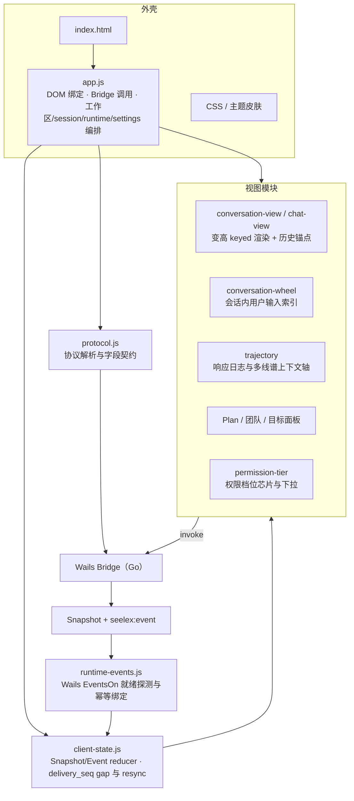

# GUI Frontend

## 生态位

本目录包含被 Go `embed.FS` 打包进 Wails 的前端源码。当前没有 bundler；`dist/` 就是可维护源文件和生产资产，而不是可随意删除的生成目录。

## 架构图



前端不维护业务镜像：权限档位、运行态、会话状态一律消费后端下发的权威字段；
本地只保留光标、viewport、展开态与布局。

## 结构

| 文件 | 职责 |
|---|---|
| `dist/app.js` | DOM 绑定、Bridge 调用、工作区/session/runtime/settings 编排；一级导航（聊天 / 定时任务 / 插件管理）、任务列表列、中栏定时编辑器与项目 temp list 的视图状态也在这一层，不复制后端业务状态。 |
| `dist/client-state.js` | Snapshot/Event reducer、delivery_seq gap 和 resync；`acceptBaseline` 是**订阅换代基线**入口（`seelex:ready` 才走它：新订阅 `delivery_seq` 从 1 重计，已应用水位必须归零——不看会话 id 变没变）；保留桌面进程段（`processContext`）——会话粒度基线到达时与进程段合并渲染，session-only 的 `runtime.changed` 不抖动账户/插件/技能/模型等进程面板（G3 收口）。 |
| `dist/runtime-events.js` | Wails `EventsOn` 就绪探测、幂等绑定与 ready/event 转发（ready 走 `acceptBaseline`）。 |
| `dist/conversation-view.js` / `chat-view.js` | 变高 keyed conversation、顶部 history sentinel（自动翻更早页由 `shouldAutoLoadOlder` 把关：**停在尾部时一律不翻**）、chat activity 渲染；历史加载用「按消息 key 的锚点」保持阅读位置。**沙箱帧不走"整行重建"**：换行前把旧行里的 `seelex-html` 帧交给 `embed-buffering.js` 领养（内容没变的帧原样搬过去，不重载），换行后才发起离屏挂载——见下节「渲染时序」。 |
| `dist/embed-buffering.js` | 会话内 HTML 渲染块的**帧缓冲**（治闪屏）：纯决策 `shouldDeferMount`（流式 / settle 窗口内不挂）与 `planEmbedMounts(prev, next, opts)`（按 `(key, srcdoc)` 分成 adopt / mount / defer / unmount 四类）+ DOM 适配 `createEmbedFrameBuffer`（领养、离屏挂载等 `load`、流式同高占位、双缓冲开关、token 防串、并发 4 上限排队、行移除清理）。零 import、可离线单测（`embed-buffering.test.mjs`）。**不改沙箱口径**：帧属性原样克隆，唯一改动是离屏副本的 `loading`（lazy 在离屏容器里可能永不加载）。 |
| `dist/conversation-wheel.js` | 右侧「会话内用户输入索引」：一条刻度 = 一条用户输入，且**覆盖整会话**（刻度表来自后端全量索引 `Bridge.SessionInputIndex`，含尚未加载到窗口的早期轮次；`app.js` 推入 + 宿主回读通道 `locateInput`）。位置：已加载轮次用问题节点在内容里的真实高度比例，未加载轮次按确定性比例布点；只索引用户输入（不再退回助手步骤/多类别刻度）。**F-1（2026-10-12）可发现性**：轨道常态即可见（基础规则默认 `opacity: .92`，不再只靠 `.conversation-shell:hover` 点亮），轨道/刻度升级为 `--r-md` + `--surface`/`--border` 的可点/可悬停刻度件（命中区仍留 34px 宽，可见要素放大），悬停出**带轮次号**的摘要浮窗（`#<round> <summary>`），当前刻度与定位高亮走与左栏 `.session-row.is-active` 同族的 `--tick-hot`/`--border-running`；几何算法（`planInputLocate`/`offsetTop` 比例）与刻度来源（仅用户输入）不变。当前输入高亮、悬停出摘要、点击跳到对应输入——未加载的目标先按页回读（`planInputLocate`/`locateInput`）再定位，回读通道未装配时只提示不空转；键盘 ↑↓/PgUp/PgDn/Home/End 只作用于用户输入刻度。纯函数（`normalizeInputIndex`/`planInputLocate`/`inputAtOffset`/`activeInputIndex`/`scrollTopForFraction`）可离线单测。空态只做视觉隐藏（`display:none` 会让轨道高度量成 0，轮轴再也出不来）。 |
| `dist/trajectory.js` | 轨迹（Network 风格响应日志）纯函数：响应类型分类（input/llm/tool/error/system/notice；`role=system`/`kind=system` 独立成「系统」轨，`message.kind` 显式类别优先，无 kind 的旧数据回退 role 判定）、tool 请求/响应配对、过滤、统计、表格渲染与多线谱分轨上下文轴。多线谱语义集中在 `AXIS_LANES`（轨定义与顺序单一事实源）：每类响应占一条固定轨，块宽只表达该记录在轴上的相对体量（`contextAxisWeight`），入轨与定位由 `axisBlocks` 统一计算，不再出现同一块两套位置语义。轴还内联前缀注入（`prefixLayerSegments`，Bridge.PromptLayers）、压缩刻度（`compactionMarks`，snapshot.task.context_compactions）与压缩分界虚线（`renderCompressionCutRow`：每个压缩点一条竖向虚线 + 「以上 … 已被压缩」，只画锚定在本页的刻度——钳到页边界的刻度位置不真实，不画假线）三条元数据轨与 `renderAxisDetail` 详情（压缩详情内按 `frame_ref` 分页读回压缩帧正文）。 |
| `dist/compaction-format.js` | 压缩记录的展示口径（纯函数、零依赖）：原因/来源标签、被压区间（`compactionRangeText`）、分界标注（`compactionCutLabel`）——右栏「上下文压缩」条目与轨迹压缩轨/详情共用同一份，避免同一条记录两种读法。区间只取记录里已有的边界字段，绝不用 `messages_before`（装配前的引擎历史条数）冒充消息条数。还有门禁进度的累计与耗时文案：`mergeCompactionProgress`（把一帧 `compaction.progress` 并进本轮，判轮次边界、累加逐关耗时、终局沿用最后一条 running 的序号，见 `dist/compaction-format.test.mjs`）与 `compactionGateDurationText`（不足 1ms 写 `<1ms`，不写 `0ms` 也不凑成 1ms）。 |
| `dist/context-summary.js` | 右栏「状态」子页的「上下文压缩」条目：**一行元数据摘要**——**seq 徽标**（= 压缩版本号，复用 `components.js renderSeqBadge`：goal 看板 active seq 与压缩条目共用同一件）+ 「栈顶」标记 + 原因；时间/来源/被压区间/估算进 hover `title`（右栏实测量级 ~280px，摊进行里必然堆叠换行）。右侧**一枚**动作按钮「查看帧正文」→ 打开可调大小的帧正文弹框（`#compaction-frame-modal`，正文按 `frame_ref` 分页读回，与轨迹详情同一容器与分页组件 `data-compact-frame-load`）——**不做行内展开**（行内 `compaction-stack-detail` 路径已下线）。「栈顶」是唯一标明"谁在前沿"的标记（非栈顶行压暗）。**压缩失败**在同一张表里排一条痕（`failed=true`：失败色 + 「失败」标记 + 原因跨整行 + 动作列写「上下文原样」，无区间/无帧），因为它不是一次压缩——但它必须查得到（此前只活在 6 秒的瞬态进度条里）。条目上方还有一轮压缩的门禁过程：**逐关耗时清单是唯一展现**（不再借 Plan 面板的轨道）——整轮只有几十毫秒，条只会瞬时满格，能看见串行工作的只有这份清单（每关一行 + 该关实测毫秒；起手帧那一关还没有数字，写「进行中」而不编耗时）。静态原型见 `dist/compaction-preview.html`（真渲染件 + 真样式，六格夹具）。 |
| `dist/trajectory-view.js` | 轨迹视图组件：对话区「轨迹」子页的上下文轴（记录轨 + 前缀注入/压缩元数据轨）/轴详情/过滤条/摘要/表格 keyed 渲染，行内复制/展开/result_ref 分页读回，本地过滤状态；普通轴块点击切回全量并定位轨迹行，元数据块点击开轴详情。**上下文轴分页**：滚轮在轴区域内翻页（`axisWheelStep` 累积阈值、一页一屏语义）、`Shift+滚轮`换页大小（`AXIS_PAGE_SIZE_STEPS`/`stepAxisPageSize`，带页码与页大小提示），分页窗口计算是纯函数（`resolveAxisPage`/`axisPageWindow`/`axisPageForIndex`）；翻到尚未加载的更早区间时提示并以既有 `loadMore` 通道回读，不静默跳位。 |
| `dist/components.js` | message/tool/queue 等纯渲染组件；对话滚动轴（thinking / tool 各自可展开收起，LLM 正文内联）与左侧调试 id。**邻接圆角**（F-6）：`renderConversationModel` 逐行按 `blocksFuse`（不同类 llm ↔ 工具过程始终融合；同类默认不分割，换轮次 `round_id` / 换角色归属 `role_name` ＝分割）给消息块与工具过程轴卡产出中介类 `is-joined-above` / `is-joined-below` / `is-joined-both` + `data-joined-above` / `data-joined-below`，CSS 只削交界那一侧、外侧角保留圆角。 |
| `dist/html-embed.js` | 会话内 HTML 渲染块：`seelex-html`（别名 `html-preview`）围栏 → **沙箱 iframe**（`sandbox="allow-scripts"`，**无 `allow-same-origin`**）+ srcdoc 内嵌 CSP（`default-src 'none'`、断网、仅 data: 图片）+ 源码压缩；`title=`/`height=` 参数，高度钳制 120–640px；`interactive=1` 表示这一块自愿驱动会话（说明牌同步显示）。**跨帧动作协议**住在这里（标签、`data-seelex-action`/`data-seelex-payload`、动作表、注入脚本）——零 import，测试按 data: URL 内联它。普通 ```html 仍是源码块。**另一条读者**（F-7）：文件预览的 HTML 只读态复用同一套沙箱口径（`buildHtmlPreviewDocument` / `renderSandboxFrame`，**不带跨帧桥**——预览一份磁盘上的 HTML 不该能驱动会话）。 |
| `dist/embed-bridge.js` | 会话内 HTML 渲染块的**动作通道宿主侧判据**（iframe → 宿主 · postMessage）：解析 → 动作白名单（`ask-agent` / `fill-composer` / `copy-text` / `open-source`）→ 载荷上限 → 块级自愿（driving 动作要求围栏 `interactive=1`）→ 滑动窗口限流与同正文去重。身份按 **`event.source`** 比对（沙箱 iframe 是 opaque origin，`event.origin` 恒为 `"null"`，按 origin 判等于不判）；有后果的动作还要求块内 1.5s 内的**真实手势**（帧内脚本按 `event.isTrusted` 记时，`onload`/timer 自动重放被丢）。落点在 `app.js`：复制 / 写输入框（不发送）/ 走 `SubmitToSession` 发一条请求 / 展开该块源码。纯函数，含 `embed-bridge.test.mjs`。 |
| `dist/theme.js` | 换肤加载层（**两轴**：深浅 × 皮肤）：读 `themes/manifest.json` → 归一化 → 切 `<html data-theme>`（深浅）与皮肤 `<link>`（品牌）；id 限 `[a-z0-9-]`、路径只允许 `themes/<id>.css`（防路径逃逸）；皮肤记 `localStorage["seelex.skin"]`、深浅记 `localStorage["seelex.mode"]`。 |
| `dist/themes/` | 内置皮肤包 + `manifest.json`（schema 2：`skins[]` + `modes[]`）：皮肤只覆盖**品牌 token**（主信号 + 环境渐变，8 个 `--skin-*`），中性基座由深浅在 `styles.css` 提供（契约与 token 清单见 `themes/README.md`），皮肤不写选择器、不用 `!important`、不引远程资源。 |
| `dist/vendor/` | 第三方资源落盘区（无 CDN、随包嵌入）：`pico.min.css` 组件库、`marked`、`highlight.js`、`DOMPurify`、`docx-preview`、`PDF.js`、`mermaid/`（markdown ```mermaid 围栏的图表渲染，约 3.3MB，懒加载）、`xterm/`（终端仿真器 + 容器自适应插件，见 `vendor/xterm/README.md`）。版本与许可登记、按需加载通道见 `vendor/README.md`。 |
| `dist/plan-dsl.js` | Plan JSON DSL 归一化、DAG → 树状布局（节点详情弹窗数据面）、节点详情弹窗。树轨事实是 `treeIsLast`/`treeAncestors`（末子标记 + 各层祖先是否续行），由 `tree-fork.treeRowAttrs` 画成缩进轨；子代理树同一套。 |
| `dist/role-session-view.js` | **角色会话只读观察面**（团队看板在编行「当前会话」chip 的落点）：从原 `agent-team-view.js`（**已删除**：2026-10-12 J-1a）**切出来的那一半**——Agent Team 面板本体已于 2026-10-12（J-1a，用户裁决：`@<团队>` 手动召唤直接删除）整块退场，只读的这一面随渲染件搬到本文件（面板的完整旧行文留 git 历史）。数据源 `Bridge.AgentTeamRoleSnapshot`（`dto.RoleSnapshot`，后端保留且不改名）；导出 `roleDisplayName` / `normalizeRoleSession` / `renderRoleSessionSwitcher` / `renderRoleSessionDetail` / `renderRoleLiveTools` / `renderRoleRecordTable`（纯渲染，不写状态）。入口与判定在团队看板一侧：`team-board-view.js` 写 `data-team-role-open` / `data-team-role-session` 钩子，`app.js` 的 `bindTeamBoardActions` 绑委托 → `openRoleSessionDetail`；「切员工」名册来自 `runtime.teamwork_board` 的 `members[]`（`roleSessionTargets`，不在前端另编一份名册）。用例见 `role-session-view.test.mjs` / `role-session-refresh.test.mjs`。 |
| `dist/agent-team-retirement.test.mjs` | **Agent Team 退场守卫**（2026-10-12 J-1a）：退场最容易留下的不是报错而是**半条通道**（少了监听器的入口、作废不存在的缓存、指回已删模块的 import）。这里把"退场后的形状"钉成断言——退场资产不再存在、`app.js` 只许剩 `AgentTeamRoleSnapshot` 两处调用、`index.html` 无 `#team-section`、空态/placeholder 不再提「`@` 手动召唤团队」；同时钉住**保留面**：团队看板（`#team-board-section` + `runtime.teamwork_board`）与角色会话只读观察面原样在场。 |
| `dist/agent-team-css-retirement.test.mjs` | **退场样式回流闸**（2026-10-12 J-1a / wi-j1a-css）：面板删面后，`styles.css` 里那批面板选择器成了**永远匹配不到**的死规则（DOM 已不存在），本条目按"存活侧引用数 0"（`dist/**.js` / `index.html` / `dist/themes/*.css`）逐条证明后整块摘除，并用这个文件把"已退场前缀"钉成 **0 命中**（按**选择器里的类名 token** 匹配前缀，不做整文件子串匹配——`team-board-*` 是活体、`scheduled-*` 不是 `schedule-*`），覆盖基础段 / hover / `:focus-visible` / `[hidden]` / `@media` 与 `reduced-motion`；**同时钉住脚本侧不许让类名复活**，以及保留面：`team-board-*`（`team-board-view.js` 自带 `TEAM_BOARD_CSS`）、角色会话读面仍在用的 `team-block` / `team-floor-chip` / `team-member-name` / `team-view`、看板表格件 `team-table` / `team-kv*`。 |
| `dist/todo-view.js` | todolist 渲染组件（数据源 `runtime.todo_items` 权威投影；仍供测试与复用，右侧工作台现由内联摘要承载）。 |
| `dist/work-table.js` | 工作表格的**归一化与状态词表**（阶段/任务/描述/状态/Assignee/Dependency/附件、`workTableView`、`workTableSignatures`、`workItemStatusToken/Label`），以及对完整多维表格的纯渲染能力。GUI 右栏不再打开表格弹窗；`workbench-summary.js` 复用这里的归一化，不重写 kind/status 判据。 |
| `dist/workbench-summary.js` | 右侧工作台的内联摘要：Todo 是纯打点表；Task 与 Subagent 分成两节但共用“状态轨 + 目标 + 打点”的后台长任务语言。数据源仍是 `snapshot.runtime.work_table`，无内容时 Todo 明确显示「暂时没有 todo 项」；不保留入口按钮或表格弹窗。 |
| `dist/tree-fork.js` | 树 / 分叉的统一渲染件（VS Code 观感，纯函数）。两件事：① `treeRowAttrs` 把「层级 + 是否末子 + 祖先是否续行」折算成树轨的 class/行内 style——祖先续行轨 = 行内 1px `linear-gradient` 背景（每层一道），自身连接轨 = `::before`（末子圆角弯头 / 非末子整行竖线），**零额外 DOM**；② `layoutCommitGraph` 把 git 的 parents 拓扑算成泳道（`rows[].lane` + 每行线段 + `dropped`），`commitGraphRowHTML` 逐行画 SVG（直线 / 合并贝塞尔 + 提交点），泳道色走 `--fork-lane-0..5`。像素几何只有一份（`railOffset`/`laneCenter`），CSS 只负责画，换肤只换 token。 |
| `dist/worktree-view.js` | 工作树视图（「资源管理器」子页「工作树」面板）：数据源 `Bridge.WorkspaceTree(relPath, depth)` / `Bridge.WorkspaceFileCount()`（后端权威元数据，只含名称/路径/类型/大小/计数，不含文件内容）；目录行惰性展开（首次经 `loadDir` 拉子级并缓存）、直接文件计数 badge、截断提示；文件行是可点击按钮（`data-file-open`），点击经 `options.onOpenFile` 打开文件预览，同时 `draggable="true" data-file-drag="<工作区相对路径>"`——可以直接拖到聊天框/消息队列发出去（落点映射见 `dist/file-drop.js`）；层级连线交给 `tree-fork` 的树轨（不再是缩进 + 字符画），行点击用容器委托（展开/收起重绘不再逐行绑监听），全部文本 escape。 |
| `dist/file-drop.js` | 档案夹 → 会话的拖放**纯映射**（拖拽载荷 → 工作区相对路径 → 排队正文 → 动作）：`normalizeDropPath`（只接受工作区内相对路径：绝对路径、`..`、超长一律丢弃）、`dropPaths`（自定义 mime → `text/plain` → 带路径字段的 `files`；**裸文件名不接受**——发出去只会让模型去读一个不存在的文件）、`fileQueueText`（渲染成一条可执行的读取指令）、`dropPlan`（草稿非空 → `insert` 只追加引用、不替用户发出去；草稿为空 → `queue` 走 composer 的普通提交路径，会话运行中由后端排进消息队列）。DOM 与 Bridge 调用留在 `app.js`（document 级委托：消息队列每次重绘都换 DOM） |
| `dist/file-reference.js` | **文件引进的唯一载体（J-1b）**：`@文件` / composer 的 `+` 加号 / 右栏工作树拖拽**三个入口产出同一条「工作区相对路径引用」**——**不是内容、不是字节**（正文里就是路径文本，agent 自己 `read_file` / `grep`）。三件事：① 路径判据**只有一份**（`normalizeFilePath` 原样转发 `file-drop.js` 的 `normalizeDropPath`，同一函数引用）；② 候选（`fileReferenceIndex` / `fileReferenceCandidates`：从已加载的工作区树条目里筛，目录在前、子串命中、有上限，纯函数不读盘）；③ **同一枚 chip**（`fileReferenceChipHTML`）的两种宿主——composer 草稿区（可 × 删除）与对话正文（可点开右栏详情）；外加两形态识别（`fileReferenceTokens`：`@路径` 与拖拽落的裸路径，判定保守——`@someone`、「and/or」不会被认成引用）与草稿操作（`applyFileReference` 整枚替换/光标插入、`removeFileReference` 摘一枚）。 |
| `dist/file-preview.js` | 文件预览控制器与纯函数（「资源管理器」子页左抽屉）：数据源 `Bridge.WorkspaceFileContent(relPath, limit)`（后端受控读取：containment/敏感过滤/上限/二进制探测，原始字节 base64 带回）；按扩展名分派渲染——markdown（marked→DOMPurify→highlight.js，其中 ```mermaid 围栏交 `mermaid-diagram.js` 渲染成图，见下）、**HTML（`.html/.htm`）=沙箱 iframe 页面**（F-7：只读态渲染为页面、点「编辑」才切源码；复用 `html-embed.js` 的 `renderSandboxFrame` 口径 —— srcdoc + `allow-scripts` 无 same-origin + CSP `default-src 'none'`；**不走** purify.sanitize + innerHTML，也不是代码块）、代码/文本（highlight.js 高亮或纯文本）、PDF（PDF.js canvas 分页）、Word（docx-preview）、图片（blob ``）、`.doc` 提示转换；组件全部本地 vendor（`dist/vendor/`，随 embed 离线打包）；文本永不直接 innerHTML，markdown 输出先 DOMPurify 消毒。**代码高亮是 token 级的**：`styles.css` 的 `.file-preview-content` 段就地声明一份 `--code-*` 映射，逐条给 `.hljs-keyword`/`.hljs-string`/`.hljs-comment` 等 token 配色，颜色只由中性基座 token 与皮肤主信号（`--accent`/`--accent-strong`）派生——六套皮肤 × 深浅两轴自动跟随，文件预览代码块与 markdown 代码块共用这一份。抽屉是**多文件详情容器**：每个打开的文件一枚 chip（`renderPreviewTabsHTML`）+ 一个独立面板（切换只切显隐，不重读、不丢滚动位置）；抽屉**头部就是 chip 标签条本身**（无独立标题 / 元信息行——「文件详情 · path · size」那行已删，文件身份由 chip 承担，动作按钮贴右）；纯函数 `previewTabLabel`/`normalizePreviewTab`/`openPreviewTab`/`closePreviewTab` 给出标签生命周期（打开去重、关闭切邻居、关闭不同项保持当前激活）；最后一个 chip 关闭（容器为空）回调 `onEmpty` → 抽屉收起、子页恢复原来大小。**编辑面**（`canEditPreview` / `decodeEditableText` / `serializeEditableText` / `editDirty` / `baselineDriftNotice`）：只有文本类、二进制探测为真且未被截断的读取才给编辑入口（`EDITABLE_PREVIEW_KINDS` = code / text / markdown / **html**——html 只读是页面、编辑是源码；非 UTF-8 的文件不给——保存会静默改掉它的编码）；**只有 Ctrl+S（或动作条「保存」）才落盘**，落盘按原文件的 EOL / BOM 还原，随后按同一路径**读回实际文件**并把编辑器基线换成读回的那一份（外部并发改动被点名而不是被掩盖）；退出编辑 / 关闭 chip / 收起抽屉前先过脏守卫（保存 / 不保存 / 取消，chip 上以 ● 标未保存），取消与保存失败都原样保留缓冲。**chip 条溢出**（J-2）：`PREVIEW_CHIP_VISIBLE_LIMIT`（=5）枚以外折叠成一枚「还有 N 个」可展开入口（选项 `expanded` 全展开并给「收起」），当前显示的详情若落在折叠区会被换进可见区（"正在看的文件"在条上必有一席）；控制器另有 `openDeferred`（批量开 chip、只第一枚成为当前显示、其余不读盘的懒加载）+ `editing()`（是否有面板正在编辑，J-2 的 apply 路径据此不抢视线）。 |
| `dist/review-request.js` | **agent 驱动打开待审阅文件（J-2）的前端纯逻辑**：解析快照顶层键 `review_request`（契约 `contract/dto/review_request.go` / `docs/gui/schemas/session-snapshot.schema.json`——会话作用域的可重放请求，不是一次性事件），判定"新的一次召唤 / 同一份快照的补放 / 用户正在编辑"（`decideReviewApply`，返回 apply/reason/key），并把清单映射成抽屉条目（`reviewRequestEntries`：只带 path(+note)，内容仍走既有 `Bridge.WorkspaceFileContent`，**没有绕过任何边界的第二条读面**）。`MAX_REVIEW_FILES_PER_REQUEST`（=10）只作 chip 条的宽度预算基准，不做前端二次硬门（超限由后端显式拒绝）。`app.js` 的 `applyReviewRequest` 是它的消费方（在快照渲染路径上幂等补放；取舍见 §7.2——不切子页、不抢当前文件、编辑中整轮不抢）。 |
| `dist/mermaid-diagram.js` | markdown 里 ```mermaid 围栏的图表渲染（与 `markdown.js` 的围栏容器约定对齐：`.mermaid-diagram[data-mermaid-diagram]` + `.mermaid-canvas[data-mermaid-canvas]` + `pre.mermaid-source > code.language-mermaid`）：`hydrateMermaid(root)` 把容器渲染成图——库体经既有懒加载通道 `vendor-loader.js: ensureVendorScript` 注入本地 `vendor/mermaid/mermaid.min.js`（UMD 单文件、离线、无 CDN、无动态 chunk），`securityLevel: "strict"`，产出的 SVG **再经 DOMPurify 的 SVG 白名单**（`USE_PROFILES: {svg, svgFilters}`）放行后才写进画布。**任何失败都不抛错**：库缺席 / 超时 / 渲染抛错 / 净化器缺席 / 空源码，一律保留源码代码块并标 `data-mermaid-state="failed"`（不白屏）；已处理的容器不重复渲染。 |
| `dist/git-log-view.js` | 提交记录视图（「资源管理器」子页「提交记录」面板）：**三层**——提交列表（数据源 `Bridge.WorkspaceGitLog(limit)`：后端权威只读元数据，按 `--topo-order` 的提交行 + 每个提交的 `parents` 父 hash，不含 diff/文件内容；`tree-fork.layoutCommitGraph` 按 parents 算泳道，逐行 SVG 画直线/合并曲线 + 提交点；短 hash 点击复制完整 hash）→ 提交详情（`Bridge.WorkspaceGitCommitDetail(hash, limit)`：状态字母/中文标签/路径/重命名原路径/±行数，删除的行不可下钻）→ 文件内容（`Bridge.WorkspaceGitCommitFileContent(hash, path, limit)`：该文件在那个提交时的内容，字节来自 git 对象库，只读）。返回键逐层退回、迟到结果按代次丢弃、根刷新不离开已打开的提交；正文渲染复用 `file-preview.renderReadOnlyContent`；全部文本 escape。 |
| `dist/terminal-panel.js` | **下栏终端面板**（VS Code 式）：纯函数（`clampTerminalHeight`/`normalizeTerminalState`/`terminalTabItems`/`nextActiveTerminal`/`decodeBase64Bytes`/`encodeBase64Bytes`/`terminalEventOf`）与 DOM 控制器 `createTerminalPanel` 同文件。终端的**权威状态在后端**（`Bridge.TerminalOpen/Write/Resize/Close/List`），前端只持有布局（`seelex.terminal.v1`：是否展开/收起/高度）与 xterm 实例：多开标签（同名 shell 编号、退出划线、行尾 ✕）、顶边拖拽调高（键盘 ↑↓ 微调）、收起只留头带；输出走独立事件名 `seelex:terminal`（不进 `seelex:event` 的 seq 水位，`TerminalOpen` 返回前到达的输出按 id 暂存后补投）；尺寸唯一来自 xterm `fit()` 的 cols/rows（`onResize` → `TerminalResize`）。终端不属于会话：切换会话/历史分页都不触碰它。xterm 的配色只在创建时从 token 取一次，换肤后由 `refreshTheme()` 把最新 token 套回全部已开终端（`app.js` 把它接到 `theme.js` 的 `onApplied` 回流口，契约见 `dist/themes/README.md` 的「换肤回流」段）。控制器级契约测试见 `terminal-panel-controller.test.mjs`（假 DOM + 假 xterm + 假 Bridge，不开窗不起进程）。 |
| `dist/scheduled-tasks-view.js` | 定时/周期任务面板渲染（数据源 `runtime.scheduled_tasks` / `runtime.scheduled_commands` 权威投影）。 |
| `dist/read-sources.js` | **deprecated**（不再被 `app.js` 引用，右栏已由「工作树」接管；文件预览已落地）：从会话工具事件中收集成功完成的 `read_file` 路径。文件与测试保留供会话证据复用。 |
| `dist/markdown.js` | 安全 Markdown、think block 和 URL 过滤。 |
| `dist/knob-slider.js` | composer 运行参数拉条的**唯一**滑杆实现（拖动只预览 / 松手提交一次 / pending 守护 / 采纳后端返回的生效值 / 失败回滚到权威值 / 快照覆盖 / 运行中上锁）；三条差异只由停位表与 `data-*` 参数表达。 |
| `dist/composer-knobs.js` | composer 两条**独立**运行参数拉条的停位表与装配：推理强度（`low/medium/high/max` 四档）与循环次数（`1..9999`，步长恒为 1）；各改一项，互不影响。 |
| `dist/release-window.js` | **会话驻留窗口**的取值面（设置弹窗「会话驻留」段）：`1..16` 的选项表 + 文案 + `normalizeReleaseWindow`（把不可信读数判成 `null`——区分"后端说了个数"与"这格没有权威读数"，不兜底成默认值）。边界与后端 `backend/limit` 的 `SessionReleaseWindowMin/Max` 同值，由 `settings-release-window.test.mjs` 逐值对账；DOM 与 `Bridge.SessionReleaseWindow` / `SetSessionReleaseWindow` 接线在 `app.js`。 |
| `dist/protocol.js` | protocol version 校验、conversation window 和递归 Plan 增量 reducer；不判定事件所属会话（归属由 application 在投递端过滤）。 |
| `dist/snapshot-shape.js` | 快照分型的字段归属契约（G3）：SessionRuntime/ProcessRuntime/顶层键所有权表、`splitRuntime`/`classifySnapshot`/`assertTypedShape`/`processContextOf` 纯函数。桌面仍收联合 Snapshot 时按表区分会话与进程字段；会话/进程制品到达后做泄漏校验（INV-G1 前端镜像）。另含「按会话身份认会话事实」的入口 `isDraftSession`/`stripDraftSessionFacts`：草稿会话（新建会话 / 卸载后就地新建）结构上没有任务面与已读文件，若宿主镜像还带着上一个会话的 `task`（压缩记录 `context_compactions` 挂在它上面）/`read_files`，在快照入口就地把它们去掉——用户口径「上下文压缩总是污染前端、在新开会话时带到新建会话」的渲染层闸门（`client-state.test.mjs` 钉住 `client.current()` 与 `onSnapshot` 拿到同一份已归一快照）。 |
| `dist/sidebar.js` | 左栏纯显示工具：重名消歧编号（渲染期派生）。标题截断已删除——会话条目改成「标题段 + ⋯ 段」后由 CSS 省略号按栏宽截断，完整标题 + 时间 + token 走共享提示气泡（数据层砍字会让同前缀会话无法区分）。会话置顶/别名**不再**存 `localStorage` —— 它们属于会话展示元数据，由后端持久化并随快照 `session.meta` 下发，写入经 `Bridge.SetSessionMeta(sessionID, pinned, alias, sortOrder)`。 |
| `dist/dock-layout.js` | 子页停靠布局纯函数：对话/轨迹与状态/工作台/资源管理器五个子页在主视图与右栏的分区、排序、激活与置换演算（`normalizeDockState`/`swapViews`），不含 DOM、存储或 Bridge 调用，由 `app.js` 消费。 |
| `dist/*.test.mjs` | Node 内置 test runner 契约测试。`trajectory.test.mjs` 覆盖轨迹响应类型分类、配对、过滤、统计、上下文轴分轨布局、前缀注入轨与压缩刻度、轴详情与转义安全。 |

## 会话内 HTML 渲染块的渲染时序（帧缓冲）

`seelex-html` 围栏渲染的是 `<iframe sandbox="allow-scripts" srcdoc=…>`。**帧的重建成本不是零**：新帧要重新解析 srcdoc、重排版、重算字体，重建期间那块区域是空的——流式输出时每帧都在重建，于是看起来一直在闪。所以渲染规则不是"内容变了就重建"，而是：

1. **稳定帧身份**：`markdown.js` 按每条消息内的 `seelex-html` 围栏序号给帧一个 key（`<行 key>#<序号>`，没有行 key 时退回内容哈希），写进 `data-embed-key`（`html-embed.js`）。内容一直在变的流式期间，只有这个 key 是稳的。
2. **帧领养**：`conversation-view.js` 的 reconcile 在**换行之前**把旧行里的帧按 `(key, srcdoc)` 交给 `embed-buffering.js`；srcdoc 完全一致的帧原样搬进新行，**不重新加载**（滚动位置与帧内交互因此自然保留）。
3. **缓冲挂载**：内容真的变了时，新帧先在离屏容器 `.html-embed-mount` 里建好、赋 srcdoc、等 `load` + 一帧 rAF，再换进可视位；交换之前旧帧仍在原位，落位台 `.html-embed-stage` 用 `--embed-height` 兜住高度，所以既不塌陷也不露白。
4. **流式延迟挂载**：会话还在跑（`chat-view.js` 传 `chat.running` → `render` 的 `streaming`）时**一帧都不新建**，只留同高占位（`data-embed-pending="1"`）；内容稳定（定稿或 `settleMs≈150ms` 无变化）后一次性挂上，连续变更只挂最后一版。
5. **防串**：每次挂载带自增 token，`load` 回来时 token 已过期就丢弃并卸载；行被移出（换会话 / 历史窗口回退）时撤在途帧、摘监听；在途帧并发上限 4（超出排队）。
6. **双缓冲是开关**：`createEmbedFrameBuffer({ doubleBuffer: true })` 才启用两层绝对定位重叠 + opacity 过渡（默认单缓冲）。单缓冲先替换再撤旧，双缓冲先淡入新的再撤旧的——两者都不在空白期上屏。

判据（`shouldDeferMount` / `planEmbedMounts`）是纯函数，`embed-buffering.test.mjs` 用最小 DOM 假体覆盖领养 / 挂载 / 延迟 / 卸载 / token 过期 / 流式期间零挂载。**安全口径不受缓冲影响**：帧的 `sandbox`、`referrerpolicy`、srcdoc 与 CSP 一律原样搬运（克隆只复制属性，不拼文档），离屏副本唯一改动的属性是 `loading`（`lazy` 在离屏容器里可能永不触发加载，那样帧永远挂不上）。

## 视觉设计系统

样式全部集中在 `dist/styles.css`，遵循 Tracebench（轨迹台架）设计体系：本地 Agent 工程验证台架，铁蓝石墨 + 暖纸白 + 黄铜信号灯，会话/工具/Plan 全部打在一条时间基线上。

- token 层分两条轴：**深浅**（`:root` 浅色 / `:root[data-theme="dark"]` 深色）给表面色（`--bg/panel/surface`）、文本色、描边、语义色（`--status-running/done/failed/info`）、刻度线（`--tick`）、半透明面与投影；**皮肤**（`themes/<skin>.css`）只给品牌（主信号 + 环境渐变，8 个 `--skin-*`），由 styles.css 桥接成 `--accent`/`--on-accent`/`--shell-gradient`。字阶、圆角与间距属基座，不分轴。组件不得硬编码色值；同义状态只允许使用对应语义变量，禁止色值漂移。
- 字体三角色：界面正文 `--font-ui`，数据/时间戳/状态 `--font-mono`，标签与数字 `--font-display`（Bahnschrift 系测量字）；最小可见字号 10px，数据行 ≥11px，正文不低于 12px。
- 中栏签名：`#trace-rail` 是一条垂直时间基线，消息与 Plan 卡片以打点（`::before` 圆点）挂线，工具卡片以左侧 3px 状态条标识；运行中的 Plan 节点是唯一常驻动效（黄铜扫掠 `trace-sweep`），`prefers-reduced-motion` 全局关闭。
- 界面词统一为中文：就绪 / 执行中 / 排队 / 手动 / 自动改文件 / 自动执行 / 全权；弹窗 eyebrow 不再使用英文机器词。
- 图标管线：静态按钮以 `data-icon` 占位，启动时由 `components.js` 的
  `hydrateIcons()` 注入统一 stroke SVG（ICONS 注册表）；顶部连接点
  `.status-dot` 由 `chat-view.js` 追加 `online` 类切换语义色。
- 信息层级：对话区子页（`对话 / 轨迹`）与右侧栏三个子页（`状态 / 工作台 /
  资源管理器`）同属一套停靠布局（`seelex.dock.v1` localStorage 记忆）：默认
  会话两页在主视图、右栏三页在右栏；页签可点击切换、拖拽换序、跨栏置换
  （拖到另一栏某页签上松开即与该页签互换）。「历史检索」收进 `#side-more`
  折叠区常驻右栏子页之下；左侧栏只承载会话树（工作区绑定在会话树的行内动作里），
  三栏宽度可拖拽调整（`--left-w`/`--right-w`，localStorage 记忆；**无固定上限**，
  只按视口宽封顶，窗口越大越能拉开）。
- 「资源管理器」子页的**内容详情抽屉可收起让出内容页**（2026-09-17）：抽屉头部
  的「收起详情，让出内容页」把详情折成一条 28px 竖轨（`.is-preview-collapsed`：
  `preview panes` 两列），工作树 + 提交记录独占子页；点竖轨还原。它与「隐藏
  工作树/提交记录」（详情独占）是两个方向，互斥（收起时复位隐蔽态），因此不会
  出现两侧都隐蔽的空子页。打开文件会解除收起态（点文件树必须能看见详情）。
- 中栏底部是**下栏终端**（VS Code 式，2026-09-17）：`.terminal-panel` 三态 =
  隐藏（`.hidden`）/ 收起（`.is-collapsed`，只留 30px 头带）/ 展开；展开高度由
  `--terminal-h` 控制（顶边分隔条拖拽或 ↑↓ 微调，localStorage `seelex.terminal.v1`
  记忆，上限 72vh 保证对话区不被顶掉）。头部左侧是收起/展开，中间是**多开标签条**
  （同名 shell 自动编号、退出态划线、行尾 ✕ 关单个），右侧是 新建 / 关闭当前 /
  隐藏。快捷键与 VS Code 对齐：`` Ctrl+` `` 切换（已展开则收起）、`` Ctrl+Shift+` ``
  新建；顶栏 `#terminal-button` 是同一入口。终端会话与输出全部来自后端
  （见 [`../README.md`](../README.md) 的「下栏终端」），前端只持有布局与 xterm 实例。
- 右栏「状态」子页自上而下：`状态`（键值两列表格 `status-table`）→ `账户`
  （条目化账户栏，见下）。账户栏从
  左侧栏底部搬到这里：状态区显示的就是当前账户的 provider/model，账户列表贴在
  它下面，一眼能对上「现在是谁在跑」。（这一栏下面原来还有一块 `Agent Team` 折叠
  面板，见「右侧栏子页」一节的退场说明：2026-10-12 已整块删除，团队面只剩「工作台」
  页的 teamwork 看板。）
- 会话条目（左栏）固定两段：**标题段**（状态点 + 完整标题，CSS 省略号按栏宽
  截断，条目里不再出现时间/token）+ **⋯ 段**（省略号按钮，点开才是置顶 / 分支 /
  删除三个操作）。时间、token 与完整标题在鼠标常驻（或键盘聚焦）时由共享提示
  气泡（`#ui-tooltip`，一条 DOM、`[data-tip]` 委托触发、`\n` 分行）一起给出；
  ⋯ 段同一时刻只开一条，点空白 / Esc / 执行动作即收起。
- 动效克制：只保留一个加载指示（`runtime-spinner`），装饰性动画（扫光、连点、辉光、呼吸）已移除；`prefers-reduced-motion` 全局生效。
- 交互口径（拟物但克制：北欧家居式极简 + 锤子式短促回弹）：
  - 焦点提示只作用于**外框**：`1px solid var(--focus-ring)` + `box-shadow: var(--focus-glow)`（`0 0 12px 1px`，零偏移、纯发散模糊）；内部 `textarea` 的 focus ring 显式清掉。
    **例外（用户口径）**：聊天框是**卡片**，它的「点击激活」不再加聚光——卡片一旦发光就像"被选中/报错"，不像"正在输入"。`.composer:focus-within` 改成卡片抬升 `--shadow-lift`（两套皮肤各一档）＋ 一点点 accent 描边提示焦点在哪；
  - 消息队列 = 叠在聊天框上沿的一叠卡片：`.message-queue` 是列，卡片之间用 `--queue-peek` 相互压边（每张卡底部预留同样高度的内边距，压边吃掉的是留白而不是正文），最下面一条（最新排队）紧贴聊天框上沿；被指到/键盘进入的那张浮到最上面；作为文件拖放目标时高亮同一套强调边；
  - 档案夹 → 会话的拖拽：工作树文件行 `draggable`（`data-file-drag` = 工作区相对路径），聊天框与消息队列是落点，映射逻辑在 `dist/file-drop.js`（纯函数）：草稿非空只**追加**引用（不替用户发出去），草稿为空就走 composer 的普通提交路径（会话运行中由后端排进消息队列——上方那叠卡片就是这么来的）；
  - 文件引用的三入口（J-1b）：`@文件`（内联候选来自已加载的工作区树索引）、composer 工具条上的 `+` 加号（路径选择器）、上面的拖拽 —— 三者只产出**工作区相对路径**，共用 `file-drop.js` 的 `normalizeDropPath` 判据与 `file-reference.js` 的**同一枚 chip**；草稿区（`#composer-file-refs`，可 × 删除）与对话正文（user 消息，点击开右栏详情）是同一枚 chip 的两种宿主，正文文本一个字都不改（引用就是路径，agent 自己 `read_file`/`grep`）；
  - 按压是「陷进去再弹回来」：`:active` 用 0 偏移内阴影 `--press-shadow` + `translateY(1px) scale(.985)`（图标键 .94），开关态（`perm-chip.is-on` / 已置顶）也用内阴影表示"已经按进去"；位移都在 1~2px，不做弹跳；
  - 层次靠 1px 外框 + 极轻投影，不堆厚描边；`prefers-reduced-motion` 关闭全部 transition/animation。
- 内存口径（前端只做减法的三件事）：
  - **事件委托**：会话列表、账户栏、插件列表、命令/内联建议、提交记录、工作树的行级动作都挂在容器上一条监听，列表重绘不再重建 N 个闭包与监听器，也不留孤儿监听；
  - **一条共享提示气泡**替代每行 `title`/子元素提示（#ui-tooltip）；
  - **拓扑只传一次**：git log 只下发 `commits`（含 parents），不再同时下发 `lines`（同一份数据发两遍）；Plan/子代理树的树轨是布尔标记而不是每节点一个引导字符串。
  - 度量看顶部性能徽标（`perf-hooks.js` 采集 DOM 节点数等无内容指标，点击展开）。
- 语义色映射以 `:root` token 为唯一事实来源；新增组件时先查 token，不新增同义色。
- 会话树：会话按工作区（`session_workspaces` 投影）分组，未绑定或工作区已消失的会话收进「未关联会话」置底；工作区组头可点击折叠（localStorage 记忆）；工具 in/out 面板支持展开/收回切换。每行带可见状态徽标（`session.status`：运行中/排队/草稿/恢复中），保留的「新建会话」草稿槽位以草稿行常驻列表（点击恢复，物化后消失）。草稿行**从新建那一刻就在自己的工作区组里**：草稿的绑定是视图级事实，后端把它补进 `session_workspaces`（存储绑定要等物化才写），前端只照着分组。运行中但还没落盘的会话（首轮、定时任务新建的后台会话）由后端补成 `running` 行，左侧栏立刻可见，不等到这一轮跑完（判据见 `application/core` 的 `withLiveSessionRowsLocked`）。`restoring` 表示运行中切换到未驻留会话时后台冷加载中：视图已切到目标空壳，输入区禁用，装载完成后由 `snapshot.changed` 发布内容基线并回到就绪。
- 目录形状（G6）：后端目录缓存按 projectID 分格枚举（`SessionsOf` 是唯一
  持久枚举源头），`sessions[]`/`session_workspaces` 是落到快照的**联合镜像**
  （跨项目按会话 ID 去重）+ 一格内存态补行（活着但尚未落盘的 running/queued/
  awaiting_approval 会话）。前端按工作区分组属渲染层派生，不拥有存储归属
  事实；同 ID 会话在多个项目格重复出现（迁移/旧布局）时以后端最近更新为准。
- 去线框原则：主面板与内容面（状态、概要、工作区、定时任务、历史检索、
  用户消息等）默认不画边框，靠底色/留白/字阶分层；数据密集视图（工作表格、
  Plan/节点详情）保留细边框作数据分隔。

## 状态流

快照分型（G3，契约先行）：`middle/protocol/model` 已把 DTO 拆成
`SessionSnapshot`/`SessionRuntime`（会话粒度、传输完备）与
`ProcessSnapshot`/`ProcessRuntime`（进程目录/能力清单）。桌面 Workbench
现阶段仍以联合 Snapshot 下发（进程字段内联在 `runtime`），`snapshot-shape.js`
是前端唯一的字段归属事实表：进程面板（账户/插件/技能/定时任务/模型）与
会话面板（effort/plan/work_table/子代理树）各自按所有权提取；会话制品若泄漏
进程字段或进程制品泄漏会话字段，`assertTypedShape` 直接拒绝（INV-G1）。
`createGUIClient` 在快照边界经 `processContextOf` 记录进程上下文（联合
Workbench 快照或进程制品）；会话粒度基线（`capabilities.session_snapshot`）
到达时与进程段合并成渲染快照，`runtime.changed` 只携带会话运行字段时进程
段照常保留——桌面进程面板不随会话载荷抖动。联合快照自身已带进程字段，
按原样渲染（无重复合并）。

1. 初始化先等待并幂等绑定 Wails `EventsOn`，再通过 Bridge `Snapshot` 获取权威状态；runtime 尚未就绪时整个初始化按既有重试机制继续，不能静默进入无事件模式。
2. `client-state` 应用连续 `seelex:event` 增量。
3. seq 缺口先向宿主 `ReplayEvents` 增量补取；补不齐、协议不兼容或未知状态才触发完整 Snapshot resync。
4. render functions 根据 state 投影 DOM；所有 mutation 通过 Bridge 返回 Application。

权限档位控件不维护本地状态：composer chip（`#perm-toggle`，位置沿用原"全权"chip，尾部 `▾` 表示可下拉）显示当前档短名，**点击就地展开芯片下拉**（`#perm-menu`，位于 `<div class="perm-picker">` 内、向上展开的一层浮层）；条目由 `permission-tier.js:permissionTierMenuItems` 给出，与运行状态弹窗里的列表**同源**（同一份后端目录 `snapshot.runtime.permission_tiers` + 同一份生效档 `snapshot.runtime.permission_tier`）。点一条即调用 `Bridge.SetPermissionTier`，按返回的**生效档位**渲染芯片并重新拉取 Snapshot；`applyPermissionTier` 是唯一提交路径，下拉与弹窗列表共用。键盘：`↑/↓` 循环（纯函数 `nextTierIndex`）、`Enter`/空格提交、`Esc` 或点击浮层外关闭；`aria-expanded`/`aria-haspopup` 由 `togglePermissionMenu` 维护。运行状态弹窗里的「权限档位（本会话）」列表保留为总览口。后端同时发布完整 `runtime.changed` 供连续事件链更新。旧 `full_access` 保留为派生位（`full` 档 ⇒ true）。

事件是状态更新的唯一快路径。渲染层每应用一批事件就向宿主回报应用水位
（`Bridge.AckEvents`，密集期按 150ms 合并）；`delivery_seq` 出现缺口时先向宿主
`ReplayEvents` 增量补取，补不齐才整份重拉 Snapshot。因此 `chat.running=true` 期间
不再有每秒轮询：桌面 WebView 丢掉 terminal event 遗留的 `RUN`/`Waiting for output…`
由宿主重推未确认事件收敛（`gui/bridge.go` 的 `armResend`/`catchUpRenderer`，重推封顶
`eventResendMaxTries` 次，超出窗口则投递带水位的 `resync.required`）。原
`active-chat-sync.js` 已删除。

视图会话切换（ResumeSession/ActivateSession/新建/分支）会使 Bridge 重建订阅：
新订阅的 `delivery_seq` 从 1 重新计，因此**订阅换代基线**（`seelex:ready`）到达时，
`client-state.acceptBaseline` 一律复位已应用水位（不看会话 id 变没变），`app.js`
同步复位待发回执游标——否则新订阅 seq<=旧水位的首段事件会被当作重复静默丢弃，
会话正文停在基线，且回执会把旧订阅的高水位报给宿主，宿主据此停止补投（永久静默）。
归零只走 `acceptBaseline` 这一个入口：同一订阅内的整份 refresh 必须保留水位，否则
宿主从重放窗口补投的旧序号事件会被重复应用（流式 delta 叠两遍）。

`resync.required` 是宿主的**指令**（"整份重拉，并把水位抬到这个序号"），因此
`protocol.js` 在 `delivery_seq` 的连续性/去重判定**之前**处理它：它的序号可能是
本订阅的投递水位（等于甚至小于渲染层已应用水位），先走去重判定会把它当迟到事件
吞掉——整份重拉永不发生，视图停在旧内容上。

右侧工作台由内联摘要统一接管：数据源 `snapshot.runtime.work_table`
+ `snapshot.runtime.work_table_batches`（权威投影）与
`worktable.changed`/`task.changed` 增量（`worktable.changed` 附加 `batches`
批次头、并在子代理树内容变化时附带 `subagent_tree`；两者都是可选增量，
缺失时保留既有值，空数组表示树已清空）。摘要按三个信息语言分区：Todo 是打点表，
Task 与 Subagent 是同一套后台长任务行；Todo 空态始终可读，Task/Subagent 无内容时退场。
Todo 三态更新仍走 `Bridge.UpdateWorkItemStatus`，Task/Subagent 行保留详情入口。

todo 项（kind=todo）进入工作表格的 `tasklist` 阶段；三态（pending/doing/
done）只读权威 `work_table` 状态，行内按钮经 `Bridge.UpdateWorkItemStatus`
回写后端（成功路径发布 `runtime.changed` + `worktable.changed`），渲染不做
本地猜测。状态迁移按 kind 限定（todo 仅三态；task/plan/subagent 维持通用
迁移），非法状态由后端拒绝。
Plan DSL（`plan-dsl.js`）保留为节点详情弹窗的数据面：`refreshPlanDetailData`
只算 DSL 不改面板 DOM。详情入口按 Plan DSL → 子代理树 → 工作表格行
（`workItemToDetailNode`）→ 仅身份节点逐级兜底打开：同一批次还有子代理在跑
时，行会先经 `worktable.changed`/`task.changed` 到达，而树只由整份快照与
`runtime.changed` 携带，早期版本在这种时序下会静默不弹窗；弹窗只保留三块
数据面——会话记录 / 上下文 / 功能打点，全部由 `SubagentSessionDetail` 单一
权威载荷提供（第一视角流式通道 `SubagentDetailStreamStart/Stop` 与
`seelex:subagent_live` 订阅已删除）。弹窗与会话记录区可拖拽调整大小
（复用工作表格弹窗的 `data-resizable` + `.modal-resize-handle` 交互），会话
记录内容按框内宽度自适应（`width:100%` + `overflow-wrap:anywhere` +
`min-width:0`），长行/代码块/URL 不横向溢出。

task 即 worktable 条目（单一注册表 actor，保护粒度=task）：主动 `taskadd`
工具、被动 plan/subagent 生命周期同步都落到同一数据面；增量事件
`task.changed` 按 task_id 单行 upsert，`worktable.changed` 保持整表替换；
retry 状态展示 `RETRY n`（retry_count）。

## 一级导航与任务列表

界面是四个独立纵向区域：`一级导航 | 任务列表 | 会话/定时编辑区 | 右栏`。
一级导航只有 `聊天 / 定时任务 / 插件管理` 三项，不是会话列表的一部分；第二列
随导航切换列表内容：

- `聊天`：按项目分组的会话列表；
- `定时任务`：每条计划只占一行，显示节奏、名称和状态；其余信息进入中栏编辑器；
- `插件管理`：第二列只列插件条目，当前插件的 `Skill 管理`显示在中栏。

页面切换与导航收缩分别记忆在 `seelex.left-page` /
`seelex.left-nav.collapsed`，都不进 Snapshot。

导航底色由深浅轴独占：浅色纯白、深色纯黑，不接受皮肤主信号或环境渐变。
运行状态弹窗不再重复展示 Plugin/Skill，避免同一能力面出现两处入口。

## 右侧栏子页（状态 / 工作台 / 资源管理器）

五个子页（对话/轨迹/状态/工作台/资源管理器）由停靠布局统一管理（纯函数见
`dist/dock-layout.js`，DOM 与持久化在 `app.js`）：`main` 区固定展示两个页签、
`right` 区固定展示三个页签，页签可点击切换、同区拖拽换序、跨区拖拽置换，
整体记忆在 `seelex.dock.v1`（旧 `seelex.right.tab` 仅作一次迁移读取）。
右栏默认三个子页（`.right-tabs`，默认激活「状态」）：

- **状态**：项目状态表（状态/会话/消息/任务/文件数）+「概要」= 压缩栈表格
  （一行一次压缩，点行读帧正文；原「状态」面板整体移入）+「工具记录」= **一张柱形图**
  （一根柱子一个工具，上半天成功、下半天失败，高度按总调用次数缩放）+ 点柱子后出现的
  **失败原因饼图**（各原因占比）。读数走 `Bridge.ToolRecordBoard()`，**按需拉取**而不是
  随快照（不进会话快照）；计数关着且没有历史读数时整块 hidden。**看板只读**：计数开关在
  「设置 → 工具记录」（走 `Bridge.SetToolRecordEnabled`，落数据根 `runtime-limits.json`）。
  渲染件 = `dist/tool-record-board.js`，与 TUI Alt+T 面板同源）。
- **工作台**：「目标」面板 + 团队看板 + Todo/Task/Subagent 内联摘要。定时任务与
  插件/Skill 位于独立的任务列表列，定时编辑器在中栏展开。
- **代码**（资源管理器）：左右分栏——左「内容详情」抽屉 + 右**三个平级子页**
  （工作树 / 提交记录 / 工作区更改）。子页用一条内嵌页签切换（`role=tablist`，
  一次只显示一个），激活态与顺序记忆在 `seelex.right.explorer.v1`，旧
  `seelex.right.codePanes` 只作一次迁移读取（迁移后写新键、删旧键）。每个子页头部
  一枚刷新按钮（`data-icon="refresh"`），内容区自己就是滚动容器
  （`overflow-y: auto`，滚轮只滚该子页）；重新激活该子页或再点该子页页签也会刷新。
  刷新是**原子能力**：单飞（在飞期间复用同一个 promise）+ 代次提交（过期响应不回写、
  不出现三个面板新旧混搭），失败保留旧数据只提示——规则在
  `gui/frontend/dist/explorer-refresh.js`，页签语义在 `explorer-pages.js`。
  子页页签与右栏页签是同一个页签族（`--r-md` + 既有信号色 `--hl-fill` / `--hl-ink`，
  不描边不投影）；三页行壳走 `--row-min-h` 行密度口径（一行一条），`.code-pane-body`
  是内容区唯一滚动源（行容器不开 overflow）；内容详情 chip 的当前项与子页页签同义，
  视觉同一套——选中语义全站只有 `.is-active`（工作树行没有选中态）。提交列表行是固定
  行高，与 `git-log-view.js` 的 `ROW_HEIGHT`（泳道 SVG）成对，改动必须同步。旧键
  `seelex.right.codePanes` 只有"读一次 + 删一次"两条路径，没有任何写回（见
  `docs/gui/modules/right-sidebar.md`「页签与行密度」）。
  **多仓库 git**：一个工作区下可能有多棵互不相干的仓库，提交记录与工作区更改因此
  共用一条**仓库子页标签栏**（`#git-repo-tabs`，位于子页页签之下、内容之上）。
  仓库清单来自 `Bridge.WorkspaceGitRepos()`（只读有界扫描），标签模型与选中收敛
  全在 `git-repos.js` 的两个纯函数里：`buildRepoTabs(repos, selectedRel)`（primary
  在前、其余按 rel 字典序；`show` 只在**多于一个仓库**时为真）与
  `resolveSelectedRepo(repos, selectedRel)`（选中的仓库没了 → primary → 第一项 →
  `""`=工作区根）。`app.js` 只做接线：选择按工作区 ID 记忆
  （`gitRepoSelectionByWorkspace`）、**工作区切换即重置**、快照刷新不重置、
  切到非 git 子页或只有一个仓库时隐藏标签栏（容器同步 `has-git-repos` 切三行网格）。
  四条 git 查询都带 `repo` 参数（`""`=工作区根，与旧的单仓库查询完全等价），
  下钻（提交详情的文件清单、提交内文件内容）沿用同一个选中仓库。样式复用页签族
  的 `.code-pane-tabs` / `.code-pane-tab`，只在 `styles.css` 的 git 段补隐藏态、
  层次差与分支小字。
  内容详情抽屉宽度可拖拽（`--preview-w`，`seelex.preview-pane-width` 记忆，
  **无固定上限**——只受子页宽封顶，可把任一侧拉到几乎占满子页），抽屉头部一枚按钮
  可**隐蔽工作树与提交记录**让内容详情独占子页（`seelex.preview-panes-hidden` 记忆），
  另一枚按钮/Esc **关闭全部文件详情**。抽屉不再记忆展开态：容器以「有文件详情」为
  生命周期前提。

「目标」面板（`goal-view`）展示当前任务的工程目标证据面：目标文本（最近一条
非空用户消息）、任务状态/摘要（`snapshot.task` 权威 TaskState）、激活 skill
chips + GOAL badge（`runtime.active_skills` / `runtime.goal_skill_active`，
后端锁内快照投影，`runtime.changed` 增量携带）。无内容时整个 section 隐藏。

「资源管理器」子页数据面：工作树走 `Bridge.WorkspaceTree/FileCount`（惰性目录展开），
提交记录走 `Bridge.WorkspaceGitLog(limit)`（最近 20 条：按 `--topo-order` 的提交行
+ 每个提交的 `parents` 父 hash + hash/作者/时间/标题；前端按 parents 算泳道，
用 SVG 画直线/合并曲线 + 提交点，短 hash 点击复制完整 hash）。**提交记录是三层视图**：
点开某一条提交 → `Bridge.WorkspaceGitCommitDetail(hash, limit)` 给出这次提交改了哪些
文件（状态字母 + 中文标签 + 路径 + 重命名原路径 + ±行数；删除的行不可下钻），点开清单
里的一行 → `Bridge.WorkspaceGitCommitFileContent(hash, path, limit)` 给出该文件**在那个
提交时**的内容（字节来自 git 对象库，只读）。返回键逐层退回；根刷新只换列表数据、
不把用户从已打开的提交里踢出去。
两面板在工作区切换或 chat 结束（文件/提交可能变化）时按需刷新；子页未激活时
数据面缓存，激活时按需拉取。文件预览：点击工作树文件行 → 左抽屉经
`Bridge.WorkspaceFileContent` 拉取受控字节（默认 4 MiB 文本 / 24 MiB 文档图片，
后端 64 MiB 硬钳制）→ 按扩展名分派渲染（见 `file-preview.js`）。抽屉是**多文件
详情容器**：每个打开的文件一枚 chip（抽屉头部就是 chip 标签条，无独立标题 /
元信息行）+ 一个独立面板（点 chip 切换、点 chip
尾部 ✕ 关闭单个详情；再次点开同一文件只是激活，不重复读盘）；最后一个 chip 关闭
（容器为空）时容器生命周期结束——抽屉自动收起、子页恢复原来大小（工作树/提交
记录重新占满）。预览属当前工作区，工作区切换时抽屉随树清空；截断文件明确提示、
分页类（PDF/Word/图片）超限放弃渲染而非半截展示。提交记录里的文件内容**不**进这个
抽屉（历史版本没有写入口，且同名文件会与工作区文件共用一枚 chip）：它在提交记录面板
内只读渲染，渲染分派共用 `file-preview.renderReadOnlyContent`。历史检索保留在
`#side-more` 折叠区常驻。

### 团队面：Agent Team 面板已退场（2026-10-12 J-1a），只剩 teamwork 看板 + 角色会话只读观察面

**Agent Team 面板整块退场**（用户裁决：`@<团队>` 手动召唤**直接删除**，`@` 让给文件指代；
问题与依据见 [docs/2026-10-12-frontend-consistency-and-fixes/README.md](../../docs/2026-10-12-frontend-consistency-and-fixes/README.md) §3 J-1）。
面板的完整旧行文（员工库 / 团队库 / 员工栏 / 发言调度四块各自的事实源、交互口径、冷加载
编辑面板的字段表、提示词优化、权限边界）留 git 历史与 `docs/devlog/2026-09-15-*` /
`docs/devlog/2026-10-01-*` 各篇——下面不再复述一个已经不存在的界面。

- **删掉的**：「状态」页的 Agent Team 折叠块（`#team-section` / `#team-view` / `#team-count`）；
  渲染件 `dist/agent-team-view.js`（**已删除**：2026-10-12 J-1a）（四块表格 + 冷加载面板 + `hirePanel` / `teamEditorPanel` /
  `renderTeamMemberList` / `employeePool` 等）与它的两条测试（`agent-team-view.test.mjs`（**已删除**） /
  `agent-team-refresh.test.mjs`（**已删除**））；`app.js` 的面板状态族（`agentTeamView` / `agentTeamLibrary` /
  `agentTeamGlobal` / `agentTeamDirty` / `agentTeamError` / `agentTeamLoading` /
  `agentTeamSessionID`）与 `AgentTeam*` 面板调用（View / Library / GlobalConfig /
  MaterializeTeam / SaveTeam / SaveEmployee / InstantiateRole / SetOrder / DeleteRole /
  DeleteEmployee / OptimizePrompt 等，连同 `agentTeamRolePayload` 与「逐格装配」读数）；
  `index.html` / `chat-view.js` 里「`@` 手动召唤团队」那句提示（空态提示与 composer placeholder）。
- **保留的（团队面只剩这两处）**：
  1. **teamwork 看板**：「工作台」页的 `#team-board-section` / `#team-board-view` /
     `#team-board-badge`（数据源 `runtime.teamwork_board`，渲染件 `dist/team-board-view.js`，
     与 TUI `Alt+T` 同源投影）——**id 与数据源都不许动**；里程碑 / Work Item / teammate
     详情页与成员入口原样在此。
  2. **角色会话只读观察面**（下面两节）：入口 = 看板在编行的「当前会话」chip，渲染件
     `dist/role-session-view.js`，读数仍是 `Bridge.AgentTeamRoleSnapshot`。
- **`@` 的口径**：前端不再有任何团队口径的 `@` 文案（空态 / placeholder / sheet 注释都改了）；
  前缀位（`SIGIL_TEAM`、`SIGILS`、`SIGIL_PATTERN` 与提交路由）本轮不动——`@` 归**文件指代**，
  候选源与提交载荷的改造是后续条目 **J-1b** 的落点，本条目不建任何新入口。
- **后端面不在本条目**：`AgentTeam*` RPC 的收口归后端条目 wi-j1a-be；`AgentTeamRoleSnapshot`
  **保留且不改名**（它是角色会话读面的权威读数，与面板存亡无关）。
- **测试**：新增 `agent-team-retirement.test.mjs` 作**退场守卫**（退场资产不复存在、
  `app.js` 只许剩 `AgentTeamRoleSnapshot` 两处调用、看板与角色会话读面在场）；原面板的两条
  文件删除，其中与面板无关的 12 条（角色会话渲染 / 竖排记录表 / 草稿区 / 实时区 / 刷新键 /
  切员工）**原样搬进** `role-session-view.test.mjs`，接线口径搬进
  `role-session-refresh.test.mjs`——退场不等于把读面的覆盖一起删掉；`plugin-source.test.mjs`
  的两条面板用例（`normalizePluginNames` 对照、`hirePanel` 上限提示）随对象消失而删除，
  「两条提交路带装配」那条改写成退场守卫。
- **样式**：删面那一轮（J-1a）只删面、**不动 `styles.css`**（团队看板的样式由
  `team-board-view.js` 自带的 `TEAM_BOARD_CSS` 提供，不在 `styles.css` 里）；面板专属的死
  样式随后由 **wi-j1a-css** 收口：13.5 / 18.3 / 21 / 24 / E3 各节的退场选择器（`team-table-row`
  / `team-toolbar` / `team-rail-*` / `team-hire-*` / `team-order-*` / `team-editor-*` /
  `team-library-*` / `team-perm-*` / `team-prompt-*` / `team-member-list|item|label|drop|add|empty|edit|actions`
  / `team-cell-*` / `team-kv-list` / `team-meta-row` / `team-panel-toolbar` / `schedule-*` 等）
  按"存活侧 JS+HTML 引用数 0"**逐条证明**后整块摘除（112 条规则、净 −342 行 / −14.5KB），
  含 hover / `:focus-visible` / `[hidden]` / `@media` 内的同名规则；`team-board-*` 与角色会话
  读面仍在用的类名（`team-block` / `team-floor` / `team-floor-chip` / `team-member-name` /
  `team-table` / `team-kv*` / `team-panel`）保留。**新规则不得再造 `team-*` 前缀的"面板类"
  选择器**——面板已不在 DOM 里，那样的规则永远匹配不到；回流闸见
  `dist/agent-team-css-retirement.test.mjs`（已退场前缀在 `styles.css` 与存活 JS/HTML 里 0 命中）。

**角色会话只读观察面：刷新与切员工**：这一面是**拉取**面（权威读数是角色会话投影），配手动
刷新键；"这位此刻在干什么"另走推送路（见下）。两者不互相冒充。

- 运行详情（`renderRoleSessionDetail`）自带一枚刷新键（`data-role-session-refresh`，键上带
  `role_name` / `role_session_id` 身份，刷新原样重放）；`team.changed` 到达时若视图开着就
  重取当前目标（`refreshRoleSessionDetail`），关着则什么都不做。面板退场后，这条事件在前端
  **只剩**这一个消费方。
- 「切员工」（`renderRoleSessionSwitcher`，多名员工时才摆）：把**已存在的会话视图**的目标换成
  另一位员工，不用关掉再回列表点下一位。名册 = 团队看板的在编名单（`roleSessionTargets` 读
  `runtime.teamwork_board` 的 `members[]`，配 `teammateSessionEntry` 判定），不在前端另编一份。

**员工在做什么：实时区（2026-10-03 口径修正）**：权威读数是拉取面、配刷新键；但"这位此刻在
干什么"**不该**等这一轮跑完才看得到：

- 后端：员工做工回合（`team_dispatch` 派出的 teammate）的每次工具调用 → `RoleToolActivity`
  → 装配根（`RuntimeDeps.RoleToolCallback` = `app.HandleRoleToolActivity`）→ 会话级事件
  `teammate.tool.started` / `teammate.tool.completed`（载荷不进快照，`revision=0`）；它就是
  `subagent.tool.*` 的员工侧对称面。
- 前端：`app.js` 的 `applyTeammateToolActivity` 把帧并进按角色会话分组的**有界**缓存
  （`roleSessionLiveTools`，上限 `ROLE_LIVE_TOOL_LIMIT`），开着的正是这一位时立刻重绘
  （不跑 RPC）；`renderRoleLiveTools` 把它画成「正在做（实时）」一节（一条一步、最新在下），
  排在记录表之前。切员工时各自带出自己的那一份。
- 边界：实时区是**瞬态**（不进快照、不落盘、关掉视图即不再更新），权威记录仍是角色会话投影。
- 「这件事的会话」可分页：对话区（`renderTeammateLiveSession`）读的 `TeammateSessionLive` 是
  默认页，底部按后端读数画翻页条（`第 X–Y 条 / 共 N 条` + 上一页/下一页，`offset` / `total` /
  `has_more` 全是后端算的，前端只搬）；翻页走
  `Bridge.TeammateSessionLivePage(role_session_id, offset, limit)`，刷新键 / 实时重绘时
  **停在用户翻到的那一页**（在尾巴按默认页再读，新消息自然露出来）。判据只有一份
  （`backend/engine/assemble/runtime_teammate_session_live.go` 的 `teammateSessionLiveSlice`），前端不
  推算"还有没有下一页"。

**员工记录表：竖排（2026-10-03）**：`role-record-table` 从"车道当行、回合号当列"的横向
excel-grid 改成**一条回合一行**（行号 = seq，时间自上而下；末尾是「草稿N」行——草稿还没有
发布 seq，不能冒充第 0 回合）。两栏 = main 车道 / 它自己那条车道，四类归属不变：
`is-main` / `is-own` / `is-shared` / `is-outside`（入伙前或已被压缩掉的回合两栏都是占位 `—`）。
样式在 `styles.css` 的 `.role-record-*`（不再依赖 `.excel-grid`）。

### 页签与压缩口径（2026-09 交互改版）

- **选中页签 = 静止胶囊（2026-09-24 换代，取代纸质笔记本书签拟物）**：选中态统一成
  "同色系薄底 + 同色系重字"（`--hl-fill` / `--hl-ink`，`styles.css` 第 27 节 j），
  不描边、不加下条、不投影、不做位移——用户口径是"高亮既不是黑块 / 黑外框，也不是
  圆角 + 单边黑条"。同一套口径覆盖页签家族的五处：对话区子页、右栏子页、工作表页签、
  终端页签、发言调度胶囊（第 27 节 o）；库内 `inset 0 -Npx 0` 的写法已清零，
  `rgba(0, 0, 0` 只剩深色主题里的两个投影 token。
- **工作表页签并入表头（2026-10-12，F-2）**：批次"分片"从表格**底部**那条独立灰条
  （`border-top` + `--surface-2`）搬进 `.work-table-head`，成为第 4 个筛选维度
  （`.work-filter-group.is-batch` + `data-work-batch-filters`，见 `work-table.js`
  的 `renderSheetTabsHTML` / `ensureSheetsBar`）：整行占满表头宽度、与表格同宽同源，
  底部灰挡板随之消失；筛选状态与计数仍走 `batchesInScope` / `scopedRows`（裁剪逻辑
  只有一份），`activeBatch` 语义不变。`.excel-sheets` 是弹窗内**唯一的横向滚动源**，
  边缘阴影（`scroll-edges-x`）就挂在它自己身上。`.excel-sheet` 的定义/覆盖从 4 处
  收敛为 3 段职责分明（基础 / 动效 / reduced-motion），末段不再合并覆盖。
- **上下文压缩块在 状态 折叠区里，且概要有且仅有它（两轮口径叠加）**：
  2026-09-24 把 `#context-compactions` 挂回 `#status-panel` 里、紧随概要（用户口径：
  "上下文压缩内容需要放到状态的概要下面"）；2026-09-26 再收窄为"概要有且仅有压缩栈
  表格"——同区的英文作用域说明删除，卡片改表格。折叠区默认收起，所以"按下回车到底
  动没动"改由视图侧兜住：`app.js: repaintCompactions` 见到本轮门禁进度就
  `revealStatusPanel()` 打开折叠区（只开不收），历次记录不自动弹开（免得跟用户手动
  收起打架）；两条口径都由 `gui/frontend/dist/status-panel.test.mjs` 钉住。
  2026-10-12（F-4）再收窄条目本体：右栏只留**一行元数据摘要**（seq + 「栈顶」+ 原因，
  其余事实进 hover `title`），详细正文改走 `#compaction-frame-modal` 弹框（行内
  `compaction-stack-detail` 展开下线，`data-compact-open` 只用来取该行的 `frame_ref`）；
  门禁过程删掉借来的 Plan 轨道，只留逐关耗时清单。
- **状态 / 账户两个折叠块默认收起**：`index.html` 里 `#status-panel`、
  `#accounts-section` 都不带 `open`，展开才拉数据。避免右栏一进来就被两张长表占满。
  （第三块 `#team-section` 已随 Agent Team 面板退场删除，见「右侧栏子页」一节。）
- **对话里的 EXEC / ADVISOR 区分（2026-09-15 二改：颜色高亮也去掉）**：两个 agent
  的 provider role 都是 `assistant`，`components.js` 仍按 `role_name` 给消息加
  `is-exec` / `is-advisor` 类，但 `styles.css` 第 20 节**只保留发言人名的着色**
  （EXEC 冷钢蓝、ADVISOR 暖黄）——既没有整块底色，也没有左侧那条 3px 状态条
  （用户口径：把左侧的颜色高亮也去掉，身份只由名字给）。**用户自己的输入气泡
  无边框、无实色，只有一层极淡的半透明底**（2026-07 用户口径，两版试错后定稿）：
  `.message.user .message-body` 不声明 `border`、不铺 `var(--surface)` 实色，改用
  `color-mix(in srgb, var(--surface) 45%, transparent)`——深色皮肤下比背景亮一档，
  浅色下比背景白一档，轮廓由那层淡底自己透出来。用户的原话是"两侧不要那两条
  竖线"：①只删 background 什么都不补 → 容器不存在（"你把气泡删了"）；②补 1px
  边框 → 就是那两条竖线。见 `dist/user-message-bubble.test.mjs` 的三条闸
  （无 border / 非实色 / 透明度 ≤50%）。
- **会话条目紧凑 + ⋯ 浮层菜单（2026-09-15 二改）**：条目只留"标题 + 状态"两段，
  行高 24px、内边距 1px 4px（`--row-min-h` 只管团队表格，不跟着一起缩）；⋯ 按钮
  **常驻**在行尾（不再 hover 才显形），点开的是挂在 `document.body` 上的浮层菜单
  `#session-menu`（`position: fixed`，所以不被左栏滚动容器裁掉；下方放不下会翻到
  上方，左右夹在视口内）：置顶 / 取消置顶、分支出新会话、删除会话三项带文字标签。
  菜单项与行内动作同源（同一批 `data-*` 键），点击经
  `dispatchSessionListAction` 走同一条分派；`state.openSessionMenu` 仍是唯一开合
  状态，重绘后 `syncSessionMenu()` 按新的 ⋯ 按钮重新贴位，滚动/缩放/Esc/点外部一律
  关闭。
- **左右栏收起按钮在栏内（2026-09-15 改版）**：收起/展开不在顶栏，而在每条栏自己
  的 `.panel-rail-head` 一行里，图标是 `chevron-left` / `chevron-right`（展开态与
  收起态各一枚，`html[data-left-collapsed]` / `[data-right-collapsed]` 由 CSS 切换
  显隐）。收起后每条栏仍保留 26px 窄脊 + 那枚按钮（可达、不占位），Ctrl+B /
  Ctrl+J 与 `seelex.*.collapsed` 记忆不变。
- **外壳承载环境渐变（2026-09-24 换代后）**：`.app-shell` 铺一条等亮度竖向渐变
  （`--shell-gradient`，每套皮肤深浅各一条），顶栏与左右栏透明透出它、中栏是盖在
  渐变上的"纸"；面板之间的层次仍靠各自的 `surface` 与 1px 发丝接缝，不靠辉光。
  右栏页签条没有装饰性渐变。

## 输入前缀（sigil）与命令面板

composer 的输入前缀是一份**跨前后端契约**，前端只消费不发明（权威表与理由见
[docs/gui/modules/shell-and-interactions.md](../../docs/gui/modules/shell-and-interactions.md)
第 6 节与 `docs/gui/decisions.md` 的 ADR-GUI-021）：

| 前缀 | 作用 | 候选来源 |
|---|---|---|
| `/` | 可执行入口：命令 + Skill（工具不在列表里——工具由模型调用） | `Bridge.Suggestions` |
| `#` | 切换 Plugin（含 `off`） | 同上 |
| `$` | 召回 Skill（激活） | 同上 |
| `@` | 文件指代（**尚未落地**：候选源与提交载荷的改造是后续条目 J-1b 的落点） | — |

- 表在前端只落一处：`app.js` 的 `SIGIL_COMMAND/SIGIL_PLUGIN/SIGIL_SKILL/SIGIL_TEAM`
  与 `SIGILS`、`SIGIL_PATTERN`（内联建议"该不该弹"的判定）。命令面板触发器按钮
  （`index.html` 的 `data-trigger`）与内联建议共用同一组字符。
- `@` 曾用于「手动召唤团队」：该口径已随 Agent Team 面板退场删除（2026-10-12 J-1a，
  用户裁决 `@<团队>` 直接删除，`@` 让给文件指代）；`@` 提交后由后端 `team.changed`
  通告团队事实变化的那条老路因此不再有 GUI 触发点，前端也不再从提交文本里猜团队。
- 选中的建议只写回 composer，最终统一走 `Submit`；前端不执行任何前缀语义。
- `suggestionIcon` 为 `team` 类建议映射 `components.js` 的 `team` 图标。

## 定时周期任务

一级导航切到「定时任务」后，第二列展示计划票据（含「新建定时任务」按钮）：
数据来自 `snapshot.runtime.scheduled_tasks`（seelebridge 调度器状态变化经
observer → `RefreshRuntimeSnapshot` → `runtime.changed` 增量投影，见
`backend/engine/schedule/` 与 `application/core/service_scheduler.go`）。每条
计划固定一行（节奏 / 名称 / 状态 / 取消），提示词、工作区、权限、插件和执行参数
只在点击后进入的中栏编辑器显示；取消按钮以
`data-sched-cancel` 携带任务 ID 并调用 `Bridge.CancelScheduledTask`。

新建/编辑器落在中栏 `#scheduled-editor`，左侧计划列表保持可见。字段由
`Bridge.ScheduleTask` 提交（`scheduled-tasks-view` 不直接持有 Bridge）：
**类型只有提示词**（2026-10-07 起，`任务类型`/`命令` 两个控件已删除）；
执行方式分「周期重复」与「定时执行（一次性）」两种。

**载荷契约（别在 `app.js` 里就地拼 spec）**：字段 → `scheduled-tasks-view.js` 的
`buildScheduledTaskSpec()`（纯函数，`scheduled-tasks-view.test.mjs` 钉住）→ `Bridge.ScheduleTask`。
Wails 的绑定层用 `encoding/json` 反序列化参数（`vendor/…/dispatcher/calls.go` → `BoundMethod.ParseArgs`），
而 DTO 的 `RunAt` 是 `time.Time`：**周期模式的 `runAt` 必须是 `null`，不能是空串**——空串会让整次调用在
Go 侧执行之前就报
`error parsing arguments: parsing time "" as "2006-01-02T15:04:05Z07:00"`（2026-10-07 现场）。
两头都有钉子：`scheduled-tasks-view.test.mjs`（`spec.runAt === null`）+ `gui/bridge_test.go` 的
`TestScheduledTaskRunAtWireContract` / `TestEmbeddedScheduledPayloadDelegatedToView`。

中栏编辑器分三块：任务内容、节奏、运行装配；打开时 `.workspace.is-task-schedule`
隐藏对话、composer 和终端，关闭后恢复原会话视图。`scheduled-task-view` 的票据
主体本身是编辑入口，取消仍是独立动作；`data-sched-edit` / `data-sched-cancel`
仍以任务 ID 为操作键。

插件管理同样采用“左列条目、中栏详情”：`#plugin-list` 每行只放插件名与来源，
`#plugin-management` 展示当前插件描述、来源和 Skill 列表。点击插件会切换能力面，
保持插件管理视图并刷新中栏 Skill；切回聊天时恢复原会话界面。

- **命令任务（只在 API 面）**：白名单命令的 argv 固定、不经 shell 展开，前端无法注入任意命令；`snapshot.runtime.scheduled_commands` 仍是它的展示数据源。**弹窗入口已不再暴露它**（2026-10-07：本机 dev 包里白名单为空，命令类任务根本发布不了，留着只是让人多点一次）——要看它得走 `Bridge.ScheduleTask`/`Runtime.ScheduleTask` 的 `kind="command"`，后端能力与登记（`main.go` 的 `auto_get_jobs`）原样保留。脚本依赖（`.env`、`user_requirements.txt`、`city_list.json`、chromedriver）均按其自身目录解析，调度器只提供固定工作目录与超时。
- **提示词任务（扩展点）**：提交后由后端注入的 executor 触发一次 agent 会话。落点默认**新建会话**（`session_id` 留空）：不打断用户正在看的会话，也不切视图指针；显式绑定会话时投递到那个会话。弹窗里的**工作区**下拉（`#sched-workspace`，选项来自快照的 `workspaces`，默认跟随当前会话绑定的工作区）决定新会话装配到哪个项目——空 = 不绑项目。每次触发的落点会话号回传在快照的 `last_session_id`。结果回传为「已提交/已新建会话 X 发起」状态字；异步会话的完整输出请从会话记录/事件库查询，这是当前实现的有意取舍。
- **编辑既有任务（`data-sched-edit`）**：点击计划票据主体，在中栏打开**同一个编辑器**并填好那条任务（标题/提交按钮/启用勾的文案切成编辑态）。表单回填的唯一映射是 `scheduled-tasks-view.js` 的 `scheduledTaskFormFields(task)`，提交仍走 `buildScheduledTaskSpec` —— 两条腿都是纯函数、node 用例钉住来回。提交时按编辑态分派到 `Bridge.UpdateScheduledTask(id, spec)`：后端整体替换定义（ID 不变、运行账目保留）。`session_id` 面板上不编辑，但编辑提交会原样带回，改个名字不会顺手清掉绑定。
- **装配（`#sched-permission` / `#sched-plugins`）**：任务定义里声明"这次触发用什么权限档位、装配哪些插件"。档位下拉的选项来自快照的 `runtime.permission_tiers`（后端下发，前端**不自造**档位名）、默认空 = 后端按 **full access** 处理（后台跑没人能在审批弹窗上点"同意"）；插件是**多选**，选项来自 `runtime.plugins`，空选 = 继承宿主当前激活插件。面板与表格用 `sched-chip-tier` / `sched-chip-plugins` 照实显示这条任务的装配（档位是安全相关的一格；取不到档位短名就退回显示 id）。两格都由 `renderScheduledAssemblyOptions` 填充、经 `buildScheduledTaskSpec` 原样送出，判据与默认值只在后端一份。

- **周期重复**：以「每 n 分钟/小时/天/周/月」表达（`period-row`：数值 + 单位下拉；
  提交时换算为 `interval` 纳秒并附带 `periodUnit`/`periodValue`）。month 由
  调度器按日历月推进、月末日期自动钳制；无周期单位的旧任务回退到
  `interval_seconds` 秒级展示。
  - **周期锚点**：`开始时间`（`HH:MM`）对 day/week/month 开放，`每周` 另给
    `星期几`（ISO 1=周一…7=周日）。给了锚点 → 触发落在锚点墙钟上（「每天 09:00」
    在 08:00 建就是今天 09:00，在 10:00 建就是明天 09:00）；**没给就必须勾
    「每个周期按当前时间」**（提交时缺这条会提示，不静默按当前时间发出去）。
    minute/hour 是子日周期，锚点行整体隐藏（后端也拒收），勾选框随之出现/隐藏。
    锚点与周期单位的搭配由后端二次校验，非法即拒（不静默降级）。
- **定时执行（一次性）**：以 `datetime-local` 选择执行时间，提交时转为
  RFC3339 `runAt`；后端要求晚于当前时间，创建即启用，执行后自动停用并保留
  记录（面板展示「定时 MM-dd HH:mm」与「一次性」标记）。

勾选框（`创建后立即启用` / `每个周期按当前时间`）是**原生控件 + `accent-color`**
（`.settings-field.sched-toggle input[type="checkbox"]`）。别让它再吃文本输入框的皮：
Pico 给"包着 checkbox 的 label"写了 `width: fit-content`、又给 `[type=checkbox]` 写
`appearance: none` + 白色勾图，两头都会被 `.settings-field input` 的
`width:100%` / `min-height:32px` / `background` 简写搅成"67×32 的浅色空方块、勾看不见"。
现场量测与修法见 `docs/devlog/2026-10-07-scheduled-task-anchor-and-toggle.md`；
钉子见 `gui/bridge_test.go` 的 `TestEmbeddedScheduledToggleHasOwnSkin`。

任务状态、白名单命令均为公开元数据，不含 secret；渲染文本全部 escape。

`Snapshot.Conversation` 是后端提供的有界窗口；**窗口截断与游标（`total_messages`/`history_offset`/`has_more_history`）全部是后端 `view_state` 的投影，增量 reducer 只负责 upsert 消息**（阶段 B2：旧实现曾在 JS 里复刻一份截断+计数规则，两边一旦漂移就会出现客户端少显示历史）。回合边界的 `snapshot.changed` 会把权威窗口带回，因此一次回合内数组最多增长该回合新增的消息数。消息 DOM 使用真实内容高度的 keyed reconciliation，不使用 `virtual-list.js` 的固定行高模型。

历史分页契约（2026-09-11 收口，前后端同口径）：

- 窗口 = `[history_offset, history_offset + 窗口条数)` 的**连续区间**，窗口条数上限
  `limits.history_window`；初始窗口贴尾（`history_offset = total - 窗口条数`）。
- 顶部 sentinel 接近视口或点「加载更早」→ `LoadMoreHistory(0)`：**一页 = 一整窗**
  （页大小由后端单点决定；半页会把「窗口」和「页」两个尺寸混在一起），
  窗口整体后退一页，分页态写进后端会话可见投影（不再只写 Snapshot 镜像，
  否则新消息/工具事件一次镜像就把分页结果抹回尾部，表现为「点了加载更早，
  内容回卷，再点还是同一页」）。
- **自动翻页只在用户离开尾部时发生**（`conversation-view.js` 的
  `shouldAutoLoadOlder`）：窗口整体后退会把尾部那段移出 DOM，所以用户停在尾部时
  sentinel 的任何几何触发（容器 `display:none` 后重新显示、侧栏压缩、布局抖动
  把 sentinel 带进 `rootMargin`）都不得翻页——否则"最新消息"会在用户没做任何
  操作的情况下从 DOM 消失。「加载更早」按钮走宿主命令，不受这条限制。
- 回看更早历史期间（`history_offset + 窗口条数 < total_messages`，前端判据
  `historyWindowed()`）：尾部新消息不再把窗口拽回尾部，也**不会**被追加进
  列表（那会在窗口与尾巴之间插出断层）；`message.added` 只记为已应用。
- 历史栏因此常驻两个动作：「加载更早」（`has_more_history`）与「回到最新」
  （`LoadLatestHistory`，窗口重新贴尾并带回回看期间的新消息）。
- 滚动恢复按**消息 key 锚定**（记住视口顶部第一条消息，更新后按回原位），
  而不是 `scrollHeight` 增量——窗口整体后退时高度几乎不变，增量算法会把
  用户甩到别的位置。锚点已被截掉时退回增量算法。

对话区聊天视图（`components.js` + `conversation-view.js`）按 Codex/Qoder 式
分离「对话与轨迹」：LLM 正文保持内联不进滚动轴；thinking 与 tool-calling
各自收进可展开/收起的滚动轴（thinking 轴默认展开并带滚动，工具轴默认收起，
展开后在轴内滚动查看全部工具条目）；每条消息/工具左侧显示会话定位 id
（`.item-id`），便于对照轨迹与记录排查。聊天区右侧的对话导航轮轴是一条
**问答刻度**（对齐 DeepSeek 网页版右侧导航）：**一条刻度 = 一问一答**，刻度挂在
每个 user 轮上，位置来自问题节点在内容里的**真实高度比例**（不是按条目权重
均分），当前问答用主信号色加长、其余压暗；点击刻度即跳到该问题（回答正好在
它下面铺开）并闪烁定位、悬停出问题摘要、键盘支持上下/翻页/首尾，拖动或点击
轨道空白处按内容比例滚动。相邻刻度保持最小间距，短问答不会叠在一起。窗口里
没有 user 轮时（长会话翻到中段）退回按助手步骤分段，右侧不会空着。刻度表随
DOM 重新测量：加载更早历史、增量新消息、容器缩放后自动重建，不需要任何
「刻度加载」状态。类型与摘要来自渲染层写入的 `data-wheel-kind`/`data-wheel-label`。
轨迹子页仍保留全部工具 IN/OUT 与思考全文，不做压缩。

块与块之间的**邻接圆角**（F-6）：对话列里的块就是 llm 正文块（`.message`）与工具过程
块（`.conversation-axis.is-tools`）。渲染期按邻接算出融合与否——不同类（llm ↔ 工具
过程）始终融合（交界两侧圆角置 0、间距归零，外侧角保留圆角）；同类默认不分割，换轮次
（`round_id`）或换角色归属（`role_name`）才算分割（两枚块圆角相对、保留间距）。判据挂
成中介类 `is-joined-above` / `is-joined-below` / `is-joined-both`，同时写
`data-joined-above` / `data-joined-below`，`styles.css` 只消费这些类、不认别的信号。

回答里需要图表/示意图时，用显式标记的围栏块让前端渲染 HTML：

````text
```seelex-html title="任务耗时分布" height=320
<svg viewBox="0 0 100 40">…</svg>
```
````

渲染规则是固定的安全契约（实现见 `html-embed.js`）：HTML **只进沙箱 iframe**，
永不注入应用 DOM；`sandbox` 只给 `allow-scripts`，不给 `allow-same-origin`
（两者同给等于没有沙箱），因此块内脚本拿不到宿主 DOM / storage，也够不到
Wails bridge；srcdoc 自带 CSP（`default-src 'none'`、`connect-src 'none'`、
只允许内联样式/脚本与 `data:` 图片）断掉网络出口；不给表单/弹窗/顶层跳转。
块内附「查看源码」（转义文本）供用户核对。普通 ```html 围栏仍然是源码块，
不会被执行。

### 块内交互与跨帧动作

块内交互默认**留在帧内**，不需要任何协议：CSS `:hover/:focus`、点击改类、内联脚本改 SVG
DOM、SMIL/CSS 动画、`<foreignObject>` 里的真控件、指针拖拽都实测可用（探针页
`tmp/svg-interactive-probe{,2,3}.html`，结论见 devlog `2026-10-03-svg-embed-interactivity`）。
两条兜底默认写在 `EMBED_BASE_CSS`，都用 `:where()`（特异性 0，作者写自己的规则即可覆盖）：
`:where(svg text){pointer-events:none}`（标签压在图形上会**吃掉**点击）与
`:where(svg rect,…){transform-box:fill-box}`（CSS `transform` 的参考框，否则 `rotate()`
绕画布中心转）。

要"画布里的动作变成宿主动作"，反方向只有 `postMessage` 一条路，且只能是白名单动作：
`ask-agent`（向本会话发一条请求）、`fill-composer`（只写输入框，绝不发送）、`copy-text`、
`open-source`。声明式写法
`<rect data-seelex-action="ask-agent" data-seelex-payload='{"text":"…"}'>` 由桥的文档级委托
接住，模型不必为"点一下"写脚本；也可用 `seelex.emit(action, payload)`。`ask-agent` 是"有后果"
的动作，要三道闸门同时过：围栏写 `interactive=1`、块内刚发生过真实点击/按键（1.5s 内）、
宿主限流未触发。约束没变：不联网、够不到宿主 DOM / storage / bridge、`window.open` 无效——
白名单之外没有第二条路。

样式分三层，改外观前先确认改哪一层（顺序不能换）：

1. **组件库**（`vendor/pico.min.css`）= 元素基线与通用组件皮。它只作用于没被
   类选择器覆盖的元素，所以引入它不会推翻既有外观；
2. **Seelex 样式**（`styles.css`）= 语义 token + 组件样式，并把 `--pico-*`
   桥接到 token（"组件库桥接"段），因此第三方组件跟随皮肤换色；
3. **皮肤包**（`themes/<skin>.css`）= 只覆盖**品牌 token** 的换肤层（"皮肤"与
   "深浅"在设置的「外观」区各自一排卡片，两条轴互不耦合：深浅给中性基座，
   皮肤给主信号与环境渐变）。组件结构不动。

控件尺寸走 token（`--control-h-sm/--control-h/--control-h-lg`、`--row-min-h`），
图标按钮、徽标、输入框、页签、主次按钮、列表行统一取这几个值——同排控件不再
高低不齐；右栏团队区的动作按钮固定最小宽度，窄栏里不会把"删除"挤成竖排。
微标签（数据/序号）下限 10.5px，正文 13.5px。

**引入组件库必须注意 role 语义冲突**：Pico 把 `[role=group]` / `[role=search]`
当作它的"输入组合"组件（`display:inline-flex` + `width:100%` + 子项
`flex:1 1 auto`），而 Seelex 用同一个 role 表达语义分组。凡是自绘的分组容器
（`.context-axis`、`.effort-control`、`.work-todo-status`）都要在"Pico 的 role
组件归位"段里显式还原布局，否则会出现"标题与轨道被排成左右两栏、轨道塌成窄
条"这类比例错乱。新增带 role 的容器时，先检查它是否被组件库命中。

对话列与上下文轴同样按这套节奏收口：消息块间距 26px、折叠头 34px、思考正文
12.5px/1.7、工具芯片 24px 高；上下文轴用 64px 标签列 + 16px 轨道，
块最小宽 3px（压缩刻度 4px）保证可点。

**不要用高特异性通配链剥按钮样式**：``.app-shell button:not(...):not(...) { border:0;
background:transparent }`` 这类规则特异性高于自绘控件的类规则，会把上下文轴块
`.axis-segment`、关闭按钮 `.axis-detail-close` 的底色边框一起剥掉（表现为"轴上有
内容却看不见"）。要归零就归零"外边距/默认宽度"，颜色与边框交给各自的类。
上下文轴块的颜色用 `color-mix(状态色, 轨底色)` 的实色而不是 10% 透明度的
`--tint-*`：一条轨道可能装几十上百个窄块，透明底色在浅色皮肤下等于不可见。

**反过来，自绘的"文本按钮"必须自己抹掉组件库那张皮**：pico 的 `button` 背景走
`--pico-primary-background`，而 Seelex 把它桥接到 `--accent`。所以一枚只有裸类名
（没有 `.text-button` / `.stack-button` / `.tree-file` 这类皮肤类兜底）的按钮，实际
拿到的是一块 `--accent` 实心底；它的文字色若是 `--text-strong`，整枚按钮就是一块
读不出字的色块。现场：提交记录的「提交标题」（`.git-log-subject`，浅色皮肤下
`--accent` 与 `--text-strong` 同为 #1f2328）在右栏渲染成一条黑条——点得开、hover
有反应，就是没有字。口径：文本按钮一律写
`padding: 0; border: 0; background: transparent`（`.git-log-hash` /
`.git-commit-path` / `.changes-path` / `button.team-library-name` 都这么写）；
`text-button-chrome.test.mjs` 会扫出所有"裸类名 + 没有任何 background 规则"的按钮，
新加一枚忘了抹皮的按钮会当场失败。

**弹窗卡片要自己封顶 + 自己滚**：`.modal` 是 `place-items: center` 的 `fixed` 网格、
自己不带 `overflow`，卡片一旦高过视口，上下两端就被切在屏幕外，滚轮没有落点、底部
按钮永远点不着。设置面板（`.settings-card`：存储 / 外观 / 终端 三段）就踩过这条——
`max-height: min(760px, calc(100vh - 48px))` + `overflow-y: auto`
（口径同 `.runtime-card`）是能滚到「保存并切换」的唯一路径；遮罩不再复制第二份滚动。
`settings-modal-scroll.test.mjs` 钉住这三件套。

对话区顶部是主视图页签条（`.conversation-tabs`，本地 UI 状态）；「对话 / 轨迹」
两个会话子页可以留在主视图，也可以与右栏任一子页置换后停靠到右栏。会话类
页面在主视图激活时显示底部输入框，其它主视图全宽展示时不遮挡。
「轨迹」子页把同一份 `Snapshot.conversation` 投影为 Network 风格的响应日志：
先按响应类型分类（输入 / LLM / 工具 / 错误 / 系统 / 通知；`role=system` 与
`kind=system` 独立成「系统」轨），工具请求与 `tool_result`
按 tool id 配对为一行（IN/OUT、状态、耗时、大小、`result_ref` 截断读回）；
过滤条按类型筛选并带计数，展开详情复用 `io-panel` 交互契约（复制/展开/
`ToolResultContent` 分页读回）。轨迹数据纯前端派生，不新增后端契约；子页
未激活时只缓存数据面（懒渲染），增量事件到达时重新投影。顶部上下文轴在
六条响应类型轨之外内联两条元数据轨：「前缀注入」轨（Bridge.PromptLayers
的会话级当前层，段宽=层文本占比、横跨整轴，点击开详情看全文——替代旧独立
「前缀注入」面板）、「压缩」轨（`snapshot.task.context_compactions` 的压缩帧刻度，
锚定压缩发生时会话推进位置；**每段是竖向虚线**，栈顶/当前前沿用
`--compaction-frame-latest`（浅底深灰）、被更晚压缩取代的用
`--compaction-frame-stale`（浅底浅灰）——两个 token 只是中性 ramp 的别名，
所以深色模式的倒置由深浅基座自己完成，不写第二套色值）与「分界」轨（**会话单例**：
只画当前前沿那一条竖向虚线 + 「以上 消息 …（事件 …）已被压缩」标注，历次压缩各画
一条会让读者以为两条线之间那段还发给模型）。刻度与虚线都可点：详情按公开元数据
（版本/原因/来源/被压区间/时间）如实展开，并给出「压缩帧正文」入口——正文不进快照，
前端按记录里的 `frame_ref` 经 `Bridge.ToolResultContent` 分页读回（同一个分页组件，
不再把用户指向模型侧工具）。system prompt 与压缩的注入/压缩均可 trace 到轴上，
粒度到会话级当前层与每次压缩事件）。

右栏「状态」子页的「概要」区**有且仅有压缩栈表格**（2026-09-26 口径：一行一次压缩，
栈顶在前、按新旧下沉，前沿行标「栈顶」并取深灰，过时行降为浅灰；点行读本帧正文，
弹框入口同排）。原先挤在同一区的英文作用域说明已删——它说的两件事由项目名/根路径
与上面的状态表承载。表格与轨迹压缩详情、对话区分界共用同一份口径函数
（`dist/compaction-format.js`，含栈序 `compactionStackOrder` 与前沿
`compactionFrontier`）：区间只取记录里的边界字段（`message_from/to`、
`event_from/to`），绝不用 `messages_before`（装配前的引擎历史条数）冒充
"压缩前 N 条消息"。

子代理增量递归更新 `runtime.plan.nodes`：`subagent.changed` 替换完整节点，
工具 started/completed 按 ID upsert `node.tool_events`。Plan 支持
`worktree_creating`、`rebasing`、`merging`；工作表格子代理行经「详情」打开
节点详情弹窗（会话、上下文快照、节点时间线、工具输入/结果/错误与功能打点
表——tasklist 的 `task_check_node` 检查点和子代理工具活动由同一事件投影
驱动）。reducer 采用路径级结构共享（`mapPlanNodePath`）：未命中分支复用原
对象，不整树深拷贝；`worktable.changed` 只替换 `runtime.work_table`。

详情弹窗另有「上下文」标签：展示 `SubagentSessionDetail` 返回的子代理结构化上下文快照（Goal/Progress/Findings/Decisions/Constraints/PendingWork/MessageCount/TokenEstimate，运行中实时导出、结束后快照），与会话记录、工具活动共同构成运行过程的可核验证据面；快照只含公开证据，不含 prompt 原文或秘密。

Plan 渲染是树状布局（不是扁平 DAG）：`plan-dsl.js` 的 `layoutPlanTree` 从无入边根节点做 Kahn 拓扑分层（level = 到根最长路径），节点按 `treeIsLast`/`treeAncestors`（末子标记 + 各层祖先是否续行）交给 `tree-fork` 画缩进轨——末子是圆角弯头、非末子整行竖线、祖先还有后继兄弟才续行，**不再用字符画连线**；多入边节点（菱形 join）采用「主路径树 + 旁路标记」策略——树父节点取入边源中层最深者，其余入边渲染为「旁路」chip 引用，节点只出现一次、不死循环。无 edges 的 Plan（纯 children 嵌套）保留旧缩进契约；Kahn 未访问的环内节点按根扁平处理（环防御，深度有界）。节点卡片能力（打点表、详情弹窗、工具活动）原样保留。子代理树（`renderSubagentTree`）共用同一套树轨。

工作表格的 `subagent` 阶段来自 `snapshot.runtime.subagent_tree` 投影（后端
内存态，不落盘；权威 Snapshot 增量携带）。行显示状态着色（running/done/
failed）、goal、Assignee 与 parent dependency；行「详情」打开节点详情弹窗。
子代理生命周期是被动数据源：fork 注册/完成由后端 observer 自动发布
`worktable.changed`，不依赖模型调用任何工具；完成的子代理有界保留（
`subagentTreeRetainDone`，超限清最旧），直到 `ClearSubagentTree` 显式清空。
fork 子代理不在活跃 Plan 里时（计划已清除）详情弹窗回退到子代理树投影
数据，会话记录/上下文仍由 `SubagentSessionDetail` 承载。

`fork_subagents` 是**后台作业派发**：调用立刻返回每个子代理的句柄，工具卡不会停在"等结果"上。产出按句柄取回（`bg_manage(op=fetch, handle)`；一批一次等用 `handles`），过程用 `op=observe` 看、提前终止用 `op=kill`；Plan 节点则是更细的进度证据面。renderer 不把兜底的整批正文（summary 节点输出）当作完整审查结果的替代品——单个子代理的完整产出在它自己的句柄里。

点击新建会话只调用 `BeginNewSession` 进入编辑草稿：草稿从新建即持有早分配
的真实 SID（`HasSession=false`，不建引擎 bundle）。「任务会话」是真正未关联
的会话——`BeginNewSession` 会清空上一个会话继承的项目绑定（项目地址、资源
管理器文件树/提交记录不再显示），第一次提交真实对话后 Application 用同一
草稿 ID 物化，并以首个问题作为列表标题。「工作区会话」先进入未关联草稿、
再在草稿上 `BindWorkspace` 绑定所选工作区，首次提交物化到该项目。草稿
未发送正文由渲染层输入防抖写后端（`SaveComposerDraft`），重启后随
`seelex:ready` 的 `snapshot.session.composer` 回填输入框。

`beginNewSession` 只做「调命令 + 重拉快照」：会话目录的收敛由 Bridge 在命令返回前等刷新回执保证（见 `gui/README.md` 的 Bridge 契约），前端不再在列表为空时回填上一次目录并延时重拉——那是在 renderer 里伪造业务状态掩盖异步竞态。

## 安全和身份规则

- 所有模型/工具/用户文本在进入 HTML 前 escape 或经过受控 Markdown renderer。
- 禁止执行 raw HTML、危险 URL 或任意脚本。
- session/project 名称只显示；按钮 `data-session`、`data-ws` 必须保存 ID。
- 草稿 session 从新建即持有早分配真实 ID；只有输入过 composer 才随 record
  落盘并常驻左侧列表（`status=draft` 行，点击恢复同一草稿）；草稿行不允许
  delete/binding，物化后按正式 Session 处理。
- DSN、API key 等秘密不能进入 renderer state。
- system prompt、其装配结果和层摘要不能进入 renderer state；Runtime 面板只显示模型、Provider、Plugin、Effort、工具和 Plan 等可公开诊断信息。

## Review 指南

- Event delta 是否可能重复应用或越过 revision floor。
- DOM key 是否稳定，streaming 时是否无意义重建大列表。
- `innerHTML` 数据是否全部 escape。
- Plan 点状态更新是否来自权威 JSON，而非仅靠 CSS 本地猜测。
- 新 Bridge 调用是否处理 rejection 并恢复 optimistic UI。

## 测试

```text
Get-ChildItem gui/frontend/dist -Filter *.js | ForEach-Object { node --check $_.FullName }
node --test gui/frontend/dist/*.test.mjs
go test ./gui -count=1
```

`runtime-events.test.mjs` 验证 Wails runtime 延迟就绪时不会漏绑或重复绑定。`event-chain.test.mjs` mock Wails `seelex:event` 并验证主代理/子代理工具完成状态和权威 `runtime.full_access` 通过 `createGUIClient`/`protocol.js` 后可见，且连续事件不会退化为 Snapshot reload；主代理工具卡明确断言完成后不再显示 `Waiting for output…`。
`multi-session-switch-freshness.test.mjs` 复现「多会话 + 单会话进行」的正文冻结：
切到另一会话后新订阅 `delivery_seq=1..N` 的流式增量必须落地并回报宿主，不得被
旧会话水位吞掉或退化为整份刷新。
`session-switch-stale-event.test.mjs` 复现「热会话切换时而灵时不灵」的迟到事件
竞态（热→热 与 热→冷）：切换竞态中旧订阅/旧视图的迟到事件不得推进新订阅的
applied 水位——否则新会话 `delivery_seq=1..N` 会被误判为重复静默丢弃，正文冻结
在基线直到下一次整份刷新或再切换一次。配套 `protocol.test.mjs` 断言视图外事件
丢弃但不推进水位。
`work-table.test.mjs` 覆盖工作表格归一化、多维表格渲染（含转义）、todo 三态
控件与打点表；`protocol.test.mjs` 断言 `worktable.changed` 只替换
`runtime.work_table`（plan 对象引用不变）且子代理事件复用未命中分支节点
（结构共享，无整树深拷贝）。`git-log-view.test.mjs` 覆盖提交记录归一化
（提交行/畸形载荷）、parents 泳道布局（merge 分叉与 join 收口）、SVG 分叉渲染、
截断与泳道上限提示、全部文本 escape 与复制回调，以及两层下钻（提交详情归一化与
渲染、三层推进与返回、迟到结果不覆盖新画面、没有加载器时不产生死链接、根刷新不
离开已打开的提交）；`tree-fork.test.mjs` 覆盖树轨
几何（末子弯头 / 续行轨 / 深度与缩进钳制）与泳道算法（分叉、合并、空闲泳道复用、
泳道打满丢弃、畸形载荷不出 NaN）。
`file-preview.test.mjs` 覆盖预览分派（扩展名→类型/语言）、大小格式、UTF-8/
UTF-16/GBK 解码、base64 往返与截断语义、多文件详情标签的纯函数（标签名、
打开去重、关闭切邻居/保持当前项、chip 渲染与转义），以及 `styles.css` 的 hljs
token 配色口径（至少一条 `.hljs-keyword` 规则、一份就地声明的 `--code-*` 映射、
配色只由皮肤主信号与状态 token 派生不硬编码颜色）；`file-preview-render.test.mjs`
覆盖共用的只读渲染入口（按路径分派、空/二进制/截断提示、认调用方给的 kind、
mermaid 围栏换成图表容器且库缺席时降级为源码代码块）；`mermaid-diagram.test.mjs`
覆盖 mermaid 水合契约（库缺席/渲染抛错/净化器缺席一律降级为源码代码块不白屏，
在位时写入经 DOMPurify 放行的 SVG 并收起源码块，已处理容器不重复渲染）；
`worktree-view.test.mjs`
断言文件行渲染为带路径元数据的打开按钮；`file-drop.test.mjs` 覆盖拖放纯映射（只接受工作区内相对路径——绝对路径/`..`/超长丢弃、mime 与 `text/plain` 的读取优先级、裸文件名拒绝、读取指令正文、"草稿非空只追加"的落点判定）；`file-preview-controller.test.mjs` 覆盖编辑面的控制器契约（Ctrl+S 是唯一的写盘动作、保存后读回并把基线换成磁盘的那一份、脏关闭与收起抽屉的保存选择守卫）。后端侧：`workspace/readfile_test.go` 覆盖
containment/敏感过滤/符号链接拒绝/上限钳制/截断/二进制探测，
`workspace/gitcommit_test.go` 覆盖名状态与 numstat 解析、hash 形状、提交详情集成
（改/删/增/重命名/二进制/敏感过滤、根提交、合并提交按首父、子目录剥前缀、limit
截断），以及对象库读取（工作区已改而提交内仍是旧内容、已删除文件在历史提交里可读、
大文件截断早停、目录/敏感/越界路径拒绝），
`application/core/workspace_file_usecase_test.go` 覆盖当前工作区 root 转发与
后端缺文件端口时的降级，`gui/bridge_test.go` 覆盖 Bridge 参数转发与提交记录下钻
的前端接线。

## Context compression summary

Overview in the status sub-page holds **only** the compaction stack, rendered as a table: one row per successful compression, newest first, the frontier row flagged 栈顶. Each row is a **single metadata line** — seq badge (the compaction version), the 栈顶 flag, and the reason — with time, origin, compacted range and token estimate moved into the hover `title`; a single 「查看帧正文」 button opens the resizable `#compaction-frame-modal`, where the body is read back by reference (the body stays in the session content store and is paged through `Bridge.ToolResultContent` / `frame_ref`). There is **no inline expansion** any more: the `compaction-stack-detail` row-drop path is retired, and `data-compact-open` only carries the array index used to resolve that row's `frame_ref` at click time — the open state itself is keyed by (session, `frame_ref`). The English scope sentence that used to sit in the same section is gone (the project name, root path and the status table already carry it), and the card list it shared the section with is replaced, because free-layout cards misalign in a ~300px rail. Prompt text, tool payloads and raw conversation history are still not part of the snapshot.
The trajectory axis marks each frame with a **dashed** vertical tick — frontier frame in `--compaction-frame-latest`, superseded frames in `--compaction-frame-stale`; both alias the neutral ramp, so the dark-mode inversion needs no second palette — plus exactly one cut line for the current frontier, captioned `以上 消息 …（事件 …）已被压缩`, so the compacted prefix reads as a boundary rather than a bare tick. In the conversation column the same frontier is a dashed separator whose chip states in visible text that the messages above it remain readable and are simply no longer sent to the model.

A compression round is also visible **while it runs**. The backend publishes `compaction.progress` (one frame per gate, exactly one terminal frame; session-routed, `revision=0`, so it never enters the snapshot) and the right column renders the **per-gate duration list as the only gate presentation** — the plan-board track it used to borrow is gone, since a round is over in tens of milliseconds and a bar would only flash full. The block itself lives **inside the 状态 fold, right after 概要** (user口径: “上下文压缩内容需要放到状态的概要下面”); because that fold starts collapsed, `repaintCompactions` reveals it (`revealStatusPanel`) whenever a round is in flight — records alone never force it open, so a manual collapse is not fought back (`gui/frontend/dist/status-panel.test.mjs` pins both halves). Two properties make the round readable rather than a single green flash: the explicit path (`/compact`, `compact_context`) emits a **begin frame before the first expensive step** — the round has two silent stretches otherwise, the judge gate (22–40 ms on a 640 KB fixture: two whole-request token estimates, full accumulated context + engine cache peak) and the frame gate (15–19 ms) — so pressing Enter gives feedback immediately instead of "no reaction"; and every frame carries the wall-clock milliseconds of the segment that just finished (`elapsed_ms`, 0 for the begin frame), so the list answers "which gate was slow" for a round that is over in tens of milliseconds. The automatic path deliberately has no begin frame (whether to fold *is* the outcome of that estimate), which keeps the older rule intact: no fold, no progress. Gates whose segment is under a millisecond print `<1ms`; the begin frame's gate prints `进行中` and never takes a checklist row of its own — the UI never invents a duration it does not have.

The command palette (`/`) lists only what the input box can actually submit: commands and
skills. Tools are not suggestions at all (`SuggestionKindTool` and the alias-folding
`toolSuggestions` were removed) — they are called by the model behind the permission gate,
so a capability only gets a `/name` entry once it is registered as a command (compaction:
command `/compact`, model-side tool `compact_context`). Typing a tool name still gets an
unknown-command notice that says so and points at the same-capability command.

The right-column “代码”子页“工作树”面板 shows the bound workspace's file tree via
`Bridge.WorkspaceTree` / `Bridge.WorkspaceFileCount` (metadata only: name,
path, type, size, counts). It replaces the former flat “Agent read files”
list; the backend `read_files` archive is still persisted as session evidence
but is no longer a main panel. 点击文件行会在同子页左抽屉打开文件预览：内容经
`Bridge.WorkspaceFileContent` 受控读取（containment/敏感文件/忽略目录过滤、
64 MiB 硬上限 + 截断标记、二进制探测），原始字节只进预览抽屉，不进入
Snapshot/业务状态；accounts.yaml 等敏感名与 .git/node_modules/.seelex 等
忽略路径在 workspace 层直接拒绝。同一子页的「提交记录」面板经
`Bridge.WorkspaceGitLog` 展示最近 20 条提交的拓扑泳道图（按 `--topo-order` 的
提交行 + 每个提交的 parents；分叉由前端 tree-fork 画 SVG，hash/作者/时间/标题
为只读元数据，不含 diff/文件内容），并可再下钻两层：点开某一条提交经
`Bridge.WorkspaceGitCommitDetail` 看这次改了哪些文件（状态/路径/重命名原路径/
±行数），点开某个文件经 `Bridge.WorkspaceGitCommitFileContent` 看它**在那个提交
时**的内容（字节读的是 git 对象库，工作区怎么改都影响不到它，也不会写回工作区）。


## 视觉换代：Qoder 基座 + 两轴换肤（2026-09-24）

默认外观从 `graphite`（铁蓝石墨 + 黄铜）换成 `qoder` + 浅色（象牙暖白外壳 + 纯白内容面，
墨黑主信号），并在 `dist/styles.css` 末尾新增**第 27 节「Qoder 基座」**（几何、密度、层级、
标签字号——只走 token，不写硬编码色值），同时把**环境渐变**（壳承载 `--shell-gradient`）
落进第 27 节 a)。

**换肤拆成两条正交的轴**（用户要求"皮肤和深浅色分开来做"）：

- **深浅（mode）** = 中性基座：`styles.css` 的 `:root`（浅色）与 `:root[data-theme="dark"]`
  （深色）给面 / 文本 / 描边 / 状态 / 半透明面 / 投影；由 `<html data-theme>` 选择；
- **皮肤（skin）** = 品牌：`themes/<skin>.css` 只给**主信号 + 环境渐变**共 8 个 `--skin-*`
  token，styles.css 桥接成 `--accent`/`--on-accent`/`--shell-gradient`；
- 两者可自由组合（5 皮肤 × 2 深浅 = 10 种外观），"加一套皮肤 = 加一个 CSS 文件 + 一条登记"，
  不改任何 JS，也不改深浅。设置弹窗「外观」区因此有**两排卡片**（`#theme-picker` 皮肤 /
  `#mode-picker` 深浅）；`theme.js` 的落点从「6 套整皮肤」变成「皮肤 `<link>` + `data-theme`」，
  记忆也拆成 `localStorage["seelex.skin"]` 与 `localStorage["seelex.mode"]`；
- **契约收紧**：皮肤包仍"只覆盖 `:root`、不写选择器、不用 `!important`"，但覆盖面从
  "全部语义 token"收窄到 8 个品牌 token；中性 token 由深浅基座负责，`theme.test.mjs`
  对**两条轴各自的 token 清单**都有校验；
- **5 套皮肤**：`qoder`（默认）/ `graphite` / `verdigris` / `paper` / `silver`，
  **每套都有自己的环境渐变**（深浅各一条，见 `themes/README.md` 的皮肤表）；
- **文档与证据**：成因分析（五条可复现规则）、渐变色皮肤设计、逐文件改动表、静态复刻页
  与实机截图都在 [`docs/gui/design/qoder-skin/`](../../docs/gui/design/qoder-skin/README.md)。

**四栏齐边贴合（2026-10-21）**：主网格是
`一级导航 | 任务列表 | 会话/定时编辑区 | 右栏` 四个真实列；分隔条改成覆盖在
边界上的命中层，不再预留沟槽。`.workspace` 取消外圆角，列之间只保留发丝线；
边距由各自容器负责，组件不再用 `margin` 制造“缝”。

`glass` 材质皮肤按同一方向分三档：左栏 38%、对话区 66%、右栏 88%，模糊半径
同步增大，避免三块同质玻璃。所有不透明度只由材质皮肤的壳/纸规则控制，不改
深浅基座和纯色皮肤。
