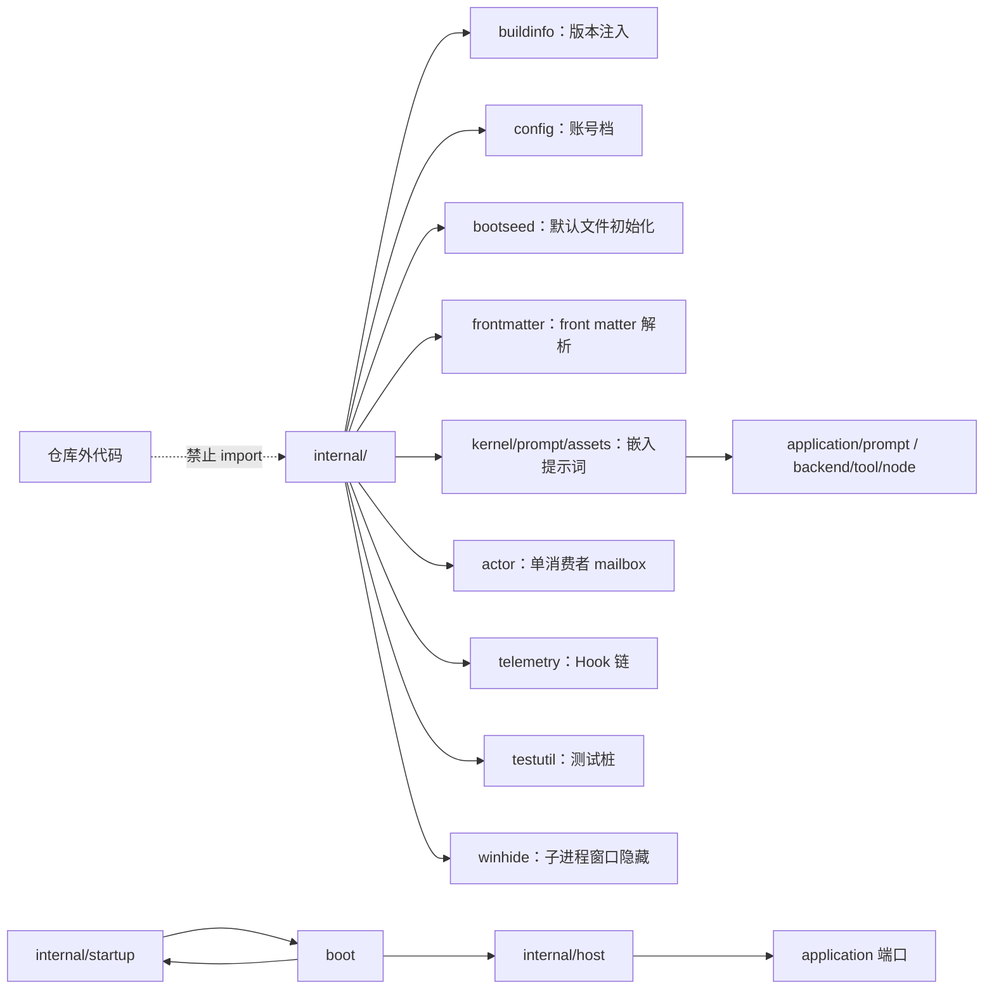

# Internal Packages

## 生态位

`internal/` 存放只允许本 module 使用的基础实现。这里的代码不能被仓库外 import，也不应包含面向产品的 Application 用例。

当前子模块：

- [`actor/`](actor/README.md)：有界单消费者 actor/mailbox 底座。
- [`bootseed/`](bootseed/README.md)：内嵌默认配置与工具骨架的初始化。
- [`buildinfo/`](buildinfo/README.md)：构建期注入的版本与默认前端。
- [`config/`](config/README.md)：账号档的加载、校验、编辑与原子写。
- [`docker/`](docker/README.md)：Docker daemon 探测与恢复提示。
- [`frontmatter/`](frontmatter/README.md)：Markdown YAML front matter 解析。
- [`host/`](host/README.md)：Application 窄端口到 Runtime/Store/Engine 的宿主适配。
- [`jsonobj/`](jsonobj/README.md)：保持结构的 JSON 对象处理。
- [`model/`](model/README.md)：内部领域模型。
- [`stablehash/`](stablehash/README.md)：稳定、跨进程一致的标识/哈希。
- [`startup/`](startup/README.md)：启动参数、模式、配置路径和 Plugin 根责任链。
- [`stream/`](stream/README.md)：流式模型与账号租约适配。
- [`telemetry/`](telemetry/README.md)：遥测、阶段、摘要和诊断 Hook 链。
- [`testutil/`](testutil/README.md)：仅测试使用的共享桩（EmbeddedChatEngine 等）。
- [`winhide/`](winhide/README.md)：Windows 子进程控制台窗口隐藏（非 Windows 空操作）。

新增 internal 包前应确认它确实被多个内部模块复用；只被单一模块使用的 helper 优先留在拥有者目录。

## 依赖方向

`internal/startup` 服务入口和 `boot`；`internal/host` 是 Application 端口到具体实现的
宿主适配层；其余叶子包只提供通用机制。任何 internal 包都不得被 Application、
Backend、Kernel 或 Store 反向依赖，也不得持有跨层业务状态机。

`internal/bootseed` 与 `kernel/prompt/assets` 分工不同：前者负责“何时、向哪里初始化
默认文件”，后者拥有提示词资产及按文件回退的唯一实现。

## 架构图



## Review 指南

- 新增包是否真的被多个内部模块复用，是否只是某个领域的第二份 helper。
- 是否把可被仓库外依赖的稳定契约放进 `internal/`。
- `startup` 是否新增第二份 flag/路径词表；`host` 是否开始承载业务判据。
- 含中文的生成脚本是否先落盘为 UTF-8 文件执行。

## 测试与验证

```text
go test ./internal/... -count=1
go test ./e2e/ -run 'Readme|Boundary' -count=1
```
