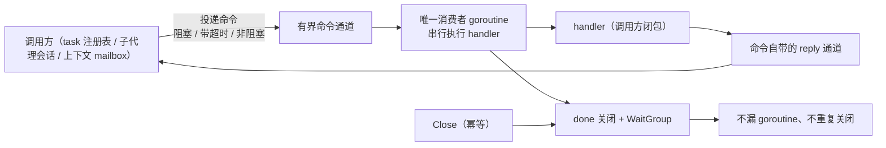
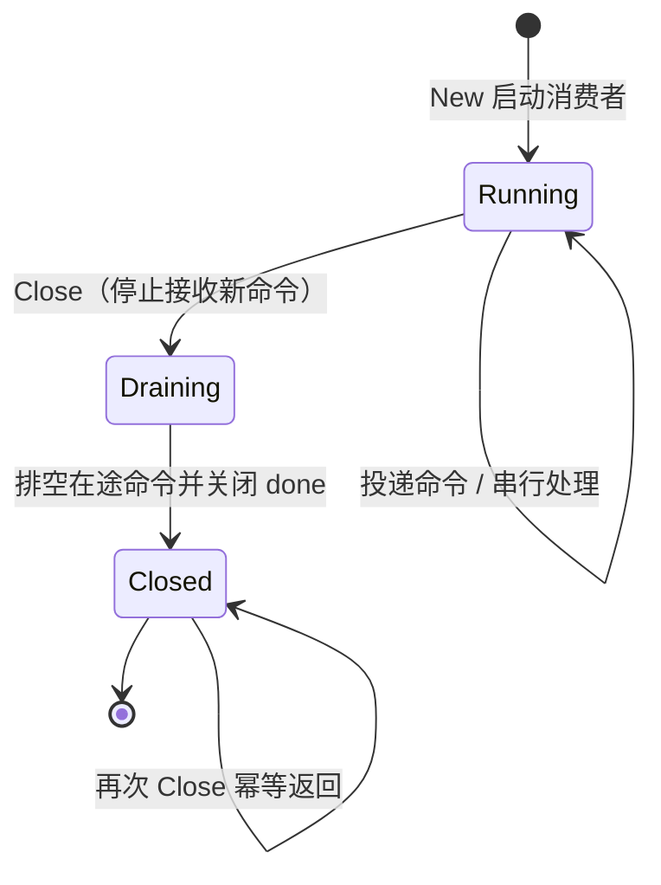

# internal/actor

## 生态位

`internal/actor` 是 seelebridge 内部的**单消费者 actor 底座**：
统一"有界命令通道 + 唯一消费者 goroutine + done 关闭 + WaitGroup + 带超时
投递 + 幂等 Close"这套样板，供 task 注册表、子代理会话/上下文等 mailbox
actor 复用。handler 由调用方闭包提供，回复类型域相关由命令自身携带。

## 职责与非职责

- 职责：命令投递（阻塞/超时/非阻塞）、单消费者串行不变量、关闭与等待。
- 非职责：不感知命令语义、不管理回复类型、不做业务状态迁移。命令的
  reply 通道由各域命令结构携带，handler 负责写回复。

## 架构图



## 生命周期状态



## 核心实现

```go
type Actor[T any] struct {
	mailbox   chan T
	done      chan struct{}
	closeOnce sync.Once
	wg        sync.WaitGroup
}
```

- `New[T](handler func(T), opts...)`：创建并启动消费者 goroutine（默认
  通道容量 256，`WithCap(0)` 无缓冲）。
- `Send` / `SendTimeout` / `TrySend`：阻塞 / 带超时 / 非阻塞投递，actor
  关闭后一律快返 false。
- `Done()`：关闭信号，供调用方在回复等待中 select 快返。
- `Close()`：幂等关闭；`Wait()`：等待消费者 goroutine 退出。

## 使用方式

```go
type registry struct {
	actor *actor.Actor[cmd]
}

func newRegistry() *registry {
	r := &registry{}
	r.actor = actor.New(r.handle, actor.WithCap(256))
	return r
}

func (r *registry) handle(cmd cmd) {
	if cmd.reply != nil {
		cmd.reply <- r.apply(cmd)
	}
}
```

## 依赖方向

- 不依赖任何域包；`sync`/`time` 仅标准库。
- 各域 actor 依赖本包，本包禁止反向依赖。

## 扩展方式

新 actor 直接复用底座，只写命令类型 + handler；不要再次手写 channel/done/
wg 样板。锁/ticker 驱动的串行化组件（如 `scheduler.State`、`fs` 写路径、
`SubagentTree`）保持现有锁实现，不强行改造成 mailbox。

## Review 指南

- handler 是否只访问 actor goroutine 内状态（避免跨 goroutine 竞争）？
- reply 通道是否带缓冲（cap ≥ 1）且 handler 不阻塞？
- Close 后是否仍有调用方投递（应快返 false 而非 panic）？

## 测试与验证

`go test ./internal/actor -count=1`；并发路径由
`fork_concurrency_*`、`merge_back_concurrency_test.go`、
`subagent_audit_test.go` 等既有测试护航。

## 文件与函数索引

> 由源码 doc 注释自动提取（首行摘要）；描述源码行为，与实现保持同步。
> 刷新方式：`python scripts/gen_core_readme_index.py`。

### actor.go

- `func WithCap(cap int) Option` — WithCap 设置命令通道容量（0 = 无缓冲；默认 256）。
- `func New[T any](handler func(T), options ...Option) *Actor[T]` — New 构造并启动 actor：handler 在单一 goroutine 内串行处理每条命令。
- `func (a *Actor[T]) Send(command T) bool` — Send 投递命令（阻塞直到入队；actor 已关闭返回 false）。
- `func (a *Actor[T]) SendTimeout(command T, timeout time.Duration) bool` — SendTimeout 投递命令（上限 timeout；超时或 actor 已关闭返回 false）。
- `func (a *Actor[T]) TrySend(command T) bool` — TrySend 非阻塞投递（通道满或 actor 已关闭返回 false）。
- `func (a *Actor[T]) Done() <-chan struct` — Done 返回 actor 关闭信号（调用方可在回复等待中 select 快返）。
- `func (a *Actor[T]) Close()` — Close 幂等关闭：close(done)，消费者 goroutine 处理完当前命令后退出。
- `func (a *Actor[T]) Wait()` — Wait 等待消费者 goroutine 退出（应在 Close 之后调用）。

### actor_test.go

- `func TestActorSerializesCommands(t *testing.T)` — TestActorSerializesCommands 验证命令在单消费者 goroutine 内串行处理且
- `func TestActorReplyRoundTrip(t *testing.T)` — TestActorReplyRoundTrip 验证命令自带回复通道的完整往返（Send + 回复等待
- `func TestActorSendAfterClose(t *testing.T)` — TestActorSendAfterClose 验证关闭后 Send/SendTimeout/TrySend 全部快返 false。
- `func TestActorCloseIsIdempotent(t *testing.T)` — TestActorCloseIsIdempotent 验证 Close 幂等且 Wait 在 Close 后返回。
- `func TestActorTrySendFullNonBlocking(t *testing.T)` — TestActorTrySendFullNonBlocking 验证通道满时 TrySend 立即返回 false。
- `func TestActorConcurrentSenders(t *testing.T)` — TestActorConcurrentSenders 验证并发投递安全（多生产者单消费者）。
