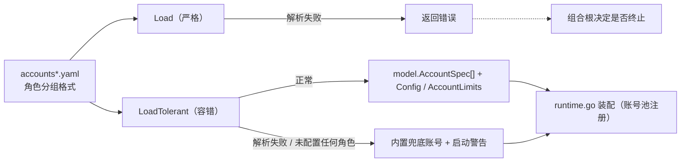

# Config

## 生态位

`internal/config` 承载简化账号 YAML（accounts*.yaml 角色分组格式）
的加载：产出账号规格（`model.AccountSpec`）与 Seelex 侧上下文/输出预算
（`Config`/`AccountLimits`）。属于根 facade 的装配细节（仅 runtime.go 使用），
置于 internal/；根包直接 import 使用（`runtime_account.go` 的
`currentAccountLimits` 委托 account.Manager），不再有重导出层。

## 容错加载

`Load` 保持严格：YAML 解析失败或未配置任何角色时返回错误。`LoadTolerant`
在同一失败场景下返回内置兜底账号配置，并把原始错误作为非致命启动警告交还
调用方——配置写错时应用照常启动，错误原因由 GUI/TUI 展示，而不是启动即退出。
配置文件缺失仍视为正常回退（无警告）。

兜底规格带 `Fallback=true`，快照据此提示“当前不是用户配置的账号”。角色解析只在
角色块缺失时回退 `agent`；角色块存在但没有可用 `api_key` 会显式报错，不会跨角色
借用另一把密钥。

## 数据流图



## 手动添加账号（accounts_write.go）

`AddAccount(path, NewAccountInput) (name, error)` 是界面「设置 → 账户 → 添加」的落盘路径，
判据三条：

1. **行级插入，不重排文件**。账号档是用户手写、带注释的配置；yaml.v3 的 Node 往返虽保留注释，
   却会按自己的缩进规则重排每个序列条目（`  - model:` → `    - model:`），造成全文件 diff。
   所以只往角色块尾追加一段条目文本，其余字节一个不动（换行风格 CRLF/LF 也跟随原文件）。
2. **插入点按结构定位**：`roles:` → `  <role>:` → 该块最后一条内容行。条目与角色键同缩进
   （`  - model:`）也属于该块——这正是 yaml.v3 写块序列的既有形状。角色块写成行内 flow
   风格时明确报错不写（否则会插出第二个同名键）。
3. **落盘前用真实加载器复核**：插入后的整份字节再走 `parseAccounts`（与 `Load` 同一条代码），
   要求"该角色账号数 +1"且"新条目的字段与输入逐字相符"。任何一项不符即放弃写入，配置不会
   停在半改状态。写盘是同目录临时文件 → 原子替换（权限沿用原文件，新建 0600）。

名字由加载器按位置推导（`agent-2`），`AddAccount` 只把它**回传**给界面，不自己编序号。
"读 → 插 → 复核 → 写"整段由包内互斥量串行化：并发两次添加会读到同一份文件、算出同一个
序号，后写的覆盖先写的（用户看到"加了两条只剩一条"）。跨进程写入不在本层处理——那种情况
由插入后的整份复核把"读到的不是我以为的那份"暴露成错误。

## 账号并发租约

账号条目可选 `max_concurrency`（必须 > 0），按角色有默认值：`agent` 与
`goalplan` 为 1（主会话/规划路径受 Session 单锁约束，租约仅作兜底）；
`subagent` 为高水位 1024——subagent 只是“角色 + 模型供应商”，框架不再设
实用并发上限（2026-09-07），实际在途请求由供应商/API 限流与 429 重试
约束。显式 `max_concurrency` 覆盖角色默认值；零值在 Load 时返回错误
（上游 accountpool Register 要求正数）。

## 验证

```text
go test ./internal/config -count=1
```

`accounts_write_test.go` 钉的是写入器的四条判据：只追加不重排（落盘内容与期望逐字比较）、
缺失角色块/缺失文件/空文件各自的建块路径、CRLF 不被改写、以及"校验失败或解析失败时文件
字节一个不变"（不以半改状态收场）。

## 文件与函数索引

> 由源码 doc 注释自动提取（首行摘要）；描述源码行为，与实现保持同步。
> 刷新方式：`python scripts/gen_core_readme_index.py`。

### accounts_write.go

- `func AddAccount(path string, input NewAccountInput) (string, error)` — AddAccount 把一个新账号追加进账号档并返回它**生效的名字**（`<role>-<序号>`，序号由加载器按条目位置推导，本函数不自己编）。
- `func AccountRoles() []string` — AccountRoles 返回可手动添加的角色名（界面下拉的数据源；词表本体在 contract/dto）。

### accounts_write_test.go

- `func TestAddAccountAppendsIntoExistingRoleBlock(t *testing.T)`
- `func TestAddAccountCreatesMissingRoleBlock(t *testing.T)`
- `func TestAddAccountCreatesFileWhenMissing(t *testing.T)`
- `func TestAddAccountKeepsCRLF(t *testing.T)`
- `func TestAddAccountRefusesWithoutTouchingFile(t *testing.T)`
- `func TestAddAccountRefusesBrokenFile(t *testing.T)`
- `func TestAddAccountRefusesFlowStyleRole(t *testing.T)`
- `func TestAddAccountRepeatedlyKeepsOrdering(t *testing.T)`
- `func TestAddAccountBlankFile(t *testing.T)`
- `func TestAddAccountConcurrentAddsDoNotLoseEntries(t *testing.T)`

### config.go

- `func Load(path string) (Config, error)` — Load reads the role-grouped accounts.yaml format and builds the account
- `func LoadTolerant(path string) (Config, error)` — LoadTolerant 与 Load 相同，但配置损坏（YAML 解析失败、账号字段非法）或
- `func fallbackConfig() Config`
- `func resolveAccountLimits(defaults simplifiedDefaults, account simplifiedAccount) (AccountLimits, error)` — resolveAccountLimits 解出账号的窗口与输出预留。
- `func resolveTemperature(defaults simplifiedDefaults, account simplifiedAccount) (float64, error)` — resolveTemperature 解析账号采样温度：账号级 > defaults 级 > 代码默认
- `func resolveReasoningEffort(defaults simplifiedDefaults, account simplifiedAccount, role model.AccountRole) (string, error)` — resolveReasoningEffort 解析账号的思考强度（reasoning effort）：
- `func firstNonEmpty(values ...string) string`

### config_concurrency_test.go

- `func TestRoleDefaultConcurrency(t *testing.T)` — TestRoleDefaultConcurrency verifies the 2026-09-07 role-aware defaults:
- `func TestExplicitZeroConcurrencyRejected(t *testing.T)` — TestExplicitZeroConcurrencyRejected guards the upstream accountpool contract

### config_example_test.go

- `func TestShippedAccountsExampleLoads(t *testing.T)` — TestShippedAccountsExampleLoads 钉住"发行示例永远可装载"。
- `func TestShippedAccountsExampleCarriesNoRuntimeConfig(t *testing.T)` — TestShippedAccountsExampleCarriesNoRuntimeConfig 钉住 2026-10-15 的口径：**账号档只放

### config_reasoning_effort_test.go

- `func specFor(t *testing.T, cfg Config, role model.AccountRole) model.AccountSpec` — specFor 取某个角色的账号规格（测试里反复要用）。
- `func TestLoadReasoningEffortRoleDefaults(t *testing.T)` — TestLoadReasoningEffortRoleDefaults 钉住"什么都没配"时的角色分档：
- `func TestLoadReasoningEffortPrecedence(t *testing.T)` — TestLoadReasoningEffortPrecedence 钉住三级优先序：账号级 > defaults > 角色默认。
- `func TestLoadRejectsInvalidReasoningEffort(t *testing.T)` — TestLoadRejectsInvalidReasoningEffort：不认识的强度在装载期就报错，

### config_temperature_test.go

- `func writeAccountsYAML(t *testing.T, body string) string`
- `func TestLoadResolvesTemperaturePerAccount(t *testing.T)` — TestLoadResolvesTemperaturePerAccount 钉住"每个账号独立配置"：
- `func TestLoadDefaultsTemperatureWhenUnset(t *testing.T)` — TestLoadDefaultsTemperatureWhenUnset：两级都没写 → 代码默认。
- `func TestLoadRejectsTemperatureOutOfRange(t *testing.T)` — TestLoadRejectsTemperatureOutOfRange：范围外的温度在装载期就报错，而不是把

### config_test.go

- `func TestLoadTolerantInvalidYAMLReturnsFallbackAndWarning(t *testing.T)` — TestLoadTolerantInvalidYAMLReturnsFallbackAndWarning 与真实事故同构：
- `func TestLoadTolerantNoRolesReturnsFallbackAndWarning(t *testing.T)`
- `func TestLoadTolerantMissingFileFallsBackWithoutWarning(t *testing.T)`

