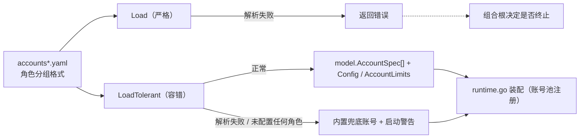

# Config

## 生态位

`internal/config` 承载简化账号 YAML（accounts*.yaml 角色分组格式）
的加载：产出账号规格（`model.AccountSpec`）与 Seelex 侧上下文/输出预算
（`Config`/`AccountLimits`）。属于根 facade 的装配细节（仅 runtime.go 使用），
置于 internal/；根包直接 import 使用（`runtime_account.go` 的
`currentAccountLimits` 委托 account.Manager），不再有重导出层。

## 容错加载

`Load` 保持严格：YAML 解析失败或未配置任何角色时返回错误。`LoadTolerant`
在同一失败场景下返回内置兜底账号配置，并把原始错误作为非致命启动警告交还
调用方——配置写错时应用照常启动，错误原因由 GUI/TUI 展示，而不是启动即退出。
配置文件缺失仍视为正常回退（无警告）。

兜底规格带 `Fallback=true`，快照据此提示“当前不是用户配置的账号”。角色解析只在
角色块缺失时回退 `agent`；角色块存在但没有可用 `api_key` 会显式报错，不会跨角色
借用另一把密钥。

## 数据流图



## 账号增删改查（accounts_write.go）

`AddAccount` / `ReadAccount` / `UpdateAccount` / `DeleteAccount` 是角色卡下账户管理的
落盘路径。四条链路都只做目标条目的行级改动，判据如下：

1. **行级插入，不重排文件**。账号档是用户手写、带注释的配置；yaml.v3 的 Node 往返虽保留注释，
   却会按自己的缩进规则重排每个序列条目（`  - model:` → `    - model:`），造成全文件 diff。
   所以新增只在角色块尾追加，编辑只替换目标条目，删除只移除目标条目；换行风格跟随原文件。
2. **插入点按结构定位**：`roles:` → `  <role>:` → 该块最后一条内容行。条目与角色键同缩进
   （`  - model:`）也属于该块——这正是 yaml.v3 写块序列的既有形状。角色块写成行内 flow
   风格时明确报错不写（否则会插出第二个同名键）。
3. **落盘前用真实加载器复核**：插入后的整份字节再走 `parseAccounts`（与 `Load` 同一条代码），
   要求"该角色账号数 +1"且"新条目的字段与输入逐字相符"。任何一项不符即放弃写入，配置不会
   停在半改状态。写盘是同目录临时文件 → 原子替换（权限沿用原文件，新建 0600）。

旧手写条目可省略 `name:`，加载器继续按角色内位置推导 `agent-2`；界面新增或第一次
编辑/删除某个角色时，会把该角色现有名字冻结为显式 `name:`，避免删掉前一条后其余
账号因位置重排而“改名复活”。`UpdateAccount` 的 `api_key` 留空表示保留旧密钥；删除
最后一条全局账号会被拒绝（账号档不能变成零凭据）。`ReadAccount` 返回账号条目里
**实际写着的** provider / base_url / reasoning_effort，而不是 defaults 解析后的值，
所以打开编辑再保存不会把“继承 defaults”意外钉死。整段读改写由包内互斥量串行化。

## 账号并发租约

账号条目可选 `max_concurrency`（必须 > 0），按角色有默认值：`agent` 与
`goalplan` 为 1（主会话/规划路径受 Session 单锁约束，租约仅作兜底）；
`subagent` 为高水位 1024——subagent 只是“角色 + 模型供应商”，框架不再设
实用并发上限（2026-09-07），实际在途请求由供应商/API 限流与 429 重试
约束。显式 `max_concurrency` 覆盖角色默认值；零值在 Load 时返回错误
（上游 accountpool Register 要求正数）。

## 验证

```text
go test ./internal/config -count=1
```

`accounts_write_test.go` 钉的是写入器的四条判据：只追加不重排（落盘内容与期望逐字比较）、
缺失角色块/缺失文件/空文件各自的建块路径、CRLF 不被改写、以及"校验失败或解析失败时文件
字节一个不变"（不以半改状态收场）。

## 文件与函数索引

> 由源码 doc 注释自动提取（首行摘要）；描述源码行为，与实现保持同步。
> 刷新方式：`python scripts/gen_core_readme_index.py`。

### accounts_write.go

- `func AccountRoles() []string` — AccountRoles 返回可手动添加的角色名（界面下拉的数据源；词表本体在 contract/dto）。
- `func normalizeAccountRole(role string) (model.AccountRole, error)` — normalizeAccountRole 校验收敛角色名；未知返回错误而不是猜一个默认值。
- `func AddAccount(path string, input NewAccountInput) (string, error)` — AddAccount 把一个新账号追加进账号档并返回它**生效的名字**（`<role>-<序号>`，
- `func ReadAccount(path, name string) (AccountRecord, error)` — ReadAccount 读取一个账号的非秘密字段。
- `func UpdateAccount(path string, input UpdateAccountInput) (AccountRecord, error)` — UpdateAccount 原位更新一条账号，保留条目外的注释与其它账号字节。
- `func DeleteAccount(path, name string) (AccountRecord, error)` — DeleteAccount 删除一条账号；删除前先把该角色现有名字冻结，避免后续条目因位置
- `func (entry pendingAccount) entryLines(itemIndent int) []string` — entryLines 按 accounts.yaml 既有条目的字段顺序渲染这条账号（新行插在角色块尾，
- `func yamlScalar(value string) string` — yamlScalar 渲染一个标量值：能裸写就裸写（与手写条目同形），不能就双引号转义。
- `func readAccountsFile(path string) (raw []byte, mode os.FileMode, exists bool, err error)` — readAccountsFile 读账号档；报告文件是否存在、原始权限位（新建时 0600）。
- `func insertAccountEntry(raw []byte, blank bool, entry pendingAccount) ([]byte, error)` — insertAccountEntry 把一条账号条目插进角色块尾，返回新的整份字节。
- `func isFlowRoleKey(line, roleKey string) bool` — isFlowRoleKey 报告某一行是不是"角色键与值写在同一行"的 flow 写法
- `func rolesEnd(lines []string, rolesIndex int) int` — rolesEnd 返回 roles 块之后的第一行下标（块内 = 非空、非注释、缩进 > 0）。
- `func roleBlockEnd(lines []string, roleIndex, roleIndent int) int` — roleBlockEnd 返回角色块之后的第一行下标。
- `func joinInsert(lines []string, insertAt int, newLines []string, eol string, trailingNewline bool) []byte` — joinInsert 把 newLines 插到 insertAt 之前（insertAt == len 即追加到文件尾）。
- `func leadingSpaces(line string) int`
- `func verifyInsertedAccount(updated []byte, before Config, role model.AccountRole, entry pendingAccount) (string, error)` — verifyInsertedAccount 用真实加载器复核插入结果，并返回新账号的名字。
- `func accountSpecByName(specs []model.AccountSpec, name string) *model.AccountSpec`
- `func nextAccountName(specs []model.AccountSpec, role model.AccountRole) string`
- `func accountRecordFromSpec(spec model.AccountSpec) AccountRecord`
- `func splitAccountLines(raw []byte) ([]string, string, bool)`
- `func joinAccountLines(lines []string, eol string, trailing bool) []byte`
- `func replaceLineRange(lines []string, start, end int, replacement []string) []string`
- `func removeLineRange(lines []string, start, end int) []string`
- `func trimItemTail(lines []string, start, end int) int` — trimItemTail 保留条目与下一条之间的空行和注释（它们可能是下一条的说明），
- `func locateRoleItems(lines []string, role model.AccountRole) (roleIndex, roleIndent, roleEnd int, starts []int, err error)`
- `func freezeRoleAccountNames(lines []string, role model.AccountRole, specs []model.AccountSpec) ([]string, error)`
- `func hasAccountField(lines []string, prefix string) bool`
- `func findAccountItem(lines []string, role model.AccountRole, name string) (start, end, itemIndent int, err error)`
- `func sameRoleAccountNames(before, after []model.AccountSpec, role model.AccountRole) bool`
- `func countRole(specs []model.AccountSpec, role model.AccountRole) int`
- `func writeFileAtomic(path string, data []byte, mode os.FileMode) error` — writeFileAtomic 同目录临时文件 + 原子替换（权限沿用原文件的权限位）。

### accounts_write_test.go

- `func writeFixture(t *testing.T, name, body string) string` — writeFixture 在临时目录里摆一份"用户手写、带注释"的账号档。
- `func TestAddAccountAppendsIntoExistingRoleBlock(t *testing.T)` — TestAddAccountAppendsIntoExistingRoleBlock 是这条链路的主判据：新条目插进目标角色
- `func TestAddAccountCreatesMissingRoleBlock(t *testing.T)` — TestAddAccountCreatesMissingRoleBlock 覆盖"这个角色还没有块"的路径：在 roles 块尾
- `func TestAddAccountCreatesFileWhenMissing(t *testing.T)` — TestAddAccountCreatesFileWhenMissing 覆盖"账号档不存在"：按最小骨架新建，
- `func TestAddAccountKeepsCRLF(t *testing.T)` — TestAddAccountKeepsCRLF 覆盖 Windows 手写文件：换行风格不因插入而被改写。
- `func TestAddAccountRefusesWithoutTouchingFile(t *testing.T)` — TestAddAccountRefusesWithoutTouchingFile 是"校验失败绝不落盘"的一组判据：
- `func TestAddAccountRefusesBrokenFile(t *testing.T)` — TestAddAccountRefusesBrokenFile：解析不了的文件不覆盖（用户的现场可能有救）。
- `func TestAddAccountRefusesFlowStyleRole(t *testing.T)` — TestAddAccountRefusesFlowStyleRole：行内写法没法行级插入，必须明确拒绝而不是
- `func TestAddAccountRepeatedlyKeepsOrdering(t *testing.T)` — TestAddAccountRepeatedlyKeepsOrdering：连加两条，名字按位置递增，条目顺序就是
- `func TestAddAccountBlankFile(t *testing.T)` — TestAddAccountBlankFile 覆盖"文件在但内容为空"：与缺失同处置（骨架新建）。
- `func TestAddAccountConcurrentAddsDoNotLoseEntries(t *testing.T)` — TestAddAccountConcurrentAddsDoNotLoseEntries：并发添加不能丢条目。
- `func TestUpdateAccountChangesOnlyTargetAndKeepsBlankAPIKey(t *testing.T)`
- `func TestDeleteAccountKeepsRemainingNamesStable(t *testing.T)`
- `func findSpec(cfg Config, name string) (model.AccountSpec, error)`

### config.go

- `func Load(path string) (Config, error)` — Load reads the role-grouped accounts.yaml format and builds the account
- `func parseAccounts(data []byte) (Config, error)` — parseAccounts 是 Load 的可测内核（字节进、配置出）：界面「手动添加账号」要在
- `func LoadTolerant(path string) (Config, error)` — LoadTolerant 与 Load 相同，但配置损坏（YAML 解析失败、账号字段非法）或
- `func fallbackConfig() Config`
- `func resolveAccountLimits(defaults simplifiedDefaults, account simplifiedAccount) (AccountLimits, error)` — resolveAccountLimits 解出账号的窗口与输出预留。
- `func resolveTemperature(defaults simplifiedDefaults, account simplifiedAccount) (float64, error)` — resolveTemperature 解析账号采样温度：账号级 > defaults 级 > 代码默认
- `func resolveReasoningEffort(defaults simplifiedDefaults, account simplifiedAccount, role model.AccountRole) (string, error)` — resolveReasoningEffort 解析账号的思考强度（reasoning effort）：
- `func firstNonEmpty(values ...string) string`

### config_concurrency_test.go

- `func TestRoleDefaultConcurrency(t *testing.T)` — TestRoleDefaultConcurrency verifies the 2026-09-07 role-aware defaults:
- `func TestExplicitZeroConcurrencyRejected(t *testing.T)` — TestExplicitZeroConcurrencyRejected guards the upstream accountpool contract

### config_example_test.go

- `func TestShippedAccountsExampleLoads(t *testing.T)` — TestShippedAccountsExampleLoads 钉住"发行示例永远可装载"。
- `func TestShippedAccountsExampleCarriesNoRuntimeConfig(t *testing.T)` — TestShippedAccountsExampleCarriesNoRuntimeConfig 钉住 2026-10-15 的口径：**账号档只放

### config_reasoning_effort_test.go

- `func specFor(t *testing.T, cfg Config, role model.AccountRole) model.AccountSpec` — specFor 取某个角色的账号规格（测试里反复要用）。
- `func TestLoadReasoningEffortRoleDefaults(t *testing.T)` — TestLoadReasoningEffortRoleDefaults 钉住"什么都没配"时的角色分档：
- `func TestLoadReasoningEffortPrecedence(t *testing.T)` — TestLoadReasoningEffortPrecedence 钉住三级优先序：账号级 > defaults > 角色默认。
- `func TestLoadRejectsInvalidReasoningEffort(t *testing.T)` — TestLoadRejectsInvalidReasoningEffort：不认识的强度在装载期就报错，

### config_temperature_test.go

- `func writeAccountsYAML(t *testing.T, body string) string`
- `func TestLoadResolvesTemperaturePerAccount(t *testing.T)` — TestLoadResolvesTemperaturePerAccount 钉住"每个账号独立配置"：
- `func TestLoadDefaultsTemperatureWhenUnset(t *testing.T)` — TestLoadDefaultsTemperatureWhenUnset：两级都没写 → 代码默认。
- `func TestLoadRejectsTemperatureOutOfRange(t *testing.T)` — TestLoadRejectsTemperatureOutOfRange：范围外的温度在装载期就报错，而不是把

### config_test.go

- `func TestLoadTolerantInvalidYAMLReturnsFallbackAndWarning(t *testing.T)` — TestLoadTolerantInvalidYAMLReturnsFallbackAndWarning 与真实事故同构：
- `func TestLoadTolerantNoRolesReturnsFallbackAndWarning(t *testing.T)`
- `func TestLoadTolerantMissingFileFallsBackWithoutWarning(t *testing.T)`
