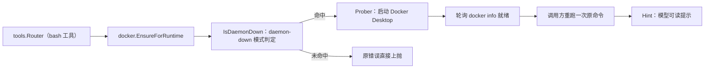

# internal/docker 域

## 生态位

承载 Docker 守护进程自动恢复（2026-08-07 根治）：bash 工具失败且错误匹配
daemon-down 模式 → 自动启动 Docker Desktop → 轮询就绪 → 调用方重跑一次
命令。主要调用方：`tools.Router`（经 Deps 闭包）。

## 职责与非职责

- 职责：`IsDaemonDown` 模式判定、`CLIPath` 定位、`Prober` 探测/启动、
  `EnsureDaemon`/`EnsureForRuntime` 恢复编排、`Hint` 模型可读提示。
- 非职责：容器编排/镜像管理等 docker 业务能力。

## 与其它域的关系

只做「恢复守护进程」这一件事：容器编排、镜像管理等 docker 业务能力不在此域。

## 核心实现

- `RealProber`：`docker info` 快速探测 + Windows 启动路径（CLI 优先，
  回退 Docker Desktop.exe）。
- `EnsureForRuntime`：按 limits 的 disable/start-timeout 配置执行恢复。

## 数据流

bash 失败 → Router 判定 daemon-down → EnsureForRuntime → Start → 轮询 Up →
重跑一次命令；仍失败附加 Hint。

## 依赖方向

允许依赖：`security`（FileExists/ConfigureHiddenCommand）。禁止依赖：
seelebridge 根包及其它域。

## 并发、存储、安全

无共享状态（测试可覆盖 CLILookup/fixedPaths 注入缝）；命令隐藏窗口防弹窗。

## 扩展方式

新增平台启动路径：扩展 `RealProber.Start`；新增判定模式：
`daemonDownMarkers`。

## Review 指南

- daemon-down 误判是否会导致无关失败被自动恢复；非 Windows 是否显式报错。

## 测试与验证

`go test ./internal/docker/...`（纯函数测试随域迁移）。

## 文件与函数索引

> 由源码 doc 注释自动提取（首行摘要）；描述源码行为，与实现保持同步。
> 刷新方式：`python scripts/gen_core_readme_index.py`。

### docker.go

- `func IsDaemonDown(stdout, stderr string) bool` — IsDaemonDown 判断 bash 命令的失败输出是否指向 docker 守护进程
- `func CLIPath() string` — CLIPath 定位 docker CLI：PATH 优先，回退 Docker Desktop 固定路径。
- `func RealProber() Prober` — RealProber 是生产探针：docker info 快速探测 + Windows 启动路径。
- `func EnsureDaemon(ctx context.Context, prober Prober, waitTimeout time.Duration) error` — EnsureDaemon 确保守护进程就绪：未就绪 → Start → 轮询 Up 直到
- `func EnsureForRuntime(ctx context.Context, disableAutoStart bool, startTimeoutSec int, probe Prober) error` — EnsureForRuntime 是 Runtime 的接线面：按 limits 配置执行自动恢复
- `func Hint(startErr error) string` — Hint 生成模型可读的恢复说明（重跑仍失败时附加）。

### docker_test.go

- `func TestIsDaemonDown(t *testing.T)`
- `func TestCLIPathFallbacks(t *testing.T)`
- `func TestEnsureDaemonReadyImmediately(t *testing.T)`
- `func TestEnsureDaemonStartsAndWaits(t *testing.T)`
- `func TestEnsureDaemonStartFails(t *testing.T)`
- `func TestEnsureDaemonTimeout(t *testing.T)`
- `func TestHintMentionsRecovery(t *testing.T)`
