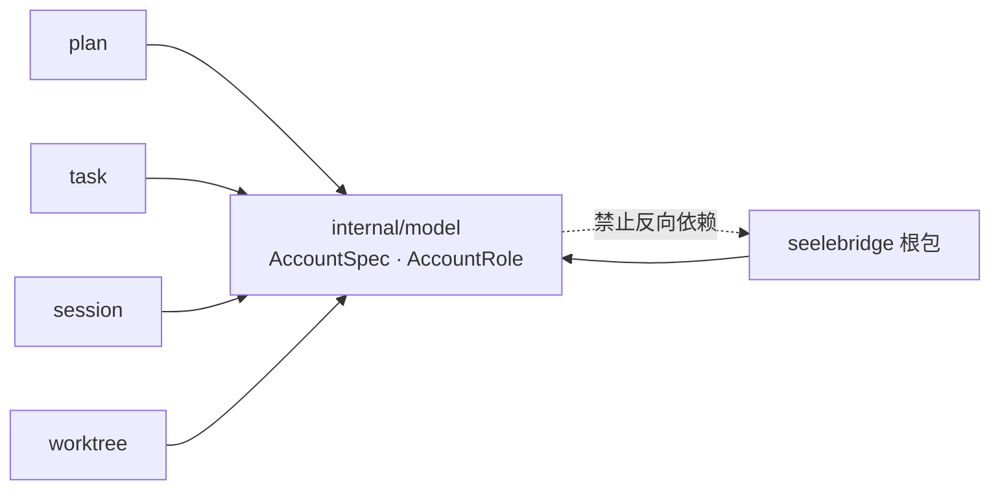

# Model

## 生态位

`internal/model` 承载 seelebridge 各域共享的纯类型（无运行时依赖），
供根包 facade 与 plan/worktree/task/session 等子包共同引用，避免跨包类型环。

## 依赖方向

它只放「多域都要用、且不依赖任何运行时」的形状；一旦某个类型只被单一域使用，
就应留在该域内，不进这里。

**SceneScope 的类型本体在 `contract/dto`**：权限判据
`backend/limit/policy.ClassForSceneScope` 要按现场作用域分主体类，而 `backend/limit`
只允许依赖契约层。本包不再保留 `SceneScope` 别名（NodeScope 退场时一并删除）。

> M4-F（2026-10-16）把本包上移到模块根 `internal/model` 后，`backend/*` 已能 import
> 本包；形状继续留在 `contract/dto` 的理由改为"权限判据与适配层共用的形状归契约层"，
> 别名与调用点不动（类型身份不变）。

## 文件与函数索引

> 由源码 doc 注释自动提取（首行摘要）；描述源码行为，与实现保持同步。
> 刷新方式：`python scripts/gen_core_readme_index.py`。

### account.go

- `func WireReasoningEffort(configured string) string` — WireReasoningEffort 把账号配置里的思考强度翻成"能不能直接上线"的值。
- `func DefaultReasoningEffortForRole(role AccountRole) string` — DefaultReasoningEffortForRole 见 dto.DefaultReasoningEffortForRole。
- `func ValidReasoningEffort(value string) bool` — ValidReasoningEffort 见 dto.ValidReasoningEffort。
- `func ReasoningEffortVocabulary() []string` — ReasoningEffortVocabulary 见 dto.ReasoningEffortVocabulary。
- `func FallbackRoles(role AccountRole) []AccountRole` — FallbackRoles 返回 role 的回退角色（未配置时回退主 agent 角色，
- `func AccountRoleFromName(name string) AccountRole` — AccountRoleFromName 从账号 ID 推断角色。唯一实现已下沉到 contract/dto，
- `func ResolveAccountSpec(specs []AccountSpec, role AccountRole) (AccountSpec, error)` — ResolveAccountSpec picks an account spec from the loaded config for the given

### account_test.go

- `func TestResolveAccountSpecDoesNotCrossRoleForCredential(t *testing.T)`
- `func TestResolveAccountSpecFallsBackOnlyWhenRoleBlockIsAbsent(t *testing.T)`
- `func TestResolveAccountSpecDoesNotUseUnrelatedRole(t *testing.T)`
