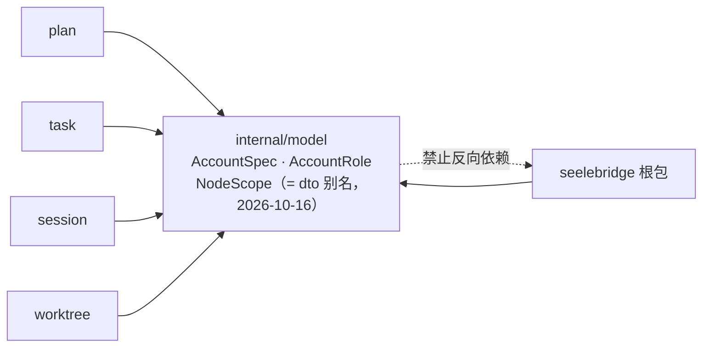

# Model

## 生态位

`internal/model` 承载 seelebridge 各域共享的纯类型（无运行时依赖），
供根包 facade 与 plan/worktree/task/session 等子包共同引用，避免跨包类型环。

## 依赖方向

它只放「多域都要用、且不依赖任何运行时」的形状；一旦某个类型只被单一域使用，
就应留在该域内，不进这里。

**NodeScope 的类型本体在 `contract/dto`**（2026-10-16 M2-C4 前置）：权限判据
`backend/limit/policy.ClassForNodeScope` 要按节点作用域分主体类，而 `backend/limit`
依 plan §1.2 只允许依赖契约层，本包当时又身在 `seelebridge/internal/`（Go 规则下
不允许被 `backend/*` import）。因此这里只留 `type NodeScope = dto.NodeScope` 与三个
函数变量的别名，调用点零改动、类型身份不变。

> M4-F（2026-10-16）把本包上移到模块根 `internal/model` 后，`backend/*` 已能 import
> 本包；形状继续留在 `contract/dto` 的理由改为"权限判据与适配层共用的形状归契约层"，
> 别名与调用点不动（类型身份不变）。
