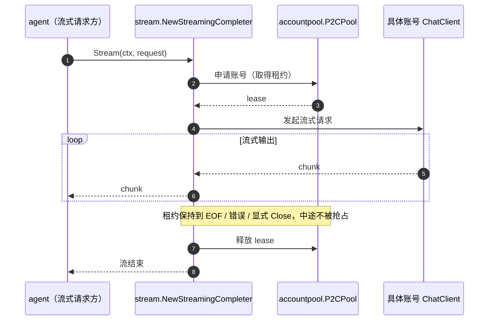

# Stream

## 生态位

`internal/stream` 承载流式账号 Completer 适配器
（`NewStreamingCompleter`）：把账号池的同步 Completer 适配为流式
`agent.StreamCompleter`，租约覆盖整条流直到 EOF/错误/Close 才释放。
属于根 facade 的装配细节（仅 runtime.go 装配使用），置于 internal/；
单元测试随包（`stream_test.go`），runtime 装配集成测试保留在根包
（`stream_integration_test.go`）。

## 时序图



## 验证

```text
go test ./internal/stream -count=1
```

## 文件与函数索引

> 由源码 doc 注释自动提取（首行摘要）；描述源码行为，与实现保持同步。
> 刷新方式：`python scripts/gen_core_readme_index.py`。

### stream.go

- `func NewStreamingCompleter(pool *accountpool.P2CPool[agent.Completer], selector bridge.AccountRequestSelector) agent.StreamCompleter` — NewStreamingCompleter 构造流式 Completer（pool 与可选账号选择器）。
- `func NewStreamingCompleterWithObserver( pool *accountpool.P2CPool[agent.Completer], selector bridge.AccountRequestSelector, observe RoutingObserver, ) agent.StreamCompleter` — NewStreamingCompleterWithObserver 与 NewStreamingCompleter 相同，另接一个
- `func (c *streamingAccountCompleter) CompleteStream( ctx context.Context, messages []types.Message, tools []types.Tool, onChunk func(string), ) (content string, reasoningContent string, toolCalls []types.ToolCall, err error)` — CompleteStream 取租约 → 流式调用 → 释放租约；账号资格失败时换号重试（有界）。
- `func (c *streamingAccountCompleter) streamWithLease( ctx context.Context, lease accountpool.ClientLease[agent.Completer], messages []types.Message, tools []types.Tool, onChunk func(string), ) (string, string, []types.ToolCall, error)` — streamWithLease 在一次租约内完成流式调用（含「账号只实现同步 Complete」的退化路径）。
- `func withExcludedAccounts(base accountpool.AcquireRequest, excluded map[string]bool) accountpool.AcquireRequest` — withExcludedAccounts 在请求上叠加「排除这些账号」的判据。
- `func withCancelCause(ctx context.Context, err error) error` — withCancelCause 在 ctx 因上游 cancel(cause) 中止时，把真实原因附加到错误文本。
- `func (c *streamingAccountCompleter) routingNotice( ctx context.Context, notice RoutingNotice, _ accountpool.ClientLease[agent.Completer], ) RoutingNotice` — routingNotice 把一次路由事实补全成 RoutingNotice：会话/节点定位来自请求
- `func unpinnedMultiAccount(pool *accountpool.P2CPool[agent.Completer]) bool` — unpinnedMultiAccount 报告「未固定账号且池里不止一个账号」：此时池的选定

### stream_routing_notice_test.go

- `func (o *collectingObserver) observe(notice RoutingNotice)`
- `func (o *collectingObserver) collected() []RoutingNotice`
- `func TestStreamingCompleterObservesFailover(t *testing.T)` — TestStreamingCompleterObservesFailover 钉住：账号资格失败换号时，观察者
- `func TestStreamingCompleterObservesUnpinnedSelection(t *testing.T)` — TestStreamingCompleterObservesUnpinnedSelection 钉住：请求未固定账号且池里
- `func TestStreamingCompleterRequestHookRole(t *testing.T)` — TestStreamingCompleterRequestHookRole 钉住 request 派发钩子的角色口径：
- `func TestStreamingCompleterSilentWithoutObserver(t *testing.T)` — TestStreamingCompleterSilentWithoutObserver 钉住：观察者为 nil 时路由事实

### stream_test.go

- `func newScriptedStreamCompleter() *scriptedStreamCompleter`
- `func (c *scriptedStreamCompleter) Complete(ctx context.Context, _ []types.Message, _ []types.Tool) (types.Message, error)`
- `func (c *scriptedStreamCompleter) CompleteStream(ctx context.Context, _ []types.Message, _ []types.Tool, _ func(string)) (string, string, []types.ToolCall, error)`
- `func (c *syncOnlyCompleter) Complete(_ context.Context, _ []types.Message, _ []types.Tool) (types.Message, error)`
- `func newStreamPool(t *testing.T, values map[string]agent.Completer) *accountpool.P2CPool[agent.Completer]`
- `func TestStreamingCompleterHoldsLeaseUntilEOF(t *testing.T)` — TestStreamingCompleterHoldsLeaseUntilEOF 验证租约覆盖整条流：
- `func TestStreamingCompleterReleasesLeaseOnStreamAbort(t *testing.T)` — TestStreamingCompleterReleasesLeaseOnStreamAbort 验证流被 ctx 取消中止时
- `func TestStreamingCompleterReleasesLeaseOnError(t *testing.T)` — TestStreamingCompleterReleasesLeaseOnError 验证错误退出也释放租约（幂等）。
- `func TestStreamingCompleterSelectorPinsAccount(t *testing.T)` — TestStreamingCompleterSelectorPinsAccount 验证共享选择器闭包生效。
- `func TestStreamingCompleterReportsCancelCause(t *testing.T)` — TestStreamingCompleterReportsCancelCause 钉住事故①：ctx 被上游 cancel(cause)
- `func TestStreamingCompleterReportsCancelCauseMidStream(t *testing.T)` — TestStreamingCompleterReportsCancelCauseMidStream 同上，但取消发生在流在途时
- `func TestStreamingCompleterFallsBackToSyncCompleter(t *testing.T)` — TestStreamingCompleterFallsBackToSyncCompleter 验证无流式能力的账号退化为单次返回。
- `func (c *staticStreamCompleter) Complete(context.Context, []types.Message, []types.Tool) (types.Message, error)`
- `func (c *staticStreamCompleter) CompleteStream(context.Context, []types.Message, []types.Tool, func(string)) (string, string, []types.ToolCall, error)`
- `func pinnedTo(id string) bridge.AccountRequestSelector`
- `func TestStreamingCompleterFailsOverOnQuotaRejection(t *testing.T)` — TestStreamingCompleterFailsOverOnQuotaRejection 钉住「第一志愿没额度 → 第二志愿」：
- `func TestStreamingCompleterDoesNotFailOverOnTransportError(t *testing.T)` — TestStreamingCompleterDoesNotFailOverOnTransportError 钉住换号的**边界**：
