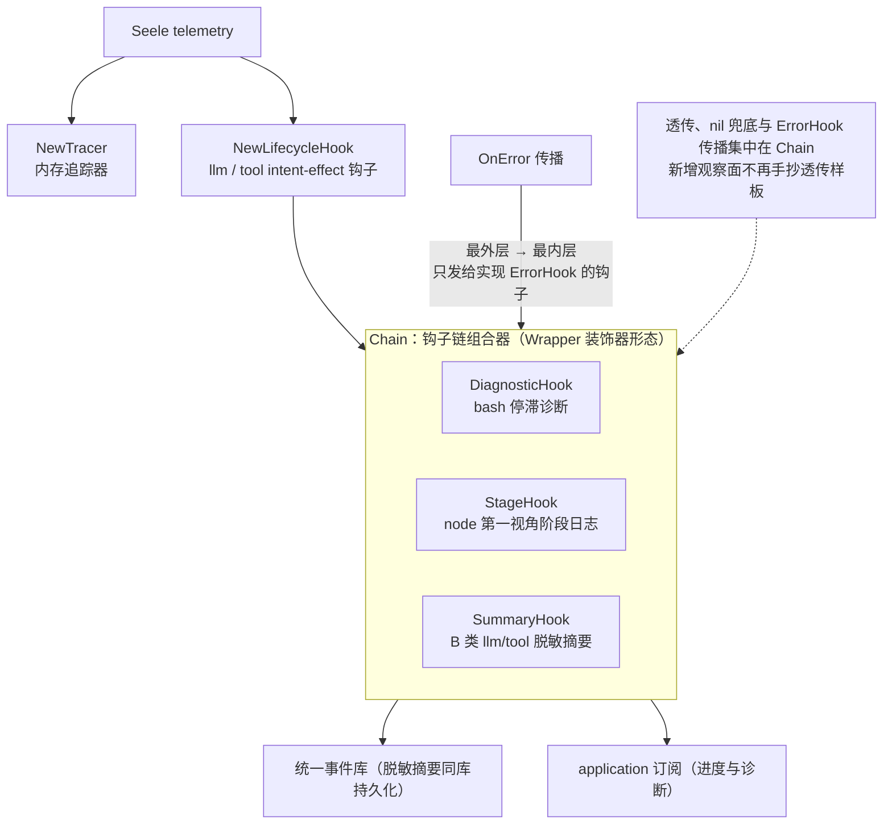

# Telemetry

## 生态位

`internal/telemetry` 承载内存遥测追踪器、生命周期钩子、
`Chain` 组合器与 `SummaryHook` 脱敏摘要的构造（薄封装 `Seele/telemetry`）。
属于根 facade 的装配细节，置于 internal/；根包以 `seeletelemetry` 别名直接
import 使用，不再有重导出层。

## 架构图



## 关键组件

- `NewTracer` / `NewLifecycleHook`：内存遥测追踪器与 llm/tool intent-effect
  钩子（薄封装）。
- `Chain`：telemetry 钩子链组合器（`Wrapper` 装饰器形态）。透传、nil 兜底
  与 `ErrorHook` 传播集中在 Chain，新增观察面不再手抄透传样板；`OnError`
  按最外层→最内层传播给所有实现 `ErrorHook` 的组成钩子（未实现的钩子不
  接收，也不应再为实现透传而实现 `ErrorHook`）。
- `DiagnosticHook` / `StageHook`：bash 停滞诊断 / node 第一视角阶段日志
  （Wrapper 形态，由 Chain 组装）。
- `SummaryHook` / `SummaryEvent`：B 类 llm/tool 脱敏摘要（统一事件库的
  B 类摘要层，见 `backend/engine/assemble/events_unified.go`）。只记失败、超时或慢
  调用（默认阈值 30s，`WithSlowThreshold` 可覆盖）；字段仅含
  kind/name/status/duration_ms/at/nodeID，绝不含参数、结果或正文。

## 验证

```text
go test ./internal/telemetry -count=1
```

## 文件与函数索引

> 由源码 doc 注释自动提取（首行摘要）；描述源码行为，与实现保持同步。
> 刷新方式：`python scripts/gen_core_readme_index.py`。

### chain.go

- `func Chain(base frameworktelemetry.Hook, wrappers ...Wrapper) frameworktelemetry.Hook` — Chain 组装 telemetry 钩子链：wrappers 从左到右依次包在外层（第一个
- `func (chain *chainHook) collect(hook frameworktelemetry.Hook)` — collect 登记实现了 ErrorHook 的组成钩子（最外层先登记）。
- `func (chain *chainHook) Before(ctx context.Context, action frameworktelemetry.Action) (context.Context, frameworktelemetry.Invocation, error)` — Before 实现 telemetry.Hook：委托最外层组成钩子。
- `func (chain *chainHook) After(ctx context.Context, invocation frameworktelemetry.Invocation, effect frameworktelemetry.Effect) error` — After 实现 telemetry.Hook：委托最外层组成钩子。
- `func (chain *chainHook) OnError(ctx context.Context, name string, err error, attributes frameworktelemetry.Attributes) error` — OnError 实现 telemetry.ErrorHook：按最外层→最内层调用所有实现了

### chain_test.go

- `func (hook orderSpy) Before(ctx context.Context, action frameworktelemetry.Action) (context.Context, frameworktelemetry.Invocation, error)`
- `func (hook orderSpy) After(ctx context.Context, invocation frameworktelemetry.Invocation, effect frameworktelemetry.Effect) error`
- `func spyWrapper(name string, order *[]string) Wrapper`
- `func TestChainNestsOutermostFirst(t *testing.T)` — TestChainNestsOutermostFirst 验证 Chain 按从左到右第一个最外层组装：
- `func TestChainSkipsNilWrappers(t *testing.T)` — TestChainSkipsNilWrappers 验证 nil wrapper 与 nil 产出均被跳过，链不中断。
- `func (hook *errorSpy) Before(ctx context.Context, action frameworktelemetry.Action) (context.Context, frameworktelemetry.Invocation, error)`
- `func (hook *errorSpy) After(ctx context.Context, invocation frameworktelemetry.Invocation, effect frameworktelemetry.Effect) error`
- `func (hook *errorSpy) OnError(_ context.Context, name string, _ error, _ frameworktelemetry.Attributes) error`
- `func TestChainPropagatesOnErrorInOrder(t *testing.T)` — TestChainPropagatesOnErrorInOrder 验证 OnError 集中传播：所有实现

### diagnostic.go

- `func NewDiagnosticHook(observe func(event toolreg.BashDiagnosticEvent)) Wrapper` — NewDiagnosticHook 构造诊断观察面（Wrapper 形态，由 Chain 负责透传）；
- `func (hook *DiagnosticHook) Before(ctx context.Context, action frameworktelemetry.Action) (context.Context, frameworktelemetry.Invocation, error)` — Before 实现 telemetry.Hook。
- `func (hook *DiagnosticHook) After(ctx context.Context, invocation frameworktelemetry.Invocation, effect frameworktelemetry.Effect) error` — After 实现 telemetry.Hook。

### diagnostic_test.go

- `func TestDiagnosticHookMarksBashBeforeAndAfter(t *testing.T)`

### session.go

- `func WithSessionID(ctx context.Context, sessionID string) context.Context` — WithSessionID 把会话 ID 注入 ctx（供 SessionTagHook 在钩子边界读取）。
- `func SessionIDFromContext(ctx context.Context) string` — SessionIDFromContext 返回 ctx 中的会话 ID；未注入时返回 ""。
- `func SessionTagHook(next frameworktelemetry.Hook) frameworktelemetry.Hook` — SessionTagHook 是会话标签装饰器（Wrapper）：把 ctx 中的会话 ID 打到
- `func (hook sessionTagHook) Before(ctx context.Context, action frameworktelemetry.Action) (context.Context, frameworktelemetry.Invocation, error)`
- `func (hook sessionTagHook) After(ctx context.Context, invocation frameworktelemetry.Invocation, effect frameworktelemetry.Effect) error`
- `func (hook sessionTagHook) OnError(ctx context.Context, name string, err error, attributes frameworktelemetry.Attributes) error`
- `func withSessionAttribute(attributes frameworktelemetry.Attributes, sessionID string) frameworktelemetry.Attributes`
- `func NewSessionTracer(tracer *frameworktelemetry.MemoryTracer) *SessionTracer` — NewSessionTracer 包装内存追踪器。
- `func (tracer *SessionTracer) QueryBySession(ctx context.Context, sessionID string) (frameworktelemetry.ViewModel, error)` — QueryBySession 返回目标会话的 trace 视图（按 session_id attribute
- `func (tracer *SessionTracer) QueryBySessionLimit(ctx context.Context, sessionID string, limit int) (frameworktelemetry.ViewModel, error)` — QueryBySessionLimit 是带上限的会话过滤查询（trace 满限不溢出；T1.4）。

### session_test.go

- `func runTraceStep(t *testing.T, hook frameworktelemetry.Hook, sessionID, name string)` — runTraceStep 驱动一次 llm.before/after 生命周期边界（模拟 Seele loop
- `func TestTracePerSessionIsolation(t *testing.T)` — TestTracePerSessionIsolation（T1.1/T5.4）：两会话并行执行后各自 trace
- `func (hook recordWrapper) Before(ctx context.Context, action frameworktelemetry.Action) (context.Context, frameworktelemetry.Invocation, error)`
- `func (hook recordWrapper) After(ctx context.Context, invocation frameworktelemetry.Invocation, effect frameworktelemetry.Effect) error`
- `func recordWrapperFactory(name string, order *[]string) Wrapper`
- `func TestTraceHookChainComposition(t *testing.T)` — TestTraceHookChainComposition（T1.2）：H = h_n ∘ … ∘ h_1 依序透传；
- `func TestTraceQuerySessionFiltered(t *testing.T)` — TestTraceQuerySessionFiltered（T1.4）：空/其它会话不命中；trace 满限不溢出。
- `func TestStreamResultReturnModel(t *testing.T)` — TestStreamResultReturnModel（T1.3）：Stream_i 返回语义结果（reply），

### stage_hook.go

- `func NewStageHook(recorder StageRecorder) Wrapper` — NewStageHook 构造阶段记录观察面（Wrapper 形态，由 Chain 负责透传）；
- `func (hook *StageHook) Before(ctx context.Context, action frameworktelemetry.Action) (context.Context, frameworktelemetry.Invocation, error)` — Before 实现 telemetry.Hook：按 SceneScope 投影 turn/tool 阶段日志后透传。
- `func (hook *StageHook) After(ctx context.Context, invocation frameworktelemetry.Invocation, effect frameworktelemetry.Effect) error` — After 实现 telemetry.Hook：透传。
- `func (hook *StageHook) record(nodeID, stage string, action frameworktelemetry.Action)`
- `func (noopHook) Before(ctx context.Context, action frameworktelemetry.Action) (context.Context, frameworktelemetry.Invocation, error)`
- `func (noopHook) After(context.Context, frameworktelemetry.Invocation, frameworktelemetry.Effect) error`

### summary.go

- `func WithNow(now func() time.Time) SummaryOption` — WithNow 注入确定性时钟（测试用）；默认 time.Now。
- `func WithSlowThreshold(threshold time.Duration) SummaryOption` — WithSlowThreshold 覆盖慢调用判定阈值；默认 summarySlowThreshold。
- `func NewSummaryHook(recorder SummaryRecorder, options ...SummaryOption) Wrapper` — NewSummaryHook 构造摘要观察面（Wrapper 形态，由 Chain 负责透传）；
- `func (hook *SummaryHook) Before(ctx context.Context, action frameworktelemetry.Action) (context.Context, frameworktelemetry.Invocation, error)` — Before 实现 telemetry.Hook：记录 llm/tool 起点后透传。
- `func (hook *SummaryHook) After(ctx context.Context, invocation frameworktelemetry.Invocation, effect frameworktelemetry.Effect) error` — After 实现 telemetry.Hook：透传并按策略落摘要。
- `func (hook *SummaryHook) remember(action frameworktelemetry.Action, ctx context.Context, startedAt time.Time)` — remember 按 trace span 记录配对条目；无 trace 上下文或表满时丢弃。
- `func (hook *SummaryHook) emit(ctx context.Context, effect frameworktelemetry.Effect)` — emit 计算耗时并按策略落摘要：失败必记；正常成功且未超阈值丢弃。

### summary_test.go

- `func (fn summaryRecorderFunc) RecordSummary(event SummaryEvent)`
- `func newSummaryTestHook(t *testing.T, at *time.Time) (*SummaryHook, *frameworktelemetry.MemoryTracer)` — newSummaryTestHook 构造基于真实 LifecycleHook 的摘要钩子（确定性时钟）。
- `func TestSummaryHookRecordsFailure(t *testing.T)` — TestSummaryHookRecordsFailure 验证失败调用必记摘要（Status=failed）。
- `func TestSummaryHookDropsNormalSuccess(t *testing.T)` — TestSummaryHookDropsNormalSuccess 验证正常成功且未超阈值的调用不落摘要。
- `func TestSummaryHookRecordsSlowSuccess(t *testing.T)` — TestSummaryHookRecordsSlowSuccess 验证正常成功但超阈值的调用记 completed。
- `func TestSummaryHookCapturesNodeID(t *testing.T)` — TestSummaryHookCapturesNodeID 验证 SceneScope 注入后摘要携带 nodeID。
- `func TestSummaryHookCleansPendingAfterAfter(t *testing.T)` — TestSummaryHookCleansPendingAfterAfter 验证 After 后配对条目被清理（不泄漏）。
- `func TestSummaryHookIgnoresNonLLMToolEvents(t *testing.T)` — TestSummaryHookIgnoresNonLLMToolEvents 验证非 llm/tool 事件不落摘要。
- `func TestSummaryHookNilRecorder(t *testing.T)` — TestSummaryHookNilRecorder 验证 recorder 为 nil 时纯透传不 panic。

### telemetry.go

- `func NewTracer() *telemetry.MemoryTracer` — NewTracer 返回内存遥测追踪器（telemetry.NewMemoryTracer）。
- `func NewLifecycleHook(tracer *telemetry.MemoryTracer) (telemetry.Hook, error)` — NewLifecycleHook 为内存追踪器创建生命周期钩子
