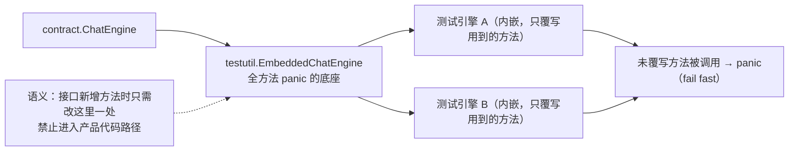

# internal/testutil

## 生态位

`internal/testutil` 存放**仅供测试**的共享桩（Go internal 限制，禁止进入
产品代码路径）。目的：同一契约（如 `contract.ChatEngine`）的
多份测试假实现不再每份手写全量方法，接口新增方法时只改这里一处。

## 架构图



## 内容

- `chat_engine.go`：`EmbeddedChatEngine`——全方法 panic 的 `ChatEngine`
  底座。测试引擎以 `*EmbeddedChatEngine` 内嵌，只覆写测试路径实际用到的方法；
  未覆写方法被调用时 panic，明确提示需要补实现（fail fast）。

## 使用方式

```go
type myTestEngine struct {
	*testutil.EmbeddedChatEngine
	history []contract.EngineMessage
}

func (e *myTestEngine) History() []contract.EngineMessage { return e.history }
```

## 扩展方式

给 `ChatEngine` 新增方法时：在 `EmbeddedChatEngine` 补一个 panic 实现即可，
各测试桩自动满足接口；只有真正需要该方法的测试桩才覆写。

## Review 指南

- 测试桩是否只覆写所需方法？被测试路径意外触发的未实现方法会 panic——
  这是特性，不是 bug（提示测试装配缺失）。
- 本包只允许被 `_test.go` 或测试专用包（如 `e2e/scenario`）引用。

## 文件与函数索引

> 由源码 doc 注释自动提取（首行摘要）；描述源码行为，与实现保持同步。
> 刷新方式：`python scripts/gen_core_readme_index.py`。

### budget_norace.go

- `func Budget(d time.Duration) time.Duration` — Budget 见 budget_race.go：非 race 构建下原样返回，普通测试的数字不变。

### budget_race.go

- `func Budget(d time.Duration) time.Duration` — Budget 把测试里的"预算 / 超时"在 -race 下放宽。

### chat_engine.go

- `func panicUnimplemented(method string)`
- `func (*EmbeddedChatEngine) ChatStream(context.Context, string, func(string)) (string, error)`
- `func (*EmbeddedChatEngine) History() []contract.EngineMessage`
- `func (*EmbeddedChatEngine) ClearHistory()`
- `func (*EmbeddedChatEngine) ReplaceHistory(string, []contract.EngineMessage) error`
- `func (*EmbeddedChatEngine) SessionID() string`
- `func (*EmbeddedChatEngine) StartSession() string`
- `func (*EmbeddedChatEngine) SetSystemPrompt(string)`
- `func (*EmbeddedChatEngine) SetMaxLoops(int)`
- `func (*EmbeddedChatEngine) TraceText() string`
- `func (*EmbeddedChatEngine) TokenCount() string`
- `func (*EmbeddedChatEngine) AppendHistory(contract.EngineMessage)`
- `func (*EmbeddedChatEngine) NodeSessionConversation(string) ([]contract.EngineMessage, bool)`
- `func (*EmbeddedChatEngine) NodeContextSnapshot(string) (*snapshot.ContextSnapshot, bool)`
- `func (*EmbeddedChatEngine) NodeToolResult(string, string) (string, bool)`
- `func (*EmbeddedChatEngine) NodeWorktreeInfoFor(string) (dto.NodeWorktreeInfo, bool)`
- `func (*EmbeddedChatEngine) SubscribeSubagentLive(string) ([]dto.SubagentLiveEvent, <-chan dto.SubagentLiveEvent, func(), error)`
- `func (*EmbeddedChatEngine) SubagentLiveHistoryPage(string, int, int) dto.SubagentLiveHistoryPage`
- `func (*EmbeddedChatEngine) SubAgentTree() []dto.SubAgentTreeNode`

### reporoot.go

- `func RepoRoot() string` — RepoRoot 返回仓库根目录：从当前工作目录（测试运行时 = 该测试包目录）向上找
