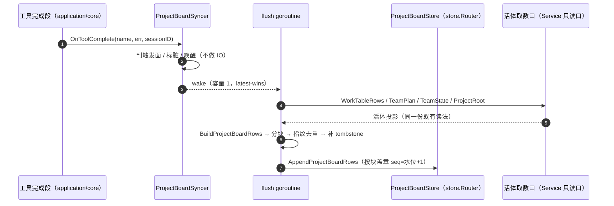

# kernel/board

## 生态位

`kernel/board` 是**项目看板**（project board）的中立行投影与落盘侧：
把活体工作表格 / 团队计划映射成投影行（`store.ProjectBoardRow`），并在工具完成段按
一张触发表**标脏**、由唯一 flush goroutine 落进两个白名单文件。主要调用方是
`application/core`（经 `application/execution` 的 identity alias 持有取数口与订阅口）
与 `wiring/registry`（装配门
`ProjectBoardSinkFor`，以及 `project_board_read` 工具的注册面——它直接用本包的
`ReadProjectBoard` 与 `ProjectBoardRead*` 常量）。

本包同时是**取数侧**的落点（P21-11「域方法随类型走」）：`ReadProjectBoard`（按需读取面）
与 `TeamworkPlanFor`（窄端口背后的取数判定）原在 `backend/engine/assemble`，随
"域方法随类型走"归位到看板域；装配层只留 `Runtime.TeamworkPlanFor` 的两格宿主读数接线。

本包是 M5-R5 从 `application/core` 的看板实现（原 `project_board.go`）拆出的：映射、触发表与同步器
原样搬入，行为零变化；`application/core` 只留 Service 侧的只读取数口
（`project_board_read.go`），门面签名不变。

## 职责与非职责

- 职责：活体投影 → 投影行的**零判定映射**；触发档词表与触发表；按会话标脏、去重
  （内容指纹）、差集补 tombstone、按文件水位盖章落盘；唯一 flush goroutine 的生命周期。
- 非职责：任何**状态判定**（状态/依赖/收口一律原样搬运，读 task 注册表 / plan /
  teamwork 事实）；活体工作表格行本身的构建（`application/execution/table/runtime.go` 与
  `kernel/worktable`）；会话视图切换与锁（由 `application/core` 的视图锁持有）；
  「这台机器哪个工具最该优化」这类看板读数（**不进 Snapshot**，直接与 JSONL 交互，
  见 plan §V10）。

## 目录结构

| 文件 | 职责 |
|---|---|
| `projection.go` | 纯函数映射（`BuildProjectBoardRows` 及其载荷/指纹助手）+ 触发装配表与档名词表 |
| `syncer.go` | 写侧端口（`ProjectBoardStore`）、订阅口（`ProjectBoardSink`）、装配入参（`ProjectBoardDeps`）与同步器 `ProjectBoardSyncer` |
| `read.go` | **按需读取面**（P21-11 从 `backend/engine/assemble` 归位）：`ProjectBoardReader` 窄端口 + `ProjectBoardReadRequest` / `ProjectBoardReadResult` + `ReadProjectBoard`（边界校验与取数，只读有界）+ 白名单文件名归一与稳定排序；缺省/硬上限常量 `ProjectBoardReadDefaultLimit` / `ProjectBoardReadMaxLimit` |
| `teamwork_plan.go` | **取 teamwork 计划的那一跳**（P21-11 同上）：`TeamworkPlanDeps`（两格宿主读数）+ `TeamworkPlanFor(sessionID, deps)`；口径是"未装配 / 解析不出作用域 / 半截键 / 读失败 / 空计划 ⇒ (零值, false)"，调用方据此整块退场（I6）。键完整性判据随类型走——`store.Key.Complete`（与装配层团队作用域解析同一句） |
| `projection_test.go` / `syncer_test.go` / `trigger_test.go` | 随代码搬入的用例（映射零判定、同步器语义、档名词表） |
| `read_test.go` | 读取面验收（随实现搬入，断言逐字）：单会话折叠读 + 落点在项目目录、聚合读的有界与截断上抛、边界显式报错（未知 file / 超上限 limit / 没有项目根） |
| `teamwork_plan_test.go` | 域级判据：两格读数缺一、空会话号（且不惊动宿主读数）、半截键（且不去读计划）、读失败与空计划同解、成功路径原样返回 + 键不重算 |
| `boardtest/` | 两侧共用的测试夹具（内存存储面、行读取助手）；**刻意不 import 本包**，避免本包内部用例 import 它时形成测试环 |

## 核心实现

- `BuildProjectBoardRows`：把活体投影映射成投影行（纯函数）。`kind ∈ {todo, task}` 上板，
  `plan` / `subagent` / 未知 kind 一律不上板（判据表 `projectBoardWorkKindProjected`）。
- `TriggerFor` / `ProjectBoardTrigger.Matches`：档名 → 命中集合的编译结果；未知档按默认档
  `todo_list` 处理，`ProjectBoardHookModes` 是装配期校验用的同一份词表。
- `ProjectBoardSyncer`：`OnToolComplete` 不做 IO（判触发面 → 标脏 → 唤醒容量 1 的
  latest-wins 唤醒），落盘只有 `flush*` 一条路，且在独立 goroutine 上跑；失败只记日志。
  每 `(会话, 文件)` 记账（指纹 / 水位 / key→kind）只活在内存，进程重启即空——投影可重建。
- `TeamworkPlan` / `TeamworkState` 的数据形状归 `contract/dto`；Store 保留同身份 alias，
  本包的可选计划端口直接消费 Contract，不再把持久化实体当作中间层协议。

## 数据流



## 依赖方向

允许依赖：`store`（投影行与写侧端口形状）、`middle/protocol/model`（`WorkItem` 等行类型）、
`contract/dto`、`kernel/worktable`（证据截断的唯一实现 `TruncateWorkEvidence`）、
标准库。文本截断上限由装配根通过 `ProjectBoardDeps.EvidenceChars` 注入，本包不依赖
`backend/limit`。

禁止：反向依赖 `application/*`（本包是中间层，只被应用层消费）与 `backend/engine/assemble`
（装配层反过来 import 本包）；不得把 `Snapshot` /
前端协议类型引进来（投影不是 Snapshot 的输入，也不是它的输出）。

BM-003 已完成：Wiring 在构造 `ProjectBoardDeps` 时注入 `EvidenceChars func() int`，
`BuildProjectBoardRows` 接收同一读数。`kernel/board -> backend/limit` 已删除，
架构预算把该边归零。

## 并发与错误语义

- 同步器内部状态由自己的 `mu` 保护；落盘在唯一 flush goroutine 上，落盘期间不持视图锁。
- `Store == nil` ⇒ 不启动 goroutine、`OnToolComplete` 恒为空操作（"没装配就没有投影"）。
- `Close` 幂等；关闭前排空尾态。落盘失败只记日志：投影可删可重建，不阻塞回合、不 panic。
- 空集合**不建文件**（"没有就是没有"）；里程碑 / 工作项行只写 teamwork 白名单文件。

## 扩展方式

新增触发档：改 `projectBoardTriggerTable` 与 `projectBoardHookModeOrder` 一处（词表唯一性
由 `trigger_test.go` 钉住），再按需更新 `config/seelex.yaml` 的出厂值。新增投影字段：
只允许"字段白名单搬运"，并在 `projection.go` 的头部注释里登记该字段的活体来源。

## Review 指南

- 映射里有没有**新增判定**（状态归一、依赖推导、收口判定、空串补值）？有就是越界。
- 落盘路径是否仍只有 `flush` 一条？`OnToolComplete` 里出现 IO 即为回归。
- 提到路径门前置（plan M2-C5）时不要顺手动 `ProjectBoardDeps` 的取数口签名：
  那是装配门约定。
- 新增/删除档名后，`ProjectBoardHookModes()` 与触发表必须仍是**恰好同一个集合**。

## 测试与验证

```text
go test ./kernel/board/... -count=1
go test ./application/core/ -run 'ProjectBoard|BuildProjectBoardRows' -count=1   # 取数口 + 钩子接线
go test ./e2e/ -count=1                                                          # 闭包/README 门禁
```

`projection_test.go` 覆盖"活体与投影逐行对齐""零判定""kind 映射"；`syncer_test.go` 覆盖
debounce、指纹去重、水位、删除后重建、tombstone、关闭幂等、失败不留半截行；
`trigger_test.go` 钉住档名词表唯一性。

## 文件与函数索引

> 由源码 doc 注释自动提取（首行摘要）；描述源码行为，与实现保持同步。
> 刷新方式：`python scripts/gen_core_readme_index.py`。

### projection.go

- `func BuildProjectBoardRows( scope store.ProjectBoardScope, seq uint64, at int64, workItems []model.WorkItem, teamPlan *dto.TeamworkPlan, teamState *dto.TeamworkState, evidenceChars int, ) []store.ProjectBoardRow` — BuildProjectBoardRows 把活体投影映射成投影行（**纯函数**：同样的输入必得同样的输出）。
- `func projectBoardRow( scope store.ProjectBoardScope, seq uint64, at int64, kind, key string, payload map[string]any, ) store.ProjectBoardRow` — projectBoardRow 组装一行信封（信封字段只有这里一处写）。
- `func projectBoardWorkPayload(item model.WorkItem, evidenceChars int) map[string]any` — projectBoardWorkPayload 把 work 行映射成载荷（字段白名单；空字段不落盘）。
- `func projectBoardMilestonePayload(milestone dto.TeamworkMilestone, state dto.TeamworkState, evidenceChars int) map[string]any` — projectBoardMilestonePayload 把里程碑映射成载荷。
- `func projectBoardMilestoneStatus(milestone dto.TeamworkMilestone, state dto.TeamworkState) string` — projectBoardMilestoneStatus 是里程碑状态的**唯一读法**：运行态优先、声明态兜底。
- `func projectBoardMilestoneItemPayload(milestoneID string, item dto.TeamworkWorkItem, evidenceChars int) map[string]any` — projectBoardMilestoneItemPayload 把里程碑内的工作项映射成载荷（状态/依赖原样搬运）。
- `func projectBoardTeamState(plan *dto.TeamworkPlan, state *dto.TeamworkState) dto.TeamworkState` — projectBoardTeamState 取整队运行态：显式传入的 TeamworkState 优先，否则用计划里那份兜底。
- `func projectBoardPutText(payload map[string]any, key, value string)` — projectBoardPutText 把非空文本写进载荷（空字段不落盘：读侧沿用"缺失 = 空 = 该域约定值"
- `func projectBoardBlocks(rows []store.ProjectBoardRow) (work, teamwork []store.ProjectBoardRow)` — projectBoardBlocks 把映射结果按**落点**拆成两块：work → worktable.jsonl；
- `func projectBoardRowsForFile( scope store.ProjectBoardScope, seq uint64, at int64, workItems []model.WorkItem, teamPlan *dto.TeamworkPlan, teamState *dto.TeamworkState, file string, evidenceChars int, ) []store.ProjectBoardRow` — projectBoardRowsForFile 取**某一落点**的行集：按块取数（而不是取一遍再改 Seq），
- `func projectBoardRowsFingerprint(rows []store.ProjectBoardRow) string` — projectBoardRowsFingerprint 生成"**去掉 seq/at 之后**的内容指纹"：同样的
- `func ProjectBoardHookModes() []string` — ProjectBoardHookModes 返回触发档名的全集（装配期校验 hook 配置用：拼错的档名要
- `func TriggerFor(hookMode string) ProjectBoardTrigger` — TriggerFor 由档名编译出触发面：off / todo_list（= 空串，默认档）/ task_complete /
- `func (t ProjectBoardTrigger) Matches(name string) bool` — Matches 报告这次工具完成是否落在触发面上。空工具名恒不命中（没有名字就不是一次工具完成）。
- `func (t ProjectBoardTrigger) Off() bool` — Off 报告这个触发面是否"什么都不触发"（诊断 / 装配自检用）。

### projection_test.go

- `func TestBuildProjectBoardRowsNoJudgement(t *testing.T)`
- `func TestBuildProjectBoardRowsKindMapping(t *testing.T)`
- `func TestProjectBoardTeamworkMilestonePriority(t *testing.T)`
- `func TestProjectBoardTriggerTable(t *testing.T)`

### read.go

- `func ReadProjectBoard( reader ProjectBoardReader, request ProjectBoardReadRequest, defaultProjectRoot, defaultSession string, ) (ProjectBoardReadResult, error)` — ReadProjectBoard 按请求取数：**只取数与校验边界**，不渲染、不判定任何语义。
- `func projectBoardReadFiles(file string) ([]string, error)` — projectBoardReadFiles 把 file 入参归一化成白名单文件名清单（空 = 两份都读）。
- `func sortProjectBoardRows(rows []store.ProjectBoardRow)` — sortProjectBoardRows 按 (Kind, Key, Scope.Session) 稳定排序：

### read_test.go

- `func projectBoardReadRouter(t *testing.T) *store.Router`
- `func projectBoardReadRow(kind, key string, seq uint64, payload map[string]any) store.ProjectBoardRow`
- `func TestProjectBoardReadSingleSessionFoldsBothFiles(t *testing.T)` — TestProjectBoardReadSingleSessionFoldsBothFiles：单会话读两份文件、折叠、稳定排序。
- `func TestProjectBoardReadSingleFile(t *testing.T)` — TestProjectBoardReadSingleFile：file 简名只读一份，且接受白名单文件名本身。
- `func TestProjectBoardReadRejectsOutOfBounds(t *testing.T)` — TestProjectBoardReadRejectsOutOfBounds：边界**显式报错**（不静默截断/不静默降级）。
- `func (reader *countingReadReader) ReadProjectBoard(_ string, options store.ProjectBoardReadOptions) ([]store.ProjectBoardRow, bool, error)`
- `func (reader *countingReadReader) ReadProjectBoardRows(_, _, _ string) ([]store.ProjectBoardRow, error)`
- `func TestProjectBoardReadAggregateIsBounded(t *testing.T)` — TestProjectBoardReadAggregateIsBounded：`session: all` 走聚合读，行数有界，

### syncer.go

- `func NewProjectBoardSyncer(deps ProjectBoardDeps) *ProjectBoardSyncer` — NewProjectBoardSyncer 装配同步器并启动唯一 flush goroutine。
- `func (s *ProjectBoardSyncer) OnToolComplete(name string, err error, sessionID string)` — OnToolComplete 是 ProjectBoardSink 的实现：**不做任何 IO**。
- `func (s *ProjectBoardSyncer) signal()` — signal 非阻塞唤醒 flush goroutine（信号口容量 1）。
- `func (s *ProjectBoardSyncer) run()` — run 是唯一的 flush goroutine：唤醒重设静默窗（debounce），窗口到期落盘，Close 时补一次。
- `func (s *ProjectBoardSyncer) flushDirty()` — flushDirty 把脏集合取走（先取走再落盘：落盘期间新来的触发会攒进下一批，不会丢）。
- `func (s *ProjectBoardSyncer) flushSession(sessionID string)` — flushSession 落一个会话的两个投影文件（work 行与 milestone 行各落各的）。
- `func (s *ProjectBoardSyncer) flushFile( sessionID, projectRoot string, scope store.ProjectBoardScope, file string, at int64, items []model.WorkItem, plan *dto.TeamworkPlan, state *dto.TeamworkState, evidenceChars int, )` — flushFile 落一个文件：取水位 → 指纹去重 → 差集补 tombstone → 追加。
- `func projectBoardRemovedRow(scope store.ProjectBoardScope, seq uint64, at int64, kind, key string) store.ProjectBoardRow` — projectBoardRemovedRow 组装一行 tombstone（折叠读遇到 payload["removed"]==true 即让该 key 消失）。
- `func (s *ProjectBoardSyncer) remember(key boardFileKey, state boardFileState)` — remember 更新落盘记账。
- `func (s *ProjectBoardSyncer) Close()` — Close 幂等：关掉唯一 goroutine 并等它退出（退出前补一次落盘）。

### syncer_test.go

- `func boardDeps(st ProjectBoardStore, idle time.Duration, rows func(string) []model.WorkItem) ProjectBoardDeps`
- `func TestProjectBoardSyncerDebounce(t *testing.T)`
- `func TestProjectBoardSyncerFingerprint(t *testing.T)`
- `func TestProjectBoardSyncerWatermark(t *testing.T)`
- `func TestProjectBoardRebuildAfterDelete(t *testing.T)`
- `func TestProjectBoardSyncerIgnoresFailedAndUntriggeredCalls(t *testing.T)`
- `func TestProjectBoardSyncerTombstonesRemovedKeys(t *testing.T)`
- `func TestProjectBoardSyncerCloseIsIdempotent(t *testing.T)`
- `func TestProjectBoardHookFailureNoHalfWrite(t *testing.T)`

### teamwork_plan.go

- `func TeamworkPlanFor(sessionID string, deps TeamworkPlanDeps) (dto.TeamworkPlan, bool)` — TeamworkPlanFor 返回该会话的 teamwork 计划。

### teamwork_plan_test.go

- `func teamworkPlanFixture() store.TeamworkPlan`
- `func TestTeamworkPlanForRejectsIncompleteDeps(t *testing.T)` — TestTeamworkPlanForRejectsIncompleteDeps：两格读数缺一（未装配 / nil 端口）⇒ false，
- `func TestTeamworkPlanForRejectsEmptySession(t *testing.T)` — TestTeamworkPlanForRejectsEmptySession：空会话号（错的输入）⇒ false，且**不去碰**两格读数。
- `func TestTeamworkPlanForRejectsHalfKey(t *testing.T)` — TestTeamworkPlanForRejectsHalfKey：键缺项目或缺会话分量 ⇒ false，**读口一次都不许被调**
- `func TestTeamworkPlanForTreatsReadFailureAndEmptyPlanAlike(t *testing.T)` — TestTeamworkPlanForTreatsReadFailureAndEmptyPlanAlike：读失败与"空计划"同解
- `func TestTeamworkPlanForReturnsPlanVerbatim(t *testing.T)` — TestTeamworkPlanForReturnsPlanVerbatim：有计划 ⇒ 原样返回（本口不做任何收口折算），

### trigger_test.go

- `func TestProjectBoardHookModeVocabularyMatchesTable(t *testing.T)`

