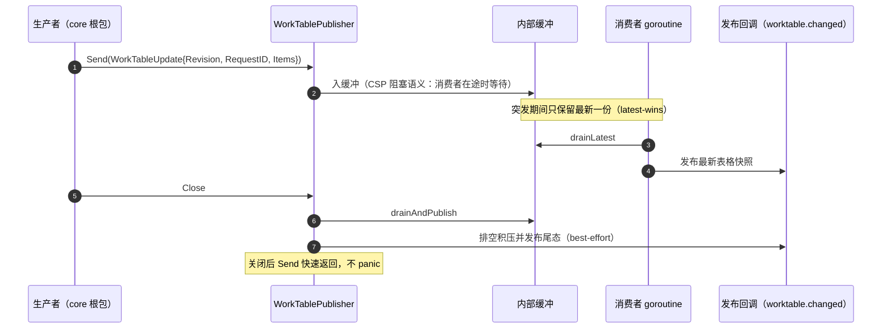
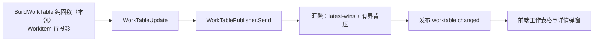

# kernel/worktable

## 生态位

`kernel/worktable` 是工作表格（Work Table）的中立纯投影与增量投递 owner，两件事：

1. **行投影判据**（`projection.go` / `async.go`）：plan 节点、task 台账行、子代理节点、
   后台执行（含 teammate 完成行）如何拼成 `WorkItem` 行与打点行——M5-R5b 接收者转移从
   `application/core/{work_table,work_table_async}.go` 原样搬来（判据、次序、文案逐字未改）；
2. **增量事件投递**（`worktable_publisher.go`）：`WorkTablePublisher` 以 CSP 汇聚
   （latest-wins、有界背压、关闭排空尾态）发布 `worktable.changed` 所需的最新表格快照。

主要调用方：`application/core`、`application/execution/table`、
`application/execution`、`application/session/query` 与它的测试。

## 职责与非职责

- 职责：`WorkItem` 行投影与打点行的**全部判据**（`BuildWorkTable` / `AsyncWorkItems` /
  `AsyncTraceLines` / `TeamworkTraceLines` / `BuildWorkTableBatches` / 结构体克隆
  `ClonePlanForSync`、`CloneSubAgentTreeForSync`、跨会话合并 `MergeTaskRecords`）；
  表格快照的并发安全汇聚与有序投递（`WorkTableUpdate` 承载 Revision/RequestID/Items）。
- 非职责：**取数**（进程级上限由宿主 `workTableBounds()` 按值传入，本包不读配置、不 import
  `backend/limit`）；task 注册表与 todo 三态更新（`backend/engine/task`）；审计/截断之外
  的持久化（`store`）。
- 身份判据不复制：`MergeTaskRecords` 的去重身份由宿主注入
  （`backend/engine/task.LedgerIdentity` 是唯一实现，AGENTS §8.3）。

## 依赖方向

只依赖 `contract/protocol`（`WorkItem` / `WorkTracePoint`）、`contract/dto`（记录 DTO）与标准库；
禁止 import `backend/**`、`store/**` 或其它 Application 领域实现；需要宿主事实时只接收
不可变值或函数参数。

## 时序图



## 数据流图



## 测试

```text
go test ./application/execution/worktable -count=1
```

`worktable_publisher_test.go` 覆盖突发汇聚、关闭尾态与关闭后 Send 安全性；
`projection_test.go` 覆盖身份判据由宿主注入（本包不留第二份）、无身份行不进合并、
secondary 为空早返回。宿主级（真实装配）用例仍在 `application/core`：

```text
go test ./application/core/ -run 'WorkTable|WorkItem|MergeTaskRecords|Teamwork' -count=1
```

## 文件与函数索引

> 由源码 doc 注释自动提取（首行摘要）；描述源码行为，与实现保持同步。
> 刷新方式：`python scripts/gen_core_readme_index.py`。

### async.go

- `func AsyncWorkItems(records []dto.AsyncRunRecord, limits Limits) []model.WorkItem` — AsyncWorkItems 把后台执行全量投影成工作表格行（跨会话：工作表格是全局台账，
- `func AsyncRunToWorkItem(record dto.AsyncRunRecord, limits Limits) model.WorkItem` — AsyncRunToWorkItem 映射一条后台执行到工作表格行。
- `func AsyncProbePoint(record dto.AsyncRunRecord, elapsed time.Duration, limits Limits) model.WorkTracePoint` — AsyncProbePoint 是一次探针采样的打点行：状态、字节数、末行、耗时。
- `func AsyncWorkStatus(state dto.AsyncState) string` — AsyncWorkStatus 把执行域状态映射到工作表格的权威状态字面量。
- `func AsyncTraceLines(records []dto.AsyncRunRecord, sessionID string, limits Limits) []string` — AsyncTraceLines 生成打点块里的作业行，且只取本会话——打点块注入在组装请求的那个
- `func AsyncTraceLine(record dto.AsyncRunRecord, limits Limits) string` — AsyncTraceLine 渲染一条作业行：句柄、类别、状态、（完成行）摘要或（在途行）标题。
- `func TeamworkTraceLines(records []dto.TeamworkJobCompletionRecord, sessionID string, limits Limits) []string` — TeamworkTraceLines 生成打点块里的 **teammate 作业行**（与 AsyncTraceLines 同一块、
- `func TeamworkTraceLine(record dto.TeamworkJobCompletionRecord, limits Limits) string` — TeamworkTraceLine 渲染一条 teammate 作业行：句柄、状态、归属（teammate/工作项）、
- `func TeamworkOwnerText(record dto.TeamworkJobCompletionRecord) string` — TeamworkOwnerText 是 teammate 行的归属文本（`<role>/<work item>`）。
- `func FormatAsyncBytes(bytes int64) string` — FormatAsyncBytes 把字节数写成便于扫读的量级（界面与打点块共用一个口径）。
- `func PromptKind(kind string) string` — PromptKind 是进正文前的类别兜底：类别缺失时按 process 读，与打点块同口径。

### evidence.go

- `func TruncateWorkEvidence(value string, limit int) string` — evidence.go — 证据文本的**唯一截断实现**（工作表格行投影、项目看板行投影、

### projection.go

- `func BuildWorkTable(plan *model.PlanState, tasks []dto.TaskRecord, subagentTree []dto.SubAgentTreeNode, asyncRuns []dto.AsyncRunRecord, limits Limits) []model.WorkItem` — BuildWorkTable 组装工作表格行：注册表 task → model.WorkItem；plan 行额外合并
- `func TaskRecordToWorkItem(record dto.TaskRecord, limits Limits) model.WorkItem` — TaskRecordToWorkItem 把注册表 task 快照映射为 model.WorkItem（含 retry 计数）。
- `func BatchLabel(id string, createdAt time.Time) string` — BatchLabel 由批次 ID 与创建时间派生展示标签：真实批次用本地时间
- `func BuildWorkTableBatches(rows []model.WorkItem) []model.WorkTableBatch` — BuildWorkTableBatches 从工作表格行派生批次分片头：按 BatchID 分组，
- `func PlanNodeTrace(node model.PlanNode, tasklistMode bool, limits Limits) []model.WorkTracePoint` — PlanNodeTrace 由节点事件 + 子代理工具活动合成打点（按时间倒序、有界；
- `func BoundWorkTrace(points []model.WorkTracePoint, limits Limits) []model.WorkTracePoint` — BoundWorkTrace 按时间倒序排序并截断。
- `func FormatWorkDuration(duration time.Duration) string`
- `func SubagentTreePayloadSignature(nodes []dto.SubAgentTreeNode) string` — SubagentTreePayloadSignature 生成子代理树投影的内容签名，用于判断
- `func TaskStatusForNode(status model.NodeStatus) dto.TaskStatus`
- `func TaskStatusForSubagent(status dto.SubAgentNodeStatus) dto.TaskStatus`
- `func PlanNodeIDFor(record dto.TaskRecord) string` — PlanNodeIDFor 返回 plan 行对应的 plan 节点 ID：SourceID 优先，缺失时
- `func PlanDependencies(plan *model.PlanState, nodeID string) []string` — PlanDependencies 由 plan 邻接面取节点的前置任务 ID（plan:<前置节点>）。
- `func MergeWorkDependencies(recorded []string, derived []string) []string` — MergeWorkDependencies 合并依赖来源（注册表记录 + plan 邻接面）：去重、
- `func MergeTaskRecords(primary, secondary []dto.TaskRecord, secondarySessionID string, identity func(dto.TaskRecord) string) []dto.TaskRecord` — MergeTaskRecords 合并两组 task 记录（按跨会话身份去重，前者优先，稳定
- `func ClonePlanForSync(plan *model.PlanState) *model.PlanState`
- `func CloneSubAgentTreeForSync(nodes []dto.SubAgentTreeNode) []dto.SubAgentTreeNode`

### projection_test.go

- `func TestMergeTaskRecordsUsesInjectedIdentity(t *testing.T)` — 身份判据是**注入**的：本包不存在自己的同口径实现（AGENTS §8.3 的同一判据一处）。
- `func TestMergeTaskRecordsSkipsRecordsWithoutIdentity(t *testing.T)` — 注入判据返回空串 = 该行没有身份：不进合并（防御性分支，宿主判据不会返回空串）。
- `func TestMergeTaskRecordsReturnsPrimaryWhenSecondaryEmpty(t *testing.T)` — secondary 为空时原样返回 primary（早返回口径与迁移前一致，不复制切片）。

### worktable_publisher.go

- `func NewWorkTablePublisher(publish func(WorkTableUpdate)) *WorkTablePublisher`
- `func (publisher *WorkTablePublisher) Send(update WorkTableUpdate)` — Send 投递一次表格更新（CSP 阻塞语义：消费者在途时等待；关闭后快速返回）。
- `func (publisher *WorkTablePublisher) loop()`
- `func (publisher *WorkTablePublisher) drainLatest(initial WorkTableUpdate) WorkTableUpdate` — drainLatest 消费缓冲区内积压的全部更新，返回最后一次（latest-wins）。
- `func (publisher *WorkTablePublisher) drainAndPublish()` — drainAndPublish 关闭路径：排空积压并发布尾态（best-effort）。
- `func (publisher *WorkTablePublisher) Close()` — Close 优雅关闭：停止消费者 goroutine 并发布尾态。

### worktable_publisher_test.go

- `func TestWorkTablePublisherCoalescesBurstToLatest(t *testing.T)`
- `func TestWorkTablePublisherCloseDrainsTail(t *testing.T)`
