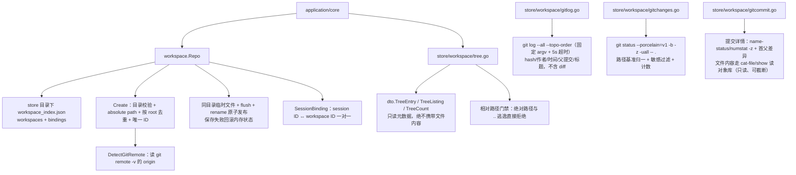
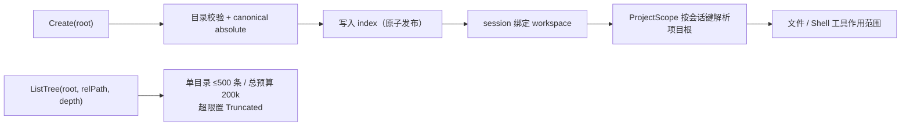

# Workspace Repository

## 生态位

`workspace` 管理 Seelex 项目定义及 session-to-workspace binding。项目的作用是限制 session 的文件读写范围；conversation history 仍由 store 独立保存。

## 架构图



名称允许重复，ID 才是唯一索引；显示名默认取 `RootPath` basename。

## 数据流图



## 数据模型

- `Info`：opaque unique `ID`、持久化名称、absolute `RootPath`、Git remote 和创建时间。
- `SessionBinding`：session ID 到 workspace ID 的一对一绑定。
- `repoSnapshot`：`workspace_index.json` 中的 workspaces + bindings。
- `dto.TreeEntry`/`TreeListing`/`TreeCount`：工作树只读元数据 DTO（名称/相对
  路径/类型/大小/直接文件计数；绝不携带文件内容），定义在
  `contract/dto/tree.go`，由 `store/workspace/tree.go` 产出。
- `dto.GitLogResult`/`GitCommitNode`：提交记录只读元数据（hash/短 hash/作者/
  时间/父提交/标题，无 diff），同一文件定义、由 `store/workspace/gitlog.go` 产出。
- `dto.GitCommitDetail`/`GitCommitFileEntry`：**一个提交改了哪些文件**的只读元数据
  （Kind 分类 + git 名状态原样与单字母 + 路径 + 重命名原路径 + ±行数），定义在
  `contract/dto/gitcommit.go`，由 `store/workspace/gitcommit.go` 产出；文件
  **内容**不在这里——它走 `dto.FileContent`（与工作树预览同一形状）。
- `dto.WorkspaceChangeEntry`/`WorkspaceChangesResult`：未提交改动只读元数据
  （Kind 分类 + porcelain XY 两字符 + 路径 + 重命名原路径 + 统计），定义在
  `contract/dto/gitchanges.go`，由 `store/workspace/gitchanges.go` 产出。

对外适配器会把 `RootPath` basename 作为显示名称；持久化 `Name` 只作为兼容 fallback。名称允许重复，ID 才是唯一索引。

## 生命周期

- `NewRepo`：内存模式。
- `NewRepoWithStore`：加载 `<store>/workspace_index.json`。
- Create 校验目录、转 absolute path、按 root 去重并生成唯一 ID。
- mutation 自动保存 index；持久化使用同目录临时文件、flush 和 rename 原子发布。Create/Delete/UpdateGitRemote 在保存失败时回滚内存状态；Delete 同时清理指向该 workspace 的 bindings。
- `DetectGitRemote` 只读取 `git remote -v` 的 origin。

## 工作树查询（tree.go）

- `ListTree(root, relPath, depth)`：列出根内某目录的子条目（dir-first 排序、
  单目录条目 ≤500、总读取预算 200k，超限置 `Truncated`）。客户端只允许相对
  路径，绝对路径与 `..` 逃逸直接拒绝（Windows 大小写不敏感 containment）。
- `CountFiles(root)`：递归统计文件/目录数（同一预算与忽略规则）。
- 默认忽略目录：`.git`、`.seelex`、`dist`、`node_modules`、`.venv`、`tmp`、
  `.idea`、`__pycache__`；敏感文件名 `accounts.yaml` 与 `*.local.yaml` 只
  元数据也不展示/统计（防真实账号配置暴露）。
- 遍历不跟随符号链接（防环、防逃逸）；权限/IO 错误目录按 best-effort 跳过。
- Repo 实现 `contract.WorkspaceTreePort`（optional 端口），Application 经
  类型断言启用；GUI Bridge 暴露 `WorkspaceTree`/`WorkspaceFileCount`。

## Git 只读查询（gitlog.go / gitchanges.go / gitcommit.go）

几条能力与工作树同级：只读、固定 argv（不经过 shell）、带超时；元数据面（提交列表、
改动清单、提交详情）只下发路径与状态，diff、补丁一律不下发；非 git 仓库以
`Result.Error` 返回展示文案，不当作 Go error 中断调用。唯一的字节通道是文件读取
（`ReadFile` 与 `GitCommitFileContent`），两条读通道共用同一条可见性边界。
起命令与失败文案收敛在 `gitread.go`（`runGitRead` / `resolveGitRoot`）：命令怎么起、
失败怎么说话只写一处，四条只读查询各自只负责自己的参数校验与解析。

- `GitLog(root, limit)`：`git log --all --topo-order`，`\x01` 分隔取
  `%H %h %an %ad %P %s`（主题放最后故可含任意字符）；limit 默认 20、上限 200。
- `GitChanges(root, limit)`：`git --no-optional-locks status --porcelain=v1 -b -z
  -uall -- .`。`-z` 免去 C 风格引号转义（中文与空格路径原样返回），重命名是
  「新路径 NUL 旧路径」两条记录；`-- .` 把范围钉在工作区子树内；limit 默认 200、
  上限 1000，解析预算 20000 条。
- `GitCommitDetail(root, hash, limit)`：某提交改了哪些文件。三条查询拼出一次详情——
  头部事实（`show --no-patch --pretty=format:<gitCommitPrettyFormat>`，与提交列表同一
  字段口径）+ 名状态清单（`show --format= --name-status -z --find-renames
  --diff-merges=first-parent --end-of-options <hash> -- .`）+ 行数（同一条换成
  `--numstat`，按新路径与名状态对齐）。`--format=` 抑制头部（`--name-status`/`--numstat`
  与 `--no-patch` 不能同时用，所以头部单独一条查询）；`--diff-merges=first-parent` 让
  合并提交按首父给出差异（默认合并提交什么都不给）；limit 默认 200、上限 1000，
  解析预算 20000 条。hash 必须是 4~64 位十六进制（修订表达式与 `--output=` 之类选项
  形状一律在进 argv 前拒绝），进程侧还叠加 `--end-of-options` 与路径前的 `--` 两道。
- `GitCommitFileContent(root, hash, relPath, limit)`：某文件在**某个提交时**的内容。
  对象类型先问（`cat-file -t`，目录/子模块不是文件就明确失败），再取大小
  （`cat-file -s`），最后读字节（`show`，读够 limit 就关读端——截断读的代价与"看多少"
  成正比，不为读完整个对象等待）。读的是对象库：工作区怎么改都影响不到它，这条通道
  也不会写回工作区。
- **路径基准**：git status / show 的路径以**仓库根**为基准，`GitChanges` 与
  `GitCommitDetail` 按 `rev-parse --show-toplevel` 剥成工作区根基准（绑定的目录可能是
  仓库子目录）；`GitCommitFileContent` 反向补齐前缀。工作区之外的兄弟路径丢弃并计入
  `Result.Filtered`（清单查询里它们通常已被 `-- .` 挡在查询侧，那是更省的做法）。
- **可见性边界**：与 ListTree/ReadFile 一致，路径任一环节命中敏感文件名
  （`accounts.yaml`、`*.local.yaml`）不展示并计入 `Filtered`；读取通道直接拒绝
  （`sanitizeWorkspaceRelPath` 是这条边界的唯一实现，磁盘与对象库两条读取共用）。
  目录噪音交给 git 自己的 `.gitignore`（套用 `ignoreDirNames` 会藏掉被跟踪的
  `dist/` 改动）。
- **分类与统计**：porcelain 的 XY 与名状态的首字母都只在 `statusKind` 一处解释成
  `dto.Change*`；`Total` 与暂存/未暂存/未跟踪/冲突计数（以及提交详情的 `Total`）覆盖
  **过滤后的全部条目**（含被 limit 截断的部分），列表截断另由 `Truncated` 表达。
- Repo 实现 `contract.WorkspaceTreePort`（树/提交/改动元数据）与
  `contract.WorkspaceFilePort`（文件字节，含提交内文件内容），GUI Bridge 暴露
  `WorkspaceTree`/`WorkspaceFileCount`/`WorkspaceGitLog`/`WorkspaceChanges`/
  `WorkspaceGitCommitDetail`/`WorkspaceFileContent`/`WorkspaceGitCommitFileContent`。

## 仓库发现（gitrepos.go）——多仓库 git 的发现端

一个工作区根下可能有多棵互不相干的仓库（根本身是仓库 / 若干子目录各自是仓库 /
仓库里套仓库）。`GitRepos` 做一次只读 BFS，回报有界的一份相对清单，前端据此渲染
仓库子页标签；四条 git 查询随后按「仓库相对路径」各自发起（`repo` 的解析与
containment 在应用层，见 `application/workspace/application.go`）。

- `GitRepos(root, limit)`：Repo 实现 `contract.WorkspaceGitReposPort`（**可选端口，
  单独声明**——往 `WorkspaceTreePort` 里加方法会打断所有既有实现与测试假体）。
- **仓库判定**：目录内存在名为 `.git` 的条目，**目录或文件都算**（文件形态是
  worktree / 子模块，`git -C` 一样可用）。
- **下钻**：仓库内部**继续下钻**（跳过 `.git` 自身，它本来就在忽略表里）——仓库里
  套独立仓库很常见，不下钻就漏。
- **剪枝**：复用 `tree.go` 的 `ignoreDirNames` + 隐藏目录（`.` 开头），不写第二份表；
  目录符号链接不跟随（`DirEntry.IsDir()` 为假即跳过，防环也防逃逸）。
- **三重预算**：深度上限 6（工作区根 = 0）、进过的目录数 20000、仓库条目 `limit`
  （默认 64，钳 1..256，`clampRepoLimit` 是纯函数）。任一触顶即 `Truncated=true`
  如实上报"还有没扫到的"；`Scanned` 是真正进过的目录数。
- **主仓库（Primary）两条判据**：根含 `.git` → `Rel="."` Primary；否则
  `git -C root rev-parse --show-toplevel` 命中祖先仓库 → 也记 `Rel="."` Primary
  （沿用"以工作区根为视角"的既有语义）；都没有则无 Primary（前端回落 `Repos[0]`）。
- **顺序**：Primary 优先，其余按 `Rel` 字典序（读数确定、标签位置稳定）。
- **错误**：读不了的目录跳过继续；空根/根不可读只回 `Result.Error` 文案与空
  `Repos`，不报 Go error、不 panic。
- **分支**：直接读 `<repo>/.git/HEAD`（`.git` 是文件时按 `gitdir:` 跟随），不跑子
  进程——为标签栏拉起 N 个 git 进程不值当；读不到、分离头指针一律留空。
- **只读元数据**：只下发相对路径、展示名、是否主仓库与分支名；`Root` 只用于前端
  判断"同一份快照"，不含绝对仓库路径。

测试在 `gitrepos_test.go`：根是仓库 / 兄弟仓库无 Primary / 仓库套仓库 / `.git`
文件形态 / 忽略与隐藏目录剪枝 / 深度截断 / limit 钳制与截断 / 空根文案 /
祖先 Primary / 分离头指针（全部临时目录现造，不依赖预置仓库）。

## 生态位与边界

Repo 保存项目目录和关系，但不执行 PathGate、文件工具或 session history IO。Runtime 的 ProjectScope 由 Application 在 bind/resume 时同步。

## Review 指南

- 不以显示名称查找或覆盖项目。
- root dedup 应处理 clean/absolute/case/volume 语义，跨平台时特别注意 Windows 大小写。
- binding mutation 的公开接口目前没有 error 返回值，因此 Bind/Unbind 的持久化失败仍是 best-effort；如果这条契约升级，必须同步修改 Application port。
- Git remote 命令必须只读且有退出边界。

## 测试

```text
go test . -run Workspace -count=1
go test ./application/core -run Workspace -count=1
```

`tree_test.go` 覆盖排序/计数、忽略与敏感过滤、逃逸拒绝、预算截断与嵌套深度。
`gitlog_test.go` 覆盖 `\x01` 字段解析、父提交顺序、主题含分隔符与截断。
`gitchanges_test.go` 覆盖 `-z` 记录解析（含重命名两条记录、裸中文/空格路径、
畸形记录、解析预算）、XY 分类、分支头归一化、路径基准剥离与越界丢弃、敏感过滤与
limit 截断，并有真实 git 仓库的集成用例（改动/暂存/删除/重命名/未跟踪、仓库子目录
即工作区根、非 git 目录返回 `Result.Error`）。
`gitcommit_test.go` 覆盖名状态与 numstat 的 `-z` 记录解析（重命名「原/新」两条路径、
二进制 `- -`、畸形计数、解析预算）、hash 形状拒绝，以及真实仓库的集成用例：一次
「改/删/增/重命名/二进制/敏感文件」齐全的提交（Kind、原路径、±行数、`Filtered`）、
根提交全为新增、合并提交按首父、子目录工作区根剥前缀、limit 截断、非 git 目录与
不存在提交返回 `Result.Error`；文件内容侧覆盖"读的是对象库而不是磁盘"（工作区已改、
提交内仍是旧内容）、已删除文件在历史提交里仍可读、二进制原样带回、大文件截断早停、
目录/敏感/越界路径与非 git 目录一律拒绝。

## 文件与函数索引

> 由源码 doc 注释自动提取（首行摘要）；描述源码行为，与实现保持同步。
> 刷新方式：`python scripts/gen_core_readme_index.py`。

### gitchanges.go

- `func (r *Repo) GitChanges(root string, limit int) (dto.WorkspaceChangesResult, error)` — GitChanges 返回工作区 root 内未提交的改动（含暂存/未暂存/未跟踪/冲突）。
- `func parseGitStatusOutput(output []byte, maxRecords int) parsedGitStatus` — parseGitStatusOutput 把 `git status --porcelain=v1 -b -z` 的原始输出解析成
- `func parseBranchHeader(line string) string` — parseBranchHeader 解析 -b 的分支头（porcelain v1）。见过的形态：
- `func classifyChange(index, worktree byte) string` — classifyChange 把 porcelain 的 XY 归一化成展示分类；未知/无改动组合返回空串
- `func isConflictXY(index, worktree byte) bool` — isConflictXY 判断 XY 是否为未解决冲突（porcelain v1 的冲突组合：任一侧为 U，
- `func statusKind(code byte) string` — statusKind 把单个状态字符映射为展示分类；空格（该侧无改动）与未知字符返回空串。
- `func isSensitiveChangePath(rel string) bool` — isSensitiveChangePath 与 ListTree/ReadFile 同一可见性边界：路径任一环节命中
- `func gitTopLevel(root string) string` — gitTopLevel 返回 root 所属仓库的顶层目录；非 git 仓库或 git 不可用时返回空串
- `func workspacePathPrefix(topLevel, rootAbs string) string` — workspacePathPrefix 计算仓库根 → 工作区根的前缀（"sub/" 形式，/ 分隔）；
- `func resolveRealPath(path string) string` — resolveRealPath 尽力把路径归一到真实路径（解掉路径上所有符号链接）；解不出来
- `func relativeToWorkspace(path, prefix string) (string, bool)` — relativeToWorkspace 把仓库根基准的路径转成工作区根基准。返回 ok=false 表示
- `func escapesRoot(path string) bool` — escapesRoot 判断相对路径是否逃出根（".." 开头；git 正常不会给出，防御性）。

### gitchanges_test.go

- `func zRecords(records ...string) []byte` — zRecords 把记录切片拼成 -z 的原始输出（每条记录以 NUL 结尾，含末尾那条）。
- `func TestParseGitStatusOutputKindsAndRename(t *testing.T)`
- `func TestParseGitStatusOutputKeepsRawPaths(t *testing.T)`
- `func TestParseGitStatusOutputSkipsJunkAndTruncatesAtBudget(t *testing.T)`
- `func TestParseGitStatusOutputDropsDanglingRenameRecord(t *testing.T)`
- `func TestParseBranchHeader(t *testing.T)`
- `func TestClassifyChange(t *testing.T)`
- `func TestRelativeToWorkspace(t *testing.T)`
- `func TestWorkspacePathPrefix(t *testing.T)`
- `func TestIsSensitiveChangePath(t *testing.T)`
- `func TestRepoGitChangesIntegration(t *testing.T)`
- `func TestRepoGitChangesFiltersSensitiveAndOutsideWorkspace(t *testing.T)`
- `func TestRepoGitChangesTruncatesAtLimit(t *testing.T)`
- `func TestRepoGitChangesRejectsNonGitDir(t *testing.T)`
- `func TestRepoGitChangesRejectsBadRoot(t *testing.T)`
- `func TestRepoGitChangesClampsLimit(t *testing.T)`
- `func newChangesTestRepo(t *testing.T) string` — newChangesTestRepo 建一个带一次提交的临时 git 仓库（含 sub/、gone.txt）。
- `func runGitChanges(t *testing.T, root string, args ...string)` — runGitChanges 在指定目录跑 git 子命令；失败即测试失败（不用 CombinedOutput 吞错）。
- `func writeFile(t *testing.T, root, relPath, content string)`

### gitcommit.go

- `func (r *Repo) GitCommitDetail(root, hash string, limit int) (dto.GitCommitDetail, error)` — GitCommitDetail 返回某个提交改了哪些文件（含状态/行数统计）。
- `func (r *Repo) GitCommitFileContent(root, hash, relPath string, limit int64) (dto.FileContent, error)` — GitCommitFileContent 读取某文件在某个提交时的内容（前 limit 字节）。
- `func gitCommitFilesArgv(rootAbs, mode, hash string) []string` — gitCommitFilesArgv 组一次"某提交的文件清单"查询 argv。mode 是 --name-status
- `func readGitBlob(rootAbs, revPath string, limit int64, expectTruncated bool) ([]byte, error)` — readGitBlob 从对象库读一个 blob，最多 limit 字节。截断时**早停**：读够就关读端，
- `func parseGitNameStatus(output []byte, maxFiles int) ([]parsedCommitFile, bool)` — parseGitNameStatus 解析 `git show --format= --name-status -z` 的输出。
- `func parseGitNumstat(output []byte, maxFiles int) (map[string]parsedCommitStat, bool)` — parseGitNumstat 解析 `git show --format= --numstat -z` 的输出，返回
- `func parseNumstatCounts(addRaw, delRaw []byte) (parsedCommitStat, bool)` — parseNumstatCounts 解析 numstat 的两个计数字段。`-` `-` 是二进制的约定
- `func commitFileKind(status string) string` — commitFileKind 把 git 名状态的首字母解释成展示分类。字母表与 porcelain 的

### gitcommit_test.go

- `func TestParseGitNameStatusRecords(t *testing.T)`
- `func TestParseGitNameStatusJunkAndBudget(t *testing.T)`
- `func TestParseGitNumstatRecords(t *testing.T)`
- `func TestParseGitNumstatJunk(t *testing.T)`
- `func TestParseGitNumstatBudget(t *testing.T)`
- `func TestParseGitCommitFields(t *testing.T)`
- `func TestCommitFileKindLetters(t *testing.T)`
- `func TestGitCommitHashPatternRejectsOptionShapes(t *testing.T)`
- `func newGitCommitTestRepo(t *testing.T) *gitCommitTestRepo`
- `func (repo *gitCommitTestRepo) git(args ...string) string`
- `func (repo *gitCommitTestRepo) write(rel, content string)`
- `func (repo *gitCommitTestRepo) writeBytes(rel string, content []byte)`
- `func (repo *gitCommitTestRepo) remove(rel string)`
- `func (repo *gitCommitTestRepo) rename(oldRel, newRel string)`
- `func (repo *gitCommitTestRepo) commit(message string) string`
- `func (repo *gitCommitTestRepo) seedBaseCommit() string` — seedBaseCommit 写第一批文件并提交（这批文件的身份在下一个提交里被改/删/改名）。
- `func (repo *gitCommitTestRepo) secondCommit() string` — secondCommit 在基准之上做一次"什么都有"的提交：改 / 删 / 增 / 重命名（带内容
- `func TestRepoGitCommitDetailIntegration(t *testing.T)`
- `func TestRepoGitCommitDetailRootCommitListsEverythingAdded(t *testing.T)`
- `func TestRepoGitCommitDetailMergeUsesFirstParent(t *testing.T)`
- `func TestRepoGitCommitDetailSubdirWorkspaceRootStripsPrefix(t *testing.T)`
- `func TestRepoGitCommitDetailTruncatesAtLimit(t *testing.T)`
- `func TestRepoGitCommitDetailRejectsBadInput(t *testing.T)`
- `func TestRepoGitCommitFileContentReadsObjectDatabase(t *testing.T)`
- `func TestRepoGitCommitFileContentTruncatesLargeBlob(t *testing.T)`
- `func TestRepoGitCommitFileContentRejectsNonFilesAndBadPaths(t *testing.T)`
- `func decodeBase64(t *testing.T, encoded string) string`
- `func decodeBase64Bytes(t *testing.T, encoded string) []byte`

### gitlog.go

- `func (r *Repo) GitLog(root string, limit int) (dto.GitLogResult, error)` — GitLog 返回 workspace root 内最近 limit 条提交（含父提交拓扑）。
- `func parseGitLogOutput(output string, limit int) dto.GitLogResult` — parseGitLogOutput 把 git log 的原始输出解析为提交行（保序）。
- `func parseGitCommitFields(line string) (dto.GitCommitNode, bool)` — parseGitCommitFields 解析一行 gitCommitPrettyFormat 口径的提交头部事实。
- `func splitParents(raw string) []string` — splitParents 把 %P（空格分隔的父提交 hash）解析成切片；根提交返回 nil。

### gitlog_test.go

- `func TestParseGitLogOutputCommitLines(t *testing.T)`
- `func TestParseGitLogOutputMergeKeepsParentOrder(t *testing.T)`
- `func TestParseGitLogOutputKeepsSubjectSeparators(t *testing.T)`
- `func TestParseGitLogOutputTruncationAndJunk(t *testing.T)`
- `func TestSplitParentsIgnoresBlankSeparators(t *testing.T)`
- `func TestRepoGitLogIntegration(t *testing.T)`
- `func TestRepoGitLogRejectsNonGitDir(t *testing.T)`
- `func TestRepoGitLogRejectsBadRoot(t *testing.T)`
- `func TestRepoGitLogClampsLimit(t *testing.T)`
- `func initTestGitRepo(root string) error` — initTestGitRepo 在临时目录初始化 git 仓库并提交两个文件。

### gitread.go

- `func runGitRead(argv []string, timeout time.Duration, timeoutMessage string) ([]byte, string)` — runGitRead 跑一次只读 git 命令。成功返回 stdout 原始字节；失败返回
- `func resolveGitRoot(root, label string) (string, error)` — resolveGitRoot 校验 git 查询的 root：非空、绝对化、且确实是一个目录。

### readfile.go

- `func (r *Repo) ReadFile(root, relPath string, limit int64) (dto.FileContent, error)` — ReadFile 读取根内 relPath 文件的前 limit 字节（GUI 文件预览数据源）。
- `func resolveFileTarget(root, relPath string) (rootAbs, fileAbs, rel string, err error)` — resolveFileTarget 校验 root/relPath 并把 relPath 解析为根内文件绝对路径。
- `func sanitizeWorkspaceRelPath(relPath string) (string, error)` — sanitizeWorkspaceRelPath 校验并归一化一个工作区相对路径（纯函数，不碰磁盘）：
- `func textLikeBytes(chunk []byte) bool` — textLikeBytes 做轻量二进制探测：含 NUL 字节即视为二进制；控制字节

### readfile_test.go

- `func writeTreeFile(t *testing.T, root, rel, content string)`
- `func TestReadFileReturnsBytesWithMetadata(t *testing.T)`
- `func TestReadFileTruncatesAtLimit(t *testing.T)`
- `func TestReadFileClampsLimitBounds(t *testing.T)`
- `func TestReadFileRejectsEscapesAndAbsolutePaths(t *testing.T)`
- `func TestReadFileRejectsDirectoryAndSymlink(t *testing.T)`
- `func TestReadFileRejectsSensitiveAndIgnoredPaths(t *testing.T)`
- `func TestReadFileDetectsBinary(t *testing.T)`
- `func TestReadFileMissingRoot(t *testing.T)`

### symlink_root_test.go

- `func linkDirOrSkip(t *testing.T, target, link string)` — linkDirOrSkip 建一个指向 target 的目录链接，并确认它真能被 filepath.EvalSymlinks 解掉；
- `func TestRepoGitChangesSymlinkedWorkspaceRootStripsPrefix(t *testing.T)` — 工作区根的祖先被符号链接过时，子树前缀仍要按真实路径算。

### tree.go

- `func isSensitiveName(name string) bool` — isSensitiveName 判断条目是否属于敏感配置文件（仅元数据也不展示/统计）。
- `func sortTreeEntries(entries []dto.TreeEntry)` — TreeEntry 直接子条目排序：目录优先，再按名称大小写不敏感排序。
- `func resolveTreeDir(root, relPath string) (rootAbs, dirAbs string, err error)` — resolveTreeDir 把客户端相对路径解析为根内目录绝对路径，同时返回规范化
- `func treeWithinRoot(root, candidate string) bool`
- `func (walker *treeWalker) readDir(dir string) ([]os.DirEntry, bool)` — readDir 读取目录并扣除预算；超预算置 truncated 并返回 nil 表示停止。
- `func (r *Repo) ListTree(root, relPath string, depth int) (dto.TreeListing, error)` — ListTree 列出根内某目录的子条目（dir-first 排序、有界；dir 条目带直接
- `func listTreeLevel(walker *treeWalker, dir string, depth int, listing *dto.TreeListing)`
- `func directFileCount(walker *treeWalker, dir string) int` — directFileCount 统计目录的直接文件子条目数（不递归；忽略目录与敏感文件
- `func (r *Repo) CountFiles(root string) (dto.TreeCount, error)` — CountFiles 递归统计工作区文件/目录数（忽略规则与敏感文件除外；有预算
- `func countTreeFiles(walker *treeWalker, dir string, count *dto.TreeCount)`
- `func isIgnoredDir(name string) bool`

### tree_test.go

- `func writeTestTree(t *testing.T, root string, paths []string)`
- `func TestListTreeSortsDirsFirstAndCountsFiles(t *testing.T)`
- `func TestListTreeFiltersIgnoredAndSensitiveEntries(t *testing.T)`
- `func TestListTreeRejectsEscapesAndAbsolutePaths(t *testing.T)`
- `func TestCountFilesRespectsIgnoresAndSensitiveNames(t *testing.T)`
- `func TestCountFilesErrorsOnMissingRoot(t *testing.T)`
- `func TestListTreeNestedDepth(t *testing.T)`
- `func TestListTreePathsAreRootRelativeAndUnique(t *testing.T)` — TestListTreePathsAreRootRelativeAndUnique 验证条目路径相对工作区根（跨

### workspace.go

- `func NewRepo() *Repo` — NewRepo creates an empty workspace repository without persistence.
- `func NewRepoWithStore(storePath string) (*Repo, error)` — NewRepoWithStore creates a workspace repository that persists to the given
- `func (r *Repo) Save() error` — Save writes the current workspaces and bindings to workspace_index.json.
- `func (r *Repo) Load() error` — Load reads workspace_index.json and populates the repo.
- `func (r *Repo) Create(name, rootPath, gitRemote string) (Info, error)`
- `func (r *Repo) Get(id string) (Info, error)`
- `func (r *Repo) List() []Info`
- `func (r *Repo) Delete(id string) error`
- `func (r *Repo) UpdateGitRemote(id, remote string) error`
- `func (r *Repo) BindSession(sessionID, workspaceID string)`
- `func (r *Repo) UnbindSession(sessionID string)`
- `func (r *Repo) SessionWorkspace(sessionID string) (Info, bool)`
- `func (r *Repo) AllBindings() map[string]string` — AllBindings returns all session→workspace bindings.
- `func (r *Repo) WorkspaceSessions(workspaceID string) []string`
- `func (r *Repo) saveLocked() error` — saveLocked persists the repo without acquiring the lock (caller holds mu).
- `func writeFileAtomic(path string, data []byte, mode os.FileMode) error`
- `func DetectGitRemote(rootPath string) string` — DetectGitRemote 在给定目录中检测 git remote origin 地址。

### workspace_test.go

- `func TestRepoPersistsWorkspaceAndBinding(t *testing.T)`
- `func TestRepoCreateDeduplicatesAbsoluteRoot(t *testing.T)`
- `func TestRepoRejectsInvalidCreateAndMissingLookup(t *testing.T)`
- `func TestRepoDeleteRemovesBindingsAndPersists(t *testing.T)`
- `func TestRepoUpdateGitRemotePersists(t *testing.T)`
- `func TestRepoSavePublishesValidJSONWithoutTempResidue(t *testing.T)`
- `func TestRepoLoadRejectsCorruptIndex(t *testing.T)`
- `func TestWorkspaceSessionsAreSortedAndUnbindWorks(t *testing.T)`

### writefile.go

- `func (r *Repo) WriteFile(root, relPath string, content []byte) (dto.FileWriteResult, error)` — WriteFile 用 content 覆盖 root 内 relPath 文件的**全部内容**（GUI 文件详情
- `func readProbeBytes(path string) ([]byte, error)` — readProbeBytes 读取文件头部至多 binaryProbeBytes 字节，供二进制探测。

### writefile_test.go

- `func decodeFileContent(t *testing.T, content dto.FileContent) string` — decodeFileContent 解出预览读取的正文（base64 通道）。
- `func TestWriteFileWritesContentAndReportsMetadata(t *testing.T)`
- `func TestWriteFileOverwritesExistingFileAndEmptyContent(t *testing.T)`
- `func TestWriteFilePreservesModeAndLeavesNoTempFiles(t *testing.T)`
- `func TestWriteFileRejectsEscapesIgnoredAndSensitivePaths(t *testing.T)`
- `func TestWriteFileRejectsDirectoryAndSymlink(t *testing.T)`
- `func TestWriteFileRejectsBinaryTargets(t *testing.T)`
- `func TestWriteFileRejectsOversizeContent(t *testing.T)`
- `func TestWriteFileMissingRoot(t *testing.T)`

