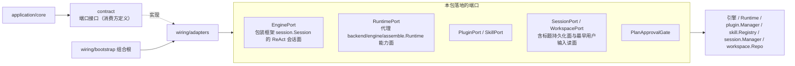

# Adapters

## 生态位

本包（M5-R1 自 `internal/adapters/` 迁入 `wiring/adapters/`）将引擎、运行时、插件、Skill、会话、工作区等外部系统的
能力适配为 `application` 依赖的窄端口。所有端口类型在此包导出（`EnginePort`、
`RuntimePort`、`PluginPort`、`SkillPort`、`SessionPort`、`WorkspacePort`、
`PlanApprovalGate`），composition root（`wiring/bootstrap`，入口 `main.go` 只做五步）负责装配，本包不持有生命周期。

## 架构图



本包只做形状转换与窄接口收敛，不持有生命周期，也不反向依赖 `application` 门面。

## 归属

- 引擎适配：`EnginePort` 包装框架 `session.Session` 的 ReAct 会话面。
- 运行时适配：`RuntimePort` 代理 `backend/engine/assemble.Runtime` 的能力面（源码里
  该包仍以局部别名 `seelebridge` 引入，别名本身不改行为，收口随 M5 门面收窄一起做）。
- 会话/工作区/插件/Skill：对应 manager/repo/registry 的窄端口。
- 会话标题的持久化面（`session_runtime.SessionTitlePort`）与"最早用户输入"的
  有界读面（`session_runtime.FirstUserInputPort`）也由 `SessionPort` 落地
  （`SaveSessionTitle`/`SessionTitle` 走会话头；`FirstUserInputs` 只打开首个
  消息分片）。这些是可选能力断言：装配缺方法时应用层会静默降级（标题不落盘、
  老会话标题回填失效），因此包内有编译期契约断言与真存储回归测试。

## 并发与锁纪律（EnginePort）

本包最容易出事的地方是**两把不同半径的锁**，谈问题时必须分清：

| 锁 | 半径 | 持锁范围 |
| --- | --- | --- |
| `frameworkSession.Session` 的回合闸门 + 工作状态短锁 | 单会话 | 闸门只串行化"谁在跑回合"（不持锁跑整轮）；工作历史由短临界区保护（Seele 的 `workingState`），回合内的写入排队到循环的下一个检查点 |
| `EnginePort.mu`（下称 `port.mu`） | 全进程（端口级） | 只应覆盖注册表/别名的查表与改写 |

四条不变量：

1. **回合内直接用公开方法，不需要"环内把手"**。Seele 把"整轮持锁"换成闸门 + 短临界区
   之后，工具 handler / 循环回调里调 `History()` / `ReplaceHistory()` 不再自锁：读只取
   一次微秒级临界区，写在忙时排队到下一个检查点（空闲时立即应用）。因此桩内的环内
   通道与 `contract.InLoopEngine` 已删除，端口侧没有"环内专用实现"这一层。
2. **`port.mu` 内不做跨越等待的操作**。`port.mu` 内只允许：查表、改
   `engines`/`engineCalls`/`pendingHistory`/别名，以及调用**不会等回合**的引擎方法
   （`Session` 的历史读写属于这一类：短临界区 + 检查点队列）。对已注册引擎的其它历史
   操作要么先释放 `port.mu`（`AppendHistoryFor`/`ClearHistoryFor`/`SetSystemPromptFor`/
   `RawHistoryFor`/`ClearHistory`），要么在该会话 `engineCalls == 0` 时进行。
3. **目标会话有回合在飞 ⇒ 把替换交给引擎排队**（`queueSessionHistory` →
   `Session.ReplaceHistory`：下一个检查点落地，本回合的下一次请求即读到），不再"登记到
   收尾再换一台干净引擎"。`pendingHistory` 只对**没有**该能力的引擎（旧替身/legacy）
   兜底：登记按会话键控，安装点在 `ChatStream`/`ChatStreamFor` 出口（该会话计数归零、
   且 `port.mu` 还握着 ⇒ 对新回合原子）；登记时不 arm durable 的「下一次装载」槽，安装
   时才 arm；后台会话的安装只换注册表里的引擎，不改活跃别名（`activateLocked` 只查表，
   不建引擎）。
4. **宿主注入实现（`PrepareHistory`）一律在 `port.mu` 之外被调**。生产装配是
   `Runtime.PrepareMainSessionHistory`（`bundlesMu` → `binding.mu` → `DurableHistory`），
   锁内调它就是"持全进程端口锁调宿主实现"，宿主实现一回读端口即自锁。所以安装/恢复路径
   一律分两段：锁内只改注册表并 `armHandoffLocked` 登记一次交接，解锁之后由 `runHandoff`
   兑现（`ReplaceRawHistory`/`replaceRawHistoryFor`/`ResumeRawSession`，以及回合出口的
   `installPendingLocked`）。两段之间必然有窗口，因此交接带序号闸：本次决定若已被更晚的
   一次取代，旧历史不得再交给宿主——否则 durable 的 next-load 被拉回过期状态。以后新增
   "要交给宿主的动作"，照这条走，不要顺手在 `*Locked` 里直接调。

`installHistoryInPlace` 是唯一的"就地重建 provider 历史"实现：引擎支持替换时直接交给
`Session.ReplaceHistory`（一次短临界区装完整份），否则退回 `ClearHistory` + 逐条
`AppendHistory` 的兼容形状；上游 `ClearHistory` 刻意保留 system 消息，所以兼容形状只补
缺、不重加——否则每次压缩/恢复都会复制一份 prompt。

## Review 指南

- 新增端口方法时先问：这一步会不会在 `port.mu` 里等某个回合？（等就有 S3b 那类引信。）
  会就改成锁外，或改走"交给引擎排队"。
- 宿主注入的实现（`EnginePortDeps` 里的那些函数）不得在 `port.mu` 内被调：它们是"另一端
  的锁 + I/O"的入口（`PrepareHistory` 就是）。要交给宿主的动作按 `armHandoffLocked` +
  `runHandoff` 两段走，别在 `*Locked` 里顺手调。
- `engineCalls` 只看目标会话自己的计数，不要拿活跃会话的计数代替（后台会话压缩的
  判据就是它）。
- 别名 `port.engine` 与 `port.sessionID` 必须成对改；先 install 再 activate，反过来
  会让工厂白造一台引擎（`TestEnginePortLazyResumeCreatesOnlyRequestedSession` 钉住）。
- 忙会话的压缩必须保留「在飞 tool_call 单元」（`withInFlightTail`），否则引擎以
  `ErrInFlightToolCallDropped` 拒收整次替换。

## 验证

```text
go test ./wiring/adapters -count=1
```

关键测试：`engine_port_reentrance_test.go`（回合内读历史**必须立刻返回**——旧自锁断言
的反转报警器）、`engine_port_history_test.go`（回合内替换在检查点当场生效 + 在飞下界 +
锁外立即落地）、`engine_port_lockfuse_test.go`（写面/读面都不再把 `port.mu` 跨在等回合
上；每条都同时断言"压缩当场返回"与"别的会话照样开回合"）、
`engine_port_handoff_test.go`（宿主 `PrepareHistory` 在锁外被调：宿主回读端口不再自锁；
序号闸丢过期交接；三条安装路径各兑现一次交接；反向护栏防止把宿主动作搬丢）。
`e2e/scenario` 与 `application/core` 的压缩用例覆盖应用侧口径。

## 文件与函数索引

> 由源码 doc 注释自动提取（首行摘要）；描述源码行为，与实现保持同步。
> 刷新方式：`python scripts/gen_core_readme_index.py`。

### adapters_test.go

- `func TestTranscriptEventWireMaterialRoundTrip(t *testing.T)` — TestTranscriptEventWireMaterialRoundTrip 覆盖 S19/D8：内部 user 材料的
- `func (fake *fakeReactorEngine) ChatStream(_ context.Context, input string, _ func(string)) (string, error)`
- `func (fake *fakeReactorEngine) History() []types.Message`
- `func (fake *fakeReactorEngine) ClearHistory()`
- `func (fake *fakeReactorEngine) SessionID() string`
- `func (*fakeReactorEngine) SetSystemPrompt(string)`
- `func (*fakeReactorEngine) SetMaxLoops(int)`
- `func (fake *fakeReactorEngine) AppendHistory(message types.Message)`
- `func TestEnginePortStartSessionCreatesAnIndependentReactor(t *testing.T)`
- `func TestEnginePortLazyStartupDoesNotCreateSession(t *testing.T)`
- `func TestEnginePortLazyResumeCreatesOnlyRequestedSession(t *testing.T)`
- `func TestEngineMessageRoundTripPreservesResumeContext(t *testing.T)`
- `func TestEnginePortReplaceHistoryUsesFreshReactorAndCollapsesSystemMessages(t *testing.T)`
- `func TestEnginePortDefersCleanReactorUntilActiveCallReturns(t *testing.T)`
- `func TestEnginePortPreparesDurableLoadWithApplicationHistory(t *testing.T)`
- `func TestEnginePortPerSessionEnginesStayIsolated(t *testing.T)`
- `func TestEnginePortActivateSessionRequiresFactoryWhenUnmaterialized(t *testing.T)`
- `func TestEnginePortResumeSessionKeepsExistingEngineInstance(t *testing.T)`
- `func TestDecodeSessionRecordMigratesLegacyArchive(t *testing.T)`
- `func TestDecodeSessionRecordPreservesV2Components(t *testing.T)`
- `func TestWorkspacePortUsesRootBasenameAndUniqueIDs(t *testing.T)`

### compaction_index_port.go

- `func (port RuntimePort) PushCompactionFrame( ctx context.Context, sessionID string, request context_runtime.CompactionIndexRequest, ) (context_runtime.CompactionIndexReceipt, error)` — PushCompactionFrame 实现 context_runtime.CompactionIndexPort：把装配层压缩产出的
- `func (port RuntimePort) ReadbackCompactionSummary( ctx context.Context, sessionID string, request context_runtime.CompactionIndexRequest, ) (context_runtime.CompactionIndexReceipt, error)` — ReadbackCompactionSummary 实现 context_runtime 的窄可选探针

### engine_port.go

- `func (port *EnginePort) ApplyDeps(deps EnginePortDeps)` — ApplyDeps 一次注入 EnginePort 启动期装配（幂等；覆盖旧值）。
- `func queueSessionHistory(engine ReactorEngine, history []types.Message) (bool, error)` — queueSessionHistory 把一次历史替换交给在飞会话的引擎自己排队。返回 false = 该引擎
- `func (port *EnginePort) armHandoffLocked(sessionID string, history []types.Message) historyHandoff` — armHandoffLocked 登记一次待交接。调用方必须持 port.mu；未注入宿主实现时不登记
- `func (port *EnginePort) runHandoff(handoff historyHandoff)` — runHandoff 在 port.mu **之外**把历史交给宿主。已被后续决定取代的那次直接丢弃。
- `func NewEnginePort(eng ReactorEngine, newEngine ReactorEngineFactory, tracer *telemetry.MemoryTracer) *EnginePort`
- `func (port *EnginePort) SessionBacked() bool` — SessionBacked 报告底层 reactor 是否为 session.Session。
- `func (port *EnginePort) ChatStream(ctx context.Context, input string, onChunk func(string)) (string, error)`
- `func (port *EnginePort) ChatStreamFor(sessionID string, ctx context.Context, input string, onChunk func(string)) (string, error)` — ChatStreamFor 是会话路由的 ChatStream：多会话并行执行时，runChat 用
- `func (port *EnginePort) engineForSessionLocked(sessionID string) ReactorEngine` — engineForSessionLocked 返回指定会话的引擎；未注册会话返回 nil（阶段 0：
- `func (port *EnginePort) HistoryFor(sessionID string) []contract.EngineMessage` — HistoryFor 返回指定会话引擎的历史（只读拷贝）。
- `func (port *EnginePort) RawHistoryFor(sessionID string) []types.Message` — RawHistoryFor 返回指定会话引擎的原始历史（只读拷贝）。
- `func (port *EnginePort) AppendHistoryFor(sessionID string, msg contract.EngineMessage)` — AppendHistoryFor 追加消息到指定会话引擎历史。
- `func (port *EnginePort) ClearHistoryFor(sessionID string)` — ClearHistoryFor 清空指定会话引擎历史。
- `func (port *EnginePort) SetSystemPromptFor(sessionID, prompt string)` — SetSystemPromptFor 设置指定会话引擎的 system prompt。
- `func (port *EnginePort) HasSession(sessionID string) bool` — HasSession 报告目标会话引擎是否已实例化。
- `func (port *EnginePort) ReleaseSessionBundle(sessionID string) bool` — ReleaseSessionBundle 释放指定会话的**桥侧会话本体**（框架 Session + 会话上下文
- `func (port *EnginePort) ReplaceHistoryFor(sessionID string, history []contract.EngineMessage) error` — ReplaceHistoryFor 是会话内历史替换（contract 版）：替换指定会话引擎
- `func (port *EnginePort) ReplaceRawHistoryFor(sessionID string, history []types.Message) error` — ReplaceRawHistoryFor 是 ReplaceHistoryFor 的原始消息版本。
- `func (port *EnginePort) NodeSessionConversation(nodeID string) ([]contract.EngineMessage, bool)` — NodeSessionConversation 转发子代理会话记录查询（节点详情数据面；
- `func (port *EnginePort) NodeContextSnapshot(nodeID string) (*snapshot.ContextSnapshot, bool)` — NodeContextSnapshot 转发子代理结构化上下文查询（详情弹窗"上下文"标签；
- `func (port *EnginePort) NodeToolResult(nodeID, ref string) (string, bool)` — NodeToolResult 转发子代理工具结果读回（ref 带 node:<nodeID>: 前缀；
- `func (port *EnginePort) NodeWorktreeInfoFor(nodeID string) (assemble.NodeWorktreeInfo, bool)` — NodeWorktreeInfoFor 转发节点 worktree 现场查询（失败现场恢复入口；
- `func (port *EnginePort) SubAgentTree() []dto.SubAgentTreeNode` — SubAgentTree 转发 fork 子代理树投影查询（GUI 树视图数据源；内存态
- `func (port *EnginePort) SubscribeSubagentLive(nodeID string) ([]dto.SubagentLiveEvent, <-chan dto.SubagentLiveEvent, func(), error)` — SubscribeSubagentLive 订阅 node 第一视角实时流（历史回放 + 即时输出面）。
- `func (port *EnginePort) SubagentLiveHistoryPage(nodeID string, offset, limit int) dto.SubagentLiveHistoryPage` — SubagentLiveHistoryPage 转发同一份实时回放窗口的分页读法（翻页入口；窗口上限
- `func (port *EnginePort) NodeStageLogs(nodeID string) []dto.NodeStageLog` — NodeStageLogs 转发 node 第一视角阶段日志历史查询（详情弹窗"第一视角"
- `func (port *EnginePort) AppendHistory(msg contract.EngineMessage)` — AppendHistory 追加消息到引擎内部对话历史。
- `func (port *EnginePort) ClearHistory()` — ClearHistory 清空活跃会话引擎历史。锁纪律同 ClearHistoryFor：port.mu 只解析
- `func (port *EnginePort) ReplaceHistory(sessionID string, history []contract.EngineMessage) error`
- `func (port *EnginePort) ReplaceRawHistory(sessionID string, history []types.Message) error`
- `func (port *EnginePort) replaceRawHistoryLocked(sessionID string, desired []types.Message) (historyHandoff, error)` — replaceRawHistoryLocked 是 ReplaceRawHistory 的锁内段：只动注册表并登记待交接，
- `func (port *EnginePort) replaceRawHistoryFor(sessionID string, history []types.Message) error` — ReplaceHistoryFor 是会话内历史替换（M2 后台并行）：替换指定会话引擎的
- `func (port *EnginePort) replaceRawHistoryForLocked(sessionID string, desired []types.Message) (historyHandoff, error)` — replaceRawHistoryForLocked 的锁内段：只动注册表并登记待交接，宿主调用在锁外
- `func (port *EnginePort) replaceTargetHistoryLocked(sessionID string, history []types.Message)` — replaceTargetHistoryLocked 就地重建目标会话引擎的历史（工厂不可用时的退路）。
- `func installHistoryInPlace(engine ReactorEngine, history []types.Message)` — installHistoryInPlace 用 history 重建 engine 的 provider 历史，保留该会话的引擎
- `func (port *EnginePort) armPendingLocked(sessionID string, history []types.Message)` — armPendingLocked 登记「该会话这次回合收尾之后要装的历史」。调用方必须持 port.mu
- `func (port *EnginePort) installPendingLocked(sessionID string) historyHandoff` — installPendingLocked 在该会话的最后一个在飞回合收尾时兑现登记的历史。调用方必须
- `func (port *EnginePort) activateLocked(sessionID string) bool` — activateLocked 把活跃别名（port.engine / port.sessionID）成对指向目标会话。
- `func (port *EnginePort) installSessionEngineLocked(sessionID string, history []types.Message) historyHandoff` — installSessionEngineLocked 为目标会话安装权威历史：优先创建全新引擎并
- `func canonicalEngineHistory(history []types.Message) []types.Message`
- `func (port *EnginePort) StartSession() string`
- `func (port *EnginePort) ActivateSession(sessionID string) error` — ActivateSession 把活跃引擎切换到目标会话（首次激活按需经工厂创建并
- `func (port *EnginePort) ResumeSession(sessionID string, history []contract.EngineMessage) error` — ResumeSession 为目标会话恢复引擎历史并切换为活跃引擎：会话已有引擎时
- `func (port *EnginePort) ResumeRawSession(sessionID string, history []types.Message) error` — ResumeRawSession 是 ResumeSession 的原始消息版本（框架消息类型）。
- `func (port *EnginePort) resumeRawSessionLocked(sessionID string, desired []types.Message) (historyHandoff, error)` — resumeRawSessionLocked 是 ResumeRawSession 的锁内段：只动注册表并登记待交接，
- `func (port *EnginePort) EnableWorkingHistoryRelease()` — EnableWorkingHistoryRelease marks this adapter as backed by DurableHistory.
- `func (port *EnginePort) ReleaseWorkingHistoryFor(sessionID string)` — ReleaseWorkingHistoryFor clears only the target session's provider working
- `func (port *EnginePort) UnloadSession(sessionID string) error` — UnloadSession 释放指定会话的引擎实例（阶段 2 生命周期：unload 后重开走
- `func (port *EnginePort) SessionID() string`
- `func (port *EnginePort) SetSystemPrompt(prompt string)`
- `func (port *EnginePort) SetSessionMaxLoopsFor(sessionID string, loops int)` — SetSessionMaxLoopsFor 给指定会话钉一个自己的循环上限（application 的
- `func (port *EnginePort) loopsForLocked(sessionID string) int` — loopsForLocked 是"这个会话该用多少轮"的唯一读法：本会话钉了就用钉住的，否则回退
- `func (port *EnginePort) SetMaxLoops(n int)`
- `func (port *EnginePort) TraceText() string`
- `func (port *EnginePort) TokenCount() string`
- `func (port *EnginePort) TokenCountFor(sessionID string) string` — TokenCountFor 返回指定会话的 token 计数（G1/M8）：只累加带该会话
- `func writeSpanSnapshot(builder *strings.Builder, span telemetry.SpanSnapshot, depth int)` — writeSpanSnapshot 递归渲染遥测 span 树（trace 视图文本）。
- `func attrTelemetryInt(attributes telemetry.Attributes, key string) int`
- `func (port *EnginePort) History() []contract.EngineMessage`
- `func (port *EnginePort) RawHistory() []types.Message` — RawHistory 返回**活跃引擎**的原始历史（只读拷贝）。

### engine_port_handoff_test.go

- `func (recorder *recordingPrepare) record(sessionID string, history []types.Message)`
- `func (recorder *recordingPrepare) snapshot() []prepareEntry`
- `func newQuietPort(t *testing.T) *EnginePort` — newQuietPort 起一个会话后端口 + 安静引擎工厂（历史替换/恢复都走立即安装路径）。
- `func frameHistory(content string) []types.Message`
- `func TestPrepareHistoryIsCalledOutsidePortLock(t *testing.T)` — TestPrepareHistoryIsCalledOutsidePortLock 钉住判据本体：宿主实现在交接期间回读端口
- `func TestSupersededHandoffIsDropped(t *testing.T)` — TestSupersededHandoffIsDropped 钉住序号闸：两次决定并发时，先决定的那个可能后交出去。
- `func TestHandoffReachesHostOnEveryInstallPath(t *testing.T)` — TestHandoffReachesHostOnEveryInstallPath 反向护栏：三条安装路径各自**恰好**兑现一次交接。
- `func TestPendingInstallHandsOffOutsidePortLock(t *testing.T)` — TestPendingInstallHandsOffOutsidePortLock 钉住回合出口那条路径：会话忙时登记的待安装
- `func messageWithContent(content string) types.Message`

### engine_port_history_test.go

- `func (a compactionProbeAgent) VisibleTools(context.Context) []types.Tool`
- `func (a compactionProbeAgent) Dispatch(ctx context.Context, name, _ string) (string, error)`
- `func (a compactionProbeAgent) LLM() types.ChatCompleter`
- `func (c *compactionProbeCompleter) next(messages []types.Message) (string, []types.ToolCall)`
- `func (c *compactionProbeCompleter) Complete(_ context.Context, messages []types.Message, _ []types.Tool) (types.Message, error)`
- `func (c *compactionProbeCompleter) CompleteStream(_ context.Context, messages []types.Message, _ []types.Tool, _ func(string)) (string, string, []types.ToolCall, error)`
- `func (c *compactionProbeCompleter) CompleteStreamEvents(ctx context.Context, messages []types.Message, tools []types.Tool, _ func(types.StreamEvent)) (string, string, []types.ToolCall, error)`
- `func (c *compactionProbeCompleter) snapshot() [][]types.Message`
- `func requestHas(messages []types.Message, want string) bool`
- `func runCompactionTurn(t *testing.T, probe compactionProbe) (*frameworkSession.Session, *compactionProbeCompleter)` — runCompactionTurn 起一个真实 Session（回合闸门与工作状态只在它身上存在，替身引擎复现
- `func inFlightCompaction(history []contract.EngineMessage) []contract.EngineMessage` — inFlightCompaction 返回一次压缩产物：压缩帧 + 当前历史里**正在飞的那一截**
- `func TestReplaceHistoryInsideTurnTakesEffectInSameTurn(t *testing.T)` — TestReplaceHistoryInsideTurnTakesEffectInSameTurn 是要交付的行为：回合内的工具
- `func TestReplaceHistoryDropsInFlightTailIsRefused(t *testing.T)` — TestReplaceHistoryDropsInFlightTailIsRefused 钉住引擎侧下界：替换若会丢掉正在飞的
- `func TestReplaceHistoryOutsideTurnAppliesImmediately(t *testing.T)` — TestReplaceHistoryOutsideTurnAppliesImmediately 是锁外路径的对照：没有回合在飞时
- `func ptrText(value string) *string`

### engine_port_lockfuse_test.go

- `func (a *hangAgent) VisibleTools(context.Context) []types.Tool`
- `func (a *hangAgent) Dispatch(_ context.Context, name, _ string) (string, error)`
- `func (a *hangAgent) LLM() types.ChatCompleter`
- `func (quietCompleter) Complete(_ context.Context, _ []types.Message, _ []types.Tool) (types.Message, error)`
- `func (quietCompleter) CompleteStream(_ context.Context, _ []types.Message, _ []types.Tool, _ func(string)) (string, string, []types.ToolCall, error)`
- `func (q quietCompleter) CompleteStreamEvents(ctx context.Context, messages []types.Message, tools []types.Tool, _ func(types.StreamEvent)) (string, string, []types.ToolCall, error)`
- `func (quietAgent) VisibleTools(context.Context) []types.Tool`
- `func (quietAgent) Dispatch(context.Context, string, string) (string, error)`
- `func (quietAgent) LLM() types.ChatCompleter`
- `func newFuseHarness(t *testing.T, hangActive bool) *fuseHarness` — newFuseHarness 装配端口。hangActive=true 时把挂死那台设为活跃会话（钉活跃分支），
- `func (h *fuseHarness) startHangingTurn(t *testing.T)` — startHangingTurn 起回合并等到工具派发点：此刻那台 Session 的会话锁一定被持着。
- `func (h *fuseHarness) runQuietTurn(t *testing.T) time.Duration` — runQuietTurn 让空闲会话跑一整轮，返回耗时；调用方用它证明 port.mu 没被冻住。
- `func (h *fuseHarness) wait(t *testing.T, desc string, fn func() error)` — wait 在 fuseQuickBudget 内跑完 fn；超时即判定「持着 port.mu 等别人的会话锁」。
- `func (h *fuseHarness) releaseHangNow()`
- `func (h *fuseHarness) releaseHang(t *testing.T)` — releaseHang 放行挂死的回合并等它收尾。
- `func (h *fuseHarness) assertNoFactoryFailure(t *testing.T)`
- `func compactionFrame(content string) []contract.EngineMessage`
- `func historyText(history []types.Message) string`
- `func compactedWithInFlightTail(port *EnginePort, sessionID, frame string) []contract.EngineMessage` — compactedWithInFlightTail 组装一次"保留在飞单元"的压缩产物：压缩帧 + 当前历史里
- `func TestCompactionOnBusySessionLandsInTurnAndDoesNotFreezePort(t *testing.T)` — TestCompactionOnBusySessionLandsInTurnAndDoesNotFreezePort 钉写面非活跃分支：目标会话
- `func TestCompactionOnBusyActiveSessionDoesNotFreezePort(t *testing.T)` — TestCompactionOnBusyActiveSessionDoesNotFreezePort 钉写面活跃分支：活跃别名上的压缩与
- `func TestHistoryReadOfBusySessionIsNonBlocking(t *testing.T)` — TestHistoryReadOfBusySessionIsNonBlocking 钉读面：读一台在飞会话的历史**立刻**
- `func TestActiveHistoryReadOfBusySessionIsNonBlocking(t *testing.T)` — TestActiveHistoryReadOfBusySessionIsNonBlocking 钉活跃别名读面（History /
- `func TestCompactionsAreKeyedBySession(t *testing.T)` — TestCompactionsAreKeyedBySession 钉住"压缩各归各的会话"：一台在飞、一台空闲时，两次压缩

### engine_port_reentrance_test.go

- `func (c *scriptedCompleter) next() (string, []types.ToolCall)`
- `func (c *scriptedCompleter) Complete(context.Context, []types.Message, []types.Tool) (types.Message, error)`
- `func (c *scriptedCompleter) CompleteStream(ctx context.Context, _ []types.Message, _ []types.Tool, _ func(string)) (string, string, []types.ToolCall, error)`
- `func (c *scriptedCompleter) CompleteStreamEvents(ctx context.Context, messages []types.Message, tools []types.Tool, _ func(types.StreamEvent)) (string, string, []types.ToolCall, error)`
- `func (a probingAgent) VisibleTools(context.Context) []types.Tool`
- `func (a probingAgent) Dispatch(ctx context.Context, name, _ string) (string, error)`
- `func (a probingAgent) LLM() types.ChatCompleter`
- `func TestEngineHistoryFromToolHandlerReturnsPromptly(t *testing.T)` — TestEngineHistoryFromToolHandlerReturnsPromptly 钉住回合内读历史**立刻返回**：

### engine_port_release_test.go

- `func TestEnginePortReleaseSessionBundleForwardsToBridge(t *testing.T)` — TestEnginePortReleaseSessionBundleForwardsToBridge：端口只把释放面转给桥
- `func TestUnloadSessionClearsHandoffLedger(t *testing.T)` — TestUnloadSessionClearsHandoffLedger：卸载后端口对该会话不留任何状态——

### engine_port_session_loops_test.go

- `func (engine *loopRecordingEngine) SetMaxLoops(loops int)`
- `func loopPortHarness() (*EnginePort, map[string]*loopRecordingEngine)` — loopPortHarness 造一个按会话建引擎的端口，并记下每个会话拿到的引擎。
- `func resumeMessages() []seeleTypes.Message` — resumeMessages 造一次历史替换的载荷（按会话重建引擎走的那条路）。
- `func TestEnginePortPinsLoopsPerSession(t *testing.T)` — TestEnginePortPinsLoopsPerSession 钉住按会话的那一格真的落到那个会话的引擎上：
- `func TestEnginePortSessionLoopPinLifecycle(t *testing.T)` — TestEnginePortSessionLoopPinLifecycle 钉住这一格的两条退场路径：

### engine_port_telemetry_test.go

- `func emitLLMUsage(t *testing.T, tracer *frameworktelemetry.MemoryTracer, sessionID string, input, output int)` — emitLLMUsage 模拟一次带会话标签的 LLM 调用：before/after intent-effect
- `func TestEnginePortTokenCountForFiltersBySession(t *testing.T)` — TestEnginePortTokenCountForFiltersBySession（G1/M8）：TokenCountFor 只累加
- `func TestEnginePortTokenCountForWithoutTracer(t *testing.T)` — TestEnginePortTokenCountForWithoutTracer 无 tracer（单会话桩）时 per-session

### messages.go

- `func adaptMessages(messages []types.Message) []contract.EngineMessage`
- `func restoreMessages(messages []contract.EngineMessage) []types.Message`
- `func ApprovalOption(choice string) model.InteractionOption`
- `func ApprovalAccepted(optionID string) bool`
- `func (g *PlanApprovalGate) Ask(ctx context.Context, q approve.Question) (any, error)` — Ask 将框架审批请求转换为 ApprovalBroker.Request，阻塞等待用户选择后返回。
- `func ConvertPermissionOptions(opts []toolspermission.ApproveOption) []model.InteractionOption` — convertPermissionOptions 将 permission.ApproveOption 转为 model.InteractionOption。

### role_fields_test.go

- `func TestTranscriptRoleFieldsRoundTrip(t *testing.T)` — TestTranscriptRoleFieldsRoundTrip 钉住 R2/R4 字段不会在 model ↔

### runtime_narrow_ports.go

- `func (port RuntimePort) TeamworkBoardSnapshot(sessionID string) *dto.TeamworkBoardView` — TeamworkBoardSnapshot 实现 contract.TeamworkBoardProjection：把某会话的团队看板
- `func (port RuntimePort) SessionContextStoreFor(sessionID string) *store.SessionContextStore` — SessionContextStoreFor 实现 application/core 的会话上下文存储取用面：goal 第五栈
- `func (port RuntimePort) SetAccountWindow(name string, window int)` — SetAccountWindow 实现 contract.AccountWindowPort：界面「设置 → 账号」设的窗口经这里
- `func (port RuntimePort) AccountWindowFor(name string) int` — AccountWindowFor 返回该账号**生效**的窗口（token；账号级 > 全局 > 账号档）。
- `func (port RuntimePort) TeammateSessionLive(sessionID string) dto.TeammateSessionLiveView` — TeammateSessionLive 实现 contract.TeammateSessionProjection：**当前 teammate 会话**
- `func (port RuntimePort) TeammateSessionLivePage(sessionID string, offset, limit int) dto.TeammateSessionLiveView` — TeammateSessionLivePage 是同一份读数的**分页读法**（"只有尾巴"改成"有界窗口 +
- `func (port RuntimePort) TeamworkJobCompletions() []dto.TeamworkJobCompletionRecord` — TeamworkJobCompletions / TeamworkJobEvents 实现 contract.TeamworkJobCompletion：teammate
- `func (port RuntimePort) TeamworkJobEvents() <-chan struct`
- `func (port RuntimePort) ReplanMetricsFor(sessionID string) dto.ReplanMetrics` — ReplanMetricsFor 实现 view_state 的 per-session replan 指标面。漏了它不会报错：
- `func (port RuntimePort) WithPluginAssembly(ctx context.Context, plugins []string) context.Context` — WithPluginAssembly 实现 application/core 的「按轮插件装配」探测点（定时任务：
- `func (port RuntimePort) SetSessionReasoningEffort(effort string) int` — SetSessionReasoningEffort 实现 contract.ReasoningEffortPort：把会话档位对应的 wire
- `func (port RuntimePort) TeamworkPlanFor(sessionID string) (store.TeamworkPlan, bool)` — TeamworkPlanFor 实现 application/core 的 `TeamworkPlanSource` 窄可选端口

### runtime_narrow_ports_test.go

- `func TestRuntimePortForwardsEveryNarrowPort(t *testing.T)` — TestRuntimePortForwardsEveryNarrowPort 是本闸门的实现。
- `func TestNarrowPortForwardingListIsReal(t *testing.T)` — TestNarrowPortForwardingListIsReal 钉住清单本身不是凭想象写的：清单里每个方法
- `func (site assertionSite) String() string`
- `func scanRuntimePortAssertions(t *testing.T) []assertionSite` — scanRuntimePortAssertions 扫 application/core 的非测试源码，收集窄端口探测点并
- `func narrowPortKey(window string) string` — narrowPortKey 把断言窗口归一成一个标识。
- `func itoa(value int) string`

### runtime_port.go

- `func (port RuntimePort) Model() string`
- `func (port RuntimePort) Provider() string`
- `func (port RuntimePort) ContextWindow() int`
- `func (port RuntimePort) MaxOutputTokens() int`
- `func (port RuntimePort) ActivePlugin() string`
- `func (port RuntimePort) FullAccess() bool`
- `func (port RuntimePort) SetFullAccess(on bool)`
- `func (port RuntimePort) SetFullAccessFor(sessionID string, on bool)`
- `func (port RuntimePort) PermissionTier() string`
- `func (port RuntimePort) SetPermissionTierFor(sessionID, tier string) error`
- `func (port RuntimePort) PerSessionExecution() bool`
- `func (port RuntimePort) ForkInFlight(sessionID string) bool`
- `func (port RuntimePort) SetRuntimeVisibilityProjection(projection assemble.RuntimeVisibilityProjection)`
- `func (port RuntimePort) SetParentEvidenceProjection(projection assemble.ParentEvidenceProjection)`
- `func (port RuntimePort) DrainSubagentContexts() []string`
- `func (port RuntimePort) SetPlanPolicy(policy dto.PlanPolicy)`
- `func (port RuntimePort) SetPlanPolicyFor(sessionID string, policy dto.PlanPolicy)` — SetPlanPolicyFor 按会话写入 plan 策略槽（会话 effort 同步入口；引擎侧
- `func (port RuntimePort) PrepareReplan(ctx context.Context, request dto.ReplanRequest) (dto.PlanPreflight, error)`
- `func (port RuntimePort) ReplanMetrics() dto.ReplanMetrics`
- `func (port RuntimePort) SetPlanBranchBinding(binding dto.PlanBranchBinding)`
- `func (port RuntimePort) RestorePlan(ctx context.Context, arguments string) error`
- `func (port RuntimePort) BindProjectRoot(rootPath string) error`
- `func (port RuntimePort) UnbindProjectRoot()`
- `func (port RuntimePort) BindProjectRootFor(sessionID, rootPath string) error`
- `func (port RuntimePort) UnbindProjectRootFor(sessionID string)`
- `func (port RuntimePort) SetCurrentTaskBatch(sessionID, batchID string)`
- `func (port RuntimePort) TodoSnapshot() []dto.TodoItem`
- `func (port RuntimePort) SetTodoStatus(index int, status dto.TodoItemStatus) error`
- `func (port RuntimePort) TaskSnapshot() []dto.TaskRecord`
- `func (port RuntimePort) TaskSnapshotFor(sessionID string) []dto.TaskRecord`
- `func (port RuntimePort) ReleaseSessionAsync(sessionID string) int`
- `func (port RuntimePort) AsyncPendingFor(sessionID string) int`
- `func (port RuntimePort) AsyncRunsSnapshot() []dto.AsyncRunRecord`
- `func (port RuntimePort) AsyncRunEvents() <-chan struct`
- `func (port RuntimePort) TaskAdd(spec dto.TaskSpec) (dto.TaskRecord, bool, error)`
- `func (port RuntimePort) TaskAddFor(sessionID string, spec dto.TaskSpec) (dto.TaskRecord, bool, error)`
- `func (port RuntimePort) ResolveTaskByKey(key string) (dto.TaskRecord, bool, error)`
- `func (port RuntimePort) ResolveTaskByKeyFor(sessionID, key string) (dto.TaskRecord, bool, error)`
- `func (port RuntimePort) TaskSetStatus(id string, status dto.TaskStatus, evidence string) (dto.TaskRecord, error)`
- `func (port RuntimePort) TaskSetStatusFor(sessionID, id string, status dto.TaskStatus, evidence string) (dto.TaskRecord, error)`
- `func (port RuntimePort) TaskAttachParticipant(id, participant string) (dto.TaskRecord, error)`
- `func (port RuntimePort) TaskChangedChannel() <-chan dto.TaskRecord`
- `func (port RuntimePort) SubagentTreeEvents() <-chan struct`
- `func (port RuntimePort) PlanNodeEventChannel() <-chan dto.PlanNodeEvent`
- `func (port RuntimePort) TakeServedRoute(sessionID string) (dto.ServedRoute, bool)`
- `func (port RuntimePort) SwitchSessionTasks(sessionID string, records []dto.TaskRecord)`
- `func (port RuntimePort) SetSessionWorkspace(sessionID, workspaceID string)`
- `func (port RuntimePort) ScheduledCommands() []assemble.ScheduledCommandInfo`
- `func (port RuntimePort) ScheduledTasksSnapshot() []assemble.ScheduledTaskStatus`
- `func (port RuntimePort) ScheduleTask(ctx context.Context, spec assemble.ScheduledTaskSpec) (*assemble.ScheduledTaskStatus, error)`
- `func (port RuntimePort) UpdateScheduledTask(ctx context.Context, id string, spec assemble.ScheduledTaskSpec) (*assemble.ScheduledTaskStatus, error)`
- `func (port RuntimePort) CancelScheduledTask(id string) error`
- `func (port RuntimePort) ClearSubagentTree() error`
- `func (port RuntimePort) RestoreSubagentAnchors(sessionID string) error`
- `func (port RuntimePort) ListSubagentRecovery(sessionID string) ([]dto.SubagentRecoveryView, error)`
- `func (port RuntimePort) ResumeInterruptedSubagents(ctx context.Context, sessionID string) (dto.SubagentResumeReport, error)`
- `func (port RuntimePort) ResumeSubagent(ctx context.Context, sessionID, nodeID string) (dto.SubagentResumeResult, error)`
- `func (port RuntimePort) ForkSubagents(ctx context.Context, sessionID string, specs []dto.SubagentForkSpec) (string, error)`
- `func (port RuntimePort) SetSubagentParentRepairer(fn func(sessionID string) error)`
- `func (port RuntimePort) SearchHistory(ctx context.Context, query string, limit int) (seelexctxsearch.Result, error)`
- `func (port RuntimePort) SelectAccount(name string) bool`
- `func (port RuntimePort) VisibleTools(ctx context.Context) []model.Tool`
- `func (port RuntimePort) Accounts() []model.AccountInfo`

### session_compaction_records_test.go

- `func TestSessionPortCompactionRecordsRoundTrip(t *testing.T)` — TestSessionPortCompactionRecordsRoundTrip：压缩记录跨重启链路的**存储侧**验收。
- `func containsField(payload []byte, field string) bool`

### session_context_attach_scope_repro_test.go

- `func TestAttachSessionContextBindsSessionProjectNotViewScope(t *testing.T)` — ── 错误复现：会话 context 的落盘键（AttachSessionContext 的装配缺口）──────────
- `func sessionScopeProjects(t *testing.T, storageRoot string) []string` — sessionScopeProjects 返回存储根下**含会话目录**的项目目录名（project-<hash>）。
- `func sameStrings(a, b []string) bool`

### session_manager.go

- `func NewSessionManager() *SessionManager` — NewSessionManager 构造空装配薄壳（Router 经 WithRouter 装配）。
- `func (m *SessionManager) WithRouter(router *store.Router) *SessionManager` — WithRouter 安装会话存储路由（原子、可配置仓库；生产装配点）。
- `func (m *SessionManager) Router() *store.Router` — Router 返回底层存储路由（context 模块装配等用途；未装配时 nil）。
- `func (m *SessionManager) SetWorkspace(workspaceID string)` — SetWorkspace 设置当前 workspace 写作用域。
- `func (m *SessionManager) Workspace() string` — Workspace 返回当前 workspace 写作用域。
- `func (m *SessionManager) StorageConfig() (store.Config, error)` — StorageConfig 返回当前存储配置。
- `func (m *SessionManager) TestStorage(ctx context.Context, config store.Config) error` — TestStorage 试探一份存储配置。
- `func (m *SessionManager) ConfigureStorage(ctx context.Context, config store.Config) error` — ConfigureStorage 切换存储配置。
- `func (m *SessionManager) InjectSaveLoad(saveFn, loadFn func(sessionID string) error)` — InjectSaveLoad 注入保存/加载回调（由 wiring/bootstrap 装配时传入）。
- `func (m *SessionManager) SaveCommitWorkspace(projectID, sessionID string, commit store.Commit) error` — SaveCommitWorkspace 在显式项目作用域下把一个 commit 追加进会话存储
- `func (m *SessionManager) SaveCurrent(sessionID string) error` — SaveCurrent 持久化当前会话。
- `func (m *SessionManager) Resume(sessionID string) error` — Resume 恢复历史会话。

### session_manager_test.go

- `func TestNewSessionManager(t *testing.T)`
- `func TestSaveCommitWorkspaceRoundTrip(t *testing.T)` — TestSaveCommitWorkspaceRoundTrip 压缩归档写通道的端到端键一致性：经 SessionManager
- `func TestSaveCommitWorkspaceWithoutRouterFailsLoud(t *testing.T)` — TestSaveCommitWorkspaceWithoutRouterFailsLoud 未装配 Router 时显式报错：
- `func TestWithRouterAndWorkspace(t *testing.T)`
- `func TestInjectSaveLoad(t *testing.T)`
- `func TestSaveCurrent_WithoutInjection(t *testing.T)`
- `func TestResume_WithoutInjection(t *testing.T)`
- `func TestSaveCurrent_SaveFnError(t *testing.T)`
- `func TestResume_LoadFnError(t *testing.T)`

### session_setting_ports_test.go

- `func TestSessionPermissionTierRoundTrip(t *testing.T)` — TestSessionPermissionTierRoundTrip：会话级权限档位设置经适配层落到真实存储

### session_status_record.go

- `func sessionStatusOfRecord(wire store.Status) dto.SessionStatus` — session_status_record.go — 会话可见状态在**存储面**上的转换点（全仓唯一一处）。

### session_status_record_test.go

- `func TestSessionStatusOfRecordLocksTheStoreVocabulary(t *testing.T)` — session_status_record_test.go — 存储面的会话可见状态读回：**跨包同一份词**的互锁。
- `func TestSessionStatusUnknownIsNotAKnownState(t *testing.T)` — TestSessionStatusUnknownIsNotAKnownState：unknown 不是 idle/running 的别名——

### session_workspace_ports.go

- `func (port PluginPort) Activate(ctx context.Context, name string) error`
- `func (port PluginPort) Deactivate(ctx context.Context) error`
- `func (port PluginPort) Current() (model.PluginInfo, bool)`
- `func (port PluginPort) All() []model.PluginInfo`
- `func (port PluginPort) pluginInfo(item plugin.Plugin) model.PluginInfo` — pluginInfo 把加载器的 Plugin 投影成应用模型，并补上「从哪来」两个面：
- `func (port WorkspacePort) Create(name, rootPath, gitRemote string) (model.WorkspaceInfo, error)`
- `func (port WorkspacePort) Get(id string) (model.WorkspaceInfo, error)`
- `func (port WorkspacePort) List() []model.WorkspaceInfo`
- `func (port WorkspacePort) Delete(id string) error`
- `func (port WorkspacePort) BindSession(sessionID, workspaceID string)`
- `func (port WorkspacePort) UnbindSession(sessionID string)`
- `func (port WorkspacePort) SessionWorkspace(sessionID string) (model.WorkspaceInfo, bool)`
- `func (port WorkspacePort) AllBindings() map[string]string`
- `func (port WorkspacePort) DetectGitRemote(rootPath string) string`
- `func (port WorkspacePort) ListTree(root, relPath string, depth int) (dto.TreeListing, error)` — WorkspaceTreePort 实现：转发给 Repo（工作树只读元数据；root/relPath 的
- `func (port WorkspacePort) CountFiles(root string) (dto.TreeCount, error)`
- `func (port WorkspacePort) GitLog(root string, limit int) (dto.GitLogResult, error)`
- `func (port WorkspacePort) GitChanges(root string, limit int) (dto.WorkspaceChangesResult, error)`
- `func (port WorkspacePort) GitCommitDetail(root, hash string, limit int) (dto.GitCommitDetail, error)`
- `func (port WorkspacePort) ReadFile(root, relPath string, limit int64) (dto.FileContent, error)` — WorkspaceFilePort 实现：转发给 Repo（文件预览读取；root/relPath
- `func (port WorkspacePort) GitCommitFileContent(root, hash, relPath string, limit int64) (dto.FileContent, error)`
- `func (port WorkspacePort) WriteFile(root, relPath string, content []byte) (dto.FileWriteResult, error)` — WorkspaceFileWritePort 实现：转发给 Repo（文件详情编辑保存；可见性边界与
- `func adaptWorkspace(item workspace.Info) model.WorkspaceInfo`
- `func workspaceDisplayName(rootPath, fallback string) string`
- `func (port SkillPort) Get(name string) (model.SkillInfo, bool)`
- `func (port SkillPort) All() []model.SkillInfo`
- `func (port SessionPort) SetSessionMeta(sessionID string, meta model.SessionMeta) error` — SetSessionMeta 实现 session.SessionMetaPort：写单个会话的展示元数据到其归属
- `func (port SessionPort) SessionMeta(sessionID string) (model.SessionMeta, error)` — SessionMeta 实现 session.SessionMetaPort：读单个会话的展示元数据。
- `func (port SessionPort) SessionPermissionTier(sessionID string) (string, error)` — SessionPermissionTier 实现 session.SessionSettingPort：读单会话的权限档位设置
- `func (port SessionPort) SetSessionPermissionTier(sessionID, tier string) error` — SetSessionPermissionTier 实现 session.SessionSettingPort：写单会话的权限档位设置
- `func (port SessionPort) applySessionMetas(projectID string, infos []model.SessionInfo) []model.SessionInfo` — applySessionMetas 把项目 blob 里的展示元数据盖到目录枚举结果上。缺 blob 或
- `func adaptSessionMetaToStore(meta model.SessionMeta) store.SessionDisplayMeta`
- `func adaptSessionMetaFromStore(meta store.SessionDisplayMeta) model.SessionMeta`
- `func (port *SessionPort) SetWorkspaceResolver(resolver func(sessionID string) string)` — SetWorkspaceResolver 注入会话绑定项目解析器（wiring/bootstrap 装配点）。
- `func (port *SessionPort) SetProjectSource(source func() []string)` — SetProjectSource 注入已知项目列表（wiring/bootstrap 装配点）。
- `func (port SessionPort) granular() *store.SessionGranularStore` — granular 返回会话粒度存储入口（Router 为物理布局，暴露层为
- `func (port SessionPort) AttachSessionContext(workspaceID, sessionID string) error` — AttachSessionContext 装配会话 context 模块（system prompt + 四栈）：
- `func (port SessionPort) sessionContextWorkspace(workspaceID, sessionID string) func() string` — sessionContextWorkspace 返回会话 context 落盘用的项目键解析器：
- `func (port SessionPort) DetachSessionContext()` — DetachSessionContext 解绑当前会话的 context 模块（离开会话时调用，
- `func (port SessionPort) SaveCurrent(id string) error`
- `func (port SessionPort) Resume(id string) error`
- `func (port SessionPort) SetWorkspace(workspaceID string)`
- `func (port SessionPort) Workspace() string`
- `func (port SessionPort) StorageConfig() (store.Config, error)`
- `func (port SessionPort) TestStorage(ctx context.Context, config store.Config) error`
- `func (port SessionPort) ConfigureStorage(ctx context.Context, config store.Config) error`
- `func (port SessionPort) Delete(id string) error` — Delete 以会话粒度删除会话（resolve 项目绑定后整键删除）。
- `func (port SessionPort) LoadHistory(id string) ([]contract.EngineMessage, error)`
- `func (port SessionPort) LoadHistoryRange(id string, offset, limit int) ([]contract.EngineMessage, int, error)`
- `func (port SessionPort) MessageCount(id string) (int, error)`
- `func (port SessionPort) SaveSessionTitle(sessionID, title string) error` — SaveSessionTitle / SessionTitle 实现会话标题的持久化读写面
- `func (port SessionPort) SessionTitle(projectID, sessionID string) (string, bool, error)` — SessionTitle 按调用方给出的项目（目录枚举格）只读会话标题；projectID 为空
- `func (port SessionPort) FirstUserInputs(projectID, sessionID string, limit int) ([]string, bool, error)` — FirstUserInputs 实现 session_runtime.FirstUserInputPort：会话最早的若干条
- `func (port SessionPort) List() []model.SessionInfo` — List 返回项目索引下的会话列表（project = 会话集合）。
- `func (port SessionPort) SessionsOf(projectID string) []model.SessionInfo` — SessionsOf 实现 session_runtime.SessionGranularPort：按项目索引枚举会话。
- `func (port SessionPort) SaveSessionRecord(id string, record model.SessionRecord) error`
- `func (port SessionPort) SaveSessionRecordWorkspace(projectID, id string, record model.SessionRecord) error` — SaveSessionRecordWorkspace 在显式项目作用域下写会话 record（物理布局
- `func (port SessionPort) SaveSessionSnapshot( id string, providerHistory []contract.EngineMessage, record model.SessionRecord, events []model.TranscriptEvent, results []model.StoredToolResult, ) error`
- `func (port SessionPort) LoadEventRangeWorkspace(projectID, sessionID string, fromSeq, toSeq uint64) ([]store.Event, error)` — LoadEventRangeWorkspace 按 EventSeq 范围读取事件流（fork 切断点解析用）。
- `func (port SessionPort) LoadToolResultsWorkspace(projectID, sessionID string) ([]store.ToolResult, error)` — LoadToolResultsWorkspace 枚举会话 tool-results 通道全部结果（fork 深拷贝
- `func (port SessionPort) SaveSessionSnapshotWorkspace( projectID, sessionID string, providerHistory []contract.EngineMessage, record model.SessionRecord, events []model.TranscriptEvent, results []model.StoredToolResult, ) error` — SaveSessionSnapshotWorkspace 在显式项目作用域下原子写入会话快照
- `func (port SessionPort) LoadContextStateWorkspace(projectID, sessionID string) ([]byte, error)` — LoadContextStateWorkspace 读取会话 context 模块（显式项目作用域）。
- `func (port SessionPort) SaveContextStateWorkspace(projectID, sessionID string, state []byte) error` — SaveContextStateWorkspace 保存会话 context 模块（显式项目作用域；fork
- `func (port SessionPort) CurrentGenerationWorkspace(projectID, sessionID string) (string, error)` — CurrentGenerationWorkspace 返回会话当前已发布 generation（fork 血缘
- `func (port SessionPort) LoadTranscriptTailWorkspace(workspaceID, id string, tokenBudget, maxUnits int) ([]model.TranscriptEvent, error)`
- `func (port SessionPort) AssembleWireHistoryWorkspace(projectID, sessionID string, budget, k int) ([]contract.EngineMessage, bool, error)` — AssembleWireHistoryWorkspace 实现 session_runtime.SessionWireAssemblerPort：
- `func (port SessionPort) LifecycleRecoverWorkspace(projectID, sessionID string) (int, bool, error)` — LifecycleRecoverWorkspace 实现 session_runtime.SessionLifecycleRecoverPort。
- `func (port SessionPort) QueueEnqueueWorkspace(projectID, sessionID, requestID, content string) error` — QueueEnqueueWorkspace 把一条排队输入镜像落盘（durable queue 写入侧：
- `func (port SessionPort) QueueMarkConsumedWorkspace(projectID, sessionID, turnID string) error` — QueueMarkConsumedWorkspace 实现 durable queue 的「消费凭据」写入侧：
- `func (port SessionPort) QueueConfirmConsumedWorkspace(projectID, sessionID, turnID string) error` — QueueConfirmConsumedWorkspace 该轮 message 已发布 → 消费项出队。
- `func (port SessionPort) QueueFailConsumedWorkspace(projectID, sessionID, turnID string) error` — QueueFailConsumedWorkspace 该轮未发布（失败）→ 消费项内容回草稿并出队。
- `func (port SessionPort) QueueItemsWorkspace(projectID, sessionID string) ([]store.QueueItem, bool, error)` — QueueItemsWorkspace 读 lifecycle 队列投影。
- `func (port SessionPort) QueueRecoverItemsWorkspace(projectID, sessionID string) (store.QueueRecoveryReport, bool, error)` — QueueRecoverItemsWorkspace 重启恢复队列（条目级结果：重发项/出队项/待发项）。
- `func (port SessionPort) PendingMessageTailWorkspace(projectID, sessionID string) (dto.PendingMessageTailReport, bool, error)` — PendingMessageTailWorkspace 探测 message 通道草稿尾部（seq_draft 只读
- `func (port SessionPort) RecoverPendingMessageTailWorkspace(projectID, sessionID string) (dto.PendingMessageTailReport, bool, error)` — RecoverPendingMessageTailWorkspace 显式恢复草稿尾部（基座一致才发布）。
- `func (port SessionPort) DiscardPendingMessageTailWorkspace(projectID, sessionID string) (dto.PendingMessageTailReport, bool, error)` — DiscardPendingMessageTailWorkspace 显式丢弃草稿尾部。
- `func pendingTailDTO(report store.PendingTailReport) dto.PendingMessageTailReport` — pendingTailDTO 把存储层报告映射成跨层 DTO（正文行本身不跨层：应用侧只需要
- `func (port SessionPort) roleRouter(mainSessionID string) (*store.Router, string, error)`
- `func (port SessionPort) CreateRoleSession(mainSessionID, roleName, roleSessionID string, joinSeq uint64) (dto.RoleSessionInfo, error)`
- `func (port SessionPort) AppendRoleDraft(mainSessionID, roleName, roleSessionID string, rows []dto.RoleDraftRow) error`
- `func (port SessionPort) ReadRoleDraft(mainSessionID, roleName, roleSessionID string) ([]dto.RoleDraftRow, error)`
- `func (port SessionPort) SyncRoleDraft(mainSessionID, roleName, roleSessionID string, order []string) (dto.RoleDraftSyncResult, error)`
- `func (port SessionPort) AppendRoleSessionRows(mainSessionID, roleName, roleSessionID string, rows []dto.RoleRow) error`
- `func (port SessionPort) ReadRoleSessionRows(mainSessionID, roleName, roleSessionID string) ([]dto.RoleRow, error)`
- `func (port SessionPort) RoleSnapshot(mainSessionID, roleName, roleSessionID string) (dto.RoleSnapshot, error)`
- `func (port SessionPort) AssembleRoleWire(mainSessionID, roleName, roleSessionID string, budget, k int) (dto.RoleWireSnapshot, error)`
- `func (port SessionPort) SetLifecycleOrder(sessionID, policy string, roles []string) error`
- `func (port SessionPort) SetRoleLifecycle(mainSessionID, roleName, roleSessionID string, joinSeq uint64, ref *dto.CompactFrameRef) error`
- `func (port SessionPort) ListRoleSessions(mainSessionID string) ([]string, error)`
- `func (port SessionPort) ScheduleRegister(sessionID string, payload dto.ScheduleEventPayload) error`
- `func (port SessionPort) ScheduleCancel(sessionID string, payload dto.ScheduleEventPayload) error`
- `func (port SessionPort) ScheduleFire(sessionID string, payload dto.ScheduleEventPayload) error`
- `func storeRoleRows(rows []dto.RoleRow) []store.Event`
- `func roleRows(events []store.Event) []dto.RoleRow`
- `func storeRoleDraftRows(rows []dto.RoleDraftRow) []store.RoleDraftRow`
- `func roleDraftRows(rows []store.RoleDraftRow) []dto.RoleDraftRow`
- `func storeCompactRef(ref *dto.CompactFrameRef) *store.CompactRef`
- `func compactRef(ref *store.CompactRef) *dto.CompactFrameRef`
- `func roleSnapshot(snapshot store.RoleSnapshot) dto.RoleSnapshot`
- `func roleWireSnapshot(snapshot store.RoleWireSnapshot) dto.RoleWireSnapshot`
- `func storeSchedulePayload(payload dto.ScheduleEventPayload) store.ScheduleEventPayload`
- `func (port SessionPort) LoadToolResultWorkspace(workspaceID, id, resultRef string) (model.StoredToolResult, error)`
- `func storeTranscriptEvents(events []model.TranscriptEvent) []store.Event`
- `func adaptTranscriptEvents(events []store.Event) []model.TranscriptEvent`
- `func storeToolResults(results []model.StoredToolResult) []store.ToolResult`
- `func compactionRecordPayloads(record model.SessionRecord) []json.RawMessage` — compactionRecordPayloads 把会话记录里的压缩记录投影成存储通道的原始行。
- `func adaptCompactionRecords(payloads []json.RawMessage) []model.ContextCompaction` — adaptCompactionRecords 把压缩记录通道的原始行还原成应用侧记录。解析不了的行
- `func (port SessionPort) LoadCompactionRecordsWorkspace(workspaceID, id string) ([]model.ContextCompaction, error)` — LoadCompactionRecordsWorkspace 读取会话的持久压缩记录（应用侧可见面事实源）。
- `func (port SessionPort) LoadSessionRecord(id string) (model.SessionRecord, error)`
- `func (port SessionPort) LoadSessionRecordWorkspace(workspaceID, id string) (model.SessionRecord, error)`
- `func (port SessionPort) deriveSessionRecord(workspaceID, sessionID string) (model.SessionRecord, error)` — deriveSessionRecord 从该会话自身的事件流构造最小 SessionRecord（S20：
- `func (port SessionPort) LoadConversationRangeWorkspace(workspaceID, id string, offset, limit int) ([]model.Message, int, error)`
- `func adaptStoredConversationMessage(message store.ConversationMessage) model.Message` — adaptStoredConversationMessage 把存储层 conversation DTO 转为 UI 消息
- `func decodeSessionRecord(payload []byte, sessionID string) (model.SessionRecord, error)`
- `func migrateSessionArchive(sessionID string, archive model.SessionArchive) model.SessionRecord`
- `func adaptGranularInfos(sessions []store.SessionInfo) []model.SessionInfo`
- `func adaptPlugin(item plugin.Plugin) model.PluginInfo`
- `func adaptSkill(item skill.Skill) model.SkillInfo`

### session_workspace_ports_test.go

- `func TestSessionPortTitleRoundTrip(t *testing.T)` — TestSessionPortTitleRoundTrip：标题读写面在适配层落地——写穿到真实存储
- `func TestSessionPortFirstUserInputs(t *testing.T)` — TestSessionPortFirstUserInputs：标题回填的有界读面在适配层落地——项目归属
- `func TestAdaptGranularInfosCarriesTimelineFields(t *testing.T)` — TestAdaptGranularInfosCarriesTimelineFields（左侧栏日期占位回归）：目录

### toolcall_status_record_test.go

- `func TestToolCallStatusOfRecordLocksTheStoreVocabulary(t *testing.T)` — toolcall_status_record_test.go — "工具调用视图词"这一格在**存储面 → 契约枚举**的互锁。

